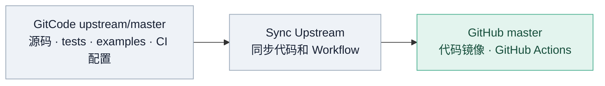
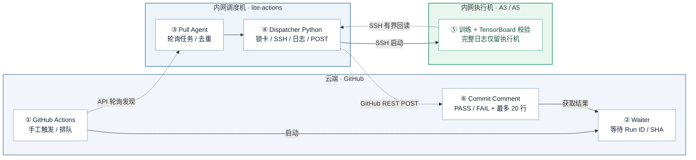

# Lite Actions

> **V2 Phase 1 交付说明**：GitHub Matrix 每个 Case 独立 Job、动态 A3 选卡与**全局串行训练**已完成实机功能回归。发布状态、剩余 Gate 与证据以 [REFACTOR_PLAN.md](REFACTOR_PLAN.md) 为准；生产操作参阅 [Phase 1 运维及回滚手册](docs/phase1_runbook.md)。不能以开发分支单测替代正式发布验收。

**一句话**：用 GitHub Actions 当远程按钮，内网调度机主动领取任务，锁定指定 NPU、SSH 执行训练，再把 PASS/FAIL 和少量日志回传 GitHub。**无需公网 IP、入站端口或 Self-hosted Runner。**

**解决的痛点**：
* **A5等黄区环境无法使用蓝区agent调试**
* **CI看护用例与对外examples脚本不同仓也不同源，容易导致Daily看护与实际交付脚本的漂移**
* **多人使用环境易冲突，使用actions池化管理验证环境后，支持多人提交任务排队执行**

**阅读指引**：触发 CI 见 [第 4.2 节](#42-日常操作)；新增用例见 [第 3 节](#3-日常新增测试用例)；初次部署和 A5 接入分别见第 4.1、5 节。

## 1. 架构总览

### 1.1 代码同步架构



**发布规则**：模型仓 GitCode `master` 是上游主源，`Sync Upstream` 每日镜像 GitHub 同名分支。2026-10-10 已在两侧特性分支合并 GitCode/GitHub 原有分叉提交（`99cd7e3`）；正式发布必须将同一个发布 SHA 以快进方式提交到两侧 `master`，避免次日强制同步覆盖。

### 1.2 CI 运行架构（已上线）



**按编号阅读**：① 在 GitHub 触发 Action → ② 云端 Waiter 开始等待 → ③ 内网 Agent 主动发现任务 → ④ Dispatcher 预留 NPU、检查占用并广播 → ⑤ 执行机运行训练并保留完整日志 → ④ 调度机 Python 从执行机通过 SSH 读取最多 128 KiB 原始日志、摘取最多 20 行、封装结果 → ⑥ **调度机 Python 直接调用 GitHub REST API** 写入 Commit Comment，由 Waiter 获取结果并结束 Job。**Pull Agent 不参与日志筛选、封装或回传；全过程不调用 AI Agent API。** ② 与 ③～⑤ 并行等待/执行，不是串行阻塞。

**数据路径**：执行机保留完整 `run.log`；调度机 Python 通过 SSH 仅读取最后 128 KiB 原始日志，再统一筛选性能指标或异常上下文（最多 20 行，每行最多 180 字符）。`ci_core/reporting.py` 在调度机生成结果 JSON 并调用 GitHub REST API，**执行机无 Token，Pull Agent 只负责发现与提交任务，无任何 AI Agent API 调用**。

**V2 Phase 1** 使用两层跨进程防线：OS 用户级 Agent 单例锁防止重复 Dispatcher 同时轮询/写状态，全局训练槽锁覆盖完整动态 Case 分配与执行；设备锁继续做细粒度资源保护。因此 GitHub Matrix Waiter 可并列展示，但任何时刻至多 **1 个训练 Case**。V1 仅作为受控回滚版本保留。`wall -n` 只广播到**执行机宿主机和训练容器**，不广播调度机。

### 1.3 职责边界：测试用例与调度配置分别维护

正确的职责边界应该是：

| 位置 | 负责什么 |
| --- | --- |
| `torchtitan-npu/tests/integration_tests/` | 测试用例、模型配置、执行参数、结果校验 |
| `torchtitan-npu/.github/workflows/` | GitHub Actions 的触发入口 |
| `lite-actions/config/pools.json` | 执行机器、SSH 地址及 NPU 资源 |
| `lite-actions/config/pipelines.json` | **调度通道与资源授权映射**，不是模型测试用例注册表 |
| `lite-actions/ci_core/` | 资源互斥、执行调度、日志摘取和 GitHub 结果回传 |

**补充说明**：`torchtitan-npu/examples/` 维护模型训练脚本；Workflow/Waiter 唯一源码位于模型仓 `.github/`；V2 已在本开发分支删除 `lite-actions/github/` 重复镜像；`lite-actions/unified_agent.py` 负责轮询、验证并接收授权任务。

**最重要的判断规则：**

- **仅新增 Integration Test 用例**（复用已有机器和受信任执行入口）：只改 `torchtitan-npu` 的测试定义、suite/入口和校验；**不改 lite-actions 的 `pipelines.json`**。
- **仅增加可调度机器**：修改 `pools.json`；若已有通道需要使用新机器，再修改 `pipelines.json` 的授权 Pool/资源规格（如确需）。
- **新增独立 GitHub Action**：增加 Workflow，配置调度通道与 Waiter 的固定标识；这属于**通道授权**，不等于每个模型用例都在调度机注册。
- **引入新的硬件/跨节点拓扑**：必须先适配安全执行器、占用检查、环境及跨节点启动，不能只靠 JSON 自动支持。

`MODULE`、`CONFIG`、`STEPS`、`train_args`、CANN 环境及模型文件路径与训练校验由模型仓控制；调度层不维护这些内容的第二份。模型仓单机 `GPUPool` **不能自动代表多机 8×8**。

## 2. 当前已验证能力与运行状态

| Actions 展示名称 | 通道 ID | 作用 | 状态 |
| --- | --- | --- | --- |
| `Dispatcher-Smoke` | `a3-smoke` | 调度机本地 `npu-smi` 连通性 PoC | 可用；不是 2P 训练 |
| `A3-8p-CI-Example` | `a3-8p` | 已验证的 A3-3 / A3-4 合法 8P 组动态选卡，Muon + AdamW Eager 5 steps | **V2 两个独立 Matrix Jobs，5 steps/TB 实机通过** |
| `A3-16p-CI-Example` | `a3-16p` | A3-3 + A3-4：EP16，Eager 5 steps | **统一 SSH Runner + nightly 用例已实机通过 5 steps** |
| `A5-64p-CI`（Workflow 已定义，通道禁用） | `a5-64p` | A5 8 台 × 每台 8P | **通用 SSH 执行器已配置；`enabled=false` 且 Workflow admission 禁用，待实机验收** |

**V2 代码归属**：模型仓 `.github/` 是唯一 Workflow/Waiter 定义；本仓不再维护镜像。发布前验证 GitCode/GitHub `master` 的同 SHA 和 Workflow 白名单。独立 Case Job 的回归证据与取消演练记录见 [Phase 1 计划台账](REFACTOR_PLAN.md)。

**安全提示**：Workflow 展示名和公开仓 README 可被外部看到，尽量不用内网 IP 命名。下文 A5 地址为指定的接入示例；在公开仓推送真实地址前应确认符合内部信息发布要求。

## 3. 日常新增测试用例

只需将新的 `OverrideDefinitions` 放进模型仓相应的 `build_test_list()`，并维护其 `env_vars` 中的 CANN/HF/Checkpoint 路径；不用修改 Lite Actions `pipelines.json` 测试注册或模型环境配置。只有新增物理资源通道、SSH/HCCL 网络拓扑或者资源策略需要修改 Lite Actions。手工使用 `python3 -m tests.integration_tests.tools.lite_actions.entrypoint inspect --suite a3_8p_tests` 查看一组测试定义。真实 NPU 训练统一通过 GitHub/Lite Actions 调度；本地 CPU 单测只能验证协议和 argv，不等于训练验收。具体测试入口与用例矩阵参见 [模型仓 Integration Tests README](https://github.com/depeng1994/torchtitan-npu/blob/master/tests/integration_tests/README.md)。

## 4. 首次部署与日常运维（在内网调度机操作）

### 4.1 首次部署

**Step 1 · 准备调度机与代码**

调度机必须是**能够主动访问 `api.github.com` 且能 SSH 访问执行机的独立 Linux 环境**，不要求公网 IP、入站端口或 Self-hosted Runner。需要 Python 3、Git、OpenSSH Client、GitHub CLI（`gh`）。以下命令都在**调度机**上执行，首次部署才需要 clone：

```bash
git clone https://github.com/depeng1994/lite-actions.git
cd lite-actions
python3 --version
git status --short --branch
```

如果已有部署，则进入已有工作目录，例如 `/mnt/workspace/work/multi-agent-workflow/lite-actions`，**不要在运行中覆盖配置或随手删除 `state/`**。执行机须单独准备 CANN/torch-npu、模型训练资产、`npu-smi` 和需要的 `wall` 命令。

**Step 2 · 配好 GitHub 出站认证与 SSH**

```bash
gh auth login
gh auth status
# 对需要的执行机验证：先核对 SSH 主机公钥指纹，再接受 known_hosts
ssh -o BatchMode=yes a3-4-docker-relay hostname
```

调度机也可使用 `A3_CI_GITHUB_TOKEN` 替代 `gh auth token`；Token 必须能读取该仓库 Actions/Commit Comment 并**写入 Commit Comment**（一般需要对应的 Actions 读取与 Contents 写入权限），不能配置到共享执行机。不要把 Token 放在 README、命令输出或训练日志里。SSH 使用非交互认证；新机器的 host key 应通过可信渠道核对并预先写入 `known_hosts`，不要为方便而全局关闭校验。

**Step 3 · 校验配置并只启动一个调度 Agent**

检查 `config/pools.json` 中 SSH 与物理芯片对应关系，及 `config/pipelines.json` 中已授权 Workflow/资源分配。随后执行：

```bash
python3 -m unittest discover -s tests
python3 unified_agent.py --validate
pgrep -af 'python3 -u unified_agent.py' || true
# 确认没有旧 Agent 在运行后，才启动：
nohup ./run-unified-agent.sh >/dev/null 2>&1 < /dev/null &
pgrep -af 'python3 -u unified_agent.py'
tail -n 30 logs/system/unified-agent.log
```

`run-unified-agent.sh` 通过 `flock` 保证同一目录只有一个实例；默认每 60 秒轮询。只接收指定账户手工触发、受信任分支（默认 `master`）和 Workflow 的任务。需要测试其他可信分支时可显式设置 `A3_CI_ALLOWED_BRANCHES`，切勿开放所有分支。按组织仓 PR 调试时，显式同时指定 `A3_CI_REPOSITORY=torchtitan-npu/torchtitan-npu` 和精确的 `A3_CI_ALLOWED_BRANCHES=fix/lite-actions-pr-validation`；默认仓库仍是 `depeng1994/torchtitan-npu`，并对仓库值执行白名单验证。**不能在正在训练时切换运行中 Agent 的源码或重启：先完成远端资源释放，再做受控切换。** 每个部署进程只轮询一个仓库。**当前没有 systemd 或容器重启后自动拉起机制**，环境重启后需重新执行 Step 3 的启动部分。

### 4.2 日常操作

**Step 1 · 检查 Agent 与可用性**

```bash
cd /mnt/workspace/work/multi-agent-workflow/lite-actions
pgrep -af 'python3 -u unified_agent.py'
tail -n 50 logs/system/unified-agent.log
python3 unified_agent.py --validate
```

如果没有 Agent 进程，先判断上次任务是否仍在执行机上运行，确认空闲后按首次部署 Step 3 重启；不要通过删除 `state/unified-agent.lock` 强制绕过排他锁。

**Step 2 · 从 GitHub 触发已启用的 CI 通道**

进入 [torchtitan-npu Actions](https://github.com/depeng1994/torchtitan-npu/actions) → 选择已部署的 Workflow → `Run workflow` → 选择已允许的分支并运行。Waiter 保持等待；调度机轮询到对应 Run ID/SHA 后锁定资源、广播、SSH 执行，并自行摘取日志和写入 Commit Comment。成功/失败最终以 **GitHub Job 状态**为准。

**Step 3 · 查看结果、排障和维护**

```bash
# 调度机日志（不含完整训练日志）
tail -f logs/system/unified-agent.log
# 该次任务调度和上传统计
ls -ltr logs/runs/ | tail
# 示例：查看某次任务目录中的 pipeline.log / upload-metrics.json
```

完整 `run.log`、TensorBoard、模型输出保留在**执行机**。调度机仅通过 SSH 有界读取日志、挑选最多 20 行，每行不超过 180 字符，直接调用 GitHub REST API 回传；**不调用 AI Agent API，执行机不持有 GitHub Token**。`state/` 包含任务去重及 NPU 锁；不可清空运行中的状态。需要升级/重启 Agent 时，应先确认无正在执行的任务，再停止唯一 Agent、拉取代码、通过 Step 3 测试并启动。意外中断后不应假定远端训练自动停止，须先人工排查残留进程及占用。

## 5. 实战：新增 A5 64P（8 台 × 8P）

本节是**真实地址接入配置 + 安全上线流程**，不代表已完成 A5 训练。当前调度机对这 8 个 SSH 地址的探测连接超时，因此 `a5-64p` 暂为 `enabled: false`。它已经与 A3 共用正式 SSH 执行器，但不能在 SSH/环境未验收时触发训练。

### Step 1 · 确认 8 台机器的 SSH / NPU / 网络基础条件

| host_id | 调度机使用的 SSH |
| --- | --- |
| `a5-01` | `root@7.246.125.19` |
| `a5-02` | `root@7.246.125.20` |
| `a5-03` | `root@7.246.125.21` |
| `a5-04` | `root@7.246.125.22` |
| `a5-05` | `root@7.246.125.23` |
| `a5-06` | `root@7.246.125.24` |
| `a5-07` | `root@7.246.125.25` |
| `a5-08` | `root@7.246.125.26` |

逐机核对 host key 指纹并预置信任后，运行 Lite Actions 提供的**只读**检查（不会启动训练、占用设备或终止进程）：

```bash
cd /mnt/workspace/work/multi-agent-workflow/lite-actions
python3 scripts/preflight_pool.py --pool a5-64p-lab
python3 scripts/preflight_pool.py --pool a5-64p-lab --npu
```

第二条只测试 `npu-smi info` 能否执行，**不等于设备空闲检查**。还需人工核对每机确有 8 个可用计算单元、A5 上的真实 device ID、宿主机/容器关系、驱动及 CANN/torch-npu、模型与数据路径、NPU 进程表格式、8 机 HCCL 网络互通及选定网卡。当前配置假设各机 device ID 为 `0..7`，须由实机证实。`wall -n` 广播指向 SSH 登录的宿主机；若在容器中训练，需另外登记容器 SSH 地址，不得把调度机填入广播目标。

### Step 2 · 在 Lite Actions 登记物理资源与调度通道

**1）`config/pools.json`：登记 SSH 登录入口和 HCCL 小网地址，不登记模型资产。** 下例的 SSH IP 已知，`node_ip` 尚未提供，故先填 `null`；请用每台机器真实的**HCCL 小网 IP**替换，不能把 `7.246.125.*`（大网 SSH IP）直接复制过去。`device_ids` 与调度分配一律单行，便于核对。

```json
"a5-64p-lab": {
  "type": "ascend-a5",
  "process_indexing": "card",
  "nodes": [
    {"host_id": "a5-01", "ssh": "root@7.246.125.19", "node_ip": null, "device_ids": [0,1,2,3,4,5,6,7], "broadcast_ssh": ["root@7.246.125.19"]},
    {"host_id": "a5-02", "ssh": "root@7.246.125.20", "node_ip": null, "device_ids": [0,1,2,3,4,5,6,7], "broadcast_ssh": ["root@7.246.125.20"]},
    {"host_id": "a5-03", "ssh": "root@7.246.125.21", "node_ip": null, "device_ids": [0,1,2,3,4,5,6,7], "broadcast_ssh": ["root@7.246.125.21"]},
    {"host_id": "a5-04", "ssh": "root@7.246.125.22", "node_ip": null, "device_ids": [0,1,2,3,4,5,6,7], "broadcast_ssh": ["root@7.246.125.22"]},
    {"host_id": "a5-05", "ssh": "root@7.246.125.23", "node_ip": null, "device_ids": [0,1,2,3,4,5,6,7], "broadcast_ssh": ["root@7.246.125.23"]},
    {"host_id": "a5-06", "ssh": "root@7.246.125.24", "node_ip": null, "device_ids": [0,1,2,3,4,5,6,7], "broadcast_ssh": ["root@7.246.125.24"]},
    {"host_id": "a5-07", "ssh": "root@7.246.125.25", "node_ip": null, "device_ids": [0,1,2,3,4,5,6,7], "broadcast_ssh": ["root@7.246.125.25"]},
    {"host_id": "a5-08", "ssh": "root@7.246.125.26", "node_ip": null, "device_ids": [0,1,2,3,4,5,6,7], "broadcast_ssh": ["root@7.246.125.26"]}
  ]
}
```

说明：此处是完整 `a5-64p-lab` 配置项，写到文件顶层 `pools` JSON 内，不要把上述代码当成整个 `pools.json` 覆盖。实际的 `process_indexing` / `device_ids` 还需以 A5 `npu-smi` 进程表核验；`node_ip=null` 时 64P 必须保持禁用。

**2）`config/pipelines.json`：仅登记通道授权和 8×8 资源，不绑定任何测试 Module。**

```json
"a5-64p": {
  "workflow": "a5-64p-lite-actions.yml",
  "pool": "a5-64p-lab",
  "resources": {"nodes": 8, "devices_per_node": 8},
  "runner": {"kind": "ssh"},
  "timeout_seconds": 14400,
  "pipeline_id": "a5-64p",
  "enabled": false
}
```

此处的 `pipeline_id` 仅供 GitHub Waiter 识别**CI 通道**，不是具体测试用例名称。`runner` 只有通用的 `kind` 字段，**不应新增 CANN、HF、Checkpoint 或 case 专属环境字段**。启用 A5 前须补齐 8 台 HCCL IP、在**模型仓用例的 `env_vars`** 中填好真实模型资产路径，并验证 SSH/NPU 进程映射；最后才设置 `enabled=true`。

### Step 3 · 在模型仓定义 Nightly 用例（不建立 Registry JSON）

路径：`tests/integration_tests/nightly_all_models_test/`。按照 TorchTitan `OverrideDefinitions` 定义 `build_test_list()`，在定义中指定 `test_name`、`ngpu`、`nnodes`、`override_args` 和 `expected_steps`。多 case 可以放在同一个文件。旧的 `ci_registry.json` 已删除。Lite Actions 通过已授权 SHA 中的 `build_test_list()` 发现用例；**不能**从 GitHub 输入任意模块路径或命令。

**模型及运行时资产归用例所有。** 在 `OverrideDefinitions.env_vars` 中维护：`ASCEND_SET_ENV_PATH`（CANN 的 `set_env.sh`）、`HF_ASSETS_PATH`（tokenizer/model assets）、`CKPT_INIT_LOAD_PATH`（初始权重目录），以及需要的 `CONFIG`、`OPTIMIZER_OVERRIDES` 和模型专用端口等。调度机从请求绑定的 **Commit SHA** 实际 `build_test_list()` 解析这些值、校验绝对路径及保留变量、经 SSH 在执行机先 source CANN 再 export 对应用例环境。只有设备分配和机器拓扑（如 `node_ip` 的 HCCL 小网地址）属于 Lite Actions `pools.json/pipelines.json`。动态生成的 `CKPT_SAVE_LOAD_PATH` 由通用 SSH Runner 设成当次 case 输出目录，不应写死在模型用例里。

示例（仅展示模型用例的环境归属；A5 路径尚未核实，因此保持禁用）：

```python
OverrideDefinitions(
    test_name="dsv4_flash_a3_8p_example",
    # ...
    env_vars={
        "ASCEND_SET_ENV_PATH": "/mnt/share/Ascend/20260805101249091/ascend-toolkit/latest/set_env.sh",
        "HF_ASSETS_PATH": "/mnt/share/models/DeepSeek-V4-Flash-bf16",
        "CKPT_INIT_LOAD_PATH": "/mnt/share/dsv4_ckpt_8rank",
    },
)
```

每条 case 分别声明自己的 `env_vars`，Lite Actions 不维护复用的模型环境字典。

A5 仍须核实网络连通性与上述环境后方可启用。

### Step 4 · Workflow 只选择真实 test ID 或 suite

GitHub `workflow_dispatch.inputs.test_cases` 为有界 JSON 数组，只允许下列两种选择，不再接受 `params/STEPS`、Python module 路径或任意 CLI/Shell 命令：

```json
[{"test_id":"dsv4_flash_a3_8p_adamw"}]
```

```json
[{"suite":"a3_8p_tests"}]
```

第二种会展开成 **Muon 和 AdamW 两个语义不同的 8P Eager case**（各 5 steps），而不是用 5/3 steps 制造重复测试。具体优化器、`override_args`、TensorBoard 预期均由模型仓对应的 `OverrideDefinitions` 决定。当前 8P AdamW 在自身 `env_vars` 中选择 `OPTIMIZER_OVERRIDES="torchtitan_npu.override.common.optimizer.virtual"`，在保持 4K 序列长度的同时使用 Host-backed Virtual Optimizer，而不是早期的空值覆盖；Muon 保留默认 swap。**Lite Actions 对具体优化器实现和值没有固定假设**，只读取并透传受信任模型源码给出的环境。16P 的非默认 Flash CONFIG、AdamW swap 关闭、CANN/HF/Checkpoint 资产路径及训练端口同样由模型 case 的 `env_vars` 提供；只有设备号、SSH 入口和 HCCL 小网拓扑属于调度机。

```bash
gh workflow run a3-8p-lite-actions.yml --ref master \
  -f 'test_cases=[{"suite":"a3_8p_tests"}]'
```

**V2 Phase 1 串行动态调度链路（发布验收）**：GitHub Inputs → Prepare 校验并展开 `build_test_list()` → 一个 SHA/Run/Attempt 绑定的 Artifact + Matrix（每 Case 独立 Job）→ Dispatcher 唯一领取 Run、展开 Case → **全局单训练槽位** → Pool 合法拓扑动态选卡 → SSH/TensorBoard 校验 → Case 级 Commit Comment → 对应 Matrix Waiter 独立结束。A3-8P 计划上限 4 个唯一 Case（当前 Suite 实际 2），16P 上限 2；A5 仍禁用。

**生产 V1 历史链路**：GitHub Inputs → 请求 Artifact → Dispatcher 串行执行 Suite → 汇总 Commit Comment → 一个 Waiter Job。调度端真实超时以 `config/pipelines.json` 为准，而不是 testcase 中对多机不生效的另一份 `timeout`。继续保持 300 分钟 GitHub Job / 16800 秒 Waiter 预算。

**历史 V1 实机验收：** [Run 38034002241](https://github.com/depeng1994/torchtitan-npu/actions/runs/38034002241) 基于模型仓 `master` 的 `1dafd49`，Muon 5 steps / AdamW + Virtual Optimizer 4K 5 steps **双 PASS**、每项 Exit Code 0、TensorBoard 5 steps、Commit Comment 两项 PASS，完整 GitHub Job **Success**。早期 [Run 38024403411](https://github.com/depeng1994/torchtitan-npu/actions/runs/38024403411) 的无 Virtual AdamW 曾在反向 FSDP AllGather OOM，已经被本次新的单次 Eager 冒烟验证覆盖，但不代表 Inductor 或长期稳定性通过。16P 本轮依维护者要求沿用此前验收、不再重复跑；A5 仍禁用、未实机验收。正式 Workflow 已进入 GitHub `master`。

### Step 5 · Lite Actions 专属 Workflow/脚本边界

模型仓 `.github/` 是唯一可部署源码；V2 已删除本仓 `github/` 镜像及 `scripts/sync_ci_mirror.py`。跨仓通过绑定 SHA 的 V2 Plan/Case Result JSON 协议交互；两仓各自运行协议测试。Workflow 文件名分别是 `a3-8p-lite-actions.yml`、`a3-16p-lite-actions.yml`、`a5-64p-lite-actions.yml`、`lite-actions-dispatcher-smoke.yml`，显示名仍为原来 A3 8P/16P 的用户可读名称；后者仅本地检查 `npu-smi`，不是 2P 训练。

### Step 6 · 分阶段验证并正式启用

按照 **代码单测/配置校验 → 8 台 SSH 连通性 → 只读 NPU/广播检查 → 单机短跑 → 8 机 1 step → 8 机 5 steps + TensorBoard → GitHub Actions E2E** 逐关放行。验收时同时检查 Commit SHA 一致性、所有 64 rank、资源锁互斥、外部占用防护、超时清理、广播、结果回传和 GitHub Job Success/Failure。

如果 SSH、A5 占用解析、跨节点启动或模型测试任一环节没有通过，就维持 `a5-64p` 为**禁用**，不得为了出现在 Actions 页面上提前启用。

## 6. 验收参考、排障与限制

只保留有代表性的记录；历史成功仅证明**对应提交**，不代表最新 testcase、Workflow 已完成回归。

| 场景 | 记录 | 结果 |
| --- | --- | --- |
| 8P 成功 | [Run 37939445270](https://github.com/depeng1994/torchtitan-npu/actions/runs/37939445270) | Eager 5 steps、TensorBoard、GitHub PASS |
| 16P 失败 | [Run 37913151439](https://github.com/depeng1994/torchtitan-npu/actions/runs/37913151439) | 双机 HCCL `EI0006` 超时 |
| 16P 成功 | [Run 37942444656](https://github.com/depeng1994/torchtitan-npu/actions/runs/37942444656) | 修复 CANN 环境传递后，双机 Eager 5 steps、TensorBoard、GitHub PASS |
| 64P 待验收 | A5 64P | 通道禁用；SSH/HCCL、设备映射及实际训练尚未完成验证 |

**16P 排障经验**：TCP 连通不代表 HCCL 可用；跨机启动须正确传递 `ASCEND_SET_ENV_PATH`。遇到类似错误，优先检查 CANN 环境及 HCCL 网络，而非反复重试训练。

**常见问题**：Agent 不接单查进程、Workflow/actor/branch 白名单与 `enabled`；Waiter 超时查 `run_id/attempt/SHA`、`pipeline_id` 和 GitHub 回传权限；SSH/HCCL 失败查 host key、网络与 CANN；NPU 被占用先查远端残留进程，**普通用户进程不得清理；仅经身份核实的 auto-occupy/vllm PID 按授权定点清理**。

**日志位置**：执行机完整日志与 TensorBoard 在 `/mnt/share/ci_tests/` 下按北京时间和 Workflow `run_number` 建立的 Run 目录，多机分别保存在 `node0/`、`node1/` 等子目录；重跑通过 `_attempt-N` 避免覆盖。调度机 `logs/runs/` 按 GitHub **Run ID / attempt** 记录任务，`logs/system/` 存 Agent 日志，`state/` 存任务去重与资源锁；不要清理正在运行的任务，或公开 Token、隐私信息及完整内网日志。

**已知限制**：Workflow 仍需与默认分支同步；A5 未实机验收；Agent 无开机自动拉起，资源锁无法约束外部用户，取消或崩溃后须确认远端进程已清理；GitHub Waiter 有时长上限，不用于长稳训练。测试定义归模型仓，机器和调度策略归 Lite Actions。

### GitHub master / GitCode 同步说明

模型仓唯一正式 Workflow：`a3-8p-lite-actions.yml`、`a3-16p-lite-actions.yml`、`a5-64p-lite-actions.yml` 和 `lite-actions-dispatcher-smoke.yml`；每个通道只维护一份 Workflow。Lite Actions `main` 是唯一调度部署分支，SSH runner 配置仅含 `{"kind":"ssh"}`；模型的 CANN/HF/Checkpoint 环境在 `OverrideDefinitions.env_vars`。

GitHub `master` 的 `Sync Upstream` 每日从 GitCode 强制镜像：请将 GitHub 已合入的模型仓改动同步到 GitCode `master` 以防镜像覆盖。实机验收以 GitHub `master` 新 Run ID、单 case 状态、日志和 Commit Comment 为准。
