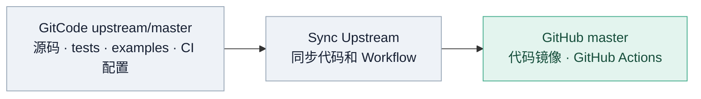
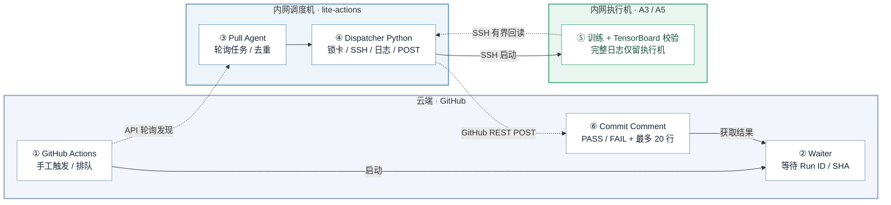

# Lite Actions

**一句话**：用 GitHub Actions 当远程按钮，内网调度机主动领取任务，锁定指定 NPU、SSH 执行训练，再把 PASS/FAIL 和少量日志回传 GitHub。**无需公网 IP、入站端口或 Self-hosted Runner。**

**解决的痛点**：
* **A5等黄区环境无法使用蓝区agent调试**
* **CI看护用例与对外examples脚本不同仓也不同源，容易导致对外脚本与Daily看护的漂移**
* **多人使用环境易冲突，使用actions池化管理验证环境后，支持多人提交任务排队执行**

## 1. 架构总览

### 1.1 代码同步架构



**目标**：将 GitHub Workflow 和 Waiter 直接合入 **GitCode 主仓**，经 `Sync Upstream` 原样同步到 GitHub，不另设配置分支或同步流程。**当前**：上游尚未合入这些文件，强制同步仍可能覆盖 GitHub 专属 Workflow。

### 1.2 CI 运行架构（已上线）



**按编号阅读**：① 在 GitHub 触发 Action → ② 云端 Waiter 开始等待 → ③ 内网 Agent 主动发现任务 → ④ Dispatcher 预留 NPU、检查占用并广播 → ⑤ 执行机运行训练并保留完整日志 → ④ 调度机 Python 从执行机通过 SSH 读取最多 128 KiB 原始日志、摘取最多 20 行、封装结果 → ⑥ **调度机 Python 直接调用 GitHub REST API** 写入 Commit Comment，由 Waiter 获取结果并结束 Job。**Pull Agent 不参与日志筛选、封装或回传；全过程不调用 AI Agent API。** ② 与 ③～⑤ 并行等待/执行，不是串行阻塞。

**数据路径**：执行机保留完整 `run.log`；调度机 Python 通过 SSH 仅读取最后 128 KiB 原始日志，再统一筛选性能指标或异常上下文（最多 20 行，每行最多 180 字符）。`ci_core/reporting.py` 在调度机生成结果 JSON 并调用 GitHub REST API，**执行机无 Token，Pull Agent 只负责发现与提交任务，无任何 AI Agent API 调用**。

同一个 Workflow 使用 `concurrency.queue: max`、`cancel-in-progress: false` 串行排队；不同 Workflow 通过 `(宿主机 ID, 物理 NPU ID)` 锁互斥，设备不重叠可并行。`wall -n` 只广播到**执行机宿主机和训练容器**，不广播调度机。

### 1.3 职责边界：测试用例与调度配置分别维护

正确的职责边界应该是：

| 位置 | 负责什么 |
| --- | --- |
| `torchtitan-npu/tests/integration_tests/` | 测试用例、模型配置、执行参数、结果校验 |
| `torchtitan-npu/.github/workflows/` | GitHub Actions 的触发入口 |
| `lite-actions/config/pools.json` | 执行机器、SSH 地址及 NPU 资源 |
| `lite-actions/config/pipelines.json` | **调度通道与资源授权映射**，不是模型测试用例注册表 |
| `lite-actions/ci_core/` | 资源互斥、执行调度、日志摘取和 GitHub 结果回传 |

**补充说明**：`torchtitan-npu/examples/` 维护模型训练脚本；`lite-actions/github/` 是 Workflow/Waiter 的维护副本，需同步到模型仓 `.github/` 下才能在 GitHub Actions 生效；`lite-actions/unified_agent.py` 负责轮询、验证并接收授权任务。

**最重要的判断规则：**

- **仅新增 Integration Test 用例**（复用已有机器和受信任执行入口）：只改 `torchtitan-npu` 的测试定义、suite/入口和校验；**不改 lite-actions 的 `pipelines.json`**。
- **仅增加可调度机器**：修改 `pools.json`；若已有通道需要使用新机器，再修改 `pipelines.json` 里的 pool/allocation。
- **新增独立 GitHub Action**：增加 Workflow，配置调度通道与 Waiter 的固定标识；这属于**通道授权**，不等于每个模型用例都在调度机注册。
- **引入新的硬件/跨节点拓扑**：必须先适配安全执行器、占用检查、环境及跨节点启动，不能只靠 JSON 自动支持。

`MODULE`、`CONFIG`、`STEPS`、`train_args`、模型文件路径与训练校验由模型仓控制；调度层不维护这些内容的第二份。模型仓单机 `GPUPool` **不能自动代表多机 8×8**。

## 2. 当前已验证能力与运行状态

| Actions 展示名称 | 通道 ID | 作用 | 状态 |
| --- | --- | --- | --- |
| `A3-2p-CI` | `a3-smoke` | 调度机本地 `npu-smi` 连通性 PoC | 可用；不是 2P 训练 |
| `A3-8p-CI-Example` | `a3-8p` | A3-4：DeepSeek-V4 Flash，Eager 5 steps | **统一 SSH Runner 实机已通过** |
| `A3-16p-CI-Example` | `a3-16p` | A3-3 + A3-4：EP16，Eager 5 steps | **旧版有成功记录；统一 SSH Runner 目前未通过实机回归** |
| `A5-64p-CI`（尚未部署 Workflow） | `a5-64p` | A5 8 台 × 每台 8P | **通用 SSH 执行器已配置；暂未启用，待实机验收** |

`github/workflows/` 是维护副本，不等于 GitHub 上已部署。目标是先把 Workflow 和 Waiter 合入 GitCode 上游主仓，再通过 `Sync Upstream` 镜像到 GitHub；在此之前，镜像同步可能覆盖 GitHub 上专有的 Workflow。已有 PR [#26](https://github.com/depeng1994/torchtitan-npu/pull/26) 涉及 A3 Example 名称，但须以 GitHub 当前实际部署的文件为准。

**安全提示**：Workflow 展示名和公开仓 README 可被外部看到，尽量不用内网 IP 命名。下文 A5 地址为指定的接入示例；在公开仓推送真实地址前应确认符合内部信息发布要求。

## 3. 首次部署与日常运维（在内网调度机操作）

### 3.1 首次部署

**Step 1 · 准备调度机与代码**

调度机必须是**能够主动访问 `api.github.com` 且能 SSH 访问执行机的独立 Linux 环境**，不要求公网 IP、入站端口或 Self-hosted Runner。需要 Python 3、Git、OpenSSH Client、GitHub CLI（`gh`）。以下命令都在**调度机**上执行，首次部署才需要 clone：

```bash
git clone https://github.com/depeng1994/lite-actions.git
cd lite-actions
python3 --version
git status --short --branch
```

如果已有部署，则进入已有工作目录，例如 `/mnt/workspace/work/multi-agent-workflow/lite-actions`，**不要在运行中覆盖配置或随手删除 `state/`**。执行机须单独准备 CANN/torch-npu、模型训练资产、`npu-smi` 和需要的 `wall` 命令。

**Step 2 · 配好 GitHub 出站认证与 SSH**

```bash
gh auth login
gh auth status
# 对需要的执行机验证：先核对 SSH 主机公钥指纹，再接受 known_hosts
ssh -o BatchMode=yes a3-4-docker-relay hostname
```

调度机也可使用 `A3_CI_GITHUB_TOKEN` 替代 `gh auth token`；Token 必须能读取该仓库 Actions/Commit Comment 并**写入 Commit Comment**（一般需要对应的 Actions 读取与 Contents 写入权限），不能配置到共享执行机。不要把 Token 放在 README、命令输出或训练日志里。SSH 使用非交互认证；新机器的 host key 应通过可信渠道核对并预先写入 `known_hosts`，不要为方便而全局关闭校验。

**Step 3 · 校验配置并只启动一个调度 Agent**

检查 `config/pools.json` 中 SSH 与物理芯片对应关系，及 `config/pipelines.json` 中已授权 Workflow/资源分配。随后执行：

```bash
python3 -m unittest discover -s tests
python3 unified_agent.py --validate
pgrep -af 'python3 -u unified_agent.py' || true
# 确认没有旧 Agent 在运行后，才启动：
nohup ./run-unified-agent.sh >/dev/null 2>&1 < /dev/null &
pgrep -af 'python3 -u unified_agent.py'
tail -n 30 logs/system/unified-agent.log
```

`run-unified-agent.sh` 通过 `flock` 保证同一目录只有一个实例；默认每 60 秒轮询。只接收指定账户手工触发、受信任分支（默认 `master`）和 Workflow 的任务。需要测试其他可信分支时可显式设置 `A3_CI_ALLOWED_BRANCHES`，切勿开放所有分支。**当前没有 systemd 或容器重启后自动拉起机制**，环境重启后需重新执行 Step 3 的启动部分。

### 3.2 日常操作

**Step 1 · 检查 Agent 与可用性**

```bash
cd /mnt/workspace/work/multi-agent-workflow/lite-actions
pgrep -af 'python3 -u unified_agent.py'
tail -n 50 logs/system/unified-agent.log
python3 unified_agent.py --validate
```

如果没有 Agent 进程，先判断上次任务是否仍在执行机上运行，确认空闲后按首次部署 Step 3 重启；不要通过删除 `state/unified-agent.lock` 强制绕过排他锁。

**Step 2 · 从 GitHub 触发已启用的 CI 通道**

进入 [torchtitan-npu Actions](https://github.com/depeng1994/torchtitan-npu/actions) → 选择已部署的 Workflow → `Run workflow` → 选择已允许的分支并运行。Waiter 保持等待；调度机轮询到对应 Run ID/SHA 后锁定资源、广播、SSH 执行，并自行摘取日志和写入 Commit Comment。成功/失败最终以 **GitHub Job 状态**为准。

**Step 3 · 查看结果、排障和维护**

```bash
# 调度机日志（不含完整训练日志）
tail -f logs/system/unified-agent.log
# 该次任务调度和上传统计
ls -ltr logs/runs/ | tail
# 示例：查看某次任务目录中的 pipeline.log / upload-metrics.json
```

完整 `run.log`、TensorBoard、模型输出保留在**执行机**。调度机仅通过 SSH 有界读取日志、挑选最多 20 行，每行不超过 180 字符，直接调用 GitHub REST API 回传；**不调用 AI Agent API，执行机不持有 GitHub Token**。`state/` 包含任务去重及 NPU 锁；不可清空运行中的状态。需要升级/重启 Agent 时，应先确认无正在执行的任务，再停止唯一 Agent、拉取代码、通过 Step 3 测试并启动。意外中断后不应假定远端训练自动停止，须先人工排查残留进程及占用。

## 4. 实战：新增 A5 64P（8 台 × 8P）

本节是**真实地址接入配置 + 安全上线流程**，不代表已完成 A5 训练。当前调度机对这 8 个 SSH 地址的探测连接超时，因此 `a5-64p` 暂为 `enabled: false`。它已经与 A3 共用正式 SSH 执行器，但不能在 SSH/环境未验收时触发训练。

### Step 1 · 确认 8 台机器的 SSH / NPU / 网络基础条件

| host_id | 调度机使用的 SSH |
| --- | --- |
| `a5-01` | `root@7.246.125.19` |
| `a5-02` | `root@7.246.125.20` |
| `a5-03` | `root@7.246.125.21` |
| `a5-04` | `root@7.246.125.22` |
| `a5-05` | `root@7.246.125.23` |
| `a5-06` | `root@7.246.125.24` |
| `a5-07` | `root@7.246.125.25` |
| `a5-08` | `root@7.246.125.26` |

逐机核对 host key 指纹并预置信任后，运行 Lite Actions 提供的**只读**检查（不会启动训练、占用设备或终止进程）：

```bash
cd /mnt/workspace/work/multi-agent-workflow/lite-actions
python3 scripts/preflight_pool.py --pool a5-64p-lab
python3 scripts/preflight_pool.py --pool a5-64p-lab --npu
```

第二条只测试 `npu-smi info` 能否执行，**不等于设备空闲检查**。还需人工核对每机确有 8 个可用计算单元、A5 上的真实 device ID、宿主机/容器关系、驱动及 CANN/torch-npu、模型与数据路径、NPU 进程表格式、8 机 HCCL 网络互通及选定网卡。当前配置假设各机 device ID 为 `0..7`，须由实机证实。`wall -n` 广播指向 SSH 登录的宿主机；若在容器中训练，需另外登记容器 SSH 地址，不得把调度机填入广播目标。

### Step 2 · 在 Lite Actions 登记物理资源与调度通道

`config/pools.json` 的 `a5-64p-lab` 已登记 8 个 SSH 节点和每节点 8P，合计 64P。A3、A5 的执行流程完全相同：物理资源在 pool 配置，实际拓扑在 allocation 配置。

`config/pipelines.json` 的 `a5-64p` 也已把 `pool` 指向 `a5-64p-lab`，并分配 8×8。这个 JSON **不是测试用例表**：它仅声明“将来 `a5-64p-ci.yml` 这条受信任通道占用哪 64 个芯片、采用哪个可信执行器、超时多少”。保持：

```json
"a5-64p": {
  "workflow": "a5-64p-ci.yml",
  "pool": "a5-64p-lab",
  "allocation": [
    {"host_id": "a5-01", "devices": [0,1,2,3,4,5,6,7]},
    {"host_id": "a5-02", "devices": [0,1,2,3,4,5,6,7]},
    {"host_id": "a5-03", "devices": [0,1,2,3,4,5,6,7]},
    {"host_id": "a5-04", "devices": [0,1,2,3,4,5,6,7]},
    {"host_id": "a5-05", "devices": [0,1,2,3,4,5,6,7]},
    {"host_id": "a5-06", "devices": [0,1,2,3,4,5,6,7]},
    {"host_id": "a5-07", "devices": [0,1,2,3,4,5,6,7]},
    {"host_id": "a5-08", "devices": [0,1,2,3,4,5,6,7]}
  ],
  "runner": {
    "kind": "ssh",
    "module": "tests.integration_tests.run_a5_64p_multinode_tests",
    "mode": "distributed",
    "env": {},
    "requires_assets": true,
    "requires_checkpoint": true
  },
  "timeout_seconds": 14400,
  "pipeline_id": "dsv4-a5-64p",
  "enabled": false
}
```

以上为 `pipelines.json` 内单条配置示例；仓库已经包含该配置。接入新 A5 节点时，在 `pools.json` 对应节点设置 `ssh`（登录入口）、`node_ip`（HCCL 训练网地址）、`device_ids`、`process_indexing`、`hf_assets_path`（Tokenizer/模型资产目录）及 `ckpt_init_path`（初始化权重目录）。**两种 IP 可能不同，不能未经确认就把 SSH IP 当训练网 IP。** 不知道的路径不能杜撰；正式使能前必须实地核实并填写全部节点。`--validate` 会拒绝使能缺少必要模型资产路径的通道。

```bash
python3 -m unittest discover -s tests
python3 unified_agent.py --validate
```

### Step 3 · 在 torchtitan-npu 维护 A5 64P Integration Test

**模型用例仍只在模型仓维护。** `examples/deepseek_v4/debug/deepseek_v4_pro_64p_cpt_4k_a5.sh` 定义 DeepSeek-V4 Pro 64P 的 EP/DP/优化器/训练参数；`tests/integration_tests/run_a5_64p_multinode_tests.py` 提供 `launch`/`verify` 和 TensorBoard 步数、loss 检查。执行器只通过固定 Python module 调用，**不再在 Lite Actions 中复制训练脚本或模型参数**。本仓的 A3 8P/16P 和 A5 64P 都使用 `runner.kind=ssh`。

新用例所在模型仓分支须合入 GitCode 上游主仓并通过同步出现在 GitHub 对应 SHA，远端才能从精确 SHA 解包运行。64P 的各节点 `NNODES=8`、`NGPU=8` 由通用执行器注入。EP32/DP-shard32/DP-replicate2 属于模型仓当前候选训练配方，**实际能否训练通过仍以 A5 实机验证为准**。

### Step 4 · 使用同一套通用 SSH 执行器（A3/A5 不分叉）

不需要为 A5 单独实现 Dispatcher。现在代码已统一：

| 公共代码 | A3 8P / A3 16P / A5 64P 共用的行为 |
| --- | --- |
| `ci_core/config.py` | 校验受信任的 Workflow、资源及固定 Integration Test 入口 |
| `ci_core/dispatch.py` | NPU 锁、占用检测、广播、调用唯一 SSH 执行器、读取结果 |
| `ci_core/ssh_runner.py` | 根据 pool/allocation 取 1/2/8 台机器、分发同一 Commit SHA、并行 SSH 启动、等待节点退出、在主节点执行校验 |
| `ci_core/logs.py` / `ci_core/reporting.py` | 调度机统一有界读取完整日志的一部分、筛选至多 20 行并回传 GitHub |

核心调用链是（完整代码见仓库）：

```python
# dispatch.py：三个硬件规模走相同代码路径
cmd = [sys.executable, "-u", "-m", "ci_core.ssh_runner",
       "--case", case["name"], "--sha", run["head_sha"],
       "--stamp", log_dir.name,
       "--remote-dir", remote_task_name(run)]

# ssh_runner.py：节点从配置动态获取，而不是写死 A3 机器
nodes = allocations(case, pools)
for node in nodes:
    # 阶段一：SSH 分发固定 SHA 的源码
    # 阶段二：每节点并行执行模型仓固定 module 的 launch
    # 阶段三：汇总退出码，主节点执行 verify
    ...
```

**硬件差异只通过配置体现**，例如：

- A3：`process_indexing=card-die`（现有 A3 两 die 映射），并配置其 `ascend_env` 和 `node_ip`。
- A5：`process_indexing=card`（按 A5 的 0～7 NPU 逻辑编号设计），其 `npu-smi` 进程输出格式、实际设备映射、`node_ip`/网卡、CANN/资产目录必须上线前核对；无法识别进程占用就拒绝发任务，不抢占用户进程。

**超时/异常处理**：远端任务有独立进程组和作业标识，尝试终止时必须校验作业身份；只有复查 NPU 空闲，才广播“设备释放”。目前未做 A5 实机的取消/超时联调，不能将单测等同于全链路验收。

### Step 5 · 为新增的独立 64P 通道部署 GitHub Workflow

如果需要**独立的 `A5-64p-CI` 按钮**，才在模型仓增加 `.github/workflows/a5-64p-ci.yml`。可参考 lite-actions 的 `github/workflows/a3-16p-ci.yml`，分别设置独立 `name`、`workflow_dispatch`、`concurrency.queue: max`、受信任 actor/branch、超时，以及 Waiter 的固定 `--case a5-64p`。

**独立通道仍需保持三处协议一致**：`config/pipelines.json` 的 `workflow` / `pipeline_id`、`ci_core/reporting.py` 的名称白名单、`github/wait_result.py` 的 `PIPELINES`。当新的 A5 Workflow 与 Waiter 测试、代码审查完成后，将维护副本合入 `torchtitan-npu`（GitCode 上游主仓），再通过 `Sync Upstream` 同步到 GitHub；**只修改 lite-actions 副本，GitHub 不会自动出现新 Action**。正式启用前不要发布可触发但无人接单的 Workflow。

### Step 6 · 分阶段验证并正式启用

按照 **代码单测/配置校验 → 8 台 SSH 连通性 → 只读 NPU/广播检查 → 单机短跑 → 8 机 1 step → 8 机 5 steps + TensorBoard → GitHub Actions E2E** 逐关放行。验收时同时检查 Commit SHA 一致性、所有 64 rank、资源锁互斥、外部占用防护、超时清理、广播、结果回传和 GitHub Job Success/Failure。

如果 SSH、A5 占用解析、跨节点启动或模型测试任一环节没有通过，就维持 `a5-64p` 为**禁用**，不得为了出现在 Actions 页面上提前启用。

## 5. 日常新增 torchtitan-npu Integration Test 用例（通常不用修改 Lite Actions）

**Step 1 · 在模型仓定义测试及判定标准**

对常规**单机**用例，在 `tests/integration_tests/` 对应模型文件增加 `OverrideDefinitions`，设置 `test_name`、`ngpu`、`train_script`、`env_vars`、`train_args`、`expected_steps`、`timeout` 及必要的 loss/TensorBoard 校验；Examples 保存可独立运行的合理默认值。对于**多机**用例，单机 `run_tests.py` 的资源池不能跨主机分配，必须使用明确的多节点 `launch` / `verify` 入口（参照既有 A3 16P 的思路，再泛化至 N 节点）。

**Step 2 · 把用例接入已有 suite / CI 入口并先做本地验证**

普通用例应由模型仓 `run_tests.py` 的 suite 构造函数（`_TEST_SUITES_FUNCTION`）包含，能通过 `--test_suite` / `--test_name` 选择；例如已准备完整**单机** NPU 环境时，可从模型仓根目录执行：

```bash
python3 -m tests.integration_tests.run_tests /tmp/my-integration-test \
  --test_suite deepseek_v4 --test_name dsv4_my_new_8p_test --ngpu 8
```

以上是**单机测试命令模板**，`dsv4_my_new_8p_test` 是占位示例，需要替换为已经注册到该 suite 的实际 `test_name`；并非 A5 64P 启动命令。对于多机/专用 E2E，则需接入该 CI 通道**固定、受信任**的模型仓 `launch` / `verify` 入口，而非把任意 shell 命令通过 GitHub 参数透传。在独立测试环境先做最小 step 数验证并明确失败判据。**此阶段不需要在 lite-actions 的 `pipelines.json` 加入测试名称。**

**Step 3 · 判断要不要改调度层**

- **复用已有 Workflow、资源与 runner**：只提交模型仓测试代码/入口；Lite Actions **零改动**。
- **同一 CI 通道换机器/卡数**：仅改 `pools.json` 和必要的 `pipelines.json` 资源映射，确保执行器支持对应拓扑。
- **新建独立按钮/新硬件执行器**：按第 4 节 Step 4～6 扩展可信 runner 与 Workflow/Waiter 通道协议。

每次按 `python3 -m unittest discover -s tests` 和 `python3 unified_agent.py --validate` 检查调度侧变更；模型仓新增用例还必须跑它自己对应的单元测试/Integration Test，不能用调度机静态测试代替真实模型验证。

## 6. 验收参考、排障与限制

| 已有记录 | 结果 |
| --- | --- |
| [A3 8P Run 37868718990](https://github.com/depeng1994/torchtitan-npu/actions/runs/37868718990) | Eager 5 steps Success |
| [A3 16P Run 37868722207](https://github.com/depeng1994/torchtitan-npu/actions/runs/37868722207) | **旧版独立 Dispatcher**：双机 EP16，Eager，5 steps Success；不代表统一 SSH Runner 已通过 |
| [A3 8P Run 37911399789](https://github.com/depeng1994/torchtitan-npu/actions/runs/37911399789) | **统一 SSH Runner**：8P Eager 5 steps、TensorBoard steps、释放和 GitHub 回传均通过 |
| [A3 16P Run 37911495316](https://github.com/depeng1994/torchtitan-npu/actions/runs/37911495316) | **统一 SSH Runner 未通过**：A3-4 Rank 报 `duplicate registrations for aten.erfc.default`（初始环境参数尚未恢复时） |
| [A3 16P Run 37912372023](https://github.com/depeng1994/torchtitan-npu/actions/runs/37912372023) | **统一 SSH Runner 未通过**：HCCL `Communication_Error_Get_Socket(EI0006)`；另一节点通过作业标识保护终止 |
| [A3 16P Run 37913151439](https://github.com/depeng1994/torchtitan-npu/actions/runs/37913151439) | **统一 SSH Runner 未通过**：恢复 CANN→参数导出顺序后仍发生跨节点 HCCL Socket 超时；已停止重复训练重试 |
| [Run 37869377044](https://github.com/depeng1994/torchtitan-npu/actions/runs/37869377044) | 同一 Workflow 排队行为验证 |
| [Run 37876792907](https://github.com/depeng1994/torchtitan-npu/actions/runs/37876792907) | 开始/释放广播已验证 |
| A5 64P | 已接入统一 SSH 执行器与 8×8 资源配置；**SSH 连通性、训练、GitHub E2E 均未通过验证** |

**16P 实机未通过的排障结论（2026-10-09）**：统一 Runner 在两机均完成固定 SHA 的源码分发、启动和 Mesh 初始化，但最新两次 16P 验证都在 `HcclBroadcast` 阶段触发 `EI0006`（A3-3 的 192.168.0.30 上部分 NPU 无法与 A3-4 的 192.168.0.107 上部分 NPU 建立设备级连接）。A3-3→A3-4 TCP `30160`、反向 TCP `30161` 的独立连通性检查均成功，因此不能简单判定为 IP 不通；TCP 通并不能验证 HCCL/RDMA 通信。A3-4 的 Rank 结构化日志存在，但尚未确定 HCCL 失败的原始原因。执行器已在**任一节点非零退出时终止同一 CI 的其他节点**，并完成结束广播与 NPU 空闲复查。后续应对照旧版成功 Run，逐 Rank 检查 HCCL 启动、网络接口/端口、设备物理映射、环境变量及底层 HCCL 日志，**未查明之前不得把新 16P 宣称为通过**。

常见阻塞：**Agent 不接单**，依次看是否运行、Workflow 文件路径/名称、actor、branch、`enabled`、唯一 agent lock；**Waiter 不结束**，核对 `run_id` / attempt / SHA、`pipeline_id`、结果 marker 和 GitHub POST 权限；**SSH 失败**，检查调度机路由、host key、密钥和非交互登录；**GPU/NPU 占用**，检查外部进程，禁止抢占别人作业；**重启后任务未恢复**，先查远端实际进程，再处理本地状态。

**任务目录命名（均使用北京时间 UTC+08:00，时间取 GitHub Actions `created_at`）**：

- **执行机**：`/mnt/share/ci_tests/YYYY-MM-DD_HH-MM-SS_run_<Workflow名称>_<run_number>/node0/`（多机还有 `node1/` 等）。例如 [A3 16P Run #6](https://github.com/depeng1994/torchtitan-npu/actions/runs/37913151439) 对应 `2026-10-09_17-43-56_run_A3-16p-CI_6/node0/`；`-Example` 后缀会自动省略。
- **重新运行**：相同 Run 的第 2 次 attempt 为 `2026-10-09_17-43-56_run_A3-16p-CI_6_attempt-2/`，避免覆盖首次执行的完整训练日志；这里的 `6` 是 GitHub Workflow 的 `run_number`，不是全局 Run ID `37913151439`，也不是 `run_attempt`。
- **调度机（不变）**：`logs/runs/YYYY-MM-DD_HH-MM-SS_run-ID_attempt-N/` 保持 Run ID，用于日志关联和去重；内部作业标识、进程取消校验及 GitHub 回传仍使用 Run ID。既有执行机历史目录不会自动重命名或删除。

`logs/system/` 为 Agent 运行日志，`state/` 保存持久去重状态和设备锁。清理历史 `logs/runs/` 须确认任务已彻底结束，不清理运行中的文件；不要将 Token、隐私信息或大块原始内网日志上传到公开 Commit Comment。

**已知限制**：部署方式目前无开机自动拉起；跨进程 NPU 锁只能协调本调度机管理的任务，不能阻止外部用户；取消/崩溃后的跨节点一致性清理和恢复仍需加强；Github-hosted Waiter 有运行时长约束，不能代替长稳测试的异步执行框架。A5 的设备映射与进程表解析尚未验证，不能假设与 A3 相同。

**维护准则**：测试事实在模型仓、资源与授权在 lite-actions；能通过补用例解决的，不复制调度器、日志筛选或 GitHub 回传代码。
