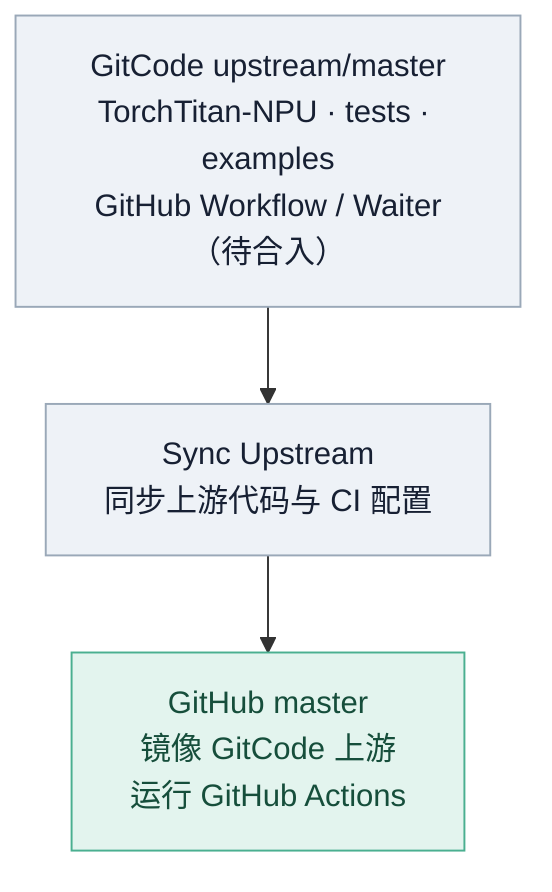
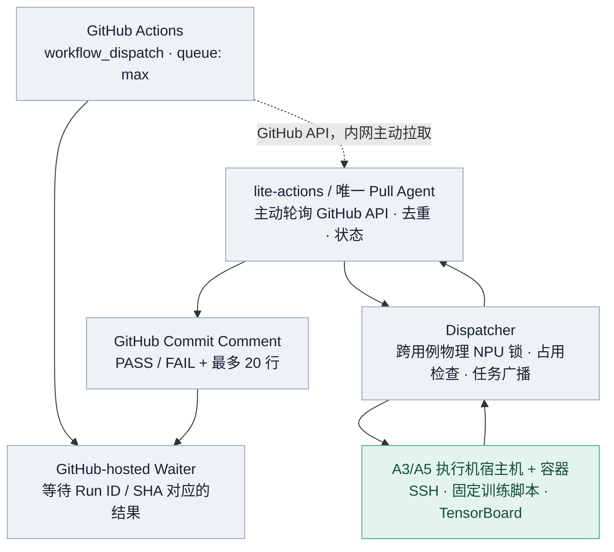

# Lite Actions

**一句话**：用 GitHub Actions 当远程按钮，内网调度机主动领取任务，锁定指定 NPU、SSH 执行训练，再把 PASS/FAIL 和少量日志回传 GitHub。**无需公网 IP、入站端口或 Self-hosted Runner。**

## 1. 架构总览

### 1.1 代码同步架构



**目标**：将 GitHub Workflow 和 Waiter 直接合入 **GitCode 主仓**，经 `Sync Upstream` 原样同步到 GitHub，不另设配置分支或同步流程。**当前**：上游尚未合入这些文件，强制同步仍可能覆盖 GitHub 专属 Workflow。

### 1.2 CI 运行架构（已上线）



同一个 Workflow 使用 `concurrency.queue: max`、`cancel-in-progress: false` 串行等待；**不同 Workflow** 通过 `(宿主机 ID, 物理 NPU ID)` 文件锁互斥，不重叠的设备可并行。仅向本次占用的**执行机宿主机及训练容器** `wall -n` 广播占用/释放通知（星号框、北京时间和 GitHub Run 链接），**不广播调度机**。

### 1.3 两个仓库分别维护什么

| 归属 | 源码位置 | 职责 |
| --- | --- | --- |
| **[lite-actions](https://github.com/depeng1994/lite-actions)** | `unified_agent.py`、`ci_core/` | GitHub 轮询、任务去重、设备锁、SSH 执行、终端广播、日志裁剪与结果回传 |
| lite-actions | `config/pools.json` | 执行机、物理芯片、SSH 别名及广播目标 |
| lite-actions | `config/pipelines.json` | 用例 ID → Workflow、资源池、设备分配、执行器、超时 |
| lite-actions | `github/workflows/`、`github/wait_result.py` | GitHub 端薄 Workflow/Waiter 的**维护副本** |
| **[torchtitan-npu](https://github.com/depeng1994/torchtitan-npu)** | `.github/workflows/`、`.github/scripts/a3-ci-wait-result.py` | 真正由 GitHub 执行的 Workflow/Waiter |
| torchtitan-npu | `tests/integration_tests/`、`examples/` | `OverrideDefinitions`、模型参数、训练脚本和 TensorBoard 校验 |

**模型配置**（`MODULE`、`CONFIG`、`STEPS`、训练环境变量和 `train_args`）放模型仓；**机器 IP、SSH、NPU 资源锁**放 lite-actions。不要在调度层维护第二份 EP/DP/优化器参数。注意 `run_tests.py` 会重写 `NGPU` 等变量，多节点训练不得直接使用单机 `GPUPool` 代替。

## 2. 当前可用的 Actions

| GitHub 展示名称 | 用例 ID | 实际工作 | 状态 |
| --- | --- | --- | --- |
| `A3-2p-CI` | `a3-smoke` | 调度机 `npu-smi info`，**仅连通性 PoC** | 可用，不是 2P 训练 |
| **`A3-8p-CI-Example`** | `a3-8p` | A3-4 chip 0–7，DeepSeek-V4 Flash Eager 5 steps | 示例，已验证 |
| **`A3-16p-CI-Example`** | `a3-16p` | A3-3 chip 0–7 + A3-4 chip 8–15，EP16 Eager 5 steps | 示例，已验证 |
| `A5-64p-CI`（尚无 Workflow） | `a5-64p` | A5 Pro 8×8 假资源池 | **禁用，仅 CPU Mock** |

**发布状态**：Example 名称已写入 [torchtitan-npu PR #26](https://github.com/depeng1994/torchtitan-npu/pull/26) 分支。当前 `master` 的 Workflow 文件已被上游同步覆盖，GitHub Actions 仍显示旧注册名；**将 Workflow/Waiter 合入 GitCode 主仓并完成同步**后，默认 Actions 列表才能稳定显示新名称。

现有 YAML 文件名 `a3-8p-ci.yml` / `a3-16p-ci.yml`、`case_id`、`pipeline_id` **均不因显示名称增加 Example 而改变**。Agent 过渡期兼容 master 上尚未同步的新旧显示名称及各自结果标识。

未来正式 CI 建议按硬件和目标机器区分，例如 `A3-8p-CI-<内网IP>`、`A5-64p-CI-<内网IP或资源池标识>`，而不是复用 Example。**GitHub 仓库如为公开仓，Workflow 展示名中的内网 IP 也会公开**；若 IP 属敏感网络信息，应使用不泄漏真实地址的机房/主机别名，实际 IP 只配置在内网调度机。

## 3. 首次部署与日常运维

**前提**：内网调度机可主动访问 GitHub HTTPS、可免交互 SSH 到执行机；Python 3，`gh auth login` 或 `A3_CI_GITHUB_TOKEN`（具备相应读取与 Commit Comment 写入权限）。执行机应有 `npu-smi`、对应 CANN/torch-npu、训练资产、`wall`；SSH host/container 别名必须真实可达。

```bash
# 在调度机的 lite-actions/ 目录执行
python3 -m unittest discover -s tests
python3 unified_agent.py --validate
nohup ./run-unified-agent.sh >/dev/null 2>&1 < /dev/null &

# 查看状态（避免同时启动第二个 Agent）
pgrep -af 'python3 -u unified_agent.py'
tail -f logs/system/unified-agent.log
```

Agent 默认每 60 秒轮询，只认 `master` 上维护者手工触发的受信任 Workflow；验证分支需显式设置 `A3_CI_ALLOWED_BRANCHES`。文件锁阻止重复启动，但**容器重启后尚无自动拉起服务**，需人工启动。

GitHub 端：进入 [torchtitan-npu Actions](https://github.com/depeng1994/torchtitan-npu/actions) → 选择 Workflow → `Run workflow`；Job 等待内网结果。调度任务目录 `logs/runs/YYYY-MM-DD_HH-MM-SS_run-ID_attempt-N/`（北京时间）；`logs/system/` 为 Agent 日志；`state/` 保存任务去重和设备锁，**不要删除正在使用的 state**。历史运行日志只清理过期的 `logs/runs/`。

执行机仅广播其**当前任务涉及的节点**：已锁定资源后警示“本环境正在用于torchtitan CI验证，请勿使用！”，退出且检查资源空闲后通知“本任务所占 NPU 资源已释放”；若退出后尚有占用，改发“仍可能被占用，请勿使用”，绝不误报。每条消息含北京时间与 `https://github.com/depeng1994/torchtitan-npu/actions/runs/<run_id>`，由 88 列星号包围。

## 4. 如何新增内网机器及正式 CI？（重点）

**先区分两种工作：新增机器 ≠ 新增训练拓扑。** 已支持的 A3 8P/16P 可复用现有逻辑，但现有执行适配脚本仍有 SSH 主机/双节点数量的硬编码。**A3 128P、A5 8P/64P 不能只改 JSON 就直接上线**，要先完成通用 N 节点/A5 运行适配。不要将未来目标当作已实现能力。

### Step 1 · 接入新执行机

1. 在调度机验证 `ssh -o BatchMode=yes <执行机别名> npu-smi info`，确认免密访问、真实卡数、物理 chip ID、容器内 CANN、训练数据/模型路径。
2. 确保宿主机与训练容器均能通过 SSH 执行 `wall -n`；`broadcast_ssh` 第一项为**宿主机**，第二项为容器。不要将调度机写进广播列表。
3. 检查已有外部进程，并确认多机 HCCL 可达、时间同步、共享日志或数据目录及安全权限；不得自动杀掉其他用户的进程。
4. 若同一物理机有多个 SSH 别名，必须使用**同一个规范化 `host_id`**，否则会被视作两套独立 NPU，破坏跨流水线互斥。

### Step 2 · 在 `config/pools.json` 注册机器

以下是**示例字段，不能直接当作真实 IP / NPU ID 使用**：

```json
{
  "a3-lab-new": {
    "type": "ascend-a3",
    "nodes": [
      {
        "host_id": "a3-node-01",
        "ssh": "a3-node-01-docker-relay",
        "broadcast_ssh": ["a3-node-01-relay", "a3-node-01-docker-relay"],
        "device_ids": [0, 1, 2, 3, 4, 5, 6, 7]
      }
    ]
  }
}
```

以上节点块应合并到**现有** `pools.json`，不可覆盖其他资源池。SSH alias 在调度机的 SSH 配置中解析为内网 IP。A3 当前 `npu-smi` 物理芯片编号按“卡号 ×2 + die 编号”解析，迁移到新硬件前必须核实映射；A5 目前没有实机进程表解析。

### Step 3 · 在 `config/pipelines.json` 注册 CI 用例

```json
{
  "a3-8p-node-01": {
    "workflow": "a3-8p-node-01.yml",
    "pool": "a3-lab-new",
    "allocation": [
      {"host_id": "a3-node-01", "devices": [0, 1, 2, 3, 4, 5, 6, 7]}
    ],
    "timeout_seconds": 7500,
    "runner": {"kind": "legacy_8p"},
    "enabled": false,
    "pipeline_id": "dsv4-flash-8p-node-01"
  }
}
```

这是注册项**示意**，不是“粘贴后就能运行”的完整配置：现有 `legacy_8p` 执行脚本**仍固定 SSH 目标**，换机器还需要按 Step 4 配置适配器；`enabled: false` 保持禁用，直至真实 SSH/训练验证。每个 Workflow 文件名和 `pipeline_id` 必须唯一，且用例使用的所有 chip 都属于对应 pool。

### Step 4 · 配置测试逻辑和执行适配器

| 目标规模 | 节点布局（仅示例） | 当前还需要完成的工作 |
| --- | --- | --- |
| **A3 8P** | 1×8 NPU | 复用 DeepSeek-V4 8P 用例；把 `legacy_8p` 固定 SSH 目标改成从资源池读取 |
| **A3 128P** | 16×8 NPU（按实际卡数调整） | 新增 128P 模型测试定义；完成 **N 节点并发 SSH launch / rank / HCCL / 清理**，目前双节点 `legacy_16p` 不支持 |
| **A5 8P** | 1×8 NPU | A5 驱动/CANN/设备映射、占用检查、A5 专属 Examples / `OverrideDefinitions` 和执行适配器，均需验证 |
| **A5 64P** | 8×8 NPU | 复用通用 N 节点执行器（完成后），验证 A5 模型并行策略；当前 `a5-mock` **绝不可直接改为实机启用** |

模型仓的 `tests/integration_tests/` 集中定义 `OverrideDefinitions.env_vars`、`train_args`、`expected_steps`、校验标准；`examples/` 负责训练逻辑，保留可被 CI 覆盖的独立运行默认值。A5 Pro 64P 现有 EP32 / DP_SHARD32 / DP_REPLICATE2 仅是**代码候选**；Flash 的 EP128/DP_SHARD128 默认值不能直接用于 64P。新执行器需先通过模拟阶段/错误退出与资源互斥测试，再做实机。

当前可信执行器白名单位于 `ci_core/config.py`（`local`、`legacy_8p`、`legacy_16p`、`mock`）；新增通用执行器需在此明确注册，并在 `ci_core/dispatch.py` 实现，**严禁接收任意来自 GitHub 的 Shell 命令**。

### Step 5 · 新增 GitHub Workflow 并注册识别

1. 从 `lite-actions/github/workflows/a3-8p-ci.yml` 复制薄模板，另起**独立文件名、展示名称、并发组**。正式名称可包含内网 IP（注意公开风险），Example 专供样例用例。
2. 在 `config/pipelines.json` 注册 `workflow` 与 `pipeline_id`；在 `unified_agent.py` 的 `STATUSES`（及必要的旧版兼容）注册 `case_id → GitHub 展示名称`；在 `github/wait_result.py` 的 `PIPELINES` 注册 `case_id → (展示名称, pipeline_id)`。这些值必须严格一致，否则 Agent 不接单或 Waiter 一直等待。
3. Workflow 保留 `workflow_dispatch`、`permissions: contents: read`、`concurrency.queue: max`、`cancel-in-progress: false`、可信账号/分支白名单；调用共享 Waiter `python3 .github/scripts/a3-ci-wait-result.py --case <case_id>`。
4. 将 Workflow 和 Waiter **合入 GitCode 主仓**的 `.github/workflows/`、`.github/scripts/a3-ci-wait-result.py`，然后由 `Sync Upstream` 同步到 GitHub；仅修改 lite-actions 副本**不会**改变 GitHub Actions 页面。

### Step 6 · 验证和启用

```bash
python3 -m unittest discover -s tests
python3 unified_agent.py --validate
# 再核对 GitHub Workflow / Waiter 的 case_id、名称、result marker
```

先做 **Mock / dry-run → 只读 NPU 占用检查 → 1 step → 5 steps → GitHub Actions E2E**。逐项核对：GitHub Job 真正 Success、TensorBoard steps/loss 合格、开始与退出广播投递成功、设备锁释放、失败有有界日志回传。全部通过再将 `enabled` 置为 `true` 并重启唯一 Agent 让新配置生效。

**新增机器时实际改动清单**：`pools.json` + `pipelines.json` + 模型测试定义/Examples + GitHub Workflow + Agent/Waiter 的用例注册。**若现有执行器不支持新机器/拓扑，还必须开发 Dispatcher 适配器**；这正是后续把 8P/16P/128P/64P 统一为真正 N 节点执行器的剩余工程。

## 5. 验收记录与已知限制

| 验证 | 链接 / 结果 |
| --- | --- |
| A3 8P Example | [Run 37868718990](https://github.com/depeng1994/torchtitan-npu/actions/runs/37868718990)：Eager 5 steps，Success |
| A3 16P Example | [Run 37868722207](https://github.com/depeng1994/torchtitan-npu/actions/runs/37868722207)：两机 EP16 / Eager / AdamW 5 steps，Success |
| GitHub 同用例排队 | [Run 37869377044](https://github.com/depeng1994/torchtitan-npu/actions/runs/37869377044)：第二次先排队，完成首任务后主动取消以避免重复训练 |
| 资源互斥 | 8P 与 16P 不重叠设备并发运行；重叠锁和部分失败回滚通过跨进程测试 |
| 执行机广播 | [Run 37876792907](https://github.com/depeng1994/torchtitan-npu/actions/runs/37876792907)：A3-4 宿主机/容器开始与释放广播均成功，GitHub Success |
| A5 64P | 8×8 模拟拓扑和参数合法性通过 CPU 测试，**未做 A5 实机验证** |

**限制**：GitHub Commit Comment 在公开仓库中所有人可见，勿上传 Token、隐私或内网日志；POST Body ≤7000 B，指标至多 20 行（估算上传量不含 TLS/代理/空闲轮询）。跨进程文件锁只能协调本 Agent 管理的任务，无法禁止外部用户启动作业；Action 取消时的跨节点强一致清理、Agent 崩溃后的运行态恢复尚未完善。GitHub-hosted 等待作业还受平台运行时长上限约束，长稳训练需另行设计异步结果通道。

**维护原则**：新增测试优先增加配置和测试定义，不复制 Agent、Waiter、GitHub 通信、日志或设备锁实现；变更时同步更新本 README。
