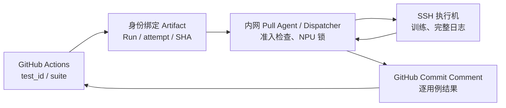

# Lite Actions

**用途**：通过 GitHub Actions 触发内网 NPU 测试。调度机主动领取经授权的任务、锁定 NPU、SSH 执行，再将逐用例 `PASS/FAIL/NOT_RUN` 和简要日志回传 GitHub。执行机无需公网入口、Self-hosted Runner 或 GitHub Token。

**从这里开始**：使用者看第 1 节；新增 testcase 的开发者看第 2 节；部署和维护人员看第 3～6 节。模型测试定义与原生 Integration Runner 另见 [torchtitan-npu Integration Tests README（当前 PR 分支）](https://github.com/depeng1994/torchtitan-npu/blob/refactor/unified-a3-a5-ci/tests/integration_tests/README.md)。

## 1. 使用者：触发并查看测试

在 [torchtitan-npu Actions](https://github.com/depeng1994/torchtitan-npu/actions) 中选择已部署、已启用的 Workflow → **Run workflow** → 选择允许的分支，在 `test_cases` 中填写：

```json
[{"test_id":"dsv4_flash_a3_8p_adamw"}]
```

也可以选择整个模块：

```json
[{"suite":"a3_8p_tests"}]
```

后一种运行 **Muon** 和 **AdamW** 两条有独立优化器语义的 8P 测试。输入只允许 `test_id` 或 `suite`，**不允许**动态 `STEPS`、`params`、模块路径或任意命令；展开后 A3 最多 2 项、A5 最多 1 项。

| Workflow（显示名） | 通道 | 状态 |
| --- | --- | --- |
| `A3-8p-CI-Example` | `a3-8p` | 旧版 Eager 已验证；新版 Muon/AdamW 组合待回归 |
| `A3-16p-CI-Example` | `a3-16p` | 旧版双机 Eager 已验证；当前修改待回归 |
| `A5-64p-CI` | `a5-64p` | **禁用**，未实机验收 |
| `Dispatcher-Smoke` | `a3-smoke` | 调度机连通性检查，不执行 NPU 训练 |

仅在开发分支新增 Workflow 并不等于它已在 GitHub 默认分支注册。完成注册、授权后才可用命令触发：

```bash
gh workflow run a3-8p-lite-actions.yml --ref refactor/unified-a3-a5-ci \
  -f 'test_cases=[{"suite":"a3_8p_tests"}]'
```

GitHub Job 等待内网调度结果，打印每项状态、整体退出码与最多 20 行诊断；**完整日志和 TensorBoard 保留在执行机**，见第 6 节。开发分支还须通过 Workflow 与调度 Agent 的 actor/branch 准入检查。

## 2. 开发者：新增或修改 testcase

**复用现有资源通道时，只修改模型仓测试定义；不需要 Lite Actions 注册表、模型专用调度配置或新 Shell。**

1. 编辑模型仓 `tests/integration_tests/nightly_all_models_test/` 的 `*_tests.py`（新模型可新增 `<model>_tests.py`）。模块统一暴露 `build_test_list()`，返回 `OverrideDefinitions`；每个 `test_name` 必须全局唯一。参阅 [真实 A3 8P 用例](https://github.com/depeng1994/torchtitan-npu/blob/refactor/unified-a3-a5-ci/tests/integration_tests/nightly_all_models_test/a3_8p_tests.py)。
2. 使用 `ngpu`、`nnodes` 说明每节点卡数及节点数。复用仓内 `train_script`，只在 `override_args` 中追加必要 CLI（如固定 `--training.steps 5`、optimizer），不复制 NPU imports。当前 testcase 通过已有 `expected_steps` 可检查 TensorBoard 完成性。
3. **当前 Lite Actions 协议**要求在 testcase `env_vars` 中声明绝对路径 `ASCEND_SET_ENV_PATH`、`HF_ASSETS_PATH`、`CKPT_INIT_LOAD_PATH`，以及确实需要的模型 Config、optimizer override 等。这是当前协议约束，**不代表每种训练都需要加载初始 checkpoint**；路径必须对应目标执行环境。`CKPT_SAVE_LOAD_PATH` 是运行时输出目录，由 Runner 管理，不写死在用例里。
4. 在有相应 Python 依赖的环境中先检查发现结果，然后经已授权通道执行真实 NPU ST：

```bash
python3 -m tests.integration_tests.tools.lite_actions.entrypoint \
  inspect --suite a3_8p_tests
```

`inspect` 仅解析代码与输出通用 case 信息，**不是训练通过的证据**。`suite` 自动展开 `build_test_list()` 的全部用例；调度器按提交 SHA 验证合法 ID、唯一性、物理拓扑和数量预算。工具级 UT 应使用合成 case 验证发现/选择契约；具体模型、optimizer 与训练步骤由模型测试验证。

**只有**新增独立 Workflow、物理机器、HCCL 网络、NPU 资源通道或执行能力时，才修改 Lite Actions 本仓的配置或调度逻辑。

## 3. 两仓职责与运行机制

| 位置 | 维护内容 |
| --- | --- |
| [模型仓 Integration Tests](https://github.com/depeng1994/torchtitan-npu/tree/refactor/unified-a3-a5-ci/tests/integration_tests) | testcase、训练 CLI、资产环境、训练验收 |
| 模型仓 `.github/workflows/`、`.github/scripts/lite_actions/` | Workflow、请求 Artifact、GitHub Waiter（**部署来源**） |
| [`config/pools.json`](config/pools.json) | 物理主机、SSH、HCCL 小网 IP 和 NPU IDs |
| [`config/pipelines.json`](config/pipelines.json) | Workflow → 资源池/设备的授权映射、超时、启用状态 |
| `ci_core/` 与 `unified_agent.py` | 准入验证、分配与锁、SSH、进程清理、日志和 GitHub 结果回传 |

**`config/pipelines.json` 不是 testcase registry**：不复制 `test_name`、`MODULE`、`CONFIG`、训练 CLI 或模型资产。目标 SHA 中的 `build_test_list()` 是唯一测试定义源，但**SHA 本身不是执行授权**。



同一 Run 持有资源锁并逐项执行；下一用例启动前须确认上项进程与 NPU 已释放，否则后续标为 `NOT_RUN`。锁只协调当前调度机的任务，**不能阻止外部人员使用 NPU**。执行机不持有 GitHub Token，结果由调度机通过 REST 发送；系统不调用 AI Agent API。

`github/` 下的 Workflow/Waiter 只是**非权威维护副本**；模型仓 `.github/` 才可部署。检查副本是否漂移：

```bash
python3 scripts/sync_ci_mirror.py --model-repo ../torchtitan-npu --check
```

去掉 `--check` 会从模型仓复制到本仓镜像，**不会反向修改模型仓**。Workflow 最终应经主仓同步到 GitHub 默认分支，才可以正常注册。

## 4. 调度机：首次部署和日常运维

调度机需要 Python 3、Git、OpenSSH Client、`gh`、出站 GitHub API 和执行机 SSH 连通性；执行机需安装适配的 CANN、torch-npu、模型资产及 `npu-smi`。通过可信渠道核对 SSH host key，预先写入 `known_hosts`，不要关闭主机密钥检查。

```bash
git clone https://github.com/depeng1994/lite-actions.git
cd lite-actions
gh auth login
gh auth status
python3 -m unittest discover -s tests
python3 unified_agent.py --validate
pgrep -af 'python3 -u unified_agent.py' || true
# 确认没有旧 Agent/运行中的作业，再启动
nohup ./run-unified-agent.sh >/dev/null 2>&1 < /dev/null &
tail -n 30 logs/system/unified-agent.log
```

`run-unified-agent.sh` 使用 `flock`，同目录只允许运行一个 Agent。也可使用 `A3_CI_GITHUB_TOKEN`，但 Token 须有读取 Actions 和写入 Commit Comment 的权限，**不得传到训练机或日志**。默认只处理指定 actor/Workflow 和受信任分支（通常为 `master`）；验证已批准的 PR 分支时，通过 `A3_CI_ALLOWED_BRANCHES` 显式允许，不能开放所有分支。

日常检查：

```bash
pgrep -af 'python3 -u unified_agent.py'
python3 unified_agent.py --validate
tail -f logs/system/unified-agent.log
ls -ltr logs/runs/ | tail
```

升级或重启前先确认远端进程已结束。`state/` 保存去重与锁状态，不得通过删除锁文件强行重启；目前没有开机自动启动机制。

## 5. 新增机器与 A5 64P 上线

新增资源池或通道时，仅在 [`config/pools.json`](config/pools.json) 登记经过核验的 SSH、HCCL IP 与 NPU 编号，在 [`config/pipelines.json`](config/pipelines.json) 授权 Workflow、pool/allocation、超时及 `enabled`。**不要把同一份地址表和 JSON 再复制到 README。**

A5 8×8 通道目前仍为 `enabled: false`；SSH、HCCL 网络、物理卡号、模型资产与真实多机训练均未验收。只读预检查：

```bash
python3 scripts/preflight_pool.py --pool a5-64p-lab
python3 scripts/preflight_pool.py --pool a5-64p-lab --npu
```

`--npu` 只证明 `npu-smi info` 可用，不证明设备空闲、映射正确或八机 HCCL 可训练。启用前依次确认 host key / SSH、设备进程映射、CANN 和模型资产、HCCL 小网、单机训练、八机训练及 GitHub 端到端回传。缺一项就保持禁用。

## 6. 日志、排障及验收边界

| 现象 | 首先检查 |
| --- | --- |
| Agent 不接单 | Agent 进程、actor/branch/SHA 白名单、Workflow 是否已部署、`enabled`、锁 |
| GitHub Waiter 超时 | `run_id/attempt/SHA`、`pipeline_id`、结果 marker、Token 权限 |
| SSH 或 HCCL 失败 | SSH host key、非交互登录、HCCL 小网/网卡、CANN 环境加载顺序 |
| 训练失败 / 后续用例未运行 | 执行机完整日志、外部 NPU 占用、进程组清理是否确认 |
| A5 无法启用 | 未核实的 SSH/拓扑/资产，先执行只读 preflight |

执行机完整源码、训练日志和 TensorBoard 存放于 `/mnt/share/ci_tests/` 的对应 Run 目录；调度机用 `logs/system/` 保存 Agent 日志、`logs/runs/` 保存单次任务日志、`state/` 保存去重及锁状态。GitHub 只收到有界摘要，不能代替执行机排障。

历史成功只证明**当时的提交**：[A3 8P Eager](https://github.com/depeng1994/torchtitan-npu/actions/runs/37939445270)、[A3 16P 双机 Eager](https://github.com/depeng1994/torchtitan-npu/actions/runs/37942444656)、[旧版 Artifact 协议](https://github.com/depeng1994/torchtitan-npu/actions/runs/37952500554)。最后一项仍包含已废弃的外部 `STEPS` 传参，不证明当前“只选 ID/suite”的协议已经回归；A5 从未完成实机 E2E。

**限制**：外部训练不受资源锁保护；崩溃或取消后需检查远程残留进程；GitHub-hosted Waiter 有最长等待时间，不能视作长稳训练调度平台。
