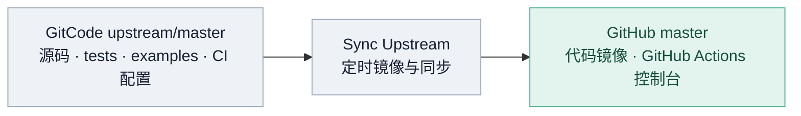
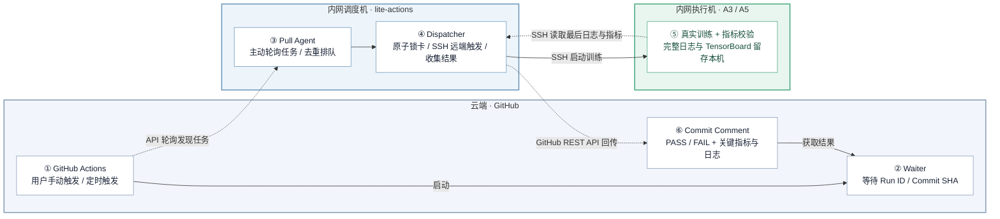

# Lite Actions

**Lite Actions** 是一套面向 NPU 集群的轻量级 CI 调度系统。它将 GitHub Actions 作为云端远程控制台，内网调度机通过 Pull 模式主动领取任务，锁定指定物理 NPU、通过 SSH 远程执行训练，并将执行结果及少量关键指标回传 GitHub。

> **核心特性**：**无需公网 IP、无需入站端口映射、无需在测试机部署 Self-hosted Runner**。

---

## 解决的核心痛点

* **A5 等黄区环境无法使用蓝区 Agent 调试**：受限网络区域外部无法直接接入，通过内网调度机主动拉取（Outbound Pull），免去开通公网入站端口或复杂网络打通的困难。
* **CI 看护用例与对外 Examples 脚本不同仓也不同源**：容易导致 Daily 看护与实际交付脚本脱节。Lite Actions 直接调度模型仓原生的训练用例与启动脚本，保证测试与交付完全同源。
* **多人共用集群易冲突**：使用 Actions 对物理验证环境进行池化调度，支持多人提交任务自动排队执行，杜绝抢卡踩踏。

---

## 1. 能力全景对比：Lite Actions vs 标准 GitHub Self-Hosted Runner

| 能力维度 / 特性 | 标准 GitHub Self-Hosted Runner | Lite Actions 调度模式 |
| :--- | :--- | :--- |
| **执行命令与工作流能力** | **完全开放**：原生支持任意 Shell 命令、多步骤 Steps、自定义 Docker 容器与组合 Action | **受控收敛**：仅支持执行受信任白名单的测试用例（`test_id` / `suite`），不支持任意 Shell 输入 |
| **GitHub 官方生态与插件** | **原生全面集成**：完整支持 Marketplace Actions、Cache、Artifacts 上传下载等全套生态 | **轻量协议交互**：通过云端 Waiter 与 Commit Comment 传递状态，不依赖 GitHub 插件体系 |
| **任务日志回传** | **全量实时流式回传**：实时在网页端查看完整的 stdout/stderr 训练输出日志 | **脱敏关键摘取**：完整日志留存执行机，仅脱敏回传关键 ≤20 行日志与 TensorBoard 标量 |
| **网络接入与环境要求** | **每台执行机需出站公网**：直接长连接 GitHub API；隔离区（黄区）无外网机器无法直接接入 | **集中出站代理**：仅需 1 台调度机连接外网，所有训练执行机处于纯内网/黄区 |
| **执行机侵入性与依赖** | **需安装常驻服务**：每台机器需部署 Runner 守护进程、.NET/Node 运行时等系统常驻依赖 | **零侵入**：执行机无需安装任何额外 Agent，仅依赖系统自带的 SSH 与已有的容器/CANN 环境 |
| **物理加速卡（NPU）互斥** | **默认主机级调度**：按整机分发 Job，无物理卡号感知；多任务并发容易争抢 NPU 显存冲突 | **原生物理卡级原子锁**：支持按物理卡号（如 0~7 / 8~15）细粒度加锁与排队，防止抢卡踩踏 |
| **分布式跨机训练编排** | **单 Job 绑定单机**：跨机训练（如 16P/64P）需在用户脚本内自行写复杂的 SSH 跨机协同与环境传递 | **原生支持多机拓扑**：配置声明 `nodes/devices_per_node`，调度机统一申请跨机卡锁并校验 HCCL 小网 |
| **执行凭据暴露面** | **执行机持有凭据**：机器上存有 Runner 注册凭据与 GitHub Token，需防范不可信 PR 提权逃逸 | **执行机零凭据**：执行机完全无 GitHub Token，仅调度机单点持有回写权限 |
| **任务取消与清理** | **原生实时中断**：由 Runner 进程组直接接收 GitHub Cancel 信号并终止 | **轮询感知与定点清理**：调度机轮询捕获取消，按环境变量精确 kill 远端对应 rank 进程组 |
| **适用场景定位** | **通用 CI/CD 全流程流水线**（功能完备、生态丰富，适用于通用软件构建与测试） | **隔离区 NPU 集群专项训练看护**（聚焦受限网络下的硬件独占、多机排队与用例回归） |

---

## 2. 架构总览

### 2.1 代码同步架构



* **双主源规则**：模型仓 GitCode `master` 是上游开发主源，GitHub `master` 为镜像及 Actions 触发入口。
* 正式发布时，确保同一发布提交在两侧 `master` 保持一致，避免定时镜像覆盖分支改动。

---

### 2.2 CI 运行架构



**完整交互时序**：
1. **触发任务**：开发者在 GitHub Actions 页面触发 Workflow。
2. **云端等待**：GitHub Waiter Job 启动并等待调度结果。
3. **主动发现**：内网调度机的 Agent 定期轮询 GitHub API，主动发现新任务。
4. **资源加锁**：调度机检查物理卡状态，通过**两级锁机制**（任务槽位 + 设备与端口原子租约）锁定目标资源。
5. **远程执行**：调度机通过 SSH 在目标执行机上运行训练容器与脚本，执行机保留完整日志。
6. **脱敏回传**：训练结束后，调度机通过 SSH 读取尾部关键日志（最多 20 行）和 TensorBoard 结果，调用 GitHub API 回写 Commit Comment，Waiter Job 获得终态并成功结束。

> **安全与性能保障**：
> - 执行机**无需配置 GitHub Token**，也不直接连外网；
> - 回传仅包含脱敏后的核心指标，保证敏感数据不泄露；
> - 全过程不调用任何第三方 AI Agent API。

---

### 2.3 任务级并发与资源隔离机制

为了提升集群利用率并缩短 CI 等待耗时，Dispatcher 具备用例级并发与严格隔离机制：

* **独立 Case 并发（4 Worker 架构）**：Dispatcher 运行 4 个独立 Worker（3 个 SSH 训练 Worker + 1 个本地 Smoke Worker）。GitHub Matrix 中互不冲突的用例可同时排队并发执行（例如单机的 Muon 与 AdamW 同时运行）；本地 Smoke 任务独立运行，无需等待训练排队。
* **物理卡号与通信端口双重原子锁**：每个任务原子获取目标 Host 的 NPU 物理文件锁，同时持有该 Host 动态分配的 rendezvous 端口及 HCCL 端口范围租约（`LITE_CI_MASTER_PORT` 与 `LITE_CI_HCCL_*_PORT_RANGE`），从根本上避免同机并发时的卡号与网络端口冲突。
* **跨机任务原子准入**：16P 等跨节点分布式任务必须一次性获取全部节点的完整 8P 设备组，资源未凑齐前在队列中等待，绝不半途持卡占位。
* **组织仓 PR 自动 CI 与安全准入**：面向 `torchtitan-npu:master` 提交的 PR 自动触发组织仓 CI；Agent 通过 GitHub PR API 严格校验 PR 编号与 Head Commit SHA，按精确 SHA 下载代码；执行机零 GitHub Token；低频心跳（每 60 秒上报一次状态日志至 GitHub Actions 云端日志）。

---

### 2.4 职责边界划分

| 关注点 | 模型仓 (`torchtitan-npu`) | 调度仓 (`lite-actions`) |
| :--- | :--- | :--- |
| **测试用例与参数** | 测试逻辑、超参、步数、模型 Flavor | 仅透传执行，不解析参数细节 |
| **运行时环境** | CANN 路径、权重路径、HF 缓存路径 | 负责在执行机 source 与 export 对应环境变量 |
| **触发入口** | `.github/workflows/` 定义触发参数 | 负责拉取并校验任务合法性 |
| **硬件与机器** | 仅声明需要多少卡（如 8P / 16P） | 维护具体 IP、SSH 账号、网卡与物理 Device ID |
| **资源互斥** | 不关心 | 维护设备原子锁与排队机制，防止抢卡 |

---

## 3. 当前已验证通道与状态

| Actions 通道展示名称 | 通道 ID | 硬件规格与作用 | 状态 |
| :--- | :--- | :--- | :--- |
| **`Dispatcher-Smoke`** | `a3-smoke` | 调度机本地 `npu-smi` 连通性冒烟验证 | 可用 |
| **`A3-8p-CI-Example`** | `a3-8p` | A3 单机 8P 动态选卡：Muon + AdamW 5 steps | **正式可用（支持同机/跨机并发调度）** |
| **`A3-16p-CI-Example`** | `a3-16p` | A3 双机 16P（跨机 EP16）：Eager 5 steps | **正式可用（支持跨机原子调度）** |
| **`A5-64p-CI`** | `a5-64p` | A5 八机 64P（每台 8P）集群训练 | 预留模板，实机验收前保持禁用 |

---

## 4. 首次部署指南（在内网调度机操作）

### 4.1 环境要求

调度机是一台**能够主动访问 `api.github.com`，且能通过 SSH 访问内网各执行机**的 Linux 主机。
- **软件依赖**：Python 3.10+、Git、OpenSSH Client、GitHub CLI (`gh`)。
- **权限要求**：调度机账号具有访问执行机的 SSH 免密权限；持有具有目标仓库 Actions 读取与 Commit Comment 写入权限的 GitHub Token。

### 4.2 步骤一：克隆代码与出站认证

在**调度机**上执行：

```bash
git clone https://github.com/depeng1994/lite-actions.git
cd lite-actions

# 配置 GitHub 出站认证（两者选一即可）
gh auth login
# 或配置环境变量：export LITE_ACTIONS_GITHUB_TOKEN="ghp_xxx"

# 验证与执行机的 SSH 免密连通性
ssh -o BatchMode=yes <execution-host> hostname
```

### 4.3 步骤二：环境变量配置

调度进程支持通过以下环境变量定制运行参数（未指定时全部采用安全默认值）：

| 环境变量 | 默认值 | 作用说明 |
| :--- | :--- | :--- |
| **`LITE_ACTIONS_GITHUB_TOKEN`** | 留空（自动读取 `gh auth token`） | GitHub API 认证凭据 |
| **`LITE_ACTIONS_ALLOWED_ACTORS`** | 留空（仅白名单人员） | 允许触发任务的 GitHub 用户白名单 |
| **`LITE_ACTIONS_ALLOWED_BRANCHES`** | `master` | 允许执行任务的仓库分支 |
| **`LITE_ACTIONS_POLL_SECONDS`** | `60` | 调度机拉取 GitHub Actions 任务队列的轮询周期（秒） |
| **`LITE_ACTIONS_RECLAIM_EXTERNAL_PROCESSES`** | `1` | 是否允许安全回收白名单闲置占卡进程（需在资源池显式授权） |
| **`LITE_ACTIONS_RESOURCE_LOCK_ROOT`** | `~/.cache/lite-actions/resource-leases` | 物理设备锁与端口租约本地存储路径 |

### 4.4 步骤三：校验配置并启动调度 Agent

```bash
# 1. 运行自测单测与配置语法校验
python3 -m unittest discover -s tests
python3 unified_agent.py --validate

# 2. 确认当前没有残留旧 Agent 进程
pgrep -af 'python3 -u unified_agent.py' || true

# 3. 后台启动唯一的调度守护进程
nohup ./run-unified-agent.sh >/dev/null 2>&1 < /dev/null &

# 4. 确认 Agent 成功运行
pgrep -af 'python3 -u unified_agent.py'
tail -n 30 logs/system/unified-agent.log
```

> **启动说明**：`run-unified-agent.sh` 通过 `flock` 文件锁保证全局单例运行，默认每 60 秒轮询一次 GitHub Actions 队列。

---

## 5. 日常运维与应急排障

### 5.1 快速健康巡检

```bash
# 检查 Agent 是否存活
pgrep -af 'python3 -u unified_agent.py'

# 查看调度机实时日志
tail -f logs/system/unified-agent.log

# 查看最近任务的运行记录与上报指标
ls -ltr logs/runs/ | tail -n 5
```

### 5.2 任务取消与残留清理（GitHub Cancel 应对）

当用户在 GitHub 页面点击 `Cancel workflow` 时：
1. 调度机 Agent 会捕获取消事件，并向该任务分配的执行机发送终止指令。
2. **精准清理机制**：根据本次任务唯一的 `LITE_CI_JOB_ID` 环境变量，调度机通过 `/proc/<pid>/environ` 精确识别本次任务启动的 `torchrun` 及其全部 Rank 进程并终止，**绝不通过 `pkill` 或进程名误杀其他用户的正常训练**。
3. 随后调度机会通过 `npu-smi` 复查设备释放状态，确认 NPU 空闲后才会释放设备锁。

### 5.3 异常隔离（Quarantine）与手动恢复

若在任务执行过程中发生 SSH 闪断、执行机异常重启或进程无法判定退出，调度机会将相关 NPU 标记为 **Quarantine（隔离状态）**，防止后续任务因脏环境报错。

**解除 Quarantine 的标准步骤**：
1. **暂停调度**：停止当前 Agent（`kill <agent-pid>`）。
2. **检查远端真实物理卡状态**：
   SSH 登录执行机，运行 `npu-smi info`，确认对应卡上确实已无残留进程。如有僵尸进程，核对 PID 后手动 `kill -9` 清理。
3. **解除隔离记录**：
   在调度机检查 `state/unified-jobs.json`，将对应 Task 的 `quarantined` 字段由 `true` 改为 `false`，并记录修复说明。
4. **重启 Agent**：重新执行 `./run-unified-agent.sh` 恢复调度。

### 5.4 A3 共享设备闲置占卡受控回收（Reclaim 机制）

当 A3 任务缺少空闲卡组且资源池显式配置了 `reclaim_external_processes: true` 时，调度机支持受控清理闲置占卡进程：
* **白名单安全过滤**：回收前通过宿主机 `npu-smi` 读取占卡 PID，严格比对 `/proc/<pid>` 的启动时间、命令行和父进程，**仅允许清理 `auto-occupy` 或空闲的 `vLLM` worker 进程族**；
* **防误杀保障**：采用专属 PID 发送 TERM/KILL，**绝不停止看门狗、绝不使用 pkill/killall、绝不误杀任何正在执行的真实训练任务**。若检测到非白名单未知进程，立即放弃回收并退出等待；
* **开关控制**：如需临时关闭回收，启动前设置 `LITE_ACTIONS_RECLAIM_EXTERNAL_PROCESSES=0` 即可。

### 5.5 磁盘空间预检（Docker Overlay / 共享 NFS 缓存）

* **常见隐患**：部分执行机容器使用的是宿主机 `/data` 作为 Docker Overlay 底层，若宿主机磁盘写满，会导致容器内报错 `Not enough disk space`。
* **规避方案**：模型仓用例统一将 Hugging Face 缓存重定向至共享存储（`HF_HOME=/mnt/share/ci_tests/.lite-actions-hf-cache`）。
* **排查命令**：
  ```bash
  # 在执行机上检查根目录与共享目录可用空间
  df -h /
  df -h /mnt/share
  ```

### 5.6 版本平滑升级与安全回滚

* **平滑升级**：
  1. 查看日志确认当前无正在执行的训练任务；
  2. 终止当前 Agent 进程；
  3. 执行 `git pull` 拉取最新代码，执行 `python3 unified_agent.py --validate` 校验配置；
  4. 启动新 Agent 并通过 `Dispatcher-Smoke` 工作流做冒烟验收。
* **安全回滚**：
  如新版本出现非预期异常，停止 Agent 后执行 `git checkout <stable-tag/sha>`，重新拉起旧版本即可。

---

## 6. 环境扩展指南：如何新增机器与调度通道

当集群新增了机器或需要开辟新的测试通道时，按以下三个步骤在 `lite-actions` 仓配置。

### 步骤一：在 `config/pools.json` 中登记物理机与 NPU

机器池配置文件用于描述物理节点、SSH 登录入口与 NPU 卡号分配：

```json
{
  "pools": {
    "a3-shared": {
      "type": "ascend-a3",
      "process_indexing": "card",
      "nodes": [
        {
          "host_id": "a3-03",
          "ssh": "root@10.x.x.3",
          "node_ip": "192.168.1.3",
          "device_ids": [0, 1, 2, 3, 4, 5, 6, 7]
        },
        {
          "host_id": "a3-04",
          "ssh": "root@10.x.x.4",
          "node_ip": "192.168.1.4",
          "device_ids": [0, 1, 2, 3, 4, 5, 6, 7]
        }
      ]
    }
  }
}
```

* `host_id`：机器唯一标识；
* `ssh`：调度机访问该节点所用的 SSH 用户名与 IP；
* `node_ip`：多机分布式训练时节点间通信的 HCCL 小网 IP；
* `device_ids`：该节点允许被 CI 调度的物理卡号列表。

### 步骤二：在 `config/pipelines.json` 中配置调度通道

调度通道配置文件用于将 GitHub Actions 的 Workflow 与物理机器池建立授权映射：

```json
{
  "pipelines": {
    "a3-8p": {
      "workflow": "a3_8p_lite_actions.yml",
      "pool": "a3-shared",
      "resources": {
        "nodes": 1,
        "devices_per_node": 8
      },
      "runner": {
        "kind": "ssh"
      },
      "timeout_seconds": 7500,
      "enabled": true,
      "pipeline_id": "a3-8p"
    }
  }
}
```

* `workflow`：关联的模型仓 GitHub Actions Workflow 文件名；
* `pool`：指定使用的机器池名称；
* `resources`：该通道单次运行所需的拓扑规格（节点数、单节点卡数）；
* `timeout_seconds`：单任务最大超时时间（秒）。

### 步骤三：网络与连通性只读自检

添加配置后，在调度机上运行只读预检脚本（不会启动训练，不占用物理卡）：

```bash
# 验证 SSH 连通性
python3 scripts/preflight_pool.py --pool a3-shared

# 验证远端 npu-smi 命令与卡号识别
python3 scripts/preflight_pool.py --pool a3-shared --npu
```

自检全绿后，即可在 GitHub 触发该通道的任务。

---

## 7. 相关参考

* **如何编写和新增测试用例**：参见模型仓 [集成测试使用指南 (tests/integration_tests/README.md)](https://github.com/depeng1994/torchtitan-npu/blob/master/tests/integration_tests/README.md)。
* **历史架构演进与阶段设计备忘**：参见 [REFACTOR_PLAN.md](REFACTOR_PLAN.md)。
