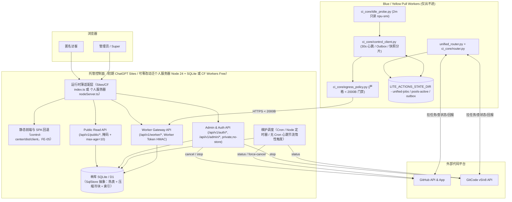

# Lite Actions 调度网站开发详细设计

**v1.5（Demo 交接对齐版） · 2026-11-19** · 产品需求见 [PRD.md](PRD.md) · 接口契约见 [api-contract.md](api-contract.md) · v1.1 后端回归见 [backend-validation.md](backend-validation.md)

> **当前就绪度评估与已拍板决策（必读）**
> - **交互基线与全部 5 项冲突已最终拍板（零未决规格）**：前端 Demo（`codex/control-center-demo @ cd770ce`）与 PRD v1.5 全部口径已对齐定稿：
>   1. **Super 密钥**：仅创建/重置展示一次，用户表移除重复查看、提供「重置密钥」+「删除」（服务端仅存 HMAC-SHA256）；
>   2. **集群变更**：新增粘贴 `preflight.py` JSON 片段 + 解析预览；**删除采用 Demo 已确认的两步「先排空、再删除」**（排空中可恢复，活动租约/排队引用/隔离全清零才开放删除）；补齐历史版本回滚入口；
>   3. **双平台取消**：GitHub 与 GitCode 同时支持，前端按接口 `cancel_supported` 渲染；
>   4. **节点展示与隐私**：公网匿名服务端掩码（`113.xxx.xxx.205:153`）、登录后完整呈现 `host_id`；**不增加节点显示别名**，直接以 `host_id` 呈现；
>   5. **全量探测与统一调度开关**：**全部已配置节点（含暂停调度 / `enabled: false` Pool）均执行 2 分钟在线探测**；`enabled` 与「是否暂停调度」统一为同一语义（Pool `enabled: false` 与节点/组 `paused: true` 均只停止发新租约、任务继续排队不报错失败）；`model_repos.json` 静态配置 `repo_scope`（组织仓/个人仓）。
> - **初期托管与可迁移架构原则（已拍板）**：初期采用 **ChatGPT Sites** 直接部署上线，但**全部前后端源码、数据库迁移、Sites 打包脚本与个人服务器运行入口均完整合入 GitHub 仓**；业务核心严格只依赖标准 Web Fetch 与 SQLite 抽象（`SqlStore`），不绑定任何单一托管商专有 API，支持零业务代码改动迁移至个人服务器（Node.js 24 + 内置 `node:sqlite`）或 Cloudflare Workers Free + D1 Free，并由新增的 **`portability_intercept` DT 门禁（`REQ-20`）** 在 CI 中强制防锁死拦截。
> - **后端/Worker 现状**：基于 **v1.1** 的底座（`REQ-01` ~ `REQ-14`）已落地并通过 27 项后端单测、209 项 Python 单测及 YCY 隔离回归；实审现有代码发现 4 处 Cloudflare/D1 锁死点（见 `REQ-20`）。需完成 **Phase 5.5（`REQ-15` ~ `REQ-20`，预计 ~4,020 行增量）** 及联调补齐（`INT-03/04/05/06/07/08/09/09B/10`）即可进入全栈端到端联调。
> - **双轨并行开工**：
>   - **正式网页开发（前端 Agent）**：✅ **可立即启动**。基于 Demo（`cd770ce`）将全量前端源码迁入 GitHub 仓 `control-center/web/`，对接本版冻结的 [v1.5 API 契约](api-contract.md) 并落实第 5.2 节定稿改造项，统一构建至 `control-center/dist/client/`（同时适配 ChatGPT Sites 与个人服务器）。
>   - **后端与 Worker 增量开发**：✅ **可立即启动 Phase 5.5（`REQ-15` ~ `REQ-20`）**，完成后与前端汇合直通 Phase 7 端到端联调。
> - **硬边界（不可妥协）**：零新增费用（禁用 R2/KV/DO 等付费绑定）；初期 ChatGPT Sites 直出、代码全入 GitHub 仓且可零业务改动迁个人服务器（由 `portability_intercept` DT 强制拦截）；网站故障不影响原 CI 调度与回报；网站不实现第二套选单算法；Worker 只出不进；所有网站上传请求与 Yellow 平台写请求单次整包严格 `< 2,000` 字节（严于 2 KB，由 `tests/test_upload_intercept.py` 强制门禁）。

---

## 1. 落地实施 Todo List（按依赖顺序执行）

> **执行指引**
> 1. **Phase 0–5（v1.1 基线）** 已实现；其中受 PRD v1.5 升级及托管解耦影响的 9 项（`REQ-01/02/07/08/09/11/12/13/14` 局部）由 **Phase 5.5（`REQ-15` ~ `REQ-20`）** 增量覆盖，切勿将 v1.1 的 `[x]` 误判为已满足 Demo/PRD v1.5 或个人服务器可迁移要求。
> 2. **双轨并行推进**：后端/Worker 立即执行 **Phase 5.5（`REQ-15` ~ `REQ-20`）** 与 **Phase 7.1** 补齐；前端 Agent 同步执行 **Phase 6（`FE-01` ~ `FE-05`）**，每完成一项由项目负责人标绿 `[x]`。
> 3. **双拦截门禁不松动**：① 任何涉及 Worker 出站报文或调度的改动，提交前必须跑绿 `python3 -m unittest tests/test_upload_intercept.py -v` 与 `python3 scripts/lint.py`；② 任何涉及控制面服务端/前端/打包配置的改动，提交前必须跑绿 **`npm run test:portability --prefix control-center/worker`**（`portability_intercept` DT）与 `node control-center/scripts/build-sites.mjs`。
> 4. **放行标准**：Phase 7.2 中标有 **`★ P0 关键必通`** 的 **8 条**核心闭环用例 100% 通过且 **`REL-00` ~ `REL-04`** 签收后方可正式上线。

### Phase 0 ~ Phase 5：v1.1 后端与 Worker 底座（已落地，含 4 项待 v1.5 增量升级）

#### Phase 0：控制面工程底座、账号权限与 v1.1 契约
- [x] **`REQ-01` 控制面骨架与 D1 Schema（v1.1 基线）**：`control-center/worker/` 骨架、`migrations/0001_init.sql`、`model_repos.json`（v1.5 增量表结构见 `REQ-15/16/17`）。
- [x] **`REQ-02` 账号、会话、防爆破与审计**：Super/普通管理员认证、HMAC-SHA256 哈希、密钥仅展示一次、重置密钥/删号即刻失效、7 天 Cookie、10 分钟 5 次锁 10 分钟、操作审计。
- [x] **`REQ-03` 权限矩阵、服务端 IP 掩码与缓存隔离**：公开/管理员/Super/Worker 四级鉴权、服务端 IPv4 掩码 + `node_ref`、`/public/*`（`max-age=10`）与 `/admin/*`（`private, no-store`）路由隔离。

#### Phase 1：Worker 通信协议底座与 `< 2KB` 拦截门禁
- [x] **`REQ-04` Worker 控制面客户端与磁盘 Outbox（v1.1 基线）**：`ci_core/control_client.py`、30s 心跳、磁盘 Outbox、分片快照、`egress_policy.py` 支持 `provider="control"` 与 `ci_reserve_bytes`（v1.5 新增字段见 `REQ-15/16/17`）。
- [x] **`REQ-05` 全路径上传 `< 2KB` 拦截单测（`upload_intercept` UT）**：`tests/test_upload_intercept.py` 真实 HTTP/1.1 序列化拦截 + AST 写路径静态审计（v1.5 变更后需同步扩展最坏边界断言并重跑全绿）。

#### Phase 2：服务端采集对账、设备巡检、排期估算与看板读接口（v1.1 基线）
- [x] **`REQ-06` 服务端 Worker 接入网关与快照对账（v1.1 基线）**：`/api/v1/worker/*`、去重、缺口触发快照、分片原子对账、90s 心跳离线、不导入历史（v1.5 扩展 `IP/TU/SWAP_WORKFLOW` 见 `REQ-15/16/17`）。
- [x] **`REQ-07` 设备只读空闲巡检与占用三态（v1.1 基线；⚠ v1.5 升级见 `REQ-15`）**：已实现未租用组 30 分钟空闲三态；**缺**全量设备 5 次失败离线、`last_online_at`、暂停后持续探测与 `/cluster` 状态输出。
- [x] **`REQ-08` 元数据采集、耗时中位数与排期虚线（v1.1 基线；⚠ v1.5 升级见 `REQ-16`）**：已实现 10 次 PASS 中位数与贪心虚线；**缺**平台提交时间 `submitted_at` 与 Workflow 名称 `workflow_name`。
- [x] **`REQ-09` 看板读接口（v1.1 基线；⚠ v1.5 升级见 `REQ-16`）**：已实现旧版 `/models/:slug/runs` 与基础 `/timeline`；**缺**统一 Workflow 表 `/workflows`（50 Workflow 分页、全局负/零/正序号、调度结果、运行总卡时）及 `/timeline` 内嵌 `tasks_by_uid`。

#### Phase 3：调度控制能力（v1.1 基线）
- [x] **`REQ-10` 整次 Workflow 取消（GitHub App + GitCode + Cron）**：`/api/v1/admin/cancellations`、GitHub cancel / 2 分钟 force-cancel、GitCode `/stop`、1 分钟 Cron 跟踪与 Worker 轮询闭环。
- [x] **`REQ-11` 排队插队与 train 72h 超时（v1.1 case 级基线；⚠ v1.5 升级为 Workflow 级见 `REQ-17`）**：已完成 `train` 72h（259,200s）排队超时与 case 级 `MOVE_UP`；**须按 `REQ-17` 升级为 Workflow 级版本化跨区相邻交换**。

#### Phase 4 ~ Phase 5：集群配置热加载与单 D1 热冷自治（已落地，含 2 项待 v1.5 增量升级）
- [x] **`REQ-12` 集群管理服务端与 `preflight.py` 片段导出（v1.1 基线；⚠ v1.5 升级见 `REQ-15/18`）**：乐观锁版本、预览、发布、回滚、三级暂停、隔离拒删、跨 Worker 先删后加、`--export-node-snippet`；**待按 `REQ-18` 升级为两步「先排空再删除」与统一 `enabled`/`paused` 语义**。
- [x] **`REQ-13` Worker Pools 持久化、实机校验与调度间隙热加载（v1.1 基线；⚠ v1.5 升级见 `REQ-18`）**：`pools-active.json` 优先加载、实机复核指纹/容器、在途 `pools_snapshot` 隔离、重启/自动更新保留；**待按 `REQ-18` 统一 `enabled: false` 与 `paused: true` 为同一暂停调度语义（不报 `POOL_DISABLED`）**。
- [x] **`REQ-14` 单 D1 热转冷（30d）、1 年清理、80%→70% 滚删与写额度降级**：压缩冷块写-校-删、1 年清理、`meta.size_after` 滚删、写额度 503 降级（`REQ-16` 同步确保滚删按完整 Workflow 粒度不删半残）。

---

### Phase 5.5：v1.5 规格对齐增量开发（对标确认版 Demo `cd770ce` & PRD v1.5，当前阻断联调）
- [x] **`REQ-15` 全量节点 2 分钟 `npu-smi` 在线探测（含暂停/`enabled: false` Pool）、5 次离线状态机与 `/cluster` / `/timeline` 健康融合**
  - 实现：`449534a` + `7858c59`，包含 D1 健康迁移、全量节点探测、轮次持久化、0～5 次失败状态、最近在线时间、IP/heartbeat 扩展和时间轴健康投影。Blue 线上已实测四个设备组 `ONLINE`。
  - 依赖：`REQ-04` ~ `REQ-07`, `REQ-12` ｜ 门禁：`npx wrangler d1 migrations apply DB --local`、`python3 -m unittest tests/test_idle_probe.py tests/test_upload_intercept.py -v`、`npm test -- device-state.test.ts cluster-config.test.ts` 全绿
- [ ] **`REQ-16` 统一 Workflow 表格接口（`/workflows`）、50 Workflow 游标分页、汇总口径（调度结果 / 运行总卡时）与 `/timeline` 零 N+1 增强**
  - 依赖：`REQ-06`, `REQ-08`, `REQ-09`, `REQ-14`, `REQ-15` ｜ 门禁：`python3 -m unittest tests/test_control_client.py tests/test_queue_telemetry.py tests/test_upload_intercept.py -v`、`npm test -- workflows-board.test.ts board-read.test.ts retention-storage.test.ts` 全绿
- [ ] **`REQ-17` Workflow 级版本化跨区插队（`POST /admin/workflows/move-up` + `SWAP_WORKFLOW` 命令 + 晚发现/回队沿用顺位 + 多端分池回执）**
  - 依赖：`REQ-05`, `REQ-11`, `REQ-16` ｜ 门禁：`python3 -m unittest tests/test_workflow_priority.py tests/test_smoke_queue.py tests/test_upload_intercept.py -v`、`npm test -- workflow-priority.test.ts` 全绿
- [ ] **`REQ-18` 集群两步「先排空再删除」状态机与统一 `enabled`/`paused` 暂停调度语义**
  - 可验证子集已实现：新增 `0003_v15_cluster_drain.sql` 的 `cluster_drain_targets`，服务端支持 Pool `DRAIN`/`RESUME`、删除前 `RESOURCE_NOT_DRAINED` / 活动租约 / 排队引用 / 隔离四项门禁、Pool `enabled: false` 暂停语义及 `/cluster` 的 `draining` 状态。完整 Worker 侧排空取消、双端回执、实机重启与自动更新联调仍未完成，故本条保持未勾选。
  - 依赖：`REQ-12`, `REQ-13`, `REQ-15` ｜ 门禁：`python3 -m unittest tests/test_pools_hot_reload.py tests/test_upload_intercept.py -v`、`npm test -- cluster-config.test.ts` 全绿
- [x] **`REQ-19` v1.5 TypeScript 契约冻结（`types/api.ts` + `model_repos.json` 含 `repo_scope`）与正式前端接入基线同步**
  - 实现：`cb58ecd`，`/models` 已返回组织仓/个人仓 `repo_scope`，契约类型与定向测试已同步。REQ-16～REQ-18 的业务接口仍保持未标绿。
  - 依赖：`REQ-15` ~ `REQ-18`（契约文件 `types/api.ts` 与 `api-contract.md` 已冻结可并行放行前端） ｜ 门禁：`npm run lint --prefix control-center/worker` & 契约类型一致性检查全绿
- [ ] **`REQ-20` 托管解耦、ChatGPT Sites 打包、个人服务器（Node 24 + `node:sqlite`）迁移适配与 `portability_intercept` DT 拦截门禁**
  - 可验证子集已实现：`src/storage/sqlStore.ts` 提供运行时无关 `SqlStore`/`SqlStatement` 契约和统一 BLOB 解码，`npm run test:portability` 扫描业务源码并拦截运行时专有恒时比较、非适配器 Cloudflare 客户端 IP 头和硬编码 `workers.dev`。完整双运行时适配、SPA/无 Cron 兜底、Sites 打包与 Node 24 SQLite 联调仍未完成，故本条保持未勾选。
  - 依赖：`REQ-01` ~ `REQ-19`（消除 `timingSafeEqual` / `CF-Connecting-IP` / `D1Database` 直连 / 无 Cron 维护阻塞 / BLOB 形态假定，抽离 `app.ts` + `SqlStore` + `adapters/{d1,nodeSqlite,nodeServer}.ts` + `build-sites.mjs` + `deploy/{Dockerfile,systemd}` + 4 层 `portability-intercept.test.ts` 接入 CI） ｜ 门禁：`npm run test:portability --prefix control-center/worker`、`npm test --prefix control-center/worker` 与 `node control-center/scripts/build-sites.mjs` 全绿

---

### Phase 6：`[外部依赖 · 前端 Agent]` 正式前端工程化、GitHub 仓合入与 Sites/自建统一产物构建
> **可立即并行启动**：前端 Agent 直接以已确认的 `control-center/demo`（`cd770ce`）为 UI/交互基线，**将完整前端源码合入 GitHub 仓 `control-center/web/`**，按 [api-contract.md](api-contract.md) v1.5 对接真实 API，完成后由项目负责人在此标绿。

- [x] **`FE-00` 交互原型 Demo 定稿与确认**：`codex/control-center-demo @ cd770ce`（Pools 时间轴双框渲染 + 下方排队表、统一 Workflow 表 + 列筛选排序 + 上方历史折叠展开、集群健康与两步排空删除展示、浅/深色主题）。
- [ ] **`FE-01` `[依赖项 · ⏳ 待前端 Agent 标绿]` Pools 时间轴与排队面板正式化**：对接 `/api/v1/{public,admin}/timeline`（读取 `tasks_by_uid` 与 `queued_by_pool`，同租约多组独立画框、零卡探针不占行、设备在线/未知占用/暂停/排空中叠加、30s 静默轮询、**直接以 `host_id ?? display_host_id` 呈现节点不加别名**、按实际 `devices.length` 显示卡数）。
  - 后端依赖：`REQ-15`, `REQ-16`, `REQ-18`
- [ ] **`FE-02` `[依赖项 · ⏳ 待前端 Agent 标绿]` 统一 Workflow 表格、上方 50 条历史分页/折叠与任务详情抽屉正式化**：对接 `/api/v1/{public,admin}/workflows`、`/models`、`/tasks/:uid`；保留全部 12 列筛选/排序、`-3,-2,-1,0,1,2...` 序号、表顶加载/折叠历史、容量清理末尾提示、冷归档标签、北京时间（UTC+8）标注与 `repo_scope` 归属标签。
  - 后端依赖：`REQ-16`, `REQ-19`
- [ ] **`FE-03` `[依赖项 · ⏳ 待前端 Agent 标绿]` 认证会话、双平台取消 Workflow 与 Workflow 级插队正式化**：对接 `/auth/*`、`POST/GET /admin/cancellations*`（**已拍板：按后端 `cancel_supported` 同时开放 GitHub 与 GitCode 取消**）、`POST /admin/workflows/move-up` & `GET /admin/workflow-priority-ops/:opId`（携带 `queue_version`，409 冲突自动刷新，分 Worker/Pool/任务类型展示实时回执）。
  - 后端依赖：`REQ-02`, `REQ-03`, `REQ-10`, `REQ-17`
- [ ] **`FE-04` `[依赖项 · ⏳ 待前端 Agent 标绿]` 集群管理与 Super 用户管理正式化**：对接 `/cluster`、`/cluster/{preview,publish,rollback}`、`/admin/users*`、`/admin/audits`；**按已拍板口径落实**：① Super 用户列表移除“重复查看密钥”，改为“重置密钥（旧会话即刻失效）”+ 创建/重置一次性弹窗复制；② 新增资产采用「粘贴 `preflight.py --export-node-snippet` JSON 片段 + 自动解析只读预览」；③ **删除沿用 Demo 两步「先排空、再删除」**（排空中可点恢复，活动租约/排队引用/隔离归零后才开放删除）；④ 补齐历史版本列表与回滚入口；⑤ 节点直接展示掩码/完整 `host_id`，无别名。
  - 后端依赖：`REQ-02`, `REQ-12`, `REQ-15`, `REQ-18`
- [ ] **`FE-05` `[依赖项 · ⏳ 待前端 Agent 标绿]` 源码全入 GitHub 仓与统一产物构建（ChatGPT Sites / 个人服务器 / CF Workers 共用）**：全量前端源码合入 `control-center/web/`（零仓外私有路径引用）；构建产物统一输出至 `control-center/dist/client/`，由 `control-center/scripts/build-sites.mjs` 同步产出 Sites 完整包并被个人服务器 `nodeServer.ts` 与 `wrangler.toml` 直接复用；严格仅使用相对路径 `/api/v1/*`（零硬编码绝对后端域名），移除“模拟数据”徽章与演示快捷登录按钮，确保 `HttpOnly; Secure; SameSite=Strict` Cookie 正常生效。
  - 后端依赖：`REQ-01`, `REQ-20`, `FE-01` ~ `FE-04`

---

### Phase 7：端到端联调、最终集成验证与生产上线签收

> **2026-11-20 正式上线记录**：Cloudflare Worker 使用线上 D1 `lite-actions-control-center`，正式 Site **版本 13** 通过同源 Server-backed API 访问控制面。前端构建已移除所有 Demo/fixture 数据回退，正式 D1 无活动任务时页面显示空队列。Blue 已配置线上 URL、机器密钥和控制面客户端，`/api/v1/public/overview` 实测 `offline=false`、`applied_rev=1`，四个设备组持续 `ONLINE`。个人仓 `depeng1994/lite-actions` 的 `lite-ci-self-smoke` CPU-only run `44565274119` 在部署 SHA `12c5ea87f9d121885eff757259a33833e1129dc1` 上通过。Site 版本 13 还通过了 API 代理环境变量、完整静态资源、SPA 路由回退、正式 cluster 状态映射（包含 `enabled: false` Pool 的暂停态）和无 Worker 错误日志核验。

> v1.1 隔离联调实测通过：公开/管理员权限与掩码、双 Worker 90s 离线与恢复、连续三次插队、集群发布/重启应用、20+ 条事件补发、双平台写回；TLS 抓包 86 个请求，最大 1,761 字节。完整 NPU smoke、Yellow 主机、v1.5 Phase 5.5 及双平台取消仍按下方未勾选门槛记录。

> v1.5 可回溯增量 `cb58ecd`、`449534a`、`7858c59` 已落地 `repo_scope` 元数据、运行时注入 `clientIp`、纯 JavaScript 恒时比较及 REQ-15 健康探测。`9ca58a6` 已提供统一 `/workflows` 只读基线，`c57850f` 已提供 Workflow move-up 管理入口，`d727a4c` 已提供 REQ-18 的 DRAIN/RESUME/DELETE 四项服务端门禁与统一 Pool 暂停语义，`0be1d65` 已提供 SqlStore/BLOB 解码和 portability 静态拦截子集。REQ-16～REQ-18 的完整分页汇总、跨区交换、Worker 排空回执及完整 REQ-20 portability 仍保持未勾选，等待 Node 24 SQLite 双运行时和真实基础设施证据。


#### 7.1 后端 + Worker 集成验证（不依赖前端，Phase 5.5 完成后立即跑绿）
> 说明：v1.1 回归证据见 [backend-validation.md](backend-validation.md)；下列为补齐 v1.1 遗留项并升级至 v1.5 全量口径后的最新状态。

- [x] **`INT-01`** `★ P0` 公网匿名读取、IP 掩码、缓存头与四级权限全矩阵验证（v1.1 已过；v1.5 需对新增 `/workflows` 与增强 `/cluster` 补跑脱敏回归）
- [x] **`INT-02`** `★ P0` 双 Worker 心跳、90s 离线、事件去重/缺口检测、分片快照对账与断网 30 分钟恢复验证（v1.1 已过）
- [ ] **`INT-03`** `★ P0` 全部节点 2 分钟 `npu-smi` 可见性探测（含暂停/`enabled: false` Pool；1–4 异常 / 5 次已离线 / 最近在线时间不改写 / 重放不重计）+ 空闲三态叠加验证（⚠ v1.1 空闲三态已过，待补 `REQ-15` 全量在线状态机）
- [ ] **`INT-04`** 耗时中位数（0 / <10 / ≥10 可靠 PASS 样本，排除 FAIL 与 `timing_reliable=0`）与排期虚线投影 API 集成验证
- [ ] **`INT-05`** `★ P0` 全链路上传报文 `< 2,000` 字节门禁验证（v1.1 已过，最长 1,748 B；⚠ **`REQ-15/16/17` 改完 Worker 协议后须重跑 `test_upload_intercept.py` 与 TLS 抓包复验**）
- [ ] **`INT-06`** `★ P0` GitHub & GitCode 整次 Workflow 取消端到端闭环（含原生作业、2 分钟 `force-cancel`、**双 Worker 断连网站但通平台仍停机**、清理失败进隔离）
- [ ] **`INT-07`** `★ P0` Workflow 级跨区（Blue/Yellow）版本化插队联调（`3→2→1`、队首/在途、共享/不共享队列、晚发现/回队沿用顺位、并发/过期冲突、单端离线）+ 虚拟时钟验证 `train` 72h 排队超时（71h59m vs 72h01m）
- [ ] **`INT-08`** `★ P0` 集群配置热加载全场景（Pool `enabled: false` 与节点/组 `paused: true` 统一暂停语义不报错、16P 半节点暂停、在途快照隔离、`preflight.py` 实机校验、**两步先排空再删除（排空中可恢复，活动/排队/隔离未清零拒删）**、双 Worker 单端失败状态展示、回滚、重启/自动更新保留）
- [ ] **`INT-09`** `★ P0` 单 SQLite/D1 热冷分层（103 个历史 Workflow 按 50/50/3 跨 30 天翻页、第 31 天冷解压、1 年过期、80%→70% 按完整 Workflow 滚删与提示、同一次写额度熔断触发管理写 503 + Worker 暂存恢复）
- [ ] **`INT-09B`** `★ P0` 统一 Workflow 表汇总口径专项验证（混合活动/已结束子用例保留在活动表标 `0`、全结束归历史标 `-1`、调度结果三态、运行总卡时 16 卡 38 分钟 = `10.13 卡·小时`、截至当前/统计不完整标记）
- [ ] **`INT-10`** `★ P0` 可迁移性 DT 拦截与双运行时对等联调（`portability-intercept.test.ts` + `sites-parity.test.ts` + `build-sites.mjs` 产物包校验 + 同一份代码与 SQLite 迁移分别在 Sites/D1 与个人服务器 Node 24/`node:sqlite` 上跑通双 Worker 心跳、无 Cron 取消推进、冷块 BLOB 读写与防爆破 IP 识别）

#### 7.2 全栈端到端联调（浏览器 + 正式前端 + 控制面 + 双 Worker，`⏳ 依赖 Phase 5.5 + FE-01~05 标绿`）
- [ ] **`E2E-01`** **`★ P0 关键必通`** 公网匿名看板读取、服务端 IP 掩码、缓存隔离与四级权限/账号生命周期闭环
- [ ] **`E2E-02`** **`★ P0 关键必通`** 全栈操作下的双 Worker 实时抓包 `< 2,000` 字节硬门禁验证
- [ ] **`E2E-03`** **`★ P0 关键必通`** 设备组 5 次探测离线 + 最近在线时间 + 16P 半节点暂停热加载与重启保留闭环
- [ ] **`E2E-04`** **`★ P0 关键必通`** 统一 Workflow 表格全交互闭环（`-3,-2,-1,0,1,2...` 序号、50 条上方历史分页/折叠恢复、12 列筛选排序、调度结果三态、运行总卡时、冷归档详情）
- [ ] **`E2E-05`** **`★ P0 关键必通`** Workflow 级跨区（Blue/Yellow）插队端到端闭环（含筛选态按真实队列交换、多端回执、晚发现沿用、排期同步刷新）
- [ ] **`E2E-06`** **`★ P0 关键必通`** GitHub & GitCode 整次 Workflow 取消端到端闭环（含原生作业、2 分钟 `force-cancel`、断连网站仍停机、清理失败隔离）
- [ ] **`E2E-07`** **`★ P0 关键必通`** 网站宕机 30 分钟故障隔离 + 恢复快照对账 + 单库 80%→70% 滚删 + 写额度耗尽降级演练
- [ ] **`E2E-08`** `P1` Pools 时间轴 16P 双框独立点击与去重计卡 + 零卡探针不占行 + 0/<10/≥10 耗时样本与排期虚线边界
- [ ] **`E2E-09`** `P1` 集群新增资产（粘贴 `preflight.py` 片段与指纹报错回退）、**两步先排空再删除（排空中可恢复 + 阻断条件校验）**、双 Worker 部分生效与版本回滚全栈闭环
- [ ] **`E2E-10`** `P1` `train` 72 小时排队超时与 `npu_smoke` 无超时边界验证
- [ ] **`E2E-11`** `P1` 30 秒页面自动刷新、浅/深色主题、切回后台标签页刷新与缓存时效一致性
- [ ] **`E2E-12`** **`★ P0 关键必通`** ChatGPT Sites 产物包验证 + 个人服务器（Node 24 + SQLite）零业务改动迁移切换演练（含 Worker 仅改 `control_center.url` 重连对账、SPA 刷新回退、反代 IP 限流与 `portability_intercept` DT 全绿）

#### 7.3 生产上线前置实机签收（对应 PRD v1.5 §12 全部 5 条前提）
- [ ] **`REL-00`** **`★ 上线必过`** 初期 ChatGPT Sites 实机能力边界核验（验证 `.openai/hosting.json` D1 持久化绑定、服务端 Secret 注入、出站 `fetch()` 调 GitHub/GitCode API 及 Sites 域名接入；若任一项受限，直接以同一套可迁移代码零返工切至个人服务器或 Cloudflare Workers Free）
- [ ] **`REL-01`** **`★ 上线必过`** 真实 Yellow 主机通过批准域名完成心跳、取令、拉配置、回执，满足出口放行与每日字节预算（待定 1）
- [ ] **`REL-02`** **`★ 上线必过`** 已装 App 的 GitHub 测试仓 + 配好 Token 的 GitCode 测试仓各完成一次含原生作业和双区用例的真实整次取消
- [ ] **`REL-03`** **`★ 上线必过`** 实际免费托管实例（ChatGPT Sites / D1 或 Cloudflare Workers Free + D1 Free）实测容量水位监控、80%→70% 滚删、CPU 预算与额度耗尽行为
- [ ] **`REL-04`** **`★ 上线必过`** 真实双 Worker 环境联调一次 Workflow 级跨区插队（管理接口 → 两端应用回执 → 排期刷新），并回归原有调度规则

---

## 2. 端到端联调与最终集成验证用例设计（Integration & E2E Test Plan）

### 2.1 ★ 8 条 P0 关键必须打通的核心用例（Release Blocker 总览）

> 端到端联调必须覆盖全部功能路径；其中以下 **8 条 `★ P0 关键必通`** 对应系统的安全红线、出口合规、核心主视图、两大调度控制能力、故障容错底线与初期 Sites 部署/后期迁移个人服务器防锁死红线，**任意一条未打通均不得进入生产发布**：

| 必通编号 | 对应 E2E / INT 用例 | 必须打通的核心链路 | 为何是不可妥协的红线（一票否决理由） |
|---|---|---|---|
| **★ P0-1** | `E2E-01` (`INT-01`) | 匿名公网读取 + 服务端 IP 掩码 + 缓存隔离 + 管理员/Super 权限与一次性密钥 | 网站无登录面向公网开放，任何真实 IP/凭据/日志泄漏或越权写操作均为 P0 安全事故 |
| **★ P0-2** | `E2E-02` (`INT-05`) | `tests/test_upload_intercept.py` + 实时 TLS 抓包全路径 `< 2,000` B | Yellow 出口硬限制 `< 2,000` B，v1.5 新增探测与 Workflow 插队字段后任何超包都会导致线上上报被拒 |
| **★ P0-3** | `E2E-03` (`INT-03` + `INT-08`) | 2 分钟 `npu-smi` 5 次离线/最近在线时间 + 16P 半节点暂停热加载 + 在途快照隔离 + 重启保留 | 直接决定生产集群运维是否可控，错误暂停/删除或重启丢配置会直接中断线上训练任务 |
| **★ P0-4** | `E2E-04` (`INT-09B`) | 统一 Workflow 表 + `-3,-2,-1,0,1,2` 序号 + 上方 50 条历史加载/折叠 + 调度结果三态 + 运行总卡时（10.13 卡·小时）+ 冷归档详情 | 这是用户确认版 Demo 的核心主视图与产品形态变更最大处，直接决定网站是否可用 |
| **★ P0-5** | `E2E-05` (`INT-07`) | Workflow 级跨区（Blue/Yellow）版本化插队 + 共享/不共享队列分端回执 + 晚发现/回队沿用顺位 + 排期刷新 | PRD v1.5 最大调度协议升级（从 case 级改为 Workflow 级），必须验证与 Unified Router 零冲突 |
| **★ P0-6** | `E2E-06` (`INT-06`) | GitHub（含 2 分钟 `force-cancel`）& GitCode 整次取消 + 2 分钟内两区停机释放 + 断连网站仍生效 + 清理失败进隔离 | 线上卡死/误触任务止损的唯一一键入口，必须保证绝不遗漏原生作业或留下僵尸占卡 |
| **★ P0-7** | `E2E-07` (`INT-02` + `INT-09`) | 网站宕机 30 分钟 CI 照常跑 + 恢复分片快照对账 + 单库 80%→70% 滚删 + 写额度耗尽降级 | 保证零费用免费套餐下的架构底线：“网站挂了或额度耗尽，CI 照常跑” |
| **★ P0-8** | `E2E-12` (`INT-10`) | `portability_intercept` DT 4 层门禁 + ChatGPT Sites 产物包校验 + 同套业务零改动切换个人服务器（Node 24 + `node:sqlite`） | 保障“初期 ChatGPT Sites 直出、代码全入 GitHub 仓、后期无痛迁个人服务器”架构承诺，杜绝任何隐式云商 API 锁死 |

### 2.2 本地联调与集成测试拓扑

沿用并扩展 [control-center/tests/integration/run.py](../tests/integration/run.py) 一键拉起零外部网络依赖的全栈闭环环境（支持按 `--runtime=sites|node` 分别验证两套运行时）：
1. **控制面服务（双运行时共用 `control-center/dist/client/` 与 `migrations/*.sql`）**：
   - **运行时 A（Sites / D1 模式）**：`wrangler dev --local`（加载 `control-center/dist/client/` 静态产物 + 本地 Miniflare D1）；
   - **运行时 B（个人服务器自建模式）**：Node.js 24 直接运行 `control-center/worker/src/adapters/nodeServer.ts` + 本地 SQLite 文件（`node:sqlite`）+ `control-center/dist/client/` 静态目录。
   - 两套运行时均支持相同环境变量覆写：`DB_LIMIT_BYTES`（兼容 `D1_LIMIT_BYTES`）、`DB_DAILY_WRITE_LIMIT`、`FORCE_CANCEL_WAIT_SECONDS`、`HEARTBEAT_OFFLINE_SECONDS`、`PROBE_INTERVAL_SECONDS`、`TRUST_PROXY_HEADERS`。
2. **Mock 平台服务**：本地 HTTP Server 同时模拟 GitHub REST API（含 App JWT/Installation Token、`cancel`/`force-cancel`、commit comments、原生作业状态）与 GitCode v5/v8 API（含 `/actions/runs/{id}/stop`）。
3. **双 Worker 进程**：同时启动真实的 `unified_router.py`（`blue` 与 `yellow` 两个独立子进程，隔离的 `LITE_ACTIONS_STATE_DIR`、独立 `worker-id` 与 `pools-active.json`，仅将远端 SSH/NPU 执行与 `npu-smi` 替换为可控模拟桩）。
4. **TLS 抓包代理**：透明拦截两个 Worker 全部出站 HTTPS 请求（网站 + 平台），逐帧核算真实 HTTP/1.1 线序字节 `< 2,000` B 与脱敏边界。
5. **浏览器 E2E 驱动**（Phase 7.2）：Playwright 无头浏览器（匿名 Context、普通管理员 Context、Super Context 三个独立会话隔离运行）。

### 2.3 后端 + Worker 集成测试用例（`INT-01` ~ `INT-10`，不依赖前端）

| 用例 ID | 级别 | 名称 | 关联需求 | 前置条件与核心步骤 | 预期结果与客观断言 |
|---|---|---|---|---|---|
| **INT-01** | `★ P0` | 公网读取、掩码、缓存与四级权限矩阵 | `REQ-02`, `REQ-03`, `REQ-09`, `REQ-16` | 1. 匿名请求 `/api/v1/public/{overview,timeline,models,workflows,cluster,tasks/:uid}`。<br>2. 匿名调用所有管理写、用户管理、Worker 接口。<br>3. 普通管理员登录读 `/admin/timeline`、`/admin/workflows`、`/admin/cluster` 并尝试访问 `/admin/users`。<br>4. Super 新建/重置/删除管理员，用旧密钥与旧 Cookie 访问管理接口；错误密钥连错 5 次。 | 1. 公开接口 200 且 `Cache-Control: public, max-age=10`；全部 IP 为 `X.xxx.xxx.Y:P`，全文扫描无真实 `host_id`、`node_ip`、`container_id`、Token、密钥、日志。<br>2. 所有非法写/Worker 接口 401/403，DB 零变更。<br>3. 管理员读接口 `private, no-store` 且含完整 `host_id`；访问 `/users` 403。<br>4. 密钥仅创建/重置返回 1 次；重置/删除后旧 Cookie 即刻 401，审计保留；第 6 次登录 429 锁 10 分钟。 |
| **INT-02** | `★ P0` | 双 Worker 心跳、90s 离线、去重与断网 30 分钟对账 | `REQ-04`, `REQ-06` | 1. 状态目录预置 5 条上线前已 `REPORTED` 任务 + 1 条 `RUNNING` 任务后首次启动。<br>2. 推进任务全周期并重放重复事件；制造序号缺口。<br>3. 断开 Blue 到控制面网络 >95s 期间产生 20+ 状态变化，随后恢复。 | 1. 历史 5 条不导入；活动任务入库且 `timing_reliable=0`。<br>2. 重放严格幂等；跳号回包 `need_snapshot=true` 触发分片对账。<br>3. 90s 后标 Worker 离线；断网不阻塞平台回报，恢复后全量一致零重复。 |
| **INT-03** | `★ P0` | 全部节点 2 分钟 `npu-smi` 5 次离线 + 最近在线时间 + 空闲三态叠加 | `REQ-07`, `REQ-15` | 1. 初始无探测查设备组状态（包含初始 `enabled: false` 的暂停 Pool 节点，如 `a5_shared_yellow`）。<br>2. 模拟查到全部卡且无进程 → 再模拟连续缺卡/报错 4 次（期间重放同一探测轮次事件 1 次）→ 第 5 次缺卡 → 第 6 次恢复全部卡。<br>3. 模拟外部进程占用、超时 30 分钟无新鲜巡检、暂停调度/排空中、隔离、Worker 心跳离线叠加；暂停与排空状态下继续做在线探测。 | 1. 初始 `待探测`；`enabled: false` 暂停 Pool 的节点同样参与探测不跳过。<br>2. 首次成功变 `在线` 并记 `last_online_at`；1–4 次显示 `探测异常 X/5`（重放不重复计数）、`last_online_at` 不变；第 5 次变 `已离线`、`last_online_at` 仍不变；第 6 次恢复 `在线` 且刷新 `last_online_at`；节点/Pool 汇总正确呈现 `部分离线`/`已离线`。<br>3. 外部占卡/超时显示红色 `未知占用`（无外部 PID/用户）；暂停调度与排空中显示黄色且继续更新在线探测；`/cluster` 与 `/timeline` 输出一致。 |
| **INT-04** | `P1` | 耗时中位数（0/<10/≥10 样本）与排期虚线投影 API | `REQ-08`, `REQ-09` | 在同一 D1 测试集准备 0 / 5 / 12 条可靠 `PASS` 样本 + 2 条 `FAIL` + 1 条 `timing_reliable=0`，验证 API 返回的中位数、超时标记、无估算级联阻断与未知占用 `WAITING_EXTERNAL`。 | 仅取最近 10 条可靠 `PASS` 计算中位数（排除 `FAIL` 与不可靠样本）；超时标 `EXCEEDED`；无估算 case 及同队列后续均标 `NO_ESTIMATE`；仅落未知占用组标 `WAITING_EXTERNAL`。 |
| **INT-05** | `★ P0` | 全链路上传报文 `< 2,000` 字节门禁（含 v1.5 扩展字段） | `REQ-04`, `REQ-05`, `REQ-15`, `REQ-16`, `REQ-17` | 1. 运行 `python3 -m unittest tests/test_upload_intercept.py -v`（覆盖 v1.5 新增 `TU.sub/wn`、`IP.pr/v/mc/lo`、`SWAP_WORKFLOW` 回执及最大长度输入）。<br>2. 在集成环境 TLS 代理抓包双 Worker 完整运行周期（含 50 条积压事件、50 任务长队列、大快照、Workflow 插队回执）。 | 1. UT 全绿，AST 写路径审计零漏登。<br>2. TLS 代理捕获的 100% 网站请求（Blue/Yellow）及 Yellow 平台写请求真实 HTTP/1.1 线序字节均严格 `< 2,000` B，零违规。 |
| **INT-06** | `★ P0` | GitHub & GitCode 整次 Workflow 取消闭环 | `REQ-10` | GitHub 与 GitCode 各建 1 个含原生作业、Blue/Yellow 排队与在途用例的 run；覆盖：重复点击、GitHub `if: always()` 2 分钟 `force-cancel`、晚发现、旧 attempt 拒绝、**双 Worker 断开网站但连通平台仍取消**、清理失败进隔离、平台取消接口报错。 | 重复点击返同单；两平台原生作业与双区用例 2 分钟内全停并释放设备、回报 `CANCELLED`，已结束用例保原态；断连网站时 Worker 仍靠平台轮询停机并在重连后补发事件；清理失败进隔离不可调度；平台报错记录原因且任务继续跑。 |
| **INT-07** | `★ P0` | Workflow 级跨区插队 + `train` 72h 排队超时 | `REQ-11`, `REQ-17` | 1. 排入 4 个待调度 Workflow（`W0` 在途标 `0`，`W1/W2/W3` 待调度标 `1/2/3`，混含 GitHub/GitCode 且横跨 Blue/Yellow 共享与不共享队列）。<br>2. 对 `W3` 连续插队两次（`3→2→1`），验证队首 `1` 与在途 `0`、过期 `queue_version`、重复同 `op_id`、单端离线、同 attempt 晚发现/回队用例、重启保留。<br>3. 虚拟时钟推进调度循环 71h59m 与 72h01m。 | 1. 两次交换后 `W3` 移至 `1`，只交换涉及双方相对顺位、保留同 Workflow 内子用例顺序与不共享队列原状；分 Worker/Pool/类型返回准确回执；过期 `queue_version` 返 409；重复 `op_id` 幂等返原回执；晚发现/回队同 attempt 用例沿用新顺位；在途租约与多机组合不受影响。<br>2. `train` 71h59m 仍排队、72h01m 报 `RESOURCE_TIMEOUT`；`npu_smoke` 超 72h 仍排队。 |
| **INT-08** | `★ P0` | 集群配置热加载、统一暂停语义与两步排空删除 | `REQ-12`, `REQ-13`, `REQ-18` | 1. 向 `enabled: false` 的 Pool 入队任务验证继续排队不报 `POOL_DISABLED`；暂停 16P 节点 `:153` 的 `0-7`（有在途任务）→ 恢复（验无 `paused: false`）。<br>2. `preflight.py --export-node-snippet` 新增与指纹报错回退。<br>3. **两步删除**：先发 `DRAIN` 进入排空中（验证有活动租约/排队引用/隔离时 `DELETE` 返回 409；验证排空中可 `RESUME` 取消排空；验证确认排空取消唯一依赖排队用例 + 等在途跑完且无隔离后再发 `DELETE` 移除资产）。<br>4. 双 Worker 一端成功一端失败 → 回滚 → 重启及更换代码目录。 | 1. Pool `enabled: false` 与节点/组 `paused: true` 行为完全统一（不发新租约、排队不报错）；`0-7` 及含其跨机组合停发新租约，`8-15` 正常，在途沿用分配快照跑完。<br>2. 指纹校验失败保持旧版并回执原因。<br>3. 未排空或存在活动租约/排队引用/隔离时 `DELETE` 均返 409；全部清零后第二步 `DELETE` 生效且历史记录保留节点身份。<br>4. 双端部分生效准确展示两端版本与失败原因；回滚发 `N+1`；重启与自动更新切目录后仍加载 `pools-active.json`。 |
| **INT-09** | `★ P0` | 单 D1 热冷分层、跨 30 天分页、80%→70% 滚删与写额度降级 | `REQ-14`, `REQ-16` | D1 构造 103 个已完成 Workflow（60 个 0–30 天热库 + 43 个 31–360 天）+ 5 个满 366 天 + 2 个活动 Workflow + 审计/账号；依次验证每日归档 Cron、3 页 50/50/3 翻页与第 31 天冷详情、推过 80% 滚删至 <70%、同一次 D1 日写额度耗尽熔断下管理写 503 与 Worker 本地暂存恢复。 | 热转冷先写后校再删；3 页分别 50/50/3 个完整 Workflow 且无重无漏，第 31 天详情可打开；滚删以完整 Workflow 粒度清理最早历史至 <70%，活动任务/命令/取消单/账号/审计零丢失，末尾返 `truncated_by_capacity=true`；写额度耗尽管理写 503，Worker 本地暂存恢复后补发。 |
| **INT-09B** | `★ P0` | 统一 Workflow 表汇总口径专项验证 | `REQ-16` | 构造：① 1 个同时含运行中与已结束子用例的混合 Workflow；② 1 个 16 卡执行 38 分钟的用例；③ 1 个含无开始时间子用例的不完整计量 Workflow；④ 1 个含 1 PASS + 1 CANCELLED 的已结束 Workflow。 | ① 混合 Workflow 留在活动队列标 `0`，展开可见全部运行中与已结束子用例，不重复出现在历史表；② 运行总卡时精确为 `10.13` 卡·小时（多组同用例不重复计）；③ 标 `card_hours_partial=true`；④ 调度结果独立字段返回 `FAIL`（前端显示“失败”），各子用例保留各自终态。 |
| **INT-10** | `★ P0` | `portability_intercept` DT 与双运行时对等联调 | `REQ-20` | 1. 运行 `npm run test:portability --prefix control-center/worker` 与 `node control-center/scripts/build-sites.mjs`。<br>2. 分别以 `--runtime=sites`（Miniflare/D1 + Mock `ASSETS`）和 `--runtime=node`（Node 24 `node:sqlite` + 真实本地 HTTP 进程）运行同一套核心契约与双 Worker 集成回归。<br>3. 不触发任何外部 Cron，仅通过 30s Worker 心跳与查询流量验证取消单 2 分钟 `force-cancel` 与每日维护节流推进。 | 1. 静态扫描 0 平台专有 API/付费绑定/硬编码域名/仓外私有路径违规；Sites 产物 `dist/client/index.html`、`dist/server/index.js`、`dist/.openai/hosting.json` 完整可加载。<br>2. 两套运行时对静态 SPA 回退 vs `/api/*` JSON 404、公开脱敏、管理员登录与无 `CF-Connecting-IP` 防爆破、冷块 gzip BLOB 读写与 `dbSizeBytes()`、无 Cron 惰性取消跟踪结果 100% 一致。<br>3. Worker 仅修改 `control_center.url` 即可从运行时 A 无缝切至运行时 B 并快照对账，零超包。 |

### 2.4 全栈端到端联调用例（`E2E-01` ~ `E2E-12`，`⏳ 依赖 Phase 5.5 + FE-01~05 标绿`）

| 用例 ID | 级别 | 名称 | 前端依赖 | 核心执行步骤（真实浏览器操作） | 预期结果与客观断言 |
|---|---|---|---|---|---|
| **E2E-01** | **`★ P0 关键必通`** | 公网匿名看板读取、IP 掩码与四级权限/账号闭环 | `FE-01`~`FE-05` | 1. 匿名浏览器直开站点访问 Pools、模型仓、集群管理、用户管理。<br>2. 普通管理员登录，验证完整 IP、操作按钮开启及访问用户管理被拒。<br>3. Super 登录新建管理员（复制一次性密钥）→ 用该密钥登录 → Super 点重置密钥 → 原管理员页面刷新操作 → Super 删除该管理员。<br>4. 检查 Network 响应头与公开载荷。 | 1. 匿名可浏览全部业务视图，节点 IP 全为 `X.xxx.xxx.Y:P`，无登录态下管理按钮提示登录且匿名 API 写调用被拒；用户管理页拒绝匿名访问。<br>2. 管理员登录后切换 `/api/v1/admin/*`（`private, no-store`）显示完整 `host_id`；普通管理员无用户管理入口。<br>3. 密钥仅创建/重置弹窗显示 1 次（列表中无“查看完整密钥”）；重置与删除后原管理员会话下一次请求立即失效（401），操作审计完整保留。 |
| **E2E-02** | **`★ P0 关键必通`** | 全栈交互场景下的 `< 2,000` 字节实时抓包门禁 | `FE-03`, `FE-04`, `FE-05` | 在全栈联调期间全程开启 TLS 抓包代理，依次通过浏览器触发任务全周期、设备探测状态翻转、Workflow 跨区插队、集群暂停/恢复/发布与回滚，结束后核查全部出站报文与 `test_upload_intercept.py`。 | 抓包代理中双 Worker 发往网站的 100% 请求及 Yellow 发往平台的 100% 写请求真实 HTTP/1.1 线序长度 `< 2,000` B，`test_upload_intercept.py` 零失败。 |
| **E2E-03** | **`★ P0 关键必通`** | 全部节点 5 次离线探测 + 统一暂停语义 + 16P 半节点暂停热加载闭环 | `FE-01`, `FE-04`, `FE-05` | 1. 在集群管理页观察含初始 `enabled: false` Pool 在内的全部节点直接以掩码/完整 `host_id` 展示（无别名）及 2 分钟在线探测（连续 4 次缺卡 → 第 5 次缺卡 → 恢复见全卡）。<br>2. 验证 `enabled: false` Pool 展示黄色 `暂停调度` 且入队任务保持排队不报错；暂停 16P 节点 `0-7` 组并观察在途任务、新排队 8P/16P 任务及 `8-15` 组调度。<br>3. 暂停期间继续触发在线探测；随后恢复 `0-7`；重启 Worker 并切换代码目录后刷新页面。 | 1. 全部节点均无别名、直接展示掩码/完整 `host_id`；依次显示黄色 `探测异常 4/5` → 红色 `已离线`（节点/Pool 行相应显示 `部分离线`/`已离线`，最近在线时间不变）→ 恢复青色 `在线` 且刷新最近在线时间。<br>2. Pool `enabled: false` 与组 `paused: true` 统一展示黄色 `暂停调度` 与在线状态并列，未知占用标红；`0-7` 及含其 16P 组合停发新租约，`8-15` 正常，在途任务跑完。<br>3. 恢复后 JSON 不含 `paused` 字段且不解除已有隔离；重启/切目录后页面仍显示最新生效版本。 |
| **E2E-04** | **`★ P0 关键必通`** | 统一 Workflow 表格全交互、上方历史 50 条分页/折叠与汇总口径 | `FE-02`, `FE-05` | 1. 打开模型仓页，核对默认筛选 `vllm-ascend`、清除筛选浏览全部及全部 12 列顺序。<br>2. 核对混合在途+排队 Workflow 序号 `0`、等待队列 `1, 2...`。<br>3. 点表顶「加载 50 个历史 Workflow」→ 验证滚动定位交界 `-2, -1, 0, 1` → 继续加载 103 条验证 `50/50/3` 且更早批次插在顶部 → 展开若干子用例 → 点「折叠历史」再点「展开历史」。<br>4. 对多列组合筛选、数值比较（如 `>=16`）、升/降序排序后点「恢复队列顺序」。<br>5. 核对 16 卡 38 分钟显示 `10.13` 卡·小时、调度结果仅三值、子用例列名为「耗时」、点开第 31 天冷归档任务详情与 Actions ID 跳转。 | 1. 默认仅显示活动队列 `0, 1, 2...`，`lite-actions` 无特殊分类，跨平台 `torchtitan-npu` 归同模型保留完整仓名。<br>2. 历史按 `... -2, -1, 0, 1, 2` 展示在队列上方，103 条分页 50/50/3 无重无漏；折叠再展开完整恢复已加载批次、子用例展开状态及固定负序号。<br>3. 筛选与排序不改原始序号，恢复默认回到实时队列。<br>4. 调度结果仅取 `成功/失败/排队中`；卡时精确 `10.13`（活动标“截至当前”）；第 31 天冷归档详情无日志且标“归档”；末尾有清理提示时正确展示。 |
| **E2E-05** | **`★ P0 关键必通`** | Workflow 级跨区（Blue/Yellow）插队端到端闭环 | `FE-01`, `FE-02`, `FE-03`, `FE-05` | 1. 管理员先对表格应用自定义排序或模型筛选，再对原序号 `3` 的跨区 Workflow（GitHub / GitCode 各测一次）点「插队」查看确认弹窗并确认。<br>2. 观察新队列顺序与「插队回执」弹窗中 Blue/Yellow 各 Pool/任务类型状态。<br>3. 再次点击把 `2` 移到 `1`，验证 `1` 置灰与 `0` 无插队按钮。<br>4. 模拟另一浏览器窗口同时使用旧 `queue_version` 发起插队。<br>5. 触发该 Workflow 同 attempt 晚发现子用例与回队子用例，切回 Pools 时间轴检查排期虚线刷新。 | 1. 确认弹窗展示真实顺位 `3 → 2`（不受当前前端筛选/排序影响）及排队子用例；确认后自动切回默认队列顺序展示 `3` 与 `2` 互换。<br>2. 回执分 Worker/Pool/任务类型展示 `已应用`/`无变化`/`待受理`/`失败`；再次点击移至 `1` 后按钮置灰。<br>3. 过期 `queue_version` 提示冲突并自动刷新。<br>4. 同 attempt 晚发现/回队用例沿用新顺位；在途租约与多机组合不受影响；Pools 虚线同步更新。 |
| **E2E-06** | **`★ P0 关键必通`** | GitHub & GitCode 整次 Workflow 取消端到端闭环 | `FE-02`, `FE-03`, `FE-05` | 1. 管理员分别在 GitHub（含原生 `if: always()` 作业 + 两区用例）与 GitCode 活动 Workflow 行点「取消 Workflow」，核对确认弹窗（仓库/run/attempt）并确认。<br>2. 重复点击取消按钮；打开「取消进度」弹窗跟踪平台结论、两区停止进度与设备释放。<br>3. 另测：未装 App 的 GitHub 仓按钮置灰；断连 Worker 与网站但通平台时发起取消；模拟清理失败进隔离。 | 1. GitHub 与 GitCode 均可发起取消（不再限制仅 GitHub）；2 分钟内两区排队与在途用例全停释放设备（GitHub 超 2 分钟触发 `force-cancel`），已结束用例保原结果。<br>2. 重复点击返同取消单；未装 App 仓取消按钮置灰。<br>3. 断连网站仍能停机且恢复后进度闭合；清理未确认设备在集群管理与时间轴标为 `隔离`。 |
| **E2E-07** | **`★ P0 关键必通`** | 网站宕机故障隔离 + D1 容量滚删 + 写额度耗尽降级 | `FE-01`~`FE-05` | 1. 停止控制面服务 30 分钟，期间两区 Worker 照常接单执行并回报平台；随后重启控制面刷新浏览器。<br>2. 推高 D1 容量过 80% 触发滚删，在浏览器翻阅历史至末尾。<br>3. 触发 D1 日写额度耗尽，分别测试匿名看看板、管理员点取消/插队/暂停、Worker 上报及次日恢复。 | 1. 停服期间原 CI 100% 正常无报错；控制面恢复 1–2 个心跳后页面完整对账一致。<br>2. 历史翻到底显示“更早的记录已因容量清理”，活动任务与审计/账号完好。<br>3. 写额度耗尽时页面对管理写操作给出明确 503 提示，匿名只读看板仍可用，Worker 本地暂存事件恢复后自动补发。 |
| **E2E-08** | `P1` | Pools 时间轴 16P 双框、零卡探针与耗时排期边界 | `FE-01`, `FE-05` | 1. 调度 1 个 16P Yellow 租约（占 `0-7`、`8-15` 两组）+ 1 个多机 16P Blue 租约 + 1 个 0 卡探针。<br>2. 分别点击 16P 租约的两个框及下方排队表行。<br>3. 观察 0 / 5 / 10+ 样本耗时、超时「已超过预计」、无估算阻断同队列后续及「等待外部释放」。 | 16P 租约在两组行各画独立框，点任一框打开同一用例详情，模型仓总卡时与卡数只计一次；零卡探针不占设备行；时间轴下方排队表筛选与排期估算状态完全准确。 |
| **E2E-09** | `P1` | 集群新增资产、两步先排空再删除、单端生效与回滚 | `FE-04`, `FE-05` | 1. 粘贴 `preflight.py --export-node-snippet` 输出并核对解析预览新增节点（先测指纹错误被 Worker 拒绝，再测正确生效）。<br>2. **两步删除**：先点「排空删除」进入黄色 `排空中`（验证排空中可点「恢复」退出）；重新排空并验证在活动租约/排队引用/隔离未清零时「删除」按钮置灰并提示原因；待清零后点击「删除」移除节点。<br>3. 模拟仅一端 Worker 生效后，再执行历史版本回滚并查看操作审计。 | 实机指纹不匹配回执失败原因且保留旧版；排空态下可恢复、未清零前阻止第二步删除、清零后确认删除生效且保留历史节点身份；版本栏准确展示双端不同生效版本；回滚发布新版本并全部记录审计。 |
| **E2E-10** | `P1` | `train` 72 小时排队超时与 `npu_smoke` 无超时 | `FE-02`, `FE-05` | 通过虚拟时钟验证 `train` 用例排队 71h59m 仍显示排队中、72h01m 转为 `RESOURCE_TIMEOUT`（调度结果归“失败”），同池 `npu_smoke` 超 72h 仍排队。 | 与 PRD §8 规则完全一致，模型仓与时间轴状态同步。 |
| **E2E-11** | `P1` | 30 秒自动刷新、后台暂停、浅/深色主题与北京时间 | `FE-01`~`FE-05` | 验证页面每 30 秒静默刷新数据、切至后台标签页暂停并在切回时立即刷新、浅/深色主题持久化、全部时间按北京时间（UTC+8）展示。 | 刷新不丢失用户展开的子用例、筛选/排序与历史折叠状态；主题持久化生效。 |
| **E2E-12** | **`★ P0 关键必通`** | ChatGPT Sites 产物验证与个人服务器零改动迁移切换演练 | `FE-05`, `REQ-20` | 1. 基于 GitHub 仓全量源码执行一键构建，验证 `control-center/dist/{client,server,.openai/hosting.json}` 产物包在 Sites/D1 运行时完整加载（含深链接刷新回退 `/index.html` 与 `/api/v1/unknown` 返回 JSON 404）。<br>2. 在同一份前后端源码零改动前提下，使用 `seed.mjs --sqlite` + `nodeServer.ts` 启动个人服务器实例，将双 Worker `control_center.url` 指向个人服务器地址并重启。<br>3. 浏览器访问个人服务器域名完成匿名看掩码、管理员登录与按反代 IP 防爆破、Workflow 表格与冷详情、取消与插队，并全程跑绿 `portability_intercept` DT。 | 1. Sites 产物包无任何硬编码绝对 API 域名或仓外私有路径，SPA 路由刷新不 404，`/api/*` 404 不被错转为 HTML。<br>2. 个人服务器（Node 24 + `node:sqlite`）零业务修改直接运行，双 Worker 仅改 `control_center.url` 即完成快照对账且报文 `< 2,000` B，全量页面功能与 Sites 运行时 100% 一致。 |

### 2.5 生产上线前置实机签收（对应 PRD v1.5 §12 全部 5 条前提）

| 签收 ID | 级别 | 验收目标 | 实机执行方式 | 通过门槛 |
|---|---|---|---|---|
| **REL-00** | `★ 上线必过` | 初期 ChatGPT Sites 实机能力边界核验 | 将 `control-center/dist/` 产物部署至 ChatGPT Sites，实机核验 `.openai/hosting.json` D1 持久化、服务端 Secret 注入、出站 `fetch()` 调 GitHub/GitCode API 及 Sites 域名接入 | 全项达标即以 ChatGPT Sites 正式上线；若其中任一项受 Sites 平台限制，直接以同一套可迁移代码零业务返工切至个人服务器（Node 24 + SQLite）或 Cloudflare Workers Free + D1 Free。 |
| **REL-01** | `★ 上线必过` | 真实 Yellow 出口连通与预算达标 | 在真实 Yellow 主机配置批准域名，完成心跳、取令、拉配置、回执与事件上报 | 真实 Yellow 出口放行，本地 `http-egress.json` 中 `sent_violations=0`、`max_request_bytes < 2,000`，符合待定 1 出口预算策略。 |
| **REL-02** | `★ 上线必过` | 双平台真实整次取消 | 在已安装公开 GitHub App 的测试仓与已配置专用 Token 的 GitCode 测试仓，各触发 1 次含原生作业 + 双区用例的 run 并从正式网站点取消 | 两平台原生作业与双区排队/在途 case 均在 2 分钟内停下并释放设备，平台结论与取消进度页一致。 |
| **REL-03** | `★ 上线必过` | 免费托管实例实测容量与配额 | 在实际免费托管实例（ChatGPT Sites / D1 或 Cloudflare Workers Free + D1 Free）验证水位监控、80%→70% 滚删与写额度耗尽降级 | 实测容量水位准确触发滚删、单次维护满足平台 CPU 预算、零额外费用产生。 |
| **REL-04** | `★ 上线必过` | 真实双 Worker Workflow 级插队闭环 | 在真实 Blue/Yellow 测试环境通过正式网站执行 Workflow 级插队，观察两区回执、本地排队执行顺位与排期刷新 | 管理接口、Worker 持久化应用、两端回执和排期刷新 100% 闭环，原有 Router 调度/锁/隔离规则零回归。 |

---

## 3. 系统总体架构、目录规划与需求 ID 总览

### 3.1 逻辑架构与请求边界



### 3.2 代码目录规划

```text
lite-actions/
├── unified_router.py                  # [修改] 启动 ControlClient、支持事件唤醒调度循环
├── ci_core/
│   ├── config.py                      # [修改] 支持 pools-active.json 优先加载、paused/enabled 统一校验
│   ├── egress_policy.py               # [修改] 支持 provider="control"、<2000B 门禁、CI 额度保底钩子
│   ├── scheduler.py                   # [修改] candidates() 支持 paused/enabled 统一过滤与 include_paused 参数
│   ├── job_state.py                   # [修改] 持久化 queue_rank / workflow_order、原子换位、阶段时间戳
│   ├── router.py                      # [修改] 接入事件钩子、命令消费、队列上报、热加载、72h 超时
│   ├── executor.py                    # [修改] 执行与清理使用分配时 pools_snapshot
│   ├── ssh_runner.py                  # [修改] 使用 runtime-case 内嵌 pools_snapshot
│   ├── github_source.py               # [修改] 留存已获取的 pr_author 等展示元数据（零额外请求）
│   ├── gitcode.py                     # [修改] 留存已获取的 pr_author 等展示元数据（零额外请求）
│   ├── control_client.py              # [新增] 30s 心跳、磁盘 Outbox、分包/分片快照、命令拉取回执
│   └── idle_probe.py                  # [新增] 2 分钟全量节点只读 npu-smi 探测与 5 次离线状态机
├── scripts/
│   ├── preflight.py                   # [修改] 新增 --export-node-snippet 输出标准新增节点 JSON
│   └── reconcile.py                   # [修改] 兼容 pools_snapshot 与 pools-active.json
├── tests/
│   ├── test_upload_intercept.py       # [新增] upload_intercept UT：全路径一次性上传 < 2000B 门禁
│   ├── test_control_client.py         # [新增] ControlClient / Outbox / 分片快照 / 断网恢复单测
│   ├── test_idle_probe.py             # [新增] 2 分钟只读巡检与 5 次离线单测
│   ├── test_queue_telemetry.py        # [新增] 队列顺位、候选组索引与元数据零额外调用单测
│   ├── test_move_up.py                # [新增] case 级插队与 train 72h 超时单测
│   ├── test_workflow_priority.py      # [v1.5 新增] Workflow 级跨区插队与晚发现/回队沿用单测
│   ├── test_preflight_export.py       # [新增] preflight 节点片段导出单测
│   └── test_pools_hot_reload.py       # [新增] 统一暂停语义、两步排空删除、实机校验、在途快照与热加载单测
└── control-center/
    ├── docs/
    │   ├── PRD.md                     # 产品需求文档（v1.5）
    │   ├── DESIGN.md                  # 本开发详细设计文档
    │   ├── api-contract.md            # 前后端共享 REST API 契约文档（v1.5）
    │   └── backend-validation.md      # 后端回归验收与多托管部署指南
    ├── scripts/
    │   └── build-sites.mjs            # [v1.5 新增] 一键构建 ChatGPT Sites 完整产物包并校验
    ├── deploy/
    │   ├── Dockerfile                 # [v1.5 新增] 个人服务器零原生依赖 Node 24 镜像模板
    │   └── control-center.service.example # [v1.5 新增] 个人服务器 systemd + Caddy/Nginx 模板
    ├── worker/                        # 控制面服务端工程 (TypeScript，运行时无关核心 + 薄适配层)
    │   ├── wrangler.toml              # Cloudflare / Miniflare 本地与备选部署配置（禁 R2/KV/DO）
    │   ├── package.json               # 零运行期第三方依赖；含 test / test:portability / build-sites
    │   ├── tsconfig.json
    │   ├── vitest.config.ts           # Workers/D1 运行时测试配置
    │   ├── vitest.portability.config.ts # [v1.5 新增] Node 24 portability_intercept DT 独立配置
    │   ├── config/model_repos.json    # 逻辑模型页签、平台仓库与 repo_scope 映射
    │   ├── migrations/
    │   │   ├── 0001_init.sql          # [已落地] 单库 SQLite/D1 v1.1 基线表结构与索引
    │   │   └── 0002_v15_workflow_and_health.sql # [v1.5 新增] 设备在线探测、workflow_runs 汇总、Workflow 队列版本、排空目标表
    │   ├── scripts/
    │   │   └── seed.mjs               # 支持 --local / --remote (D1) 与 --sqlite <path> (个人服务器)
    │   ├── src/
    │   │   ├── app.ts                 # [v1.5 新增] 纯标准 Web Fetch 核心调度器（含 SPA 回退与无 Cron 惰性维护）
    │   │   ├── index.ts               # ChatGPT Sites / CF Workers 薄入口适配器
    │   │   ├── router.ts              # 轻量路由分发（依赖 SqlStore，零平台专有类型）
    │   │   ├── storage/
    │   │   │   └── sqlStore.ts        # [v1.5 新增] 运行时无关 SqlStore 抽象与通用 BLOB 解码
    │   │   ├── adapters/
    │   │   │   ├── d1.ts              # [v1.5 新增] Sites / Cloudflare D1 适配器
    │   │   │   ├── nodeSqlite.ts      # [v1.5 新增] 个人服务器 Node 24 内置 node:sqlite 适配器
    │   │   │   └── nodeServer.ts      # [v1.5 新增] 个人服务器 HTTP + 静态托管 + 定时器入口
    │   │   ├── types/api.ts           # 前后端共享类型定义（v1.5 冻结版）
    │   │   ├── middleware/            # access / quota
    │   │   ├── services/              # auth / audit / ingest / deviceState / schedule / board / workflows / workflowPriority / cancellations / cluster / retention
    │   │   ├── routes/                # auth / users / board / cancellations / commands / cluster / worker
    │   │   └── utils/                 # crypto(纯JS恒定比对/HMAC/RS256) / mask / gzip / microCache / taskIdentity / validate
    │   └── tests/
    │       ├── helpers/portabilitySuite.ts # [v1.5 新增] 双运行时共享的核心行为对等断言套件
    │       ├── portability-intercept.test.ts # [v1.5 新增] portability_intercept DT 4 层拦截门禁（Node 24 运行）
    │       ├── sites-parity.test.ts   # [v1.5 新增] Sites/D1 运行时对等套件（workerd 运行）
    │       └── *.test.ts              # Vitest + Miniflare 单元测试套件
    ├── web/                           # [全量源码必须合入 GitHub 仓 · 前端 Agent] 正式前端工程（以 demo @ cd770ce 为基线）
    ├── dist/                          # [构建产物，.gitignore 忽略，CI 必测] client/ + server/index.js + .openai/hosting.json
    └── tests/integration/             # 本地双 Worker + Mock 平台 + 双运行时（Sites/D1 & Node/SQLite）集成测试夹具
```

### 3.3 需求 ID 总览与改动量估算

| 需求 ID | 模块 / 功能点 | 对应 PRD 章节 | 归属 | 当前状态 | 涉及文件数 | 预计净改动量（含 UT） | 所属阶段 |
|---|---|---|---|---|---:|---:|---|
| **REQ-01** | 控制面骨架、单库 Schema 与逻辑模型仓映射 | §1, §2, §3, §6 | 服务端 | ✅ v1.1 已落地（托管解耦见 `REQ-20`） | 10 新增 | ~800 行 | Phase 0 |
| **REQ-02** | 账号体系、会话 Cookie、防爆破与操作审计 | §1, §3, §10 | 服务端 | ✅ 已落地（加密/IP 移植修补见 `REQ-20`） | 6 新增 + 1 修改 | ~740 行 | Phase 0 |
| **REQ-03** | 权限矩阵、服务端 IP 掩码、脱敏过滤与缓存隔离 | §1, §2, §3 | 服务端 | ✅ 已落地 | 5 新增 + 2 修改 | ~570 行 | Phase 0 |
| **REQ-04** | Worker 控制面客户端、磁盘 Outbox 与小报文协议 | §1, §2, §5 | Worker | ✅ v1.1 已落地 | 2 新增 + 4 修改 | ~1,050 行 | Phase 1 |
| **REQ-05** | `upload_intercept` UT：全路径一次性上传 `< 2KB` 门禁 | §1, §5, §11 | Worker/QA | ✅ 已落地（v1.5 须复验） | 1 新增 | ~460 行 | Phase 1 |
| **REQ-06** | 服务端 Worker 接入网关、事件去重、缺口检测与快照对账 | §5, §11 | 服务端 | ✅ v1.1 已落地 | 4 新增 + 1 修改 | ~900 行 | Phase 2 |
| **REQ-07** | 2 分钟只读 `npu-smi` 巡检与设备组占用三态 | §1, §4.1 | Worker + 服务端 | ⚠ v1.1 已落地，v1.5 升级见 `REQ-15` | 4 新增 + 2 修改 | ~660 行 | Phase 2 |
| **REQ-08** | 零额外请求元数据、耗时中位数（10 次 PASS）与排期虚线 | §1, §4.2, §4.3, §5 | Worker + 服务端 | ⚠ v1.1 已落地，v1.5 升级见 `REQ-16` | 4 新增 + 4 修改 | ~890 行 | Phase 2 |
| **REQ-09** | 看板读接口（时间轴/旧版模型仓/50 条分页/任务详情） | §1, §3, §11 | 服务端 | ⚠ v1.1 已落地，v1.5 升级见 `REQ-16` | 5 新增 + 1 修改 | ~970 行 | Phase 2 |
| **REQ-10** | 整次 Workflow 取消（GitHub App / force-cancel + GitCode + 定时/惰性跟踪） | §1, §7, §11 | 服务端 + Worker 复核 | ✅ 已落地（无 Cron 兜底见 `REQ-20`） | 4 新增 + 2 修改 | ~965 行 | Phase 3 |
| **REQ-11** | case 级插队（`MOVE_UP`）与 train 72h 排队超时 | §1, §8, §11 | 服务端 + Worker | ⚠ 72h 已落地，插队升级见 `REQ-17` | 3 新增 + 3 修改 | ~645 行 | Phase 3 |
| **REQ-12** | 集群管理服务端、三级暂停、排空删除与 `preflight.py` 导出 | §1, §9, §11 | 服务端 + 脚本 | ⚠ v1.1 已落地，v1.5 升级见 `REQ-15/18` | 5 新增 + 2 修改 | ~1,130 行 | Phase 4 |
| **REQ-13** | Worker Pools 持久化、实机校验与调度间隙热加载 | §9, §11 | Worker | ⚠ v1.1 已落地，统一暂停见 `REQ-18` | 1 新增 + 6 修改 | ~790 行 | Phase 4 |
| **REQ-14** | 单库热转冷（30d）、1 年清理、80%→70% 滚删与写额度降级 | §1, §6, §11 | 服务端 | ✅ 已落地（Workflow 滚删见 `REQ-16`，抽象见 `REQ-20`） | 4 新增 + 3 修改 | ~820 行 | Phase 5 |
| **REQ-15** | **v1.5 增量**：全部节点 2 分钟 `npu-smi` 5 次离线探测（含暂停/`enabled: false`）与 `/cluster`/`/timeline` 健康融合 | §1, §3, §4.1, §5, §11 | Worker + 服务端 | ✅ 已实现；INT-03 的完整 5 次实机故障演练待补 | 1 新增 + 8 修改 | ~620 行 | **Phase 5.5** |
| **REQ-16** | **v1.5 增量**：统一 Workflow 表（`/workflows`）、50 Workflow 游标分页、汇总口径与 `/timeline` 零 N+1 增强 | §1, §3, §6, §11 | Worker + 服务端 | ⏳ **待开发** | 2 新增 + 7 修改 | ~840 行 | **Phase 5.5** |
| **REQ-17** | **v1.5 升级**：Workflow 级版本化跨区插队（`SWAP_WORKFLOW`）+ 晚发现/回队沿用顺位 + 多端回执 | §1, §8, §11, §12 | Worker + 服务端 | ⏳ **待开发** | 3 新增 + 7 修改 | ~760 行 | **Phase 5.5** |
| **REQ-18** | **v1.5 增量**：集群两步「先排空再删除」状态机与统一 `enabled`/`paused` 暂停调度语义 | §1, §9.4, §9.5, §11 | Worker + 服务端 | ⏳ **待开发** | 0 新增 + 8 修改 | ~420 行 | **Phase 5.5** |
| **REQ-19** | **v1.5 增量**：TypeScript 契约冻结（`types/api.ts` + `model_repos.json` 含 `repo_scope`）与正式前端基线对齐 | §3, §7–§10 | 服务端 + 契约 | ⏳ **待开发** | 0 新增 + 3 修改 | ~150 行 | **Phase 5.5** |
| **REQ-20** | **v1.5 增量**：托管解耦（`SqlStore`/去锁死/无 Cron 兜底）、ChatGPT Sites 打包、个人服务器 Node 24 运行时与 `portability_intercept` DT | §1, §2, §6, §11, §12 | 服务端 + 工程/QA | ⏳ **待开发** | 12 新增 + 13 修改 | ~1,230 行 | **Phase 5.5** |
| **INT / E2E** | 集成测试夹具升级（补齐 `INT-03/04/05/06/07/08/09/09B/10` 双运行时）与全栈 E2E 脚本 | §11, §12 | 联调/QA | ⏳ 部分已过，待补齐 | 2 新增 + 1 修改 | ~720 行（增量） | Phase 7 |
| **FE-00 ~ 05** | Demo（`cd770ce` 已确认）全量源码合入 GitHub `control-center/web/` 对接真实 API + 统一构建 `dist/client/` | §1–§3, §7–§10 | **外部依赖（前端 Agent）** | `FE-00` ✅ / `FE-01~05` ⏳ | 前端独立估算 | 前端独立估算 | Phase 6 |
| **v1.5 增量合计（不含前端）** | — | — | — | — | **20 新增 / 47 修改次** | **~4,740 行（后端/Worker ~4,020 + 联调 ~720）** | **Phase 5.5 + 7** |

---

## 4. 按需求 ID 顺序的详细设计

---

### REQ-01：控制面工程底座、单 D1 Schema 与逻辑模型仓映射

- **对应 PRD**：§1（存储/托管与迁移/刷新）、§2（边界）、§3（模型仓页签映射）、§6（单库存储）
- **状态**：✅ v1.1 基线已落地；⚠ **v1.5 托管解耦（ChatGPT Sites 打包、个人服务器 Node 24 + SQLite 运行时与 `SqlStore` 抽象）见下方 `REQ-20`**。

#### 1. 详细技术方案

1. **托管与零费用配置（`control-center/worker/wrangler.toml`）**
   - 仅绑定 1 个 D1 数据库（`DB`）与 Static Assets（`directory = "./public"`）；**严禁配置 R2、KV、Durable Objects、Queues 等可能产生超额费用的绑定**。
   - Cron Triggers 配置两条免费定时任务：
     - `* * * * *`（每分钟）：执行活跃取消单状态轮询与 GitHub 2 分钟 `force-cancel` 检查（无活跃取消单时仅 1 次空索引读，0 写入）。
     - `0 2 * * *`（每日 UTC 02:00）：执行满 30 天热转冷归档、满 1 年清理与容量水位巡检。
   - Secrets 清单（通过 `wrangler secret put` 注入，绝不进代码库）：`SUPER_SECRET`、`KEY_PEPPER`、`WORKER_BLUE_KEY_HASH`、`WORKER_YELLOW_KEY_HASH`、`GITHUB_APP_ID`、`GITHUB_APP_PRIVATE_KEY`（PKCS#8）、`GITCODE_CANCEL_TOKEN`。

2. **逻辑模型仓映射配置（`control-center/worker/config/model_repos.json`）**
   ```json
   {
     "default_model": "vllm-ascend",
     "models": [
       {
         "slug": "vllm-ascend",
         "display_name": "vLLM Ascend",
         "repos": [
           { "provider": "github", "repo": "cann-framework/vllm-ascend" }
         ]
       },
       {
         "slug": "torchtitan-npu",
         "display_name": "TorchTitan NPU",
         "repos": [
           { "provider": "github", "repo": "cann-framework/torchtitan-npu" },
           { "provider": "gitcode", "repo": "cann/torchtitan-npu" },
           { "provider": "gitcode", "repo": "depeng1994/torchtitan-npu" }
         ]
       },
       {
         "slug": "lite-actions",
         "display_name": "Lite Actions",
         "repos": [
           { "provider": "github", "repo": "depeng1994/lite-actions" }
         ]
       }
     ]
   }
   ```
   - 所有配置的模型无条件生成页签；未映射的新接入仓自动兜底按 `repo.split('/')[1]` 归入动态页签并保留原 `(provider, repo)`。

3. **单 D1 数据库核心表结构（`migrations/0001_init.sql`）**
   - `workers(worker_id PK, instance_id, applied_rev, code_sha, health_ok, active_count, queued_count, last_heartbeat_at, last_idle_probe_at, last_egress_used, need_snapshot, updated_at)`
   - `worker_ingest_state(worker_id PK, instance_id, last_seq, updated_at)`：用于事件连续性校验与去重。
   - `worker_event_dedup(worker_id, instance_id, seq, received_at, PK(worker_id, instance_id, seq))`：按 7 天滑动清理，保证重放绝对幂等。
   - `snapshot_staging(worker_id, snap_id, part_no, total_parts, payload_json, created_at, PK(worker_id, snap_id, part_no))`：分片快照暂存表。
   - `pools_configs(revision PK AUTOINCREMENT, sha256 UNIQUE, config_json, diff_summary_json, created_by, created_at, rollback_from_rev)`：Pools 不可变版本表；初始化时从仓库 `config/pools.json` 导入 `revision = 1`。
   - `device_group_states(worker_id, pool_name, host_id, devices_json, occupancy_state, probe_at, quarantined, quarantine_task_uid, updated_at, PK(worker_id, pool_name, host_id, devices_json))`：设备组非租约巡检态与隔离态。
   - `tasks_active(task_uid PK, short_tid UNIQUE, worker_id, provider, repo, logical_model, run_id, attempt, dispatch_id, case_id, test_id, label, kind, target_pool, req_nodes, req_devices, pr_number, pr_author, trigger_actor, event_type, workflow_file, phase, allocation_json, queued_at, reserved_at, staging_at, running_at, cleaning_at, timing_reliable, updated_at)`：当前非终态任务表（永不参与容量滚删）。
   - `task_index(task_uid PK, finished_at NOT NULL, id_seq INTEGER, worker_id, provider, repo, logical_model, run_id, attempt, dispatch_id, case_id, test_id, label, kind, target_pool, req_nodes, req_devices, actual_allocation_json, pr_number, pr_author, trigger_actor, event_type, workflow_file, status, exit_code, cleanup_verified, duration_sec, timing_reliable, storage_tier, cold_chunk_id)`：热冷统一分页索引，建复合索引 `idx_task_index_model_page(logical_model, finished_at DESC, task_uid DESC)` 与 `idx_task_index_purge(finished_at ASC, task_uid ASC)` 与 `idx_task_index_run(provider, repo, run_id, attempt)`。
   - `task_details_hot(task_uid PK, finished_at, detail_json)`：30 天内已完成任务完整阶段耗时明细（不含日志）。
   - `task_details_cold(chunk_id PK, logical_model, finish_day, min_finished_at, max_finished_at, record_count, sha256, gzip_blob BLOB, raw_bytes, compressed_bytes, created_at)`：31 天–1 年按 `(logical_model, finish_day)` gzip 压缩块。
   - `queue_orders(worker_id, pool_name, kind, task_uid, queue_pos, candidate_group_idxs_json, queue_ver, updated_at, PK(worker_id, pool_name, kind, task_uid))`：Worker 上报的权威排队顺序与候选组索引。
   - `duration_samples(id PK AUTOINCREMENT, logical_model, test_id, target_pool, req_nodes, req_devices, duration_sec, finished_at, task_uid UNIQUE)`：建索引 `(logical_model, test_id, target_pool, req_nodes, req_devices, finished_at DESC)`，每次仅取前 10 条计算中位数。
   - `commands(cmd_id PK, worker_id, cmd_type, payload_json, status, created_by, created_at, acked_at, finished_at, result_json, error_msg)`：`status IN ('PENDING','ACKED','APPLIED','NOOP','CONFLICT','FAILED','EXPIRED')`。
   - `cancellations(cancel_id PK, provider, repo, run_id, attempt, status, requested_by, created_at, submitted_at, force_cancel_sent_at, platform_conclusion, platform_error, updated_at, UNIQUE(provider, repo, run_id, attempt))`。
   - `users(user_id PK, username UNIQUE, role, key_hash, created_at, updated_at, deleted_at)`：`role IN ('admin')`（Super 由 Secret 验证）。
   - `sessions(session_id PK, principal_type, user_id, username, role, created_at, expires_at, revoked_at)`。
   - `login_attempts(bucket_key PK, fail_count, window_start_at, locked_until)`：`bucket_key = sha256(username + '|' + ip)`。
   - `audit_logs(audit_id PK AUTOINCREMENT, actor_username, actor_role, action, target_type, target_id, summary_json, result, error_msg, ip_hash, created_at)`。
   - `system_meta(meta_key PK, meta_value, updated_at)`：保存 `capacity_purged_before_ts`、`last_db_size_bytes`、`quota_exhausted_day` 等全局状态。

#### 2. 改动文件与预计改动量

| 文件路径 | 操作 | 核心内容 | 预计改动量 |
|---|---|---|---:|
| `control-center/worker/package.json` | 新增 | 依赖（`wrangler`, `typescript`, `vitest`, `@cloudflare/vitest-pool-workers`）与脚本 | +45 行 |
| `control-center/worker/tsconfig.json` | 新增 | Strict TS 配置 | +25 行 |
| `control-center/worker/wrangler.toml` | 新增 | Workers Free + 单 D1 + Cron + Assets 配置（无付费绑定） | +40 行 |
| `control-center/worker/config/model_repos.json` | 新增 | 逻辑模型仓映射与默认页签配置 | +35 行 |
| `control-center/worker/migrations/0001_init.sql` | 新增 | 18 张表 DDL 及核心索引 | +260 行 |
| `control-center/worker/src/index.ts` | 新增 | Fetch / Scheduled 入口框架 | +65 行 |
| `control-center/worker/src/router.ts` | 新增 | 轻量零依赖路径参数路由器 | +85 行 |
| `control-center/worker/src/types/api.ts` | 新增 | 前后端共享核心 DTO / Enum 类型（阶段 0 冻结） | +110 行 |
| `control-center/worker/src/utils/modelMap.ts` | 新增 | 仓库→逻辑模型解析、页签列表构造 | +55 行 |
| `control-center/worker/tests/schema.test.ts` | 新增 | 迁移执行、约束索引与模型映射单测 | +80 行 |
| **小计** | **10 新增** | — | **~800 行** |

#### 3. 验收标准
- `npx wrangler d1 migrations apply DB --local` 零报错完成 18 张表创建。
- `npm test -- schema.test.ts` 通过：验证 `cann-framework/torchtitan-npu` 与 `cann/torchtitan-npu` 归入同一 `torchtitan-npu` 页签、默认选中 `vllm-ascend`、`lite-actions` 为普通页签、`wrangler.toml` 不含 R2/KV 付费绑定。

---

### REQ-02：账号体系、会话管理、防爆破与操作审计

- **对应 PRD**：§1（账号）、§3（身份与审计）、§10（账号全流程）
- **状态**：✅ v1.1 基线已落地；⚠ **v1.5 可迁移改造（用纯 JS 恒定时间比对替换 CF 专有 `crypto.subtle.timingSafeEqual`，用适配器注入 `context.clientIp` 替换硬编码 `CF-Connecting-IP`）见下方 `REQ-20`**。

#### 1. 详细技术方案

1. **密钥与哈希（Web Crypto API，CPU 耗时 < 0.2ms）**
   - 管理员密钥：后端使用 `crypto.getRandomValues(new Uint8Array(32))` 生成 32 字节随机串，编码为 base64url（43 字符）并带前缀 `la_adm_`；**仅在创建或重置接口响应中返回一次**，绝不落盘明文、不进日志。
   - 哈希存储：`HMAC-SHA256(key = env.KEY_PEPPER, msg = raw_secret)`，登录校验使用恒定时间比对（`crypto.subtle.timingSafeEqual`）。
   - Super 登录：用户名固定为 `super`（或环境变量 `SUPER_USERNAME`，默认 `super`），密钥直接与 `env.SUPER_SECRET` 做 HMAC 后恒定时间比对；不存库。
2. **登录与会话 Cookie**
   - `POST /api/v1/auth/login`：`{ username, secret }` → 校验防爆破桶 → 验密 → 写入 `sessions`（`expires_at = now + 7 * 86400`）→ 下发 `Set-Cookie: la_session=<session_id>; Path=/; HttpOnly; Secure; SameSite=Strict; Max-Age=604800`（本地 HTTP 开发可通过 `DEV_INSECURE_COOKIE=1` 豁免 `Secure`）。
   - `POST /api/v1/auth/logout`：将 `sessions.revoked_at = now` 并清除 Cookie。
   - `GET /api/v1/auth/me`：始终返回 `Cache-Control: private, no-store`，返回 `{ authenticated, username?, role? }`。
3. **防爆破限流**
   - 以 `bucket_key = sha256(username.toLowerCase() + '|' + client_ip)`（`CF-Connecting-IP`）查 `login_attempts`：
     - 若 `locked_until > now`：直接返回 `429 Too Many Requests` + `Retry-After`（不泄漏账号是否存在）。
     - 登录失败：若 `now - window_start_at > 600` 则重置窗口 `fail_count = 1`；否则 `fail_count += 1`，达到 `5` 次时置 `locked_until = now + 600`。
     - 登录成功：清除该桶失败计数。
4. **Super 用户管理接口（`/api/v1/admin/users*`，仅 `role === 'super'`）**
   - `GET /api/v1/admin/users`：列出所有未删除普通管理员（`user_id, username, created_at, updated_at`，永不返回 `key_hash` 或密钥）。
   - `POST /api/v1/admin/users`：`{ username }`（正则 `^[a-zA-Z0-9._-]{3,32}$`，禁重名、禁 `super`）→ 生成新密钥、入库、记审计 → 返回 `{ user_id, username, secret_once }`。
   - `POST /api/v1/admin/users/:userId/reset-key`：事务内更新 `key_hash` + 撤销该用户全部 `sessions`（`revoked_at = now`）+ 记审计 → 返回 `{ user_id, username, secret_once }`。
   - `DELETE /api/v1/admin/users/:userId`：事务内软删 `users.deleted_at = now`（保留外键与历史关联）+ 撤销该用户全部 `sessions` + 记审计；审计记录永久保留。
5. **操作审计基础设施**
   - 提供统一 `writeAudit(db, ctx, { action, target_type, target_id, summary, result, error_msg })` 供所有管理写接口（账号管理、取消、插队、集群发布/回滚）调用。
   - `GET /api/v1/admin/audits?limit=50&cursor=...`：普通管理员与 Super 均可查看操作记录。

#### 2. 改动文件与预计改动量

| 文件路径 | 操作 | 核心内容 | 预计改动量 |
|---|---|---|---:|
| `control-center/worker/src/utils/crypto.ts` | 新增 | 随机 32B 密钥生成、HMAC-SHA256、恒定时间比对、SHA-256 工具 | +85 行 |
| `control-center/worker/src/services/auth.ts` | 新增 | 登录校验、防爆破桶、7 天会话签发/校验/即时吊销 | +175 行 |
| `control-center/worker/src/services/audit.ts` | 新增 | 审计写入与游标分页查询 | +75 行 |
| `control-center/worker/src/routes/auth.ts` | 新增 | `/api/v1/auth/{login,logout,me}` | +85 行 |
| `control-center/worker/src/routes/users.ts` | 新增 | Super `/api/v1/admin/users*` 与 `/api/v1/admin/audits` | +135 行 |
| `control-center/worker/src/index.ts` | 修改 | 挂载 auth / users / audits 路由 | +20 行 |
| `control-center/worker/tests/auth.test.ts` | 新增 | Super/管理员登录、密钥一次性返回、重置/删除立即失效、5 次锁定 10 分钟、审计留存单测 | +165 行 |
| **小计** | **6 新增 + 1 修改** | — | **~740 行** |

#### 3. 验收标准
- `npm test -- auth.test.ts` 全绿：
  - 创建管理员返回的 `secret_once` 含 32 字节熵，后续 `GET /users` 响应与 D1 表内均无明文密钥。
  - 重置密钥与删除管理员后，原 Cookie 和原密钥的下一次请求立即返回 `401`，`audit_logs` 保留历史记录。
  - 同用户名+IP 连续错 5 次，第 6 次即使密钥正确仍返回 `429`，10 分钟后自动解锁。

---

### REQ-03：公开/登录读写权限矩阵、服务端 IP 掩码与缓存策略

- **对应 PRD**：§1（公开看板/刷新）、§2（不公开敏感信息）、§3（页面与权限规则）

#### 1. 详细技术方案

1. **四类路由与鉴权物理隔离**
   - `/api/v1/public/*`：**公开只读**。完全忽略 Session Cookie（即使管理员已登录，前端也按登录态切换到 `/api/v1/admin/*`），**杜绝任何 CDN/共享缓存串读登录态响应的风险**。
   - `/api/v1/admin/*`（读与写）：必须通过 `requireAdmin` 中间件校验有效未撤销会话；其中 `/api/v1/admin/users*` 叠加 `requireSuper` 中间件。匿名调用一律 `401`，普通管理员调 Super 接口返回 `403`，零状态变更。
   - `/api/v1/worker/*`：必须通过 `requireWorker` 中间件校验 `Authorization: Bearer <worker_secret>`，与 `WORKER_BLUE_KEY_HASH` / `WORKER_YELLOW_KEY_HASH` 做 HMAC-SHA256 恒定时间比对，绑定 `ctx.workerId`（`"blue" | "yellow"`），Worker 不能冒充另一 Worker。
2. **服务端 IP 掩码与非可逆节点标识（`src/utils/mask.ts`）**
   - 掩码规则：`maskHostId("113.46.17.205:153") → "113.xxx.xxx.205:153"`；`maskHostId("7.246.125.19:22") → "7.xxx.xxx.19:22"`。
   - 公共视图节点行键：使用 `node_ref = "n_" + HMAC-SHA256(KEY_PEPPER, host_id).slice(0, 12)`，既保证匿名端两个同首尾段节点不撞键，又不可逆推真实 IP。
   - **出站敏感字段守卫**：所有 `/api/v1/public/*` 序列化前经统一投影函数构造白名单 DTO，并附带深度防御断言（测试态与生产态均过滤禁止键名集合：`host_id`（仅在 public 替换为 `display_host_id` + `node_ref`）、`node_ip`、`ssh`、`host_ssh`、`broadcast_ssh`、`container_id`、`last_20_lines`、`diagnostics`、`log_locator`、`token`、`secret`、`key_hash`）。
3. **缓存策略**
   - `/api/v1/public/*`：响应头固定 `Cache-Control: public, max-age=10`；同时在 Worker Isolate 内提供 5 秒轻量内存微缓存（按 URL key，上限 32 条），显著降低 `workers.dev`（边缘 `caches.default` 无效场景）上的 D1 行读消耗。
   - `/api/v1/admin/*`、`/api/v1/auth/*`、`/api/v1/worker/*`：响应头固定 `Cache-Control: private, no-store`，绝不进共享缓存或 Isolate 内存缓存。

#### 2. 改动文件与预计改动量

| 文件路径 | 操作 | 核心内容 | 预计改动量 |
|---|---|---|---:|
| `control-center/worker/src/utils/mask.ts` | 新增 | `maskHostId()`、`nodeRef()`、公开响应深度脱敏白名单校验 | +95 行 |
| `control-center/worker/src/middleware/access.ts` | 新增 | `requireAdmin`、`requireSuper`、`requireWorker`、响应头缓存策略注入 | +145 行 |
| `control-center/worker/src/utils/microCache.ts` | 新增 | 仅限 `/api/v1/public/*` 的 5s Isolate 内存微缓存 | +60 行 |
| `control-center/worker/src/index.ts` | 修改 | 接入权限与缓存中间件链 | +30 行 |
| `control-center/worker/src/router.ts` | 修改 | 支持路由组级中间件声明 | +25 行 |
| `control-center/worker/tests/access-matrix.test.ts` | 新增 | 4 种身份 × 全部路由组权限与缓存头矩阵单测 | +120 行 |
| `control-center/worker/tests/masking.test.ts` | 新增 | IP 掩码边界、非可逆 `node_ref` 及敏感字段防泄漏单测 | +95 行 |
| **小计** | **5 新增 + 2 修改** | — | **~570 行** |

#### 3. 验收标准
- `npm test -- access-matrix.test.ts masking.test.ts` 全绿：
  - 验证匿名访问所有管理写、用户管理、Worker 接口均返回 401/403 且 DB 无修改。
  - 验证公开接口返回 `Cache-Control: public, max-age=10` 且响应体正则表达式扫描无任何真实 IPv4（`(?<!xxx\.)\b\d+\.\d+\.\d+\.\d+\b`）与敏感字段键。
  - 验证登录/管理接口全部返回 `Cache-Control: private, no-store`。

---

### REQ-04：Worker 侧控制面通信客户端、磁盘 Outbox 与小报文分包协议

- **对应 PRD**：§1（刷新/上传报文）、§2（网站挂了 CI 照常跑、Worker 只出不进）、§5（Worker 通信全节）

#### 1. 详细技术方案

1. **配置接入（不破坏无网站运行模式）**
   - `/etc/lite-actions/deployment.json` 下 `workers.<zone>` 新增可选块 `control_center`：
     ```json
     "control_center": {
       "url": "https://lite-actions-control.xxx.workers.dev",
       "ci_reserve_bytes": 262144
     }
     ```
   - 机器密钥通过环境变量 `LITE_ACTIONS_CONTROL_TOKEN` 注入（与 GitHub/GitCode Token 同级保护，不落盘日志）。未配置 `control_center` 时 Worker 100% 按原有纯平台模式运行，零行为变化。
2. **线程解耦与唤醒机制**
   - `ControlClient` 在独立后台 daemon 线程运行（心跳周期 **30s**，事件刷新间隔 **5s** / 最多 30s 攒批一次）。
   - `unified_router.py` 主循环改用 `wake_event.wait(timeout=poll_seconds)` 替代硬 `time.sleep(60)`；当 `ControlClient` 拉到待执行命令（`MOVE_UP` / `SYNC_CONFIG`）后立即持久化到 `${LITE_ACTIONS_STATE_DIR}/control-commands.json` 并调用 `wake_event.set()`，唤醒主线程**仅执行命令处理与 `pump()`**，绝不额外触发受 `next_discovery` 限制的平台发现轮询。
   - 控制面任何网络异常、5xx、超时、D1 写额度耗尽（503）仅记录 warning 并按指数退避（30s → 60s → 120s → 最大 300s）重试，**绝不抛异常影响 `router.tick()` 或平台回报**。
3. **小报文协议与最坏字节预算（硬上限 `< 2,000` 字节）**
   - HTTP/1.1 头部 + `http.client` 框架余量（沿用 `ci_core/egress_policy.py:303-310` 的保守公式：`request_line + host_line + headers + 2 + 128`）在 80 字符域名 + 64 字符 Bearer Token 下约 **460–520 字节**。
   - 因此所有发往 `/api/v1/worker/*` 的 POST 请求采用动态整包预算器 `estimate_http1_bytes(request)`，设定打包目标水位 `1,880` 字节、硬熔断上限 `< 2,000` 字节（超限拒绝发送并拆包）。
   - **各接口紧凑线序格式与最坏字节核算**：
     - **`POST /api/v1/worker/heartbeat`**：
       `{"w":"yellow","i":"<8B inst>","ts":1795056000,"rev":12,"sha":"<8B>","ok":1,"act":2,"q":3,"idle_ts":1795055940,"eu":42000}` → 正文 **~135 B**，整包 **~610 B**。
       回包：`{"ok":true,"pending_commands":1,"latest_revision":13,"need_snapshot":false}`；**仅当 `pending_commands > 0` 时调用 `GET /api/v1/worker/commands`**。
     - **`POST /api/v1/worker/command-receipts`**：
       `{"cmd_id":"cmd_...","status":"APPLIED","rev":13,"pos":1,"err":"<≤200B>","ts":1795056005}` → 正文 **≤ 360 B**，整包 **≤ 860 B**。
     - **`POST /api/v1/worker/events`**：
       `{"w":"yellow","i":"<8B>","ev":[...]}`。
       - 首次出现任务发 `TU`（Task Upsert）：使用短键名（`s,t,ts,tid,p,r,run,att,did,cid,lbl,k,pool,req,pr,pa,tr,et,wf,ph`），不发 `docker`、`html_url`、`test_id`（服务端由 `cid` 与身份字段推导），展示字符串按预算上限截断（`lbl ≤ 115B`、`pa/tr ≤ 40B`、`wf ≤ 100B`），单条最坏 **≤ 980 B**（整包 **≤ 1,520 B < 2,000 B**）。
       - 后续变更仅发短 `tid`（12 字符 `sha256(task_key)[:12]`）+ 变化字段：`TP`（阶段变化 ~110 B）、`TL`（租约分配/释放 ~180 B）、`TF`（终态结果/退出码/清理确认/隔离 ~190 B）、`IP`（巡检状态变化 ~150 B）、`QP`（队列页分片，每页 ≤ 8 项 ~650 B）。
       - 打包器按序向 `ev[]` 追加事件，在加入下一条会令 `estimate_http1_bytes >= 1,880` 时立刻封包发送，自动拆分为多个独立 POST。
     - **`POST /api/v1/worker/snapshots`**：
       - 启动首次连接、断网重连、或收到 `need_snapshot: true` 时生成 `snap_id`。
       - 按固定动态打包器拆分为多片：`{"w":"yellow","i":"<8B>","sid":"<10B>","p":1,"n":5,"seq":42,"kind":"task","items":[...]}`，每片保证整包 `< 1,880` B；仅包含活动/排队/持租约任务（绝不导入历史已完成任务），并标注无可靠起止时间的老活动任务 `tr: 0`。
4. **磁盘持久化 Outbox**
   - 存放于 `${LITE_ACTIONS_STATE_DIR}/control-outbox.json`（文件锁 + 临时文件 `fsync` + `os.replace`，复用 `JobState` 原子写模式），保存单调递增 `next_seq` 与待发事件队列（上限 5,000 条，极端长期断网超限时自动折叠并标记 `need_snapshot=true`，恢复时由分片快照无损对账）。
5. **Yellow `ci_core/egress_policy.py` 扩展**
   - `Egress.before()` 新增 `provider="control"` 分支：校验 HTTPS + 精确匹配 `cfg["control_center"]["url"]` 的 host/port + 路径白名单（仅允许 `/api/v1/worker/{heartbeat,commands,command-receipts,events,snapshots,configs/[0-9]+}`）+ `size < 2000` + 令牌桶与每日字节配额。
   - **CI 平台保底预留（对接 PRD §12 待定 1）**：当 `provider == "control"` 且 `daily_upload_bytes - used - size < ci_reserve_bytes` 时抛出 `Deferred("CONTROL_CI_RESERVE")`，确保 Yellow 平台 ACK/结果回报永远优先。
   - 抽出公共函数 `estimate_http1_request_bytes(request)`，供 Blue 与 Yellow 的 `ControlClient` 共同强制校验 `< 2,000` 字节。

#### 2. 改动文件与预计改动量

| 文件路径 | 操作 | 核心内容 | 预计改动量 |
|---|---|---|---:|
| `ci_core/control_client.py` | 新增 | `ControlClient`、`ControlOutbox`、动态 `< 1,880B` 攒批与快照分片打包器、30s 心跳/取令/回执后台线程 | +480 行 |
| `ci_core/egress_policy.py` | 修改 | 抽出 `estimate_http1_request_bytes()`；支持 `provider="control"` 路径白名单、分类计数与 `ci_reserve_bytes` 保底 | +95 行 |
| `ci_core/config.py` | 修改 | `deployment()` 允许并校验可选 `control_center` 配置块 | +30 行 |
| `ci_core/router.py` | 修改 | 接入 `control_client` 可选注入，在 `admit/transition/pump/finish/requeue` 节点发事件与执行本地已拉取命令 | +110 行 |
| `unified_router.py` | 修改 | 初始化并启停 `ControlClient`，主循环 `time.sleep` 改为 `wake_event.wait`（不加速平台发现） | +45 行 |
| `tests/test_control_client.py` | 新增 | 30s 心跳触发 `GET /commands`、Outbox 落盘重启恢复、动态拆包、分片快照、断网不阻塞 CI、CI 额度保底单测 | +290 行 |
| **小计** | **2 新增 + 4 修改** | — | **~1,050 行** |

#### 3. 验收标准
- `python3 -m unittest tests/test_control_client.py -v` 全绿：
  - 验证心跳仅在 `pending_commands > 0` 时调用 `GET /commands`。
  - 验证控制面返回 500/503/超时时，Outbox 持久化不丢事件且 `Router.tick()` 平台回报不受影响。
  - 验证 Yellow 接近 `daily_upload_bytes - ci_reserve_bytes` 时暂停网站上报、平台 ACK/终态仍放行。

---

### REQ-05：全路径上传报文 `< 2KB` 拦截单元测试（`upload_intercept` UT）

- **对应 PRD**：§1（上传报文）、§5（报文大小）、§11（上传报文 `upload_intercept` UT）

#### 1. 详细技术方案

1. **文件命名与自动发现**：命名为 `tests/test_upload_intercept.py`（对应 PRD 中的 `upload_intercept` UT，加 `test_` 前缀确保 `python3 -m unittest discover -s tests` 默认自动执行）。
2. **真实线序拦截器（`UploadInterceptor`）**
   - 复用并增强 `tests/test_egress_client_headers.py` 中的 `serialized_request()` 机制：Monkey-patch `urllib.request.build_opener` 与 `urllib.request.urlopen`（同时封堵裸 `http.client.HTTPConnection.request`），对每一次出站请求：
     - 经过真实 `urllib.request.HTTPHandler.do_request_()` 补全 `Content-Length`、`Content-Type`、`Host`、`Connection`、`Accept-Encoding` 等默认头；
     - 经无 Socket 的 `_WireCapture(http.client.HTTPConnection)` 序列化得到 **真实 HTTP/1.1 线上字节流 `wire: bytes`**；
     - 拦截所有**写/上传方法**（`method in {"POST", "PUT", "PATCH"}` 或 `request.data is not None`），记录 `(caller_tag, method, url, len(wire), wire_head)` 并实时校验上限。
3. **全场景最坏长度边界覆盖矩阵**
   - **网站上传通道（Blue & Yellow 均强制 `< 2,000` B）**：
     - 构造最大合法长度 URL 域名（80 字符）+ 最大长度 Bearer 密钥（64 字符）+ 最大合法长度业务字段（128B `repo` / 128B `run_id` / 128B `dispatch_id` / 89B `case_id` / 115B `label` / 180B `workflow` / 64B `target_pool` / 400B 超长错误消息截断）。
     - 逐一实测：① `POST /api/v1/worker/heartbeat`；② `POST /api/v1/worker/command-receipts`；③ `POST /api/v1/worker/events`（单条最大 `TU` 首包 + 多条 `TP/TL/TF/IP` 攒批 + 50 条积压事件自动拆包 + 50 项长队列 `QP` 自动分片）；④ `POST /api/v1/worker/snapshots`（含 8 节点 + 30 活动任务 + 50 排队任务分片）。
     - **断言**：捕获到的每一帧请求 `len(wire) < 2000`（严格小于 2 KB = 2,048 B），且 `estimate_http1_request_bytes(req) >= len(wire)`（保守估计不漏报）。
   - **Yellow 平台上传通道（GitHub & GitCode 均强制 `< 2,000` B）**：
     - 构造最大长度 Token（按现有 `test_egress_client_headers.py` 实测长度及标准 PAT 长度边界）与最大长度 `repo/run_id/dispatch_id/case_id/plan_digest/log_locator`：
       - `GitHubClient.send_result`：`ack`、`ack_retry`、`terminal`（含满 10 行诊断触发剥离逻辑）、`terminal_retry`。
       - `GitCodeClient.send_result`：`ack`、`ack_retry`、`terminal`（含满诊断触发剥离）、`terminal_retry`。
     - **断言**：每一帧 `len(wire) < 2000` 且 `Egress.before()` 记录的 `max_request_bytes >= len(wire)`、`sent_violations == 0`。
4. **新增未覆盖上传代码路径自动失败机制（AST 静态审计 + 注册表）**
   - 使用 Python 标准库 `ast` 扫描 `ci_core/**/*.py` 与 `unified_router.py` 中所有 HTTP 写调用点（匹配 `urllib.request.Request(..., data=...)`、`urllib.request.Request(..., method="POST"|"PUT"|"PATCH")`、`.request("POST"|"PUT"|"PATCH", ...)`、`.api_call("POST"|"PUT"|"PATCH", ...)`、`.send_result(...)`、`ControlClient._post(...)`、`http.client` / `requests` 写调用）。
   - 维护显式 `UPLOAD_CALLSITE_REGISTRY`：
     - **严格 `< 2,000` B 路径**：全部 `ControlClient` 写调用点 + `GitHubClient.request/send_result`（Yellow）+ `GitCodeClient.request/send_result`（Yellow）。
     - **Blue 既有平台诊断通道显式白名单**（附各自上限校验）：`reporting.progress` `PATCH /comments/{id}`（≤ 7,000 B）、Blue `GitHubClient.send_result` / `GitCodeClient.send_result`（≤ 7,000 B）、`ReleaseLogs.deliver` `POST /releases/{id}/assets`（≤ 4 MiB + 头）。
   - **双向断言**：① 源码扫描发现的任何上传调用点若未在 `UPLOAD_CALLSITE_REGISTRY` 中登记，**单测直接失败**并打印文件路径与行号；② 注册表中每条 `< 2,000` B 路径在本次运行期必须至少被 `UploadInterceptor` 实际命中 1 次，否则报错“存在未执行的死注册项”。

#### 2. 改动文件与预计改动量

| 文件路径 | 操作 | 核心内容 | 预计改动量 |
|---|---|---|---:|
| `tests/test_upload_intercept.py` | 新增 | `UploadInterceptor`、全路径最坏边界测试、超限拆包测试、AST 写路径完整性审计与 Blue 白名单上限验证 | +460 行 |
| **小计** | **1 新增** | — | **~460 行** |

#### 3. 验收标准
- 运行 `python3 -m unittest tests/test_upload_intercept.py -v` 全部绿灯。
- **反向自证（验收必做）**：在 `ci_core/` 临时加一行未登记的 `urllib.request.Request(url, data=b"{}", method="POST")`，运行 `test_upload_intercept.py` 必须立即失败并精准报出文件名与行号；临时将某控制面事件塞入超 2,000 B 正文且绕过拆包，拦截器必须报错失败。

---

### REQ-06：服务端 Worker 接入网关、事件去重、缺口检测与快照对账

- **对应 PRD**：§1（刷新）、§5（Worker 通信接口、可靠性、身份、从零开始）

#### 1. 详细技术方案

1. **接口清单（均位于 `/api/v1/worker`，经 `requireWorker` 鉴权绑定 `worker_id`）**
   - `POST /api/v1/worker/heartbeat`：
     - 单行 `UPSERT workers`（更新 `instance_id, applied_rev, code_sha, health_ok, active_count, queued_count, last_heartbeat_at=now, last_idle_probe_at, last_egress_used`）。
     - 若检测到 `instance_id` 变化（Worker 重启）或 `workers.need_snapshot = 1`，回包返回 `need_snapshot: true`。
     - 查询本 Worker `commands` 表 `status = 'PENDING'` 数量返回 `pending_commands`，及 `pools_configs` 最大 `revision` 返回 `latest_revision`。
   - `GET /api/v1/worker/commands`：
     - 仅返回本 Worker `status = 'PENDING'` 的命令列表（按 `created_at ASC, cmd_id ASC`），响应头 `Cache-Control: private, no-store`；**读取不改变状态**（不算受理）。
   - `POST /api/v1/worker/command-receipts`：
     - 校验 `cmd_id` 归属当前 `worker_id`；状态机按 `PENDING → ACKED → APPLIED/NOOP/CONFLICT/FAILED` 单向推进（重复同态幂等返回 200）；若为 `SYNC_CONFIG` 且 `APPLIED`，同步更新 `workers.applied_rev`。
   - `POST /api/v1/worker/events`：
     - 校验批次中每条事件的 `(worker_id, instance_id, seq)`：
       - 若已存在于 `worker_event_dedup`：直接跳过（幂等）。
       - 若 `seq > last_seq + 1`（发生缺口）：拒绝后续乱序事件，置 `workers.need_snapshot = 1`，返回 `{ ok: true, need_snapshot: true, expected_seq: last_seq + 1 }`。
       - 顺序合法事件在 D1 `batch()` 事务内按类型落地：
         - `TU`：`UPSERT tasks_active`（根据 `model_repos.json` 解析 `logical_model`）；
         - `TP`：更新阶段与对应阶段时间戳（支持回队 `QUEUED` 清空租约）；
         - `TL`：更新 `allocation_json`（租约分配或释放）；
         - `TF`：原子将任务从 `tasks_active` 移出，写入 `task_index` + `task_details_hot`，若为 `PASS` 且 `timing_reliable = 1` 写入 `duration_samples`；若 `cleanup_verified = false` 同步更新对应 `device_group_states.quarantined = 1`；
         - `IP`：更新 `device_group_states`（巡检状态变化，见 `REQ-07`）；
         - `QP`：更新 `queue_orders`（队列顺序与候选组，见 `REQ-08`）。
   - `POST /api/v1/worker/snapshots`：
     - 将分片写入 `snapshot_staging(worker_id, snap_id, part_no, total_parts, payload_json)`。
     - 当该 `(worker_id, snap_id)` 已收齐 `1..total_parts` 全部切片时，在单个 D1 事务中原子对账：
       - 对比快照中的活动任务集与 `tasks_active`（本 Worker）：补充缺失活动任务、更新已有任务阶段/租约、对快照中已消失但未终态的残留任务标记为对账结束（若未收到 `TF` 则记 `INFRA_ERROR / reconciled` 且 `timing_reliable=0`，**绝不覆盖已有 `task_index` 终态**）；
       - 覆盖本 Worker 的 `queue_orders` 与 `device_group_states`；
       - 重置 `worker_ingest_state.last_seq = snap.seq`、`workers.need_snapshot = 0`，清理该 `snap_id` 暂存分片。
   - `GET /api/v1/worker/configs/:revision`：返回指定不可变版本 `{ revision, sha256, config }`（支持 ETag/Immutable，严禁泄露其他 Worker 秘钥）。
2. **离线判定**
   - 读取视图实时判定：`offline = (now - workers.last_heartbeat_at) > 90`（连续 3 次 30s 心跳未收到）；无需定时写库，0 额外 D1 写入。

#### 2. 改动文件与预计改动量

| 文件路径 | 操作 | 核心内容 | 预计改动量 |
|---|---|---|---:|
| `control-center/worker/src/services/ingest.ts` | 新增 | 事件去重/缺口检测、`TU/TP/TL/TF/IP/QP` 事务落地、分片快照重组与原子对账 | +390 行 |
| `control-center/worker/src/routes/worker.ts` | 新增 | 6 个 `/api/v1/worker/*` 路由处理与 Schema 参数校验 | +210 行 |
| `control-center/worker/src/utils/taskIdentity.ts` | 新增 | 规范化 `task_uid` / `short_tid` / 平台 Actions 链接拼接工具 | +65 行 |
| `control-center/worker/src/index.ts` | 修改 | 挂载 `/api/v1/worker/*` 路由 | +15 行 |
| `control-center/worker/tests/worker-ingest.test.ts` | 新增 | 心跳/90s 离线/仅待办取令/事件去重/缺口触发快照/多分片对账/不导入历史单测 | +220 行 |
| **小计** | **4 新增 + 1 修改** | — | **~900 行** |

#### 3. 验收标准
- `npm test -- worker-ingest.test.ts` 全绿：覆盖重放去重、跳号触发 `need_snapshot=true`、3 分片快照乱序到达后末片触发原子对账、心跳超时 90s 离线标记、单次心跳仅 1 行 D1 写入。

---

### REQ-07：设备组 2 分钟只读空闲巡检与状态叠加投影

- **对应 PRD**：§1（设备状态）、§4.1（设备组状态决策树）
- **状态**：✅ v1.1 占用三态基线已落地；⚠ **v1.5 升级（全量 `npu-smi` 5 次离线探测、最近在线时间、暂停后持续探测与 `/cluster` 健康融合）见下方 `REQ-15`**。

#### 1. 详细技术方案

1. **Worker 侧只读巡检器（`ci_core/idle_probe.py`）**
   - 周期：每 **120 秒**（可测试覆写）在独立低优先级线程运行一次（单次 SSH 超时 20s，绝不阻塞调度或执行）。
   - 巡检对象：遍历当前生效 `pools` 中归属本 Worker 且 `enabled = true` 的节点，跳过当前被本 Worker `tasks_active`（`RESERVED/STAGING/RUNNING/CLEANING`）租用的设备组；**不获取任何设备/主机/端口锁，绝不调用 kill，绝不修改隔离标记**。
   - 命令与解析：按节点 SSH 别名执行只读 `npu-smi info`（每节点仅执行 1 次 SSH，一次性覆盖该节点全部未租用设备组），复用 `ci_core/executor.py:_process_rows(..., require_exclusive=False, require_end=True, require_coverage=True)` 解析每组 `allocation_groups` 是否有活动进程：
     - 表尾完整、卡覆盖完整且该组芯片 0 进程 → `idle`；
     - 该组存在任意进程 → `busy`（**仅上报布尔结果 `busy`，绝不上报外部 PID、进程名或用户名**）；
     - SSH 超时/失败、输出被截断或格式无法识别 → `probe_error`（按 PRD 决策树等同无空闲证据，展现为“未知占用”）。
   - **D1 写入优化**：仅当某设备组巡检状态相对上一轮发生变化（如 `busy → idle` 或 `idle → busy`）时，才生成 `IP` 事件推入 Outbox；若本轮全部设备组状态稳定不变，仅通过每 30 秒心跳中的 `idle_ts`（本轮巡检全部完成时间戳）刷新新鲜度，**将巡检的稳态 D1 写入降至 0 行/次**！
2. **服务端三态决策树（`src/services/deviceState.ts`）**
   - 对当前生效 `pools_configs` 展开的所有设备组 `(worker_id, pool_name, host_id, devices)`：
     1. 查 `tasks_active` 是否有租约覆盖该设备组任一芯片 → 若有：状态为 `LEASED`（展示对应 case）；
     2. 否则计算该设备组有效巡检时间戳 `effective_probe_at = max(device_group_states.probe_at, workers.last_idle_probe_at if state == 'idle' else 0)`：
        - 若 `now - effective_probe_at > 1800`（超过 30 分钟）或无巡检记录或 `occupancy_state != 'idle'` → `UNKNOWN_BUSY`（未知占用，绝不返回外部进程/用户）；
        - 否则 → `CONFIRMED_IDLE`（已确认空闲）。
   - **独立叠加标记**：
     - `offline`: `workers.last_heartbeat_at` 超 90s；
     - `quarantined`: `device_group_states.quarantined == 1`；
     - `paused`: Pool 级 `paused: true` OR Node 级 `paused: true` OR DeviceGroup 级 `paused: true`（标明暂停层级）；
     - 附带 `status_updated_at`（取心跳/巡检/状态变更的最新时间）。

#### 2. 改动文件与预计改动量

| 文件路径 | 操作 | 核心内容 | 预计改动量 |
|---|---|---|---:|
| `ci_core/idle_probe.py` | 新增 | 2 分钟只读 `npu-smi` 巡检器（按节点合并查询、复用 `_process_rows`、无锁无杀进程、仅变化发 `IP`） | +190 行 |
| `ci_core/router.py` | 修改 | 提供当前活动租约快照只读方法供 `IdleProbe` 跳过已租用设备组 | +25 行 |
| `unified_router.py` | 修改 | 当启用 `ControlClient` 时启停 `IdleProbe` | +20 行 |
| `control-center/worker/src/services/deviceState.ts` | 新增 | 三态决策树 + 30 分钟新鲜度 + 离线/隔离/暂停独立叠加 | +145 行 |
| `tests/test_idle_probe.py` | 新增 | 跳过已租用组、有外部进程/无进程/表截断/SSH 失败、零进程信息泄漏、稳态零重复事件单测 | +160 行 |
| `control-center/worker/tests/device-state.test.ts` | 新增 | 租约优先、30 分钟新鲜度过期退回未知占用、叠加状态单测 | +120 行 |
| **小计** | **4 新增 + 2 修改** | — | **~660 行** |

#### 3. 验收标准
- `python3 -m unittest tests/test_idle_probe.py tests/test_upload_intercept.py` 与 `npm test -- device-state.test.ts` 全绿：
  - 验证巡检绝不调用 `reserve()` 或发送任何信号，上报载荷绝不含外部 PID/进程名/用户名。
  - 验证巡检无进程 30 分钟内返回 `CONFIRMED_IDLE`，第 31 分钟退回 `UNKNOWN_BUSY`，离线/隔离/暂停独立叠加展示。

---

### REQ-08：任务元数据零额外采集、预计时长中位数与排期虚线投影

- **对应 PRD**：§1（预计时长与排期）、§4.2（预计时长）、§4.3（排期虚线）、§5（不为展示多调平台）
- **状态**：✅ v1.1 基线已落地；⚠ **v1.5 增量补采平台提交时间 `submitted_at` 与 `workflow_name` 见下方 `REQ-16`**。

#### 1. 详细技术方案

1. **Worker 侧零额外平台 API 元数据留存**
   - `ci_core/github_source.py:bind_request_source()` 已执行 `GET /pulls/{number}`：顺手提取 `pr.get("user", {}).get("login")` 写入 `bound["_ci_pr_author"]`（0 新增 HTTP 请求）；非 PR 场景（`workflow_dispatch`/`schedule`/`push`）留空 `pr_author`，保留 `run["event"]` 与 `(run.get("triggering_actor") or run.get("actor") or {}).get("login")` 作为 `trigger_actor`。
   - `ci_core/gitcode.py:pr_source()` 已执行 `GET /pulls/{number}`：顺手提取 `pr.get("user", {}).get("login")` 写入 `_ci_pr_author`（0 新增 HTTP 请求）；`trigger_actor` 取 `run["actor"].get("login")`。
   - `ci_core/router.py` 在 `transition()` / `pump()` / `finish()` 时在 `JobState` 中记录精确阶段时间戳 `phase_timestamps: { QUEUED, RESERVED, STAGING, RUNNING, CLEANING, FINISHED }`。
2. **Worker 队列顺位与候选设备组上报（唯一调度真相）**
   - 新增辅助函数计算当前所有 `(pool, kind)` 排队序列（复用 `Router.pump()` 的同一排序函数 `ordered_queued(records)`，保证 100% 一致）以及每个排队 case 的候选分配索引列表（复用 `candidates(case, self.pools)` + capability/docker/quarantine/paused 过滤，映射为当前 `pools_rev` 下确定性的分配选项索引 `cand_idxs: list[int]`）。
   - 仅当队列顺序或候选集合摘要发生变化时生成分片 `QP` 事件上报（每片 ≤ 8 项，满足 `< 2,000` B）。
3. **服务端耗时中位数估算（`src/services/schedule.ts`）**
   - 统计键：`(logical_model, test_id, target_pool, req_nodes, req_devices)`。
   - 查询 `duration_samples` 最近 **10 条**记录（`ORDER BY finished_at DESC LIMIT 10`）；不含排队时间（仅 `finished_at - running_at`，若 `running_at` 缺失则用 `finished_at - reserved_at`；仅可靠记录 `timing_reliable = 1` 且 `status = 'PASS'` 入库）。
   - 计算规则：
     - `count == 0`：`estimated_sec = null, sample_count = 0, estimate_status = 'NO_ESTIMATE'`；
     - `1 <= count <= 10`：排序取中位数（偶数取中间两数平均），返回 `estimated_sec, sample_count`；
     - 运行中任务若 `now - started_at > estimated_sec`：标记 `estimate_status = 'EXCEEDED'`（已超过预计）。
4. **排期虚线投影算法（纯展示投影，不实现第二套选单）**
   - 计算当前每组设备/每个候选分配的预计最早可用时间 `group_free_at`:
     - 若被活动任务占用且该任务有估算时长且未超时：`max(now, task_started_at + estimated_sec)`；若已超时或无估算：无法精确释放时间，以 `now` 为下界并标记 `uncertain_release = true`；
     - 若状态为 `CONFIRMED_IDLE`：`group_free_at = now`；
     - 若状态为 `UNKNOWN_BUSY`（或隔离/暂停）：标为不可自动推算释放（`external_blocked = true`）。
   - 严格按 Worker 上报的每个 `(worker_id, pool_name, kind)` 队列的 `queue_pos ASC` 顺序依次放置每个排队 case：
     - 若本队列中已出现无估算 case，或当前 case 无估算 → 当前及**同队列后续所有 case** 全部标 `projection_status = 'NO_ESTIMATE'`（不画虚线）；
     - 否则查看该 case 的 `candidate_group_idxs`：
       - 若全部候选组均处于 `UNKNOWN_BUSY`（且无其他空闲/租约中候选组）→ 标 `projection_status = 'WAITING_EXTERNAL'`（等待外部释放）；
       - 否则选取预计 `group_free_at` 最早的候选分配（多机分配取参与所有设备组 `max(group_free_at)` 最小者），画出虚线 `[est_start, est_start + estimated_sec]`，并将对应设备组的模拟占用时钟推进至 `est_start + estimated_sec`（供同队列后续 case 继续排）。

#### 2. 改动文件与预计改动量

| 文件路径 | 操作 | 核心内容 | 预计改动量 |
|---|---|---|---:|
| `ci_core/github_source.py` | 修改 | 留存 `pr["user"]["login"]` 至 `_ci_pr_author`（零新增请求） | +15 行 |
| `ci_core/gitcode.py` | 修改 | 留存 `pr["user"]["login"]` 至 `_ci_pr_author`（零新增请求） | +20 行 |
| `ci_core/router.py` | 修改 | 抽出 `ordered_queued()`、记录各阶段时间戳、计算并按变化上报 `QP` 队序与候选索引 | +130 行 |
| `ci_core/scheduler.py` | 修改 | 抽出确定性候选分配索引映射函数 `allocation_catalog(pool)`（Worker 与服务端同规则） | +55 行 |
| `control-center/worker/src/services/schedule.ts` | 新增 | 10 样本中位数估算 + 贪心排期虚线投影引擎 | +260 行 |
| `control-center/worker/src/utils/allocationCatalog.ts` | 新增 | 与 `ci_core/scheduler.py` 同构的候选分配索引映射器 | +75 行 |
| `tests/test_queue_telemetry.py` | 新增 | 零额外平台 API 调用断言、阶段时间戳、队列顺位与候选索引映射单测 | +155 行 |
| `control-center/worker/tests/schedule-projection.test.ts` | 新增 | 0/少于10/满10样本中位数、超时、无估算阻断后续、未知占用等待外部释放、多机跨行投影单测 | +180 行 |
| **小计** | **4 新增 + 4 修改** | — | **~890 行** |

#### 3. 验收标准
- `python3 -m unittest tests/test_queue_telemetry.py tests/test_upload_intercept.py` 与 `npm test -- schedule-projection.test.ts` 全绿：
  - 断言 GitHub/GitCode 客户端请求次数相对改造前 **+0**。
  - 验证 0 / 5 / 12 次 PASS 样本中位数精度、超时标记、无估算级联阻断同队列后续虚线、仅落未知占用组返回 `WAITING_EXTERNAL`。

---

### REQ-09：看板读接口（Pools 时间轴、模型仓视图、50 条分页历史与任务详情）

- **对应 PRD**：§1（公开看板/时间轴/模型仓/活动与历史/任务详情）、§3（页面与权限）
- **状态**：✅ v1.1 基线已落地；⚠ **v1.5 升级为统一 Workflow 表 `/workflows`（50 Workflow 分页 + 全局负/零/正序号 + 汇总口径）及 `/timeline` 内嵌 `tasks_by_uid` 见下方 `REQ-16`**。

#### 1. 详细技术方案

所有读接口提供成对路由：`/api/v1/public/*`（匿名，IP 掩码，`public, max-age=10`）与 `/api/v1/admin/*`（登录管理员，完整 `host_id`，`private, no-store`），底层共用同一组装 Service，仅通过 `includeFullHostId: boolean` 控制投影。

1. **`GET /api/v1/{public,admin}/overview`**
   - 返回两区 Worker 健康状态（在线/离线、最后心跳、当前配置版本、最新期望版本）、全局活动/排队任务数、刷新周期配置（`page_refresh_sec: 30`）。
2. **`GET /api/v1/{public,admin}/timeline`**
   - 树形纵轴：`workers[] → pools[] → nodes[] → device_groups[]`。
   - 每个 `device_group` 包含：设备列表、三态与叠加标记（离线/隔离/暂停 + `updated_at`）、实线租约列表（`solid_blocks[]`）与虚线预计列表（`dashed_blocks[]`）。
   - **多机任务防重复计卡**：同一多机任务跨多个设备组行渲染，块内携带 `task_uid`、`group_count`、`is_primary_row` 与 `total_cards`，前端/统计汇总同一物理卡只算一次。
   - **零卡探针处理**：`kind == 'worker_probe'`（`nodes=0, devices=0`）不占任何设备组行，返回在顶级 `zero_card_tasks[]`。
   - 公开态下，节点仅返回 `node_ref` 与 `display_host_id`（`113.xxx.xxx.205:153`）；登录态下增加完整 `host_id`。
3. **`GET /api/v1/{public,admin}/models`**
   - 返回 `model_repos.json` 全部逻辑模型页签（无任务亦返回），带 `default: true` 标记（`vllm-ascend`）、各页签当前活动任务数与支持取消状态（基于 GitHub App 安装缓存与 GitCode Token 就绪态）。
4. **`GET /api/v1/{public,admin}/models/:slug/runs?cursor=<base64>&limit=50`**
   - **活动区**（默认返回全部）：从 `tasks_active` 查该 `logical_model` 全部活动任务（`QUEUED/RESERVED/STAGING/RUNNING/CLEANING`），按 `(provider, repo, run_id, attempt)` 分组；每条含 PR 作者、触发者、触发来源类型（PR/手动/定时）、PR 编号、Workflow、case、申请/实际区与卡型/节点数/卡数、展开节点（匿名掩码/登录完整 `host_id`）及设备 ID、是否可取消/是否可插队（队首标 `can_move_up: false`）。
   - **历史区**（分页加载，默认每次 **50 条**，上限 50）：查 `task_index WHERE logical_model = ? AND (finished_at < ? OR (finished_at = ? AND task_uid < ?)) ORDER BY finished_at DESC, task_uid DESC LIMIT 51`（多查 1 条判断 `has_more`）；**热冷数据同表统一翻页**，按 run 分组返回。
   - 当 `has_more == false` 时读取 `system_meta.capacity_purged_before_ts`，若有值则返回 `truncated_by_capacity: true, purged_notice: "更早的记录已因容量清理"`。
5. **`GET /api/v1/{public,admin}/tasks/:taskUid`**
   - 先查 `tasks_active`；未命中查 `task_index`：
     - `storage_tier == 'hot'` → 读 `task_details_hot.detail_json`；
     - `storage_tier == 'cold'` → 读 `task_details_cold.gzip_blob`，通过 `DecompressionStream("gzip")` 解压并按 `task_uid` 精确取出单条明细。
   - 返回身份、各阶段起止时间与耗时、分配节点（匿名掩码/登录完整）与设备、最终结果、退出码、清理是否确认、平台 Actions Run 直达链接；**严禁返回任何日志或诊断行**。

#### 2. 改动文件与预计改动量

| 文件路径 | 操作 | 核心内容 | 预计改动量 |
|---|---|---|---:|
| `control-center/worker/src/services/boardRead.ts` | 新增 | Overview / Timeline / Model Runs（活动+50条游标分页）/ Task Detail（热冷透明读取）聚合逻辑 | +380 行 |
| `control-center/worker/src/routes/publicBoard.ts` | 新增 | `/api/v1/public/*` 路由 + 微缓存 + 强制脱敏投影 | +135 行 |
| `control-center/worker/src/routes/adminBoard.ts` | 新增 | `/api/v1/admin/{overview,timeline,models*,tasks/*}` 路由（完整 `host_id`） | +110 行 |
| `control-center/worker/src/utils/cursor.ts` | 新增 | `(finished_at, task_uid)` 游标编解码与合法性校验 | +55 行 |
| `control-center/worker/src/index.ts` | 修改 | 挂载 publicBoard 与 adminBoard 路由 | +20 行 |
| `control-center/worker/tests/board-read.test.ts` | 新增 | 时间轴与模型仓一致性、多机不重计卡、零卡不占行、103 条 50/50/3 翻页、冷详情读取与零日志断言单测 | +270 行 |
| **小计** | **5 新增 + 1 修改** | — | **~970 行** |

#### 3. 验收标准
- `npm test -- board-read.test.ts` 全绿：
  - 验证 103 条跨 30 天记录翻页结果为 `50 / 50 / 3`，无重无漏，第 31 天冷数据详情可正常打开。
  - 验证时间轴与模型仓使用同一租约来源，节点与设备完全一致；匿名响应无完整 IP，登录态响应含完整 `host_id`。

---

### REQ-10：整次 Workflow 取消（GitHub App + GitCode API + Cron 跟踪）

- **对应 PRD**：§1（取消 Workflow）、§7（取消 Workflow 全节）、§11（取消验收）

#### 1. 详细技术方案

1. **架构边界**：网站**只调平台取消接口，绝不给 Worker 下发取消命令**。Worker 继续用既有每轮轮询（≥60s）查询手上每个 run 的平台状态，发现结束或 attempt 变更后自动撤销排队、停止在途、清理设备并回报平台 + 上报普通事件。
2. **管理员取消接口**
   - `POST /api/v1/admin/cancellations`：入参 `{ provider, repo, run_id, attempt }`。
     - **幂等建单**：查 `cancellations` 是否已有 `(provider, repo, run_id, attempt)` 记录，若有直接返回该取消单（重复点击返回同一单）。
     - **发送前强核对**：
       - GitHub：用 GitHub App 私钥（Web Crypto `RSASSA-PKCS1-v1_5` SHA-256 签发 10 分钟 RS256 JWT，兼容 PKCS#8 与自动封装 PKCS#1）→ 查询 `/repos/{repo}/installation`（404 说明未安装 App，返回 `400 APP_NOT_INSTALLED`）→ 换取 Installation Access Token（缓存 45 分钟）→ 调 `GET /repos/{repo}/actions/runs/{run_id}` 核对 `run_attempt === attempt` 且 `status IN ('queued','in_progress','waiting','pending')`。若已换 attempt 或已结束，直接拒绝并说明原因；若查询超时/报错，不发取消，返回失败原因。
       - GitCode：使用 `env.GITCODE_CANCEL_TOKEN`（`PRIVATE-TOKEN` 头）调 `GET /api/v8/repos/{repo}/actions/runs/{run_id}` 核对 `attempt === attempt` 且未处于 `COMPLETED/FAILED/CANCELED/IGNORED`。
     - 核对通过后落盘取消单 `SUBMITTED`，调用平台取消接口：
       - GitHub：`POST /repos/{repo}/actions/runs/{run_id}/cancel`；
       - GitCode：`POST /api/v8/repos/{repo}/actions/runs/{run_id}/stop`。
     - 若平台取消调用超时：再查一次平台状态决定是否标记已提交或可安全重发；若平台返回明确失败（403 无权限 / 5xx），将取消单置 `FAILED` 记录 `platform_error`，记审计，任务继续跑。
   - `GET /api/v1/admin/cancellations/:cancelId`：返回取消单状态、平台最新结论，以及按 `(provider, repo, run_id, attempt)` 聚合的 `tasks_active` + `task_index` 中所有关联 case 的停止进度与设备释放/隔离状态（含已结束 case 保留原结果）。
   - `GET /api/v1/admin/capabilities/cancel`（及融合进 `/models`）：缓存每个 GitHub 接入仓的 App 安装状态（TTL 10 分钟），供前端对未装 App 的仓库置灰取消按钮。
3. **1 分钟 Cron 跟踪与 GitHub 2 分钟 `force-cancel`**
   - 每分钟 Cron 扫描 `cancellations WHERE status IN ('SUBMITTED', 'FORCE_CANCEL_PENDING')`：
     - 查平台 run 状态：
       - GitHub：若 `status !== 'completed'` 且 `now - submitted_at >= 120` 且 `force_cancel_sent_at IS NULL` → 自动调用 `POST /repos/{repo}/actions/runs/{run_id}/force-cancel`（处理 `if: always()` 挂起作业），记录 `force_cancel_sent_at = now`。
       - 若平台 run 已进入终态（GitHub `completed` / GitCode `COMPLETED|FAILED|CANCELED|IGNORED`），记录 `platform_conclusion` 并置 `PLATFORM_DONE`；当该 run 下关联的 `tasks_active` 数量归零时置 `COMPLETED`（若有 `cleanup_verified = 0` 标 `COMPLETED_WITH_QUARANTINE`）。
4. **Worker 侧取消逻辑复核（`ci_core/router.py` & `ci_core/gitcode.py`）**
   - 核查现有 `ci_core/router.py:1058-1113`：
     - 排队中 case：发现 `status == 'completed'` 或 `superseded` 立即 `finish(key, "CANCELLED", 130, ...)`；
     - 在途 case：触发 `cancel_event.set()`，走 `executor.py` 停进程组 + 清理设备 + 校验释放，清理失败则 `quarantined = True`；
     - 晚发现 case：`eligible()` 仅接收 `queued`/`in_progress`，已取消 run 不会入队；
     - **需补强 1 处细节**：在 `ci_core/gitcode.py:workflow_status()` 中确保除 `COMPLETED/FAILED/CANCELED/IGNORED` 外，同时兼容平台可能返回的 `CANCELLED`/`STOPPED` 拼写，以及 `attempt` 类型统一转 `int`，保证 100% 识别停机。

#### 2. 改动文件与预计改动量

| 文件路径 | 操作 | 核心内容 | 预计改动量 |
|---|---|---|---:|
| `control-center/worker/src/utils/githubApp.ts` | 新增 | Web Crypto RS256 JWT（含 PKCS#1→PKCS#8 包装）、Installation 查询与 Token 缓存 | +175 行 |
| `control-center/worker/src/services/cancellation.ts` | 新增 | 取消单幂等创建、双平台状态核对、GitHub cancel/force-cancel、GitCode stop、关联进度聚合与 1 分钟 Cron 推进 | +340 行 |
| `control-center/worker/src/routes/cancellations.ts` | 新增 | `POST/GET /api/v1/admin/cancellations*` 与审计记录 | +120 行 |
| `control-center/worker/src/index.ts` | 修改 | 挂载取消路由并在 `* * * * *` Cron 触发跟踪 | +25 行 |
| `ci_core/gitcode.py` | 修改 | `workflow_status()` 兼容 `CANCELLED`/`STOPPED` 及 `attempt` 规范化 | +15 行 |
| `control-center/worker/tests/cancellations.test.ts` | 新增 | GitHub/GitCode 正常取消、2 分钟 `force-cancel`、重复点击幂等、旧 attempt 拒绝、未装 App、平台报错、清理失败隔离单测 | +290 行 |
| **小计** | **4 新增 + 2 修改** | — | **~965 行** |

#### 3. 验收标准
- `npm test -- cancellations.test.ts` 与 `python3 -m unittest tests/test_workflow.py tests/test_gitcode_workflow.py` 全绿：
  - 覆盖 GitHub 正常取消、2 分钟未结束自动 `force-cancel`、GitCode `/stop`、重复点击返回同取消单、旧 attempt 与已结束 run 拒绝、平台取消报错不中止任务、清理未确认设备进隔离。

---

### REQ-11：排队用例插队（`MOVE_UP`）与 train 72 小时排队超时

- **对应 PRD**：§1（插队）、§8（插队与 72 小时排队超时）、§11（插队验收）
- **状态**：✅ `train` 72h 排队超时已落地；⚠ **v1.5 已将插队升级为 Workflow 级版本化跨区相邻交换，完整方案见下方 `REQ-17`**。

#### 1. 详细技术方案

1. **服务端插队接口**
   - `POST /api/v1/admin/tasks/:taskUid/move-up`：
     - 校验 `tasks_active` 中存在该任务且 `phase == 'QUEUED'`（若非 `QUEUED` 返回 `409 Conflict`）；支持 GitHub 与 GitCode 的 `train` 与 `npu_smoke` 用例（`worker_probe` 不支持插队返回 `400`）。
     - 若 `queue_orders` 显示已在队首（`queue_pos == 0`），直接返回 `200 { status: "NOOP", reason: "ALREADY_AT_HEAD" }`（同时前端已据此置灰按钮）。
     - 写入 `commands` 表（`worker_id = task.worker_id, cmd_type = 'MOVE_UP', payload_json = { task_uid, task_key }`，记审计），返回 `202 { cmd_id, status: "PENDING" }`。
     - **并发处理**：多个管理员同时点击会生成多条有序 `commands` 记录，由目标 Worker 按 `created_at ASC, cmd_id ASC` 严格串行处理，每次基于当时位置前移一位。
2. **Worker 侧持久化顺位与原子换位（`ci_core/job_state.py` + `ci_core/router.py`）**
   - **向后兼容设计**：不修改现有 `admission_seq` 的单调不可变语义（保持 `tests/test_smoke_queue.py` 全绿）。新增可选整数字段 `queue_rank`（`JobState.admit()` 初始化时：对 `npu_smoke` 赋 `queue_rank = admission_seq`；对 `train` 保留默认 `(created_at, str(id), order)` 排序，当同 `(pool, kind)` 队列首次发生 `move_up()` 时，在文件锁内为该队列当前全部 `QUEUED` 记录按当前有效顺序一次性物化连续 `queue_rank = 1, 2, ..., K`，随后将目标 case 与紧挨其前的同 `(pool, kind)` `QUEUED` case 互换 `queue_rank` 并原子 `fsync` 落盘）。
   - **新入队排序**：若某 `(pool, kind)` 队列已存在物化的 `queue_rank`，后续新入队的同队列 case 自动取 `max(queue_rank) + 1`，保证新入队始终排在队尾且插队效果跨重启持久化。
   - **执行结果与回执**：
     - 仍在 `QUEUED` 且不在队首 → 原子互换落盘 → 回执 `APPLIED`（附 `new_pos`）+ 立即触发一次 `QP` 队序事件上报；
     - 已在队首 → 回执 `NOOP`；
     - 已离队（`RESERVED/STAGING/RUNNING/CLEANING/PENDING_REPORT/REPORTED` 或不存在）→ 回执 `CONFLICT`；
     - 绝不抢占在途任务，绝不拆多机组合。
3. **train 排队超时调整（`ci_core/router.py:916`）**
   - 将现有：
     ```python
     if not is_smoke and time.time() - r["queued_at"] > 3600:
     ```
     调整为显式按 `kind` 区分（支持常量 `TRAIN_QUEUE_TIMEOUT_SECONDS = 72 * 3600` = `259200`）：
     - `kind == "train"`：排队超时 **72 小时（259,200 秒）**，超时报 `RESOURCE_TIMEOUT`（消息更新为 `"Resource wait exceeded 259200 seconds"`）；
     - `kind == "npu_smoke"`：保持无排队超时；
     - `kind == "worker_probe"`：保持轻量探针既有超时逻辑（3600 秒）。

#### 2. 改动文件与预计改动量

| 文件路径 | 操作 | 核心内容 | 预计改动量 |
|---|---|---|---:|
| `ci_core/job_state.py` | 修改 | 新增原子 `move_up(key)`、`ordered_queue_keys()` 与 `queue_rank` 持久化维护 | +115 行 |
| `ci_core/router.py` | 修改 | `pump()` 使用 `queue_rank` 排序；消费 `MOVE_UP` 命令并回执/发 `QP`；`train` 排队超时改为 `259200s` | +75 行 |
| `control-center/worker/src/routes/moveUp.ts` | 新增 | `POST /api/v1/admin/tasks/:uid/move-up` 校验、建令与审计 | +115 行 |
| `control-center/worker/src/index.ts` | 修改 | 挂载插队路由 | +10 行 |
| `tests/test_move_up.py` | 新增 | 连续 3 次插队、GitCode 插队、队首 `NOOP`、已租约 `CONFLICT`、重启顺位保持、train 72h 超时边界单测 | +210 行 |
| `control-center/worker/tests/move-up.test.ts` | 新增 | 服务端鉴权、并发建令、队首/冲突校验单测 | +120 行 |
| **小计** | **3 新增 + 3 修改** | — | **~645 行** |

#### 3. 验收标准
- `python3 -m unittest tests/test_move_up.py tests/test_smoke_queue.py tests/test_upload_intercept.py` 与 `npm test -- move-up.test.ts` 全绿：
  - 验证同一队列连点 3 次前移 3 位（含 GitCode case）、队首返回 `NOOP`、已持租约返回 `CONFLICT`、Worker 重启后顺位不丢失、`train` 排队 71h59m 不超时而 72h01m 超时、`npu_smoke` 超过 72h 不超时。

---

### REQ-12：集群管理服务端（唯一配置源、三级暂停、新增、排空删除与回滚）与 `preflight.py` 导出

- **对应 PRD**：§1（集群管理）、§3（集群管理页）、§9（集群管理与配置热加载全节）
- **状态**：✅ v1.1 基线已落地；⚠ **v1.5 升级（`/cluster` 设备健康融合见 `REQ-15`，两步「先排空再删除」与统一 `enabled`/`paused` 语义见 `REQ-18`）**。

#### 1. 详细技术方案

1. **配置唯一发布源与乐观锁**
   - 网站 D1 `pools_configs` 是生产 Pools 配置的唯一发布源；首次部署提供初始化脚本/接口从仓库 `config/pools.json` 灌入 `revision = 1`。
   - 所有变更请求必须携带 `base_revision`：若 `base_revision !== current_latest_revision`，直接返回 `409 Conflict (REVISION_CONFLICT)` 防止并发覆盖。
   - **回滚**：`POST /api/v1/admin/cluster/rollback` 指定 `target_revision` 与 `base_revision`，服务端读取历史版本内容并作为**全新递增版本 `revision = latest + 1`** 发布并下发 `SYNC_CONFIG`。
2. **结构化编辑操作（支持预览与发布两段式）**
   - `POST /api/v1/admin/cluster/preview` & `POST /api/v1/admin/cluster/publish` 接收统一 `operation`：
     - `PAUSE` / `RESUME`（支持 `scope: "pool" | "node" | "device_group"`，设备组由 `host_id + devices` 定位，不新增设备组 ID）：
       - 暂停时在目标对象写 `paused: true`；
       - **恢复时直接 `delete obj.paused`**，绝不写 `paused: false`；
       - 不改动 `enabled`（明确区分 `enabled: false` 直接令任务失败 vs `paused: true` 仅停止新租约、继续排队）；不解除隔离。
     - `ADD_POOL` / `ADD_NODE` / `ADD_DEVICE_GROUP`：
       - 新增节点时粘贴管理员在 Worker 主机运行 `preflight.py --export-node-snippet` 输出的 JSON 片段（含 `host_id, ssh, host_ssh, broadcast_ssh, node_ip, network_interface, device_ids, allocation_groups, capabilities, machine_fingerprint, environments`），选择目标 Pool。
       - 服务端静态复核：IPv4:port 合法性、全局 `host_id` 查重、全局 `machine_fingerprint`（64 位小写 hex）查重、`device_ids` 与 `allocation_groups` 子集一致性、`occupancy_policy` 与 `process_indexing` 合法性（与 `ci_core/config.py:load()` 规则 100% 同构）。
     - `DELETE_POOL` / `DELETE_NODE` / `DELETE_DEVICE_GROUP`：
       - **隔离门禁**：查询 `device_group_states` 若目标范围存在任意 `quarantined = 1` 的节点/设备组，直接拒绝并返回 `409 Conflict (NODE_QUARANTINED)`，提示管理员先上主机运行 `scripts/reconcile.py`。
       - **排空影响计算**：计算删除后哪些 `tasks_active` 中处于 `QUEUED` 的任务**再无任何剩余可用候选分配**（`drain_cancel_tasks[]`），以及正在受影响资源上执行的活动租约列表（`active_leases[]`，仅等待自然跑完不强杀）。
       - **跨 Worker 迁移守卫**：若尝试把仍在某 Worker 配置中的 `host_id` 或 `machine_fingerprint` 加入另一 Worker，预览与发布均拒绝（要求先发一版从原 Worker 删除并待原 Worker 回执排空生效，再发新版加入新 Worker）。
   - `preview` 返回结构化差异（JSON Patch/摘要）、受影响设备组与跨机组合、`drain_cancel_tasks`、`active_leases`、`preview_hash`；`publish` 必须核对 `preview_hash` 与 `base_revision`，确认后写 `pools_configs(revision N+1)`、按涉及变更的 Worker 分别写入 `SYNC_CONFIG` 命令（含 `revision`, `sha256`, `drain_cancel_keys`）并记审计。
3. **只读接口**
   - `GET /api/v1/{public,admin}/cluster`：返回当前最新期望配置（公开态掩码 IP 并剥离 `ssh/node_ip/container_id/machine_fingerprint`，登录态完整展示）、各 Worker 当前已生效 `applied_rev` 与最近一次同步回执状态/失败原因、历史版本列表（供管理员回滚）。
4. **`scripts/preflight.py` 新增节点片段导出**
   - 增加 `--export-node-snippet`（配合 `--host-id`、`--node-ip`、`--nic`、`--devices`、`--groups`、`--environment`、`--container` 等参数，只读探查目标主机 `/etc/machine-id`、Docker 运行中容器 ID/Image ID/Image Ref 及 `id -u == 0` 校验），在标准输出打印可直接粘贴至网站的纯 JSON 节点片段，不修改本地 `config/pools.json`。

#### 2. 改动文件与预计改动量

| 文件路径 | 操作 | 核心内容 | 预计改动量 |
|---|---|---|---:|
| `control-center/worker/src/utils/poolsValidator.ts` | 新增 | 与 `ci_core/config.py` 同构的 Pools 静态校验、查重、三级 `paused` 语义校验与规范化 SHA-256 | +220 行 |
| `control-center/worker/src/services/cluster.ts` | 新增 | 预览影响计算（跨机组合/排空取消集/活动租约/隔离拒删/跨 Worker 迁移守卫）、乐观锁发布与回滚 | +340 行 |
| `control-center/worker/src/routes/cluster.ts` | 新增 | `/api/v1/{public,admin}/cluster`、`/preview`、`/publish`、`/rollback` | +165 行 |
| `control-center/worker/src/index.ts` | 修改 | 挂载集群管理路由 | +15 行 |
| `scripts/preflight.py` | 修改 | 新增 `--export-node-snippet` 只读输出标准新增节点 JSON 片段 | +75 行 |
| `control-center/worker/tests/cluster-config.test.ts` | 新增 | 并发版本冲突、16P 半节点暂停/恢复删键、查重、隔离拒删、排空计算、跨 Worker 迁移守卫、回滚单测 | +230 行 |
| `tests/test_preflight_export.py` | 新增 | `preflight.py --export-node-snippet` 只读探查与输出 Schema 单测 | +85 行 |
| **小计** | **5 新增 + 2 修改** | — | **~1,130 行** |

#### 3. 验收标准
- `npm test -- cluster-config.test.ts` 与 `python3 -m unittest tests/test_preflight_export.py` 全绿：
  - 验证恢复操作输出 JSON 绝不含 `"paused": false`。
  - 验证有隔离节点在预览和发布均返回 `409 NODE_QUARANTINED`；跨 Worker 节点未先删确认前拒绝迁入；版本冲突返回 `409`。

---

### REQ-13：Worker 侧 Pools 配置持久化、实机校验与调度间隙热加载

- **对应 PRD**：§9.1（配置来源）、§9.2（发布流程）、§9.3（新增资产实机复核）、§9.4（暂停与恢复）、§9.5（删除排空）
- **状态**：✅ v1.1 基线已落地；⚠ **v1.5 升级（统一 `enabled: false` 与 `paused: true` 为暂停调度语义、不再报 `POOL_DISABLED`）见 `REQ-18`**。

#### 1. 详细技术方案

1. **生效配置持久化（跨重启与自动更新保留）**
   - 存放路径：`${LITE_ACTIONS_STATE_DIR}/pools-active.json`（与 `unified-jobs.json` 同处受控持久目录，`auto_update` 切换 `/opt/lite-actions/current` 符号链接时不受影响）。
   - 文件格式：`{"revision": 12, "sha256": "...", "applied_at": 1795056000, "pools": { ... }}`。
   - `ci_core/config.py` 新增 `load_active_pools(root, worker, state_dir=None)`：
     - 优先读取 `${state_dir}/pools-active.json` 并校验 `sha256` 及 `validate_pools()`；
     - 仅当该文件不存在时回退读取仓库 `root / "config/pools.json"`（`revision = 0`）；
     - 若 `pools-active.json` 损坏则拒绝静默降级（抛出异常，防止误用仓库过旧配置）。
   - `validate_pools()` 放行 Pool / Node / `allocation_groups[*]` 上的可选 `paused` 字段，且严格要求若存在必须为 `True`（拒绝 `paused: false` 或非 bool，与 PRD §9.4 对齐）。
2. **调度器三级 `paused` 过滤（`ci_core/scheduler.py` + `ci_core/router.py`）**
   - `candidates(case, pools, *, include_paused=False)`：
     - 当 `include_paused=False`（默认调度路径）：
       - 若 `pool.get("paused")` → 返回 `[]`；
       - 遍历 `pool["nodes"]` 时跳过 `host.get("paused")`；
       - 遍历 `allocation_groups` 时跳过 `group.get("paused")`；
       - 由于多机 `verified_multinode_allocations` 依赖 `allowed_groups`（由未暂停的 `eligible` 构造），**任何包含已暂停设备组的跨节点组合自动被排除**，而未暂停的其他组（如 16P 节点的另一半 `8–15`）完全不受影响！
   - **`Router.claim()` 关键防误杀逻辑**：
     - 先查 `all_options = candidates(case, self.pools, include_paused=True)` 并过 capability & docker 检查：若为空，抛出原有 `NO_VERIFIED_TOPOLOGY` / `NO_CAPABLE_TOPOLOGY` / `CONTAINER_BINDING_MISSING`；
     - 再过滤掉暂停项得到 `active_options`：若 `active_options` 为空，**返回 `None`（任务留在 `QUEUED` 继续等待，绝不报错失败）**！
3. **`SYNC_CONFIG` 拉取、实机复核与调度间隙原子切换**
   - Worker 收到 `SYNC_CONFIG(revision, sha256, drain_cancel_keys)` 命令后，在 `Router` 调度间隙（`pump()` 执行前，确保与新租约分配互斥）：
     1. 通过 `ControlClient.get_config(revision)` 拉取配置并校验 `sha256`（失败直接回执 `FAILED`，继续沿用旧版）；
     2. 静态校验新配置格式与本 Worker 归属（调用 `validate_pools()`）；
     3. **隔离删节复核**：对相对旧版被移除的本 Worker 节点/设备组，复核本地 `JobState` 无 `quarantined == True` 的关联记录（若有，回执 `FAILED: QUARANTINED_RESOURCE_CANNOT_DELETE`，保留旧版）；
     4. **新增/变更节点实机复核**：对比旧版 `self.pools`，对本 Worker 新增的节点或 `environments` 绑定发生变更的节点，调用 `scripts/preflight.py:probe_node()` 实机校验 `/etc/machine-id` 指纹、Docker 容器运行状态、`image_id`/`image_ref` 匹配及容器内 `id -u == 0`（任一失败回执 `FAILED` + 精确原因，保持旧版）；
     5. **原子落盘与内存切换**：将新配置写入 `pools-active.json.tmp` → `fsync` → `os.replace` 替换 `pools-active.json` + 目录 `fsync`，原子替换 `self.pools` 与 `self.pools_revision`；
     6. **删除排空处理**：对 `drain_cancel_keys` 中当前仍处于 `QUEUED` 的本 Worker case，复核在新版 `self.pools` 下确实无可用候选拓扑后，调用 `finish(key, "CANCELLED", 130, ["Resource removed by cluster configuration"])` 立即回报平台并上报事件；已在执行的活动租约不受影响；
     7. 向控制面回执 `APPLIED(applied_rev=revision)`。
4. **在途任务配置快照隔离（解决 4 处硬读 `pools.json` 风险）**
   - 现有源码中 `ci_core/executor.py:825` 与 `ci_core/ssh_runner.py:482,652` 直接重新读取仓库 `config/pools.json`，热加载或删除节点后会导致在途任务验证/清理失败！
   - **修复方案**：
     - `Router.pump()` 分配租约时，将当前 `self.pools[pool_name]`（裁剪为本池完整定义）以 `pools_snapshot: { pool_name: pool_copy }` 嵌入 `case` 与 `JobState` 持久化记录；
     - `ci_core/executor.py:execute()` 与 `ci_core/ssh_runner.py:run()/main()` 优先读取 `case.get("pools_snapshot")`（仅兼容旧单测无此键时回退读 `config/pools.json`），且调用 `validate_allocation(..., include_paused=True)`（防止中途暂停触发校验报错）；
     - `scripts/reconcile.py` 优先读取隔离记录的 `runtime.get("pools_snapshot")`，缺失时调用 `load_active_pools()`，确保即使配置已回滚或节点待清理，人工 `reconcile.py` 仍能准确核验。

#### 2. 改动文件与预计改动量

| 文件路径 | 操作 | 核心内容 | 预计改动量 |
|---|---|---|---:|
| `ci_core/config.py` | 修改 | 新增 `load_active_pools()`、`save_active_pools()`、`validate_pools()`（含 `paused: true` 校验） | +125 行 |
| `ci_core/scheduler.py` | 修改 | `candidates()` & `validate_allocation()` 支持 `paused` 过滤与 `include_paused` 参数 | +40 行 |
| `ci_core/router.py` | 修改 | 启动读 `pools-active.json`、`claim()` 区分暂停与无拓扑、分配注入 `pools_snapshot`、调度间隙消费 `SYNC_CONFIG`（实机复核+排空取消+原子切换） | +210 行 |
| `ci_core/executor.py` | 修改 | `execute()` 优先使用 `case["pools_snapshot"]` 与 `include_paused=True` | +20 行 |
| `ci_core/ssh_runner.py` | 修改 | `run()` 与 `main()` 优先使用 `case["pools_snapshot"]` 与 `include_paused=True` | +25 行 |
| `scripts/reconcile.py` | 修改 | 优先使用 `runtime["pools_snapshot"]`，回退 `load_active_pools()` | +20 行 |
| `tests/test_pools_hot_reload.py` | 新增 | 16P 暂停 0-7/放行 8-15/排除跨机组合/在途任务沿用旧快照、新增实机指纹校验失败回退、删除排空与隔离拒删、重启与目录切换保留新版单测 | +350 行 |
| **小计** | **1 新增 + 6 修改** | — | **~790 行** |

#### 3. 验收标准
- `python3 -m unittest tests/test_pools_hot_reload.py tests/test_upload_intercept.py` 及仓库全量 `python3 -m unittest discover -s tests`、`python3 scripts/lint.py` 全部绿灯：
  - 验证暂停 16P 的 `0–7` 后，该组及含该组的 16P 组合不发新租约，`8–15` 正常分配，在途任务沿用分配时快照跑完并验证清理。
  - 验证断网或新配置指纹校验失败时保持旧版生效；重启与更换代码根目录后仍加载 `${LITE_ACTIONS_STATE_DIR}/pools-active.json`。

---

### REQ-14：单 D1 热冷分层存储、自动归档、80%→70% 滚删与日写额度降级

- **对应 PRD**：§1（存储/托管与迁移）、§6（数据存储与留存全节）、§11（存储验收）
- **状态**：✅ v1.1 基线已落地；⚠ **v1.5 完整 Workflow 粒度滚删见 `REQ-16`，`SqlStore.dbSizeBytes()` 抽象、统一 BLOB 解码与无 Cron 节流惰性维护见下方 `REQ-20`**。

#### 1. 详细技术方案

1. **单 D1 热冷分层归档（每日 Cron `0 2 * * *`）**
   - **热转冷（满 30 天）**：
     - 查询 `task_index WHERE storage_tier = 'hot' AND finished_at < now - 30*86400`，按 `(logical_model, finish_day)` 分组，每次 Cron 最多处理 5 组、每块上限 100 条（保证每次 Worker 调用远低于 Cloudflare Free 10ms CPU 预算；若仍有积压则下次 Cron 继续，或由小批循环控制单次 CPU < 5ms）。
     - 将该批 `task_details_hot` 组装为 `{ task_uid: detail_obj }` JSON，经 Web Streams `CompressionStream("gzip")` 压缩为 `Uint8Array`，计算压缩后 `sha256` 与条数。
     - **先写后校验再删热表**：
       1. 写入 `task_details_cold(chunk_id, logical_model, finish_day, min_finished_at, max_finished_at, record_count, sha256, gzip_blob, ...)`；
       2. 读回刚写入的 `gzip_blob`，校验 `sha256` 并经 `DecompressionStream("gzip")` 核对记录键集合 100% 完整；
       3. 校验通过后在单事务内更新对应 `task_index.storage_tier = 'cold', cold_chunk_id = chunk_id` 并删除对应 `task_details_hot` 行。
   - **满 1 年清理（> 365 天）**：
     - 删除 `finished_at < now - 365*86400` 的 `task_index` 与 `task_details_hot` 行；因冷块按 `(logical_model, finish_day)` 分桶，凡 `max_finished_at < now - 365*86400` 的整块冷数据可直接整行 `DELETE FROM task_details_cold`，无需解压重写。
     - 同步清理超过 7 天的 `worker_event_dedup`、`sessions` 已过期记录与 `snapshot_staging` 孤儿切片。
2. **80%→70% 容量水位监控与滚动删除**
   - **容量获取**：Cloudflare D1 每次执行返回 `result.meta.size_after`（单位字节）；将最新值缓存写入 `system_meta.last_db_size_bytes`（仅变化超过 1 MB 时更新，省写入）。
   - 阈值配置：生产默认上限 `D1_LIMIT_BYTES = 500 * 1024 * 1024`（500 MB），告警/清理触发线 `80% = 400 MB`，目标水位 `70% = 350 MB`（支持通过环境变量覆写以便集成测试压测）。
   - **滚删逻辑**：当检测到 `size_after > 0.80 * limit` 时（Cron 定时检查 + 写入路径高频门控触发）：
     - 严格按 `(finished_at ASC, task_uid ASC)` 从最早结束的任务分批（每批 200 条）删除：同步删除 `task_index` 行、关联的 `task_details_hot` 行，以及若某 `cold_chunk_id` 在 `task_index` 中已无任何引用则删除该 `task_details_cold` 行；
     - 更新 `system_meta.capacity_purged_before_ts = max_deleted_finished_at`（驱动历史列表翻到底提示“更早的记录已因容量清理”），并写一条 `audit_logs` 容量清理告警（`action = 'CAPACITY_PURGE'`）；
     - 持续迭代直到 `meta.size_after < 0.70 * limit`（或单次 Cron 达到安全步数上限待下一轮继续）。
     - **受保护表（绝不参与滚删）**：`tasks_active`、未终态 `commands`、未终态 `cancellations`、`users`、`sessions`、`audit_logs`、`pools_configs`、`workers`。
3. **D1 每日写额度（10 万行）耗尽降级保护**
   - 封装统一的 D1 写执行器 `execWrite(db, stmt)`：
     - 捕获 D1 写限额错误（错误码/消息匹配 `quota` / `exceeded` / `limit`）或本地可配置测试熔断标志 `quota_exhausted_day == utc_today`；
     - 标记内存与状态为当天写额度耗尽：
       - **管理写接口**（取消/插队/集群发布/用户管理）：中间件立即拒绝并返回 `503 Service Unavailable { code: "WRITE_QUOTA_EXHAUSTED", message: "D1 每日写入额度已用尽，管理写操作暂停，CI 正常运行" }`；
       - **公开只读接口**：照常服务（读额度 500 万行/天独立不受写额度影响）；
       - **Worker 上报接口**：返回 `503 Service Unavailable` + `Retry-After`，Worker 侧 `ControlClient` 将事件留在本地 Outbox 按退避重试，次日 UTC 0 点额度恢复后自动补发或快照对账，**CI 调度与平台回报完全不受影响**。

#### 2. 改动文件与预计改动量

| 文件路径 | 操作 | 核心内容 | 预计改动量 |
|---|---|---|---:|
| `control-center/worker/src/utils/gzip.ts` | 新增 | 基于 Web Streams `CompressionStream`/`DecompressionStream` 的冷块压/解压与 SHA-256 校验 | +75 行 |
| `control-center/worker/src/services/retention.ts` | 新增 | 30 天热转冷（写-校-删）、1 年过期清理、80%→70% 滚删与尾部提示标记 | +330 行 |
| `control-center/worker/src/middleware/quota.ts` | 新增 | D1 写额度耗尽检测与 503 降级拦截中间件 | +85 行 |
| `control-center/worker/src/index.ts` | 修改 | 在 `0 2 * * *` Cron 接入归档/滚删，挂载写额度降级中间件 | +30 行 |
| `control-center/worker/src/services/boardRead.ts` | 修改 | 历史翻到底读取 `capacity_purged_before_ts` 输出清理提示 | +20 行 |
| `control-center/worker/src/services/ingest.ts` | 修改 | 写入后采样 `meta.size_after` 更新水位并在超 80% 时触发告警/清理标记 | +25 行 |
| `control-center/worker/tests/retention-storage.test.ts` | 新增 | 跨 30 天压缩与校验、第 31 天冷解压、满 1 年清理、80%→70% 滚删与保护表不受损、写额度耗尽拒管理写/不阻 Worker 本地缓存单测 | +255 行 |
| **小计** | **4 新增 + 3 修改** | — | **~820 行** |

#### 3. 验收标准
- `npm test -- retention-storage.test.ts` 全绿：
  - 验证热转冷写入校验失败时绝不删除热表原数据；校验通过后冷块可读回且与原明细 100% 一致。
  - 验证容量推高过 80% 后滚删最早记录至 < 70%，活动任务、未终态命令/取消单、账号与审计 0 条丢失，翻到底返回“更早的记录已因容量清理”。
  - 验证满 365 天记录被清理；验证日写额度耗尽时管理写返回 `503`，只读看板照常响应，Worker 事件留本地并在恢复后补发。

---

### REQ-15（v1.5 增量）：设备组 2 分钟全量 `npu-smi` 在线探测、5 次离线状态机与 `/cluster` / `/timeline` 健康融合

- **对应 PRD**：§1（设备状态）、§3（集群管理）、§4.1（设备可见性与 5 次离线）、§5（`IP` 事件）、§9.4（暂停后持续探测）、§11（集群验收）
- **状态**：⏳ 待开发（升级 `REQ-07` 与 `REQ-12` 读视图）

#### 1. 详细技术方案

1. **Worker 侧全量设备可见性探测（`ci_core/idle_probe.py`）**
   - 每 **120 秒**对本 Worker 名下**全部已配置 Pool 的全部节点与设备组**（**不再跳过 `enabled: false` 的 Pool**，无论是否暂停调度、排空中或持有租约）各跑 **1 次只读 `npu-smi info`**（超时 20s，绝不取锁、不杀进程、不写隔离）。
   - 解析分成两层：
     - **硬件可见性校验（全设备组适用）**：调用/复用 `ci_core/executor.py` 硬件表解析逻辑提取本机当前可见物理芯片集合 `visible_chips`（要求 `NPU Name / Chip Phy-ID` 映射有效且健康列为 `OK`）。对节点上每个设备组 `group.devices`：
       - 若 `set(group.devices).issubset(visible_chips)` → 本轮可见性成功：`consecutive_failures = 0`，`last_online_at = now`，`vis = "online"`；
       - 若 SSH/命令失败、输出截断或缺失任一配置卡 → 本轮可见性失败：`consecutive_failures = min(prev + 1, 5)`，`vis = "offline" if consecutive_failures >= 5 else "warn"`，**保持原 `last_online_at` 不变**。
     - **占用存在性校验（仅未租用设备组适用）**：沿用既有 `_process_rows(..., require_exclusive=False)` 判定 `idle / busy / probe_error`（绝不透出外部 PID/用户名）。
   - **去重与零多余 D1 写入**：
     - Worker 在本地状态持久化单调递增轮次 `probe_round`（重启延续）以及每组的 `(vis, consecutive_failures, last_online_at, occupancy)`；
     - 仅当某组 `vis`、`consecutive_failures` 或 `occupancy` 发生变化时才发 `IP` 事件：`{"t":"IP","ts":now,"pool":...,"h":...,"d":[...],"pr":probe_round,"v":0|1|2,"mc":0..5,"lo":last_online_at,"st":"idle"|"busy"|"probe_error"}`；
     - 若整轮所有设备组稳态无变化（如全在线且空闲），通过 30s 心跳的 `probe_ts`（本轮可见性成功时间）和 `idle_ts`（未租用组空闲时间）刷新新鲜度，**稳态 0 额外 D1 行写入**。
2. **D1 迁移（`migrations/0002_v15_workflow_and_health.sql`）**
   - `device_group_states` 新增列：`visibility_state TEXT NOT NULL DEFAULT 'pending' CHECK(visibility_state IN ('pending','online','warn','offline'))`、`consecutive_failures INTEGER NOT NULL DEFAULT 0`、`last_online_at INTEGER`、`last_probe_round INTEGER NOT NULL DEFAULT 0`。
   - `workers` 新增列：`last_visibility_probe_at INTEGER`（对应心跳 `probe_ts`）。
   - 服务端 `ingest.ts` 处理 `IP` 事件时校验 `pr > last_probe_round`（或 `pr == last_probe_round` 时幂等忽略），**防止重复投递导致 `consecutive_failures` 重复递增**；仅 `v === 0` 时更新 `last_online_at = MAX(COALESCE(last_online_at,0), lo)`，失败/配置发布/页面刷新绝不改写 `last_online_at`。
3. **节点与 Pool 汇总规则（`src/services/deviceState.ts` & `src/services/cluster.ts`）**
   - 设备组输出独立 `health` 对象：`{ status: "PENDING_PROBE" | "ONLINE" | "PROBE_WARN" | "OFFLINE", missed_count, last_online_at }`（与 `state: "LEASED" | "CONFIRMED_IDLE" | "UNKNOWN_BUSY"`、`paused`、`quarantined`、`worker_offline` 并列展示）。
   - 节点行 / Pool 行汇总成员设备组：
     - 全部成员 `OFFLINE` → `OFFLINE`（已离线，红）；
     - 部分成员 `OFFLINE` → `PARTIAL_OFFLINE`（部分离线，红）；
     - 否则存在 `PROBE_WARN` → `PROBE_WARN`（探测异常，黄）；
     - 否则无成员或存在 `PENDING_PROBE` → `PENDING_PROBE`（待探测，灰）；
     - 否则 → `ONLINE`（在线，青）；
     - 汇总 `last_online_at` 取所有成员 `last_online_at` 的最大值（无则 `null`）。
   - `GET /api/v1/{public,admin}/cluster` 关联查询 `device_group_states` 与 `tasks_active`，为每个 Pool / Node / DeviceGroup 附带 `health`、`occupancy_state`、`quarantined`、`paused`、`last_online_at`、`worker_last_heartbeat_at`，彻底补齐集群管理页全部状态列与最近在线时间列。

#### 2. 改动文件与预计改动量

| 文件路径 | 操作 | 核心内容 | 预计改动量 |
|---|---|---|---:|
| `control-center/worker/migrations/0002_v15_workflow_and_health.sql` | 新增 | `device_group_states` / `workers` 在线探测列（与 `REQ-16/17` 共用迁移文件） | +40 行 |
| `ci_core/idle_probe.py` | 修改 | 全量设备组可见性校验、连续失败 0..5 计数、`last_online_at` 持久化、单调 `probe_round` | +120 行 |
| `ci_core/control_client.py` | 修改 | `IP` 事件扩展 `pr/v/mc/lo`、心跳扩展 `probe_ts`、快照 `device` 分片同步新字段 | +45 行 |
| `control-center/worker/src/services/ingest.ts` | 修改 | `IP` 轮次防重放去重与 `last_online_at` 只增不回退更新 | +45 行 |
| `control-center/worker/src/routes/worker.ts` | 修改 | 心跳解析可选 `probe_ts` 写入 `workers.last_visibility_probe_at` | +15 行 |
| `control-center/worker/src/services/deviceState.ts` | 修改 | 设备组独立 `health` 投影 + 节点/Pool 汇总函数（`ONLINE/PROBE_WARN/PARTIAL_OFFLINE/OFFLINE/PENDING_PROBE`） | +85 行 |
| `control-center/worker/src/services/cluster.ts` | 修改 | `GET /cluster` 融合输出 Pool/Node/Group 的 `health`、未知占用、暂停与隔离 | +75 行 |
| `control-center/worker/src/services/board.ts` | 修改 | `GET /timeline` 节点/Pool/设备组输出 `health` | +25 行 |
| `tests/test_idle_probe.py` & `control-center/worker/tests/device-state.test.ts` & `tests/test_upload_intercept.py` | 修改 | 覆盖 1–4 异常/第 5 次离线/重放不重计/暂停后持续探测/恢复清零/`IP` 报文 `< 2,000` B | +170 行 |
| **小计** | **1 新增 + 8 修改** | — | **~620 行** |

#### 3. 验收标准
- `python3 -m unittest tests/test_idle_probe.py tests/test_upload_intercept.py -v` 与 `npm test -- device-state.test.ts cluster-config.test.ts` 全绿：
  - 验证连续 4 次缺卡显示 `PROBE_WARN (4/5)`、第 5 次显示 `OFFLINE`、期间 `last_online_at` 保持不变、重复上报同轮次不重复累加、恢复见全卡立刻回 `ONLINE` 并刷新时间、暂停后持续探测。

---

### REQ-16（v1.5 增量）：统一 Workflow 表格接口（`/workflows`）、50 Workflow 游标分页、汇总口径与 `/timeline` 零 N+1 增强

- **对应 PRD**：§1（模型仓视图/活动与历史/Pools 时间轴）、§3（统一 Workflow 表及 5 条汇总口径）、§6（存储）、§11（Workflow 表格验收）
- **状态**：⏳ 待开发（升级 `REQ-08`, `REQ-09`, `REQ-14`）

#### 1. 详细技术方案

1. **Worker 侧零额外请求补采 `submitted_at` 与 `workflow_name`（`ci_core/control_client.py`）**
   - `task_descriptor()` 从已有 `run["created_at"]` 解析 Unix 秒填入 `sub`（若缺失回退 `queued_at`），从已有 `run["name"]` 截取 ≤ 64B 填入 `wn`；**0 新增平台 API 请求**。
   - 重核最坏单条 `TU` 载荷：新增 `sub`(16B) + `wn`(70B) ≈ +86 B，单条最坏仍 ≤ 1,620 B < 1,880 B（由 `test_upload_intercept.py` 强制门禁）。
2. **D1 新增 `workflow_runs` 物化汇总表（`migrations/0002_v15_workflow_and_health.sql`）**
   - `tasks_active` 与 `task_index` 新增列：`submitted_at INTEGER`、`workflow_name TEXT`。
   - 新增 `workflow_runs` 表：
     - 主键：`(provider, repo, run_id, attempt)`；
     - 字段：`logical_model, submitted_at, workflow_name, workflow_file, pr_number, pr_author, trigger_actor, event_type, is_active (0|1), has_in_flight (0|1), has_waiting_resource_case (0|1), active_case_count, total_case_count, queue_order_rank INTEGER, first_started_at, finished_at, result_state ('QUEUED'|'PASS'|'FAIL'), pools_json, max_cards, card_seconds_finished INTEGER, has_unmeasured_allocated (0|1), updated_at`；
     - 索引：`idx_wf_active_queue(is_active, has_in_flight, queue_order_rank, submitted_at)`、`idx_wf_history_page(is_active, finished_at DESC, provider, repo, run_id, attempt)`、`idx_wf_model_history(logical_model, is_active, finished_at DESC)`。
   - **事务一致性维护（`ingest.ts`）**：每次 `TU / TP / TL / TF / Snapshot` 落库后，在同 D1 `batch()` 内刷新受影响 `(provider, repo, run_id, attempt)` 的 `workflow_runs` 汇总行：
     - 只要 `tasks_active` 中该 run 仍有 ≥ 1 条任务 → `is_active = 1`，`result_state = 'QUEUED'`，`finished_at = NULL`；
     - `has_in_flight = EXISTS(tasks_active WHERE phase IN ('RESERVED','STAGING','RUNNING','CLEANING'))`；
     - 当该 run 的全部子用例均已进入 `task_index`（`active_case_count == 0`）→ `is_active = 0`，`finished_at = MAX(task_index.finished_at)`，`result_state = (所有子用例均为 'PASS' ? 'PASS' : 'FAIL')`。
3. **统一 Workflow 表格读接口：`GET /api/v1/{public,admin}/workflows`（`src/services/workflows.ts`）**
   - 查询参数：`model?`（留空即“全部模型”）、`repo?`、`platform?`、`pool?`、`status?`（`"" | "active" | "history"`）、`history_limit?`（默认 `0`，首次打开只返回活动队列；点「加载 50 个历史 Workflow」传 `50`，上限 `50`）、`cursor?`（编码 `(finished_at, provider, repo, run_id, attempt)`）。
   - **全局固定队列序号（不受筛选/分页/前端自定义排序影响）**：
     - 活动 Workflow：若 `has_in_flight == 1` → `sequence = 0`（多个并行均可为 `0`，哪怕还有排队子用例）；否则按完整等待队列（`is_active=1 AND has_in_flight=0 AND has_waiting_resource_case=1`）依 `(queue_order_rank ASC, submitted_at ASC, provider, repo, run_id, attempt)` 连续编为 `1, 2, 3...`；仅含零卡探针且未开跑的 Workflow 标 `0`（不参与资源队首/插队）。
     - 历史 Workflow：按全局完整历史 `(finished_at DESC, provider ASC, repo ASC, run_id ASC, attempt ASC)` 计算固定负序号 `-1, -2, -3...`（分页批次起始位置用单条 `COUNT(*)` 定位基准偏移，批次内递减）。
   - **混合活动/已结束子用例归并**：对每个返回的活动 Workflow，联表同时查出其 `tasks_active` 与 `task_index` 全部子用例放入 `cases[]`；彻底杜绝同一 Workflow 同时出现在活动和历史两处。
   - **运行总卡时精确口径**：
     - 对每个 `cases[]` 成员（跨设备组同一 `task_uid` 只计一次）：`allocated_cards = sum(alloc.devices.length)`；仅 `allocated_cards > 0` 计入分母；
     - `exec_sec = (finished_at ?? (is_in_flight ? now : null)) - started_at`（`started_at = running_at ?? reserved_at`，且 `timing_reliable == 1` 才有效）；
     - `card_hours = measured_count > 0 ? round2(Σ(allocated_cards * exec_sec) / 3600) : null`（如 `16 * 38 * 60 / 3600 = 10.13`）；
     - 附 `card_hours_as_of_now = is_active && card_hours != null`、`card_hours_partial = measured_count > 0 && measured_count < allocated_count`。
   - **容量滚删完整性升级（`retention.ts`）**：80%→70% 滚删与满 1 年清理改为先选最早结束的完整 `workflow_runs` 批次，再级联删除其关联 `task_index` / `task_details_hot` / 空冷块与 `workflow_runs` 行，杜绝删出半残历史 Workflow。
4. **增强 `GET /api/v1/{public,admin}/timeline`（零 N+1 请求）**
   - 顶层新增 `tasks_by_uid: Record<string, TaskSummary>`（涵盖所有 `solid_blocks`、`dashed_blocks` 及排队任务，携带 `repo/pr/author/workflow_name/case_id/phase/estimated_sec/sample_count/queue_pos`）与 `queued_by_pool: Record<string, TaskSummary[]>`（直接驱动 Pools 时间轴下方的「排队用例」表）。

#### 2. 改动文件与预计改动量

| 文件路径 | 操作 | 核心内容 | 预计改动量 |
|---|---|---|---:|
| `control-center/worker/migrations/0002_v15_workflow_and_health.sql` | 修改 | 补充 `tasks_active/task_index` 新列与 `workflow_runs` 汇总表及索引 | +55 行 |
| `ci_core/control_client.py` | 修改 | `task_descriptor()` 补采 `sub`（`run.created_at`）与 `wn`（`run.name`） | +25 行 |
| `control-center/worker/src/services/ingest.ts` | 修改 | 写入 `submitted_at/workflow_name` 并同步刷新 `workflow_runs` 汇总行 | +110 行 |
| `control-center/worker/src/services/workflows.ts` | 新增 | 统一 `/workflows` 读服务：全局固定序号、50 Workflow 游标分页、多维筛选、混合子用例归并、卡时与三态汇总 | +285 行 |
| `control-center/worker/src/routes/board.ts` | 修改 | 挂载 `GET /api/v1/{public,admin}/workflows` | +15 行 |
| `control-center/worker/src/services/board.ts` | 修改 | `TaskSummary` 补充 `submitted_at/workflow_name/started_at/allocated_cards/storage_tier`；`timeline()` 内嵌 `tasks_by_uid` 与 `queued_by_pool` | +75 行 |
| `control-center/worker/src/services/retention.ts` | 修改 | 容量滚删与 1 年清理按完整 `workflow_runs` 粒度同步清理 | +55 行 |
| `control-center/worker/tests/workflows-board.test.ts` | 新增 | 103 个历史 Workflow 50/50/3 跨冷热分页、混合子用例归并标 `0`、固定负序号、16 卡 38 分 = `10.13` 卡·小时、调度结果三态、`/timeline` 零 N+1 单测 | +190 行 |
| `tests/test_control_client.py` & `tests/test_upload_intercept.py` | 修改 | 校验 `TU.sub/wn` 零额外平台调用及最坏长度 `< 2,000` B | +30 行 |
| **小计** | **2 新增 + 7 修改** | — | **~840 行** |

#### 3. 验收标准
- `npm test -- workflows-board.test.ts board-read.test.ts retention-storage.test.ts` 与 `python3 -m unittest tests/test_control_client.py tests/test_upload_intercept.py -v` 全绿：
  - 验证混合在途+排队子用例的 Workflow 留在活动表标 `0` 且不出现在历史表；全结束后进历史标 `-1`。
  - 验证 103 个历史 Workflow 跨 30 天冷热数据按 `50 / 50 / 3` 翻页无重无漏，筛选不改变负序号。
  - 验证 16 卡运行 38 分钟精确返回 `10.13`，调度结果仅三态（`QUEUED / PASS / FAIL`），`timeline` 一次返回全部租约与排队元数据。

---

### REQ-17（v1.5 升级）：Workflow 级版本化跨区插队（`SWAP_WORKFLOW`）

- **对应 PRD**：§1（插队）、§8（Workflow 插队全节）、§11（插队验收）、§12（上线前提 4）
- **状态**：⏳ 待开发（替代/升级 `REQ-11` case 级插队）

#### 1. 详细技术方案

1. **D1 版本化队列与多端回执表（`migrations/0002_v15_workflow_and_health.sql`）**
   - `workflow_queue_meta(id PK CHECK(id=1), queue_version INTEGER NOT NULL DEFAULT 1, updated_at INTEGER)`；
   - `workflow_priority_ops(op_id PK, idempotency_key UNIQUE, queue_version_before, queue_version_after, target_wf_json, swapped_wf_json, from_seq, to_seq, requested_by, created_at)`；
   - `commands` 表扩展 `cmd_type` 约束支持 `'SWAP_WORKFLOW'`（兼容保留 `'MOVE_UP'` 与 `'SYNC_CONFIG'`），新增 `op_id TEXT` 索引关联同一次插队下发给 Blue / Yellow 的多条 Worker 命令。
2. **服务端 Workflow 插队与回执查询接口（`src/services/workflowPriority.ts`）**
   - `POST /api/v1/admin/workflows/move-up`：
     - 入参：`{ provider, repo, run_id, attempt, queue_version, idempotency_key? }`。
     - 若 `idempotency_key` 已存在 → 直接幂等返回原 `op_id` 及最新分端回执（重复投递不二次交换）。
     - 事务内校验 `workflow_queue_meta.queue_version === queue_version`（不匹配返回 `409 QUEUE_VERSION_CONFLICT` + 当前最新 `queue_version` 与队列）。
     - 查询当前完整待调度 Workflow 队列（`is_active=1 AND has_in_flight=0 AND has_waiting_resource_case=1`，按 `queue_order_rank ASC, submitted_at ASC, ...` 排序）：
       - 不在等待队列（已进入 `0` 在途、已结束或仅含零卡探针）→ `409 WORKFLOW_NOT_WAITING`；
       - 已在等待队首（`index === 0`，序号 `1`）→ `200 { status: "NOOP", reason: "ALREADY_AT_HEAD" }`；
       - 否则确定紧邻前一位 `predecessor = queue[index - 1]`，**完全依据后端真实队列，绝不受前端筛选或自定义排序影响**！
     - 单 D1 `batch()` 原子执行：
       1. 物化当前等待队列的连续 `queue_order_rank` 并交换 `target` 与 `predecessor` 的 `queue_order_rank`；
       2. 递增 `workflow_queue_meta.queue_version`（带 `WHERE queue_version = ?` 乐观锁防并发）；
       3. 写入 `workflow_priority_ops` 与 `audit_logs`；
       4. 找出涉及 `target` 或 `predecessor` 的全部 Worker（可能仅 Blue、仅 Yellow，或同时 Blue + Yellow），分别插入一条 `commands(cmd_type='SWAP_WORKFLOW', op_id=op_id, payload={op_id, qv, a: target_wf, b: pred_wf})`。
     - 返回 `202 { op_id, queue_version: qv, from_seq: index + 1, to_seq: index, swapped_with: predecessor, worker_commands }`。
   - `GET /api/v1/admin/workflow-priority-ops/:opId`：
     - 聚合 `workflow_priority_ops` 与对应各 Worker 的 `commands` 行，分 Worker / Pool / 任务类型展示 `PENDING / ACKED / APPLIED / NOOP / CONFLICT / FAILED` 及受影响子用例新旧顺位；一端离线或失败时保留另一端已生效结果。
3. **Worker 侧原子应用、晚发现/回队顺位沿用与紧凑回执（`ci_core/job_state.py` + `ci_core/router.py` + `ci_core/control_client.py`）**
   - `JobState` metadata 新增持久化字段：
     - `workflow_order`: `list[str]`（以规范化 `wf_key = f"{provider}:{repo}:{run_id}:{attempt}"` 保存已确认的 Workflow 相对顺位，按需自动裁剪已全部终态且无活动记录的旧项）；
     - `applied_priority_ops`: `dict[op_id, receipt]`（本地幂等缓存，相同 `op_id` 重投直接回传原回执）。
   - 收到 `SWAP_WORKFLOW(op_id, qv, a, b)` 在 `Router` 调度间隙（文件锁内、与 `pump()` 互斥）：
     1. 若 `op_id in applied_priority_ops` → 直接回传缓存回执；
     2. 更新 `workflow_order`：确保 `b`、`a` 按交换后相对顺序（`a` 在 `b` 前）持久化，不改变其他 Workflow 相对顺序；
     3. 遍历本 Worker 当前所有 `(pool, kind)` 非探针 `QUEUED` 队列：
        - 若该队列**同时包含** `a` 与 `b` 的排队子用例：按 `a` 在前、`b` 在后重排这两个 Workflow 占据的队列槽位（**严格保留同一 Workflow 内子用例原顺序，且其他 Workflow 所在槽位不变**），更新 `queue_rank` 并记录该 `(pool, kind)` 为 `APPLIED`；
        - 若该队列不同时包含 `a` 与 `b`（不共享该资源队列）：原队列不动，记录 `NOOP`；
        - 若本 Worker 上 `a` 已无排队非探针子用例且已全部进在途/结束：记录 `CONFLICT`；
     4. 原子 `fsync` 落盘 `unified-jobs.json`；
     5. 回传紧凑回执 `POST /command-receipts`（`pools: [{p, k, st, c}]`，总包严格 `< 1,200` B < 2,000 B）并立即上报新 `QP` 队列事件触发排期刷新。
   - **同 attempt 晚发现与外部占卡回队规则**：
     - `JobState.admit()` 新入队 case 时，若其 `wf_key` 已存在于 `workflow_order`（同 attempt 晚发现子用例），自动按 `workflow_order` 顺序插入该 `(pool, kind)` 队列对应位置，而非追加到队尾；新 attempt 的 `wf_key` 不同，自然排在队尾；
     - `_complete_active()` 因外部占卡回队时，保留其原有 `queue_rank`（即沿用其 Workflow 顺位）；
     - 零卡探针（`worker_probe`）不进入 `workflow_order` 与资源队列提优。

#### 2. 改动文件与预计改动量

| 文件路径 | 操作 | 核心内容 | 预计改动量 |
|---|---|---|---:|
| `control-center/worker/migrations/0002_v15_workflow_and_health.sql` | 修改 | 新增 `workflow_queue_meta`、`workflow_priority_ops` 与 `commands` 扩展列 | +45 行 |
| `control-center/worker/src/services/workflowPriority.ts` | 新增 | `queue_version` 乐观锁相邻交换、多 Worker 下发 `SWAP_WORKFLOW`、分端分池回执聚合 | +210 行 |
| `control-center/worker/src/routes/commands.ts` | 修改 | 挂载 `POST /admin/workflows/move-up` 与 `GET /admin/workflow-priority-ops/:opId` | +35 行 |
| `control-center/worker/src/routes/worker.ts` | 修改 | `POST /command-receipts` 支持 `SWAP_WORKFLOW` 紧凑按池回执 `pools[]` | +25 行 |
| `ci_core/job_state.py` | 修改 | 持久化 `workflow_order`、`applied_priority_ops`、`swap_workflow()` 与同 attempt 晚发现/回队顺位沿用 | +135 行 |
| `ci_core/router.py` | 修改 | 调度间隙消费 `SWAP_WORKFLOW` 命令、触发 `QP` 刷新 | +45 行 |
| `ci_core/control_client.py` | 修改 | 透传 `SWAP_WORKFLOW` 命令及紧凑按池回执序列化 | +30 行 |
| `tests/test_workflow_priority.py` & `tests/test_upload_intercept.py` | 新增/修改 | 跨池共享/不共享队列换位、晚发现/回队沿用、重复 `op_id` 幂等、零卡隔离、重启保留、回执 `< 2,000` B 单测 | +145 行 |
| `control-center/worker/tests/workflow-priority.test.ts` | 新增 | 乐观锁冲突、队首 `NOOP`、在途 `409`、双区下发与单端离线回执保留单测 | +90 行 |
| **小计** | **3 新增 + 7 修改** | — | **~760 行** |

#### 3. 验收标准
- `python3 -m unittest tests/test_workflow_priority.py tests/test_smoke_queue.py tests/test_upload_intercept.py -v` 与 `npm test -- workflow-priority.test.ts` 全绿：
  - 验证 `3→2→1` 连续交换、队首 `1` 返 `NOOP`、在途 `0` 返 `409`、过期 `queue_version` 返 `409`、同 `op_id` 重投幂等、同 attempt 晚发现/回队沿用顺位、不共享队列无变化、在途与多机组合不受影响、回执报文 `< 2,000` B。

---

### REQ-18（v1.5 增量）：集群两步「先排空再删除」状态机与统一 `enabled`/`paused` 暂停调度语义

- **对应 PRD**：§1（集群管理）、§9.4（暂停与恢复调度语义统一）、§9.5（先排空、再删除与迁移）、§11（集群验收）
- **状态**：⏳ 待开发（升级 `REQ-12`, `REQ-13`）

#### 1. 详细技术方案

1. **统一 `enabled` 与 `paused` 为单一「暂停调度」语义**
   - **业务收敛**：Pool、节点、设备组三级统一只表达“是否暂停调度”（暂停 = 不发新租约，任务继续排队等待，在途照常跑完，全部节点继续 2 分钟在线探测）。不再保留 `enabled: false` 令任务直接报错失败的独立行为。
   - **配置规范与兼容**：
     - Pool 级使用既有布尔字段 `enabled`（`enabled: false` = 暂停调度，`enabled: true` = 允许调度）。服务端执行 Pool 级 `PAUSE` / `DRAIN` 时置 `pool.enabled = false` 并删除多余的 `pool.paused`；执行 `RESUME` 时置 `pool.enabled = true` 并删除 `pool.paused`；读取旧版本配置时兼容将 `pool.enabled === false || pool.paused === true` 均判为 Pool 暂停调度。
     - 节点级和设备组级继续使用可选字段 `paused: true`（恢复时删除该 key，绝不写 `paused: false`）。
   - **Worker 侧改造**：
     - `ci_core/config.py:runtime_case()`：移除 `if not pool.get("enabled"): raise ValueError("POOL_DISABLED")`，让排到暂停 Pool 的任务正常进入 `claim()`；
     - `ci_core/scheduler.py:candidates(case, pools, *, include_paused=False)`：当 `include_paused=False` 时，将 `pool.get("enabled") is False or pool.get("paused") is True` 统一视为 Pool 暂停并返回 `[]`，使 `Router.claim()` 返回 `None` 保持任务 `QUEUED` 继续排队，而不报 `INFRA_ERROR`；
     - `ci_core/router.py` / `board.ts` / `deviceState.ts`：`paused = (pool.enabled === false) || Boolean(pool.paused) || Boolean(node.paused) || Boolean(group.paused)`，且 `paused_scopes` 准确标明暂停层级。
2. **两步「先排空、再删除」状态机（对齐 Demo 确认交互）**
   - **D1 迁移（`migrations/0002_v15_workflow_and_health.sql`）**：新增 `cluster_drain_targets(target_key PK, worker_id, scope, pool_name, host_id, devices_json, revision, requested_by, created_at)` 记录处于「排空中」的目标。
   - **第一步 `DRAIN`（预览 → 发布）**：
     - 管理员对 Pool / Node / DeviceGroup 发起 `POST /admin/cluster/preview` & `/publish`（`operation.op = "DRAIN"`）；
     - 预览返回受影响设备组、跨机组合、当前活动租约（`active_leases`）及**只能落在该目标上的排队用例**（`drain_cancel_tasks`）；
     - 确认发布后在同事务内：① 发布 `revision N+1` 将目标置为暂停调度（Pool 写 `enabled: false`，节点/设备组写 `paused: true`）；② 写入 `cluster_drain_targets` 标记排空中；③ 下发 `SYNC_CONFIG`（带 `drain_cancel_keys` 使唯一依赖该目标的排队用例以 `CANCELLED` 结束并回报平台，活动租约继续沿用分配快照自然跑完）。
     - 页面待 Worker 回执生效后展示黄色「排空中」标签，并同时提供「恢复」（取消排空）和「删除」（第二步）入口。
   - **退出排空 `RESUME`**：对处于 `cluster_drain_targets` 的目标执行 `RESUME`，在发布 `revision N+1` 恢复调度的同时删除其 `cluster_drain_targets` 记录（不解除既有隔离）。
   - **第二步 `DELETE_POOL / DELETE_NODE / DELETE_DEVICE_GROUP`（强门禁）**：
     - `preview` 与 `publish` 严格检查 4 项前提，任一不满足则在预览返回 `blocking_reasons[]` 且发布返回 `409`：
       1. 目标已存在于 `cluster_drain_targets` 且对应 Worker 已应用该排空版本（未排空返回 `409 RESOURCE_NOT_DRAINED`）；
       2. 目标范围内 `active_leases.length === 0`（仍有活动租约返回 `409 ACTIVE_LEASES_REMAINING`）；
       3. 目标范围内无剩余排队引用（`queue.length === 0`，否则返回 `409 QUEUED_TASKS_REMAINING`）；
       4. 目标范围内无未解除隔离（`quarantined === 0`，否则返回 `409 NODE_QUARANTINED`，提示上主机运行 `reconcile.py`）。
     - 4 项全部满足后发布 `revision N+2` 从配置中真正移除目标，清理对应 `cluster_drain_targets` 记录，并向 Worker 下发 `SYNC_CONFIG`；历史任务中的节点身份永久保留。

#### 2. 改动文件与预计改动量

| 文件路径 | 操作 | 核心内容 | 预计改动量 |
|---|---|---|---:|
| `control-center/worker/migrations/0002_v15_workflow_and_health.sql` | 修改 | 新增 `cluster_drain_targets` 表 | +20 行 |
| `ci_core/config.py` | 修改 | `runtime_case()` 移除 `POOL_DISABLED` 报错，统一 `enabled: false` 为暂停调度 | +15 行 |
| `ci_core/scheduler.py` | 修改 | `candidates()` 统一将 `pool.enabled is False` 视同 `pool.paused` | +15 行 |
| `control-center/worker/src/services/deviceState.ts` | 修改 | 统一 `pool.enabled === false` 映射到 `paused` / `paused_scopes` 并透出 `draining` | +25 行 |
| `control-center/worker/src/services/cluster.ts` | 修改 | Pool `PAUSE/RESUME` 收敛写 `enabled`；新增 `DRAIN`、`RESUME` 退排空、`DELETE_*` 四重强门禁与 `GET /cluster` 返回 `draining` | +165 行 |
| `control-center/worker/src/services/board.ts` | 修改 | `/timeline` 同步透出 `draining` 与统一 `paused` 状态 | +20 行 |
| `tests/test_pools_hot_reload.py` | 修改 | 覆盖 Pool `enabled: false` 继续排队不报 `POOL_DISABLED`、两步排空再删除 Worker 侧闭环单测 | +65 行 |
| `control-center/worker/tests/cluster-config.test.ts` | 修改 | 覆盖 `DRAIN → RESUME`、`DRAIN → 未清零拒删 409 → 清零后 DELETE 成功`、Pool `enabled` 统一语义单测 | +95 行 |
| **小计** | **0 新增 + 8 修改** | — | **~420 行** |

#### 3. 验收标准
- `python3 -m unittest tests/test_pools_hot_reload.py tests/test_upload_intercept.py -v` 与 `npm test -- cluster-config.test.ts` 全绿：
  - 验证排到 `enabled: false` Pool 的任务保持 `QUEUED` 不报 `POOL_DISABLED`，恢复为 `enabled: true` 后正常获租约。
  - 验证未执行 `DRAIN` 或仍有活动租约/排队引用/隔离时 `DELETE_*` 均返回 `409`；排空期间点 `RESUME` 可恢复；全部清零后第二步 `DELETE_*` 生效。

---

### REQ-19（v1.5 增量）：v1.5 契约冻结与正式前端接入基线对齐

- **对应 PRD**：§3、§7–§10
- **状态**：⏳ 待开发（`api-contract.md` 已随本文同步冻结，待同步更新 `types/api.ts` 与 `model_repos.json`）

#### 1. 详细技术方案
1. 同步更新 `control-center/worker/src/types/api.ts`：
   - 新增 `DeviceHealthStatus`、`DeviceHealth`、`WorkflowResult`、`WorkflowRow`、`WorkflowList`、`WorkflowMoveUpRequest/Response`、`WorkflowPriorityOp`；
   - 升级 `DeviceGroup`（增加 `health`、`draining`）、`Timeline`（加 `tasks_by_uid`、`queued_by_pool`、节点/Pool `health`）、`TaskSummary`（加 `submitted_at`、`workflow_name`、`started_at`、`allocated_cards`、`storage_tier`）、`ModelRepo`（加 `repo_scope?: "组织仓" | "个人仓"`）、`ClusterOperation`（加 `DRAIN`）与 `ClusterPreview`（加 `blocking_reasons: string[]`）。
2. 更新 `control-center/worker/config/model_repos.json`：保留生产真实仓清单（`cann-framework/vllm-ascend`、`cann-framework/torchtitan-npu`、`cann/torchtitan-npu`、`depeng1994/torchtitan-npu`、`depeng1994/lite-actions`），并为每个 repo 补充静态 `repo_scope`（`"组织仓"` / `"个人仓"`）。
3. 核验错误码集合与前端零阻塞对接：`401` 未登录、`403` 无权限、`409 REVISION_CONFLICT / QUEUE_VERSION_CONFLICT / RESOURCE_NOT_DRAINED / ACTIVE_LEASES_REMAINING / QUEUED_TASKS_REMAINING / NODE_QUARANTINED / WORKFLOW_NOT_WAITING`、`429` 登录锁定、`503 WRITE_QUOTA_EXHAUSTED`。

#### 2. 改动文件与预计改动量

| 文件路径 | 操作 | 核心内容 | 预计改动量 |
|---|---|---|---:|
| `control-center/worker/src/types/api.ts` | 修改 | 冻结 v1.5 全部请求/响应 TypeScript 类型定义 | +110 行 |
| `control-center/worker/config/model_repos.json` | 修改 | 为各生产仓补充静态 `repo_scope`（组织仓/个人仓） | +10 行 |
| `control-center/worker/src/modelMap.ts` | 修改 | 透传 `repo_scope` 供 `/models` 与 `/workflows` 使用 | +30 行 |
| **小计** | **0 新增 + 3 修改** | — | **~150 行** |

#### 3. 验收标准
- `npm run lint --prefix control-center/worker` 与全量 Vitest 测试通过，类型与 [api-contract.md](api-contract.md) 100% 一致。

---

### REQ-20（v1.5 增量）：托管解耦、ChatGPT Sites 打包、个人服务器迁移适配与 `portability_intercept` DT 拦截门禁

- **对应 PRD**：§1（托管与迁移/存储）、§2（边界：初期 ChatGPT Sites 直出、代码全入 GitHub 仓、支持迁个人服务器）、§6（维护触发与容量检测）、§11（可迁移性与 Sites 打包 `portability_intercept` DT）、§12（上线前提 1 与待定 2）
- **状态**：⏳ 待开发（Phase 5.5 必做；解决实审现有 v1.1 后端代码发现的 4 类平台锁死风险并建立 CI 强制拦截门禁）

#### 1. 现状代码实审发现的 4 类锁死与缺口（迁移个人服务器必踩坑）

对当前仓库 `control-center/worker/src/`、`scripts/seed.mjs` 与 `wrangler.toml` 逐行核查，发现以下 4 处会直接阻断 ChatGPT Sites 直出或个人服务器迁移的实现耦合，必须在本需求中彻底剥离：
1. **Cloudflare 专有非标准 Web Crypto API（`src/utils/crypto.ts:24`）**：`safeHashEqual()` 直接调用 `crypto.subtle.timingSafeEqual(...)`——该 API 为 Cloudflare Workers 私有扩展，**在标准 Node.js Web Crypto 中不存在**，迁到个人服务器后首次登录/Worker 鉴权即抛 `TypeError`。
2. **硬编码 Cloudflare 专属请求头（`src/services/auth.ts:10`）**：`clientIp()` 写死 `request.headers.get("CF-Connecting-IP") ?? "unknown"`。在个人服务器（直连或经过 Caddy/Nginx 反代）上全部访客均退化为 `"unknown"`，任意用户输错 5 次密钥将把全站管理员一并锁死 10 分钟（同时 `auth.ts:17` 需兼容本地 `127.0.0.1` 与 `localhost` 联调 Cookie）。
3. **D1 类型、私有元数据与 BLOB 形态耦合（`src/router.ts:4`、`middleware/quota.ts:5`、`services/{retention,board,ingest,cancellations,schedule}.ts`）**：
   - 业务服务直接依赖 Cloudflare `D1Database` / `D1PreparedStatement` 类型，且 `retention.ts:88` 依赖 D1 专有的 `response.meta.size_after` 获取库容量；
   - `board.ts:171-173` 与 `retention.ts:52` 假定 SQLite BLOB 返回 `number[]` 或 `ArrayBuffer`（在 `board.ts:173` 若遇到 `ArrayBuffer` 调用 `Uint8Array.from(ab)` 甚至会得到空字节数组），而 Node 24 内置 `node:sqlite` 返回 `Uint8Array`；
   - `scripts/seed.mjs` 仅支持调用 `wrangler d1 execute --local|--remote`，无法直接初始化个人服务器本地 SQLite 文件。
4. **缺少静态资产托管、SPA 回退与无 Cron 托管兜底（`src/index.ts`）**：
   - 当前 `src/index.ts` 对非 `/api/*` 路径一律返回 JSON 404，尚未实现类似 Demo（`demo/worker/index.js`）的 `env.ASSETS.fetch(request)` + HTML SPA 路由回退（且保证 `/api/*` 和非 GET 请求绝不被错转为 `index.html`）；
   - 当前取消跟踪（1 分钟 / GitHub 2 分钟 `force-cancel`）与每日热冷归档/滚删完全依赖 Cloudflare `scheduled()` Cron；而 ChatGPT Sites（`.openai/hosting.json` 仅声明 `d1`/`r2`/`static`）可能不提供独立 Cron Trigger，若无兜底将导致取消进度与每日归档停摆。

#### 2. 详细技术方案

1. **运行时无关的核心层与最小 `SqlStore` 抽象（零业务逻辑改动）**
   - **`control-center/worker/src/storage/sqlStore.ts`**（~55 行）：定义与 D1 方法签名 100% 兼容的 `SqlStore` / `SqlStatement` 接口（`prepare().bind().first/all/run()`、`batch()` + `dbSizeBytes(): Promise<number>`），以及通用 `toArrayBuffer(blob: unknown): ArrayBuffer`（统一兼容 `ArrayBuffer`、`ArrayBufferView`/`Uint8Array` 与 `number[]`）。
   - **消除 4 处锁死**：
     - `src/utils/crypto.ts`：`safeHashEqual()` 改为纯 JS 恒定时间逐字节异或比对（`diff |= a[i] ^ b[i]`，不依赖 `crypto.subtle.timingSafeEqual`）；
     - `src/services/auth.ts`：`clientIp(context)` 改为读取由适配层注入的 `context.clientIp ?? "unknown"`；
     - 业务服务全部将 `D1Database` / `D1PreparedStatement` 替换为 `SqlStore` / `SqlStatement`，`retention.ts:databaseSize()` 调用 `db.dbSizeBytes()`；
     - **`src/app.ts`**：抽离纯标准 Web Fetch 处理函数 `handleRequest(request, runtimeEnv, options)`，接收适配层传入的 `{ store, staticAssets?, clientIp, scheduleBackground }`：
       - `/api/v1/*` 走现有认证、限流、微缓存与路由分发（绝不回退 HTML）；
       - 其他 `GET`/`HEAD` 请求先尝试 `staticAssets.fetch(request)`，若返回 404 且 `Accept` 包含 `text/html`（非带扩展名的静态资源路径），回退返回 `/index.html`（沿用 Demo `worker/index.js` 经验证的 SPA 规则）。
   - **无 Cron 托管环境的节流惰性维护兜底**：
     - 保留 `scheduled()`（CF Workers Cron）与 Node `setInterval`（个人服务器定时器）作为首选；
     - 同时在 `app.ts` 接入节流惰性维护钩子（通过 `scheduleBackground` 异步执行，不阻塞响应）：
       - 收到 Worker 心跳（每 30s）或 `GET /admin/cancellations*` 时，若存在活跃取消单且距 `system_meta.last_cancel_tick` ≥ 30s，立即推进 `trackCancellations(context)`（确保无 Cron 时 GitHub 2 分钟 `force-cancel` 与终态收敛照常在 2 分钟内完成）；
       - 收到写流量且 `system_meta.last_archive_day !== utcToday` 时，异步触发 `retention(context)`（日级单次节流）；超 80% 容量探针沿用 60s 节流。
2. **双运行时薄适配层（完全复用同一 `app.ts` 与同一套 `migrations/*.sql`）**
   - **适配器 A：ChatGPT Sites / Cloudflare Workers（`src/adapters/d1.ts` + `src/index.ts`）**：
     - `createD1Store(env.DB)`：`dbSizeBytes()` 读取 `SELECT 1` 的 `meta.size_after`；
     - `src/index.ts`：注入 `clientIp = request.headers.get("CF-Connecting-IP") ?? "unknown"`、`staticAssets = env.ASSETS`、`scheduleBackground = p => execution?.waitUntil(p)`，并保留 `scheduled()` 供 CF Workers Cron 使用。
   - **适配器 B：个人服务器独立运行（`src/adapters/nodeSqlite.ts` + `src/adapters/nodeServer.ts`）**：
     - **零第三方原生编译依赖**：直接基于 Node.js 24 内置 `node:sqlite`（`DatabaseSync`）实现 `SqlStore`：启用 `PRAGMA journal_mode = WAL`、`PRAGMA busy_timeout = 5000`、`PRAGMA foreign_keys = ON`；`batch()` 用 `BEGIN IMMEDIATE ... COMMIT`（异常 `ROLLBACK`）保证原子性；`dbSizeBytes()` 通过 `PRAGMA page_count` × `PRAGMA page_size` 精确获取库容量（字节）。
     - `nodeServer.ts`：基于 `node:http` 转换标准 Web `Request`/`Response`；静态文件直接读 `STATIC_DIR`（默认 `control-center/dist/client`，带路径穿越防护、MIME 与 `Cache-Control`）；`clientIp` 默认取 `socket.remoteAddress`，仅在显式配置 `TRUST_PROXY_HEADERS=1`（部署在 Caddy/Nginx 反代后）时读取 `X-Forwarded-For` 最左合法 IP 或 `X-Real-IP`；内置 60s 取消跟踪定时器与每日归档定时器；支持 `SIGTERM`/`SIGINT` 优雅关闭数据库。
     - `scripts/seed.mjs` 扩展 `--sqlite <dbPath>`：按文件名顺序自动执行 `migrations/*.sql` 并幂等写入 `pools_configs(revision=1)` 与初始 `SYNC_CONFIG` 命令。
     - `control-center/deploy/Dockerfile`（基于 `node:24-slim`）与 `control-center/deploy/control-center.service.example`（含 Caddy 自动 HTTPS 反代配置示例）。
3. **GitHub 全仓源码规范与 ChatGPT Sites 一键打包（`control-center/scripts/build-sites.mjs`）**
   - 所有前端源码必须合入 GitHub 仓 `control-center/web/`（彻底消除对仓外目录 `lite-actions-demo-handoff` 的任何依赖）。
   - `build-sites.mjs` 执行：① 构建 `control-center/web/` 输出至 `control-center/dist/client/`；② 使用轻量打包（`wrangler deploy --dry-run --outdir` 或等效 ESM 打包）将 `src/index.ts` 输出为独立单文件 `control-center/dist/server/index.js`；③ 生成标准 `control-center/dist/.openai/hosting.json`（声明 `d1` 绑定、`r2: null`、`static: { directory: "dist/client" }`）；④ 自动复核产物完整性。
   - **Worker 零代码迁移**：迁移托管地址时，Blue/Yellow Worker 仅需修改 `/etc/lite-actions/deployment.json` 中的 `control_center.url` 并重启，出站报文格式与 `< 2,000` B 约束完全不变。
4. **新增 DT 拦截手段：`portability_intercept` DT（4 层强制门禁，接入 GitHub Actions CI）**
   - 对标 `upload_intercept` UT 的硬拦截理念，新增 **`control-center/worker/tests/portability-intercept.test.ts`**（独立 Node 24 Vitest 配置 `vitest.portability.config.ts`，通过 `npm run test:portability` 运行）与 **`control-center/worker/tests/sites-parity.test.ts`**（在 workerd/D1 运行），两者共享同一断言套件 `tests/helpers/portabilitySuite.ts`，并在 `.github/workflows/control-center.yml` 中设为必跑阻断步骤：
     - **第 1 层｜静态源码与配置防锁死扫描（Static Vendor-Lock Guard）**：
       - 扫描 `control-center/worker/src/`（仅豁免显式适配器白名单 `src/adapters/*` 与薄入口 `src/index.ts`）：发现任何调用 `crypto.subtle.timingSafeEqual`、`CF-Connecting-IP`、`caches.default`、`HTMLRewriter`、`WebSocketPair`、`DurableObject`、`R2Bucket`、`KVNamespace`、直接 import `@cloudflare/*` / `cloudflare:*` / `node:*` / `better-sqlite3`、或直接引用 `D1Database`/`D1PreparedStatement`/`ExecutionContext`/`ScheduledController` → **立即失败并精准报出文件名与行号**；
       - 扫描 `control-center/worker/wrangler.toml` 与 Sites `hosting.json` 模板：禁止出现 `r2_buckets` / `kv_namespaces` / `durable_objects` / `queues` 或非空 `"r2"` 字段（守住零新增费用红线）；
       - 扫描 `control-center/web/src/` 与 `control-center/worker/src/`：禁止硬编码托管域名（`workers.dev`、`chatgpt.com`、`openai.com`、`http://127.0.0.1` 等非测试硬编码）以及本机私有路径（`/Users/`、`lite-actions-demo-handoff`）。
     - **第 2 层｜双运行时同契约行为对等实测（Dual-Runtime Parity Smoke）**：
       - 同一套 `portabilitySuite.ts` 分别跑在 **运行时 A（Sites/D1：`sites-parity.test.ts` on workerd + Mock `ASSETS`）** 与 **运行时 B（个人服务器：`portability-intercept.test.ts` on Node 24 `node:sqlite` + 真实本地 HTTP + 静态目录）**，应用完全相同的 `migrations/*.sql`，断言以下 7 项行为 100% 等价：
         1. 静态资源返回正确 MIME；SPA 前端路径（如 `/models`）在 `Accept: text/html` 下返回 `/index.html`；`/api/v1/does-not-exist` 与 `POST /unknown` 严格返回 JSON 404（绝不回退 HTML）；
         2. 匿名 `GET /api/v1/public/overview` & `/timeline` 返回掩码 IP 与 `Cache-Control: public, max-age=10`；
         3. Super/管理员登录（无 `crypto.subtle.timingSafeEqual`）签发 Cookie、会话校验与**无 `CF-Connecting-IP` 头时按独立客户端 IP 触发 5 次锁定 429**（验证不同 IP 互不误伤）；
         4. Worker 心跳、事件去重、分片快照对账与命令拉取回执闭环；
         5. **无 Cron 惰性维护实测**：不触发任何 Cron，仅通过心跳与查询流量验证活跃取消单在超过 `FORCE_CANCEL_WAIT_SECONDS` 后自动触发 `force-cancel` 并收敛；
         6. **冷块 gzip BLOB 跨运行时读写**：写入压缩冷块 → 读回并校验 SHA-256 与明文 JSON（覆盖 `Uint8Array` / `ArrayBuffer` / `number[]`）；
         7. `store.dbSizeBytes()` 返回大于 0 的有限整数并在超限阈值时准确触发 80%→70% 滚删。
     - **第 3 层｜ChatGPT Sites 产物包与 GitHub 仓完整性校验（Packaging & Repo Completeness Gate）**：
       - 在临时目录执行 `build-sites.mjs`（若 `control-center/web/` 尚未合入前在 CI 中校验后端服务端产物 + 占位校验，待 `FE-05` 合入后自动开启全量前后端校验），验证产出 `dist/client/index.html`、`dist/server/index.js`（动态 ESM import 校验默认导出 `fetch` 函数并成功响应 `/api/v1/public/overview` 与 `/`）、`dist/.openai/hosting.json` 合法 JSON 且 `r2 === null`；
       - 扫描构建出的客户端 JS 产物，断言零硬编码 `https://*.workers.dev` 或其他绝对后端 API 域名（确保前端严格同源相对路径 `/api/v1/*`）。
     - **第 4 层｜Worker 迁移 URL 预算联动门禁**：
       - 复用 `tests/test_upload_intercept.py` 与 `ci_core/egress_policy.py`，确保任意最长 80 字符的自定义 HTTPS 域名（ChatGPT Sites 域名、个人服务器自有域名或 `workers.dev`）下，全部 Worker 上传报文依然严格 `< 2,000` B，零代码修改即可切换。

#### 3. 改动文件与预计改动量

| 文件路径 | 操作 | 核心内容 | 预计改动量 |
|---|---|---|---:|
| `control-center/worker/src/storage/sqlStore.ts` | 新增 | 运行时无关 `SqlStore` / `SqlStatement` 接口与通用 `toArrayBuffer()` BLOB 解码器 | +55 行 |
| `control-center/worker/src/app.ts` | 新增 | 纯标准 Web Fetch 核心调度器（含静态资产 + SPA 回退、注入 `clientIp`、`scheduleBackground` 与无 Cron 节流惰性维护） | +150 行 |
| `control-center/worker/src/adapters/d1.ts` | 新增 | ChatGPT Sites / Cloudflare D1 适配器（包装 `D1Database` + `meta.size_after`） | +45 行 |
| `control-center/worker/src/adapters/nodeSqlite.ts` | 新增 | 个人服务器 Node 24 内置 `node:sqlite` 适配器（零第三方原生依赖、`BEGIN IMMEDIATE` 事务 `batch()`、`PRAGMA` 库大小） | +110 行 |
| `control-center/worker/src/adapters/nodeServer.ts` | 新增 | 个人服务器独立 HTTP 入口（`node:http` ↔ Web Fetch、静态目录 + SPA 回退、受控反代 IP 解析、定时器与优雅停机） | +165 行 |
| `control-center/worker/src/index.ts` | 修改 | 瘦身为 ChatGPT Sites / CF Workers 薄适配器（包装 `createD1Store`、`CF-Connecting-IP`、`env.ASSETS`、`waitUntil` 与 `scheduled()`） | +45 行 |
| `control-center/worker/src/utils/crypto.ts`、`services/auth.ts`、`router.ts`、`middleware/quota.ts`、`services/{board,retention,ingest,cancellations,schedule}.ts`（9 文件） | 修改 | 消除 4 处平台锁死：纯 JS 恒定时间比对替换 `timingSafeEqual`、`context.clientIp` 替换 `CF-Connecting-IP`、`D1Database`→`SqlStore`、统一 BLOB 解码 | +85 行 |
| `control-center/worker/scripts/seed.mjs` | 修改 | 新增 `--sqlite <path>` 模式：一键对个人服务器 SQLite 应用 `migrations/*.sql` 并幂等灌入 `revision = 1` | +45 行 |
| `control-center/scripts/build-sites.mjs` | 新增 | 一键产出标准 ChatGPT Sites 产物包（`dist/client/`、`dist/server/index.js`、`dist/.openai/hosting.json`）与产物自检 | +95 行 |
| `control-center/deploy/Dockerfile`、`control-center/deploy/control-center.service.example`（2 文件） | 新增 | 个人服务器零原生依赖 Node 24 容器与 systemd / 反代部署模板 | +75 行 |
| `control-center/worker/tests/helpers/portabilitySuite.ts`、`tests/portability-intercept.test.ts`、`tests/sites-parity.test.ts`、`vitest.portability.config.ts`（4 文件） | 新增 | `portability_intercept` DT 4 层拦截套件（静态防锁死扫描 + 双运行时对等实测 + Sites 产物包与仓完整性校验） | +340 行 |
| `.github/workflows/control-center.yml`、`control-center/worker/package.json`（2 文件） | 修改 | 接入 `npm run test:portability` 与 Sites 产物校验为 CI 必跑阻断门禁 | +20 行 |
| **小计** | **12 新增 + 13 修改** | — | **~1,230 行** |

#### 4. 验收标准
- `npm run lint --prefix control-center/worker`、`npm test --prefix control-center/worker`、`npm run test:portability --prefix control-center/worker` 与 `node control-center/scripts/build-sites.mjs` 全部绿灯。
- **反向自证（验收必做，对标 `upload_intercept`）**：
  1. 在 `control-center/worker/src/services/` 任意文件临时加入 `CF-Connecting-IP`、`crypto.subtle.timingSafeEqual` 或 `import ... from "node:fs"`，运行 `npm run test:portability` 必须立即失败并精准打印文件名与行号；
  2. 在 `wrangler.toml` 临时加入 `[[r2_buckets]]` 或在前端临时硬编码 `https://xxx.workers.dev`，运行 `npm run test:portability` 必须立即失败；
  3. 使用 `seed.mjs --sqlite /tmp/test.sqlite` + `nodeServer.ts` 启动个人服务器，在不开启任何外部 Cron 的前提下跑通匿名掩码读取、管理员登录、按独立 IP 5 次防爆破、冷块压缩读回与心跳推进取消单全链路。

---

## 5. 附录：Demo（`cd770ce`）交接对齐与正式前端改造清单（最终定稿，供前端 Agent 执行）

> 正式前端（`control-center/web/`）直接以已确认的本地 Demo（分支 `codex/control-center-demo @ cd770ce`，源码 `control-center/demo`）作为视觉、布局与交互基线，**全量源码必须合入 GitHub 主仓 `control-center/web/`**（不依赖仓外目录），将静态模拟数据与 `setTimeout` 模拟回执替换为真实 `/api/v1/*` 接口调用。以下规范均已由项目负责人最终拍板，无待决事项。

### 5.1 必须严格保留的 Demo 已确认交互与视觉规范
1. **顶部导航与主题**：`Pools 时间轴` / `模型仓` / `集群管理`（Super 登录追加 `用户管理`）、浅色/深色主题切换与持久化、北京时间（UTC+8）标注。
2. **Pools 时间轴页**：四层折叠树（Worker → Pool → 节点 → 设备组）、同租约覆盖多组时逐行独立画框（点击任一框打开同一用例详情抽屉）、下方「排队用例」筛选表；设备在线/探测异常/已离线/待探测、未知占用（红）、暂停调度/排空中（黄）并列标签。
3. **模型仓统一 Workflow 表**：默认筛选 `vllm-ascend`（可清除浏览全部）、顶部 5 维筛选 + 12 数据列独立列筛选（含 `>=`/`<=`/`>`/`<` 数值比较）与三态排序（升序/降序/恢复队列默认顺序）、表顶「加载/再加载 50 个历史 Workflow」与「折叠/展开历史 Workflow」（保留批次、负序号与已展开子用例）、`… -2, -1, 0, 1, 2 …` 交界自动定位、展开子用例表（列名为「耗时」）、`repo_scope` 归属标签展示。
4. **集群两步「先排空、再删除」交互**：保留 Demo 的两步删除按钮状态机（先点「排空删除」进入黄色「排空中」，期间可点「恢复」退出排空；待活动租约、排队引用与隔离全部清零后开放「删除」按钮）。

### 5.2 正式前端必须落实的 5 处定稿改造（对齐 PRD v1.5 & 安全/可迁移底线）

| # | Demo（`cd770ce`）现状 | 正式版已拍板规格（必须落实） |
|---|---|---|
| **1** | 取消 Workflow 硬编码 `run.platform === "GitHub"`，隐藏了 GitCode 取消入口 | 按接口返回的 `cancel_supported` 控制按钮，**同时支持 GitHub 与 GitCode 整次取消**（未装 App / 未配 Token 时置灰并提示原因），轮询 `GET /admin/cancellations/:id` 展示真实平台结论与两区停止/释放进度。 |
| **2** | Super 用户管理表每行有「查看完整密钥」可反复查看明文，且无「重置密钥」 | 服务端只存 HMAC-SHA256 哈希不可逆；**移除重复查看密钥，提供「重置密钥」+「删除」**；仅在创建或重置响应中一次性弹窗展示 `secret_once` 并强提示复制（关闭后不再显示）。 |
| **3** | 未登录与登录后均明文显示节点 IP（`192.0.2.31:22`），且有手写节点别名 `blue-a3-01` | 未登录调 `/api/v1/public/*` 渲染服务端掩码 `display_host_id`（`113.xxx.xxx.205:153`）；`/auth/me` 登录态下切 `/api/v1/admin/*` 渲染完整 `host_id`；**不设节点别名，全站直接以 `host_id`（掩码或完整）作为节点名称呈现**。 |
| **4** | 集群管理：① 新增资产为纯表单手填；② 无历史版本回滚入口；③ 设备组硬编码显示“8P / 8 卡” | ① 新增资产采用「粘贴 `preflight.py --export-node-snippet` JSON 片段 + 前端解析展示只读摘要预览」；② 补齐历史配置版本列表与 `POST /admin/cluster/rollback` 回滚入口；③ Pool `enabled: false` 与节点/组 `paused: true` 统一展示黄色「暂停调度」；④ 保留两步「先排空、再删除」（对接 `DRAIN` / `RESUME` / `DELETE_*`）；⑤ 设备组卡数按 `group.devices.length` 动态渲染。 |
| **5** | 顶部有「模拟数据」徽章、登录框带演示账号按钮、无 30s 自动轮询，源码位于仓外 Demo 目录 | 全量前端源码合入 GitHub 仓 `control-center/web/`（零仓外路径引用）；生产构建移除模拟徽章与演示账号按钮；页面每 **30 秒**静默轮询（`document.hidden` 暂停、切回立即刷新，不丢展开/筛选/折叠状态）；构建产物统一输出至 `control-center/dist/client/`（供 ChatGPT Sites 打包、个人服务器静态目录与 CF Workers 共用）；严格使用相对路径 `/api/v1/*`（零硬编码绝对后端地址，受 `portability_intercept` DT 拦截校验），保障同源 `HttpOnly; Secure; SameSite=Strict` Cookie。 |

