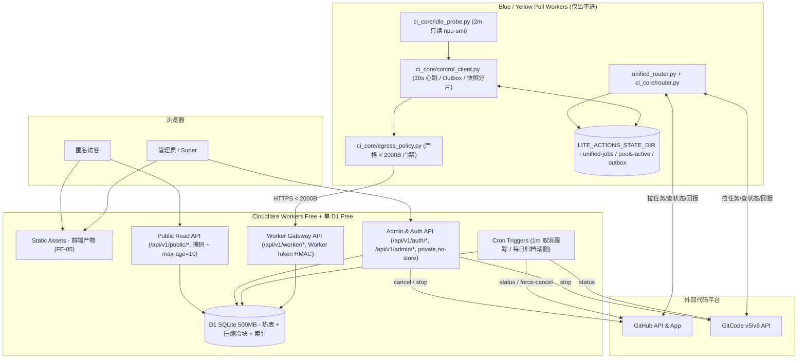

# Lite Actions 调度网站开发详细设计

**v1.1 · 2026-11-19** · 产品需求见 [PRD.md](PRD.md)

> **定位与原则**
> - 本文档面向后端（Cloudflare Worker + D1）、Worker 侧（Python `lite-actions`）及联调测试开发者，按 **需求 ID（`REQ-01` ~ `REQ-14`）** 给出可直接编码落地的方案、文件改动量与验收标准。
> - **前端页面由独立前端 Agent 负责**，在 Todo List 与集成验证中以 `FE-01` ~ `FE-05` 标为外部依赖项（`⏳ 待前端 Agent 标绿`），后端与 Worker 开发及核心联调（`INT-01` ~ `INT-09`）不阻塞于前端。
> - **硬边界**：零新增费用（Cloudflare Workers Free + 单 D1 Free，禁用 R2）；网站故障不影响原 CI 调度与回报；网站不实现第二套选单算法；Worker 只出不进；所有网站上传请求与 Yellow 平台写请求单次整包严格 `< 2,000` 字节（严于 2 KB）。

---

## 1. 落地实施 Todo List（按依赖顺序执行）

> **执行指引**
> 1. 严格按 `Phase 0 → Phase 7` 顺序推进；每完成一个 `REQ-xx`，必须先跑绿该需求对应的 UT 与 Lint，再进入下一项。
> 2. **Phase 0 结束后立即冻结 API 契约**（`control-center/worker/src/types/api.ts` + `control-center/docs/api-contract.md`），即可放行前端 Agent 并行开发 `FE-01` ~ `FE-05`。
> 3. **Phase 1 先立护栏**：`REQ-05`（`tests/test_upload_intercept.py`）完成后，后续所有涉及 Worker 侧的 PR（`REQ-07/08/10/11/13`）都必须把它作为必跑门禁。
> 4. **Phase 7 分两段验证**：Phase 5 完成后即可跑绿无前端依赖的 `INT-01` ~ `INT-09`；待前端 Agent 将 `FE-01` ~ `FE-05` 标绿后，再执行全栈端到端 `INT-10` ~ `INT-12` 与实机上线门槛 `REL-01` ~ `REL-03`。

### Phase 0：控制面工程底座、账号权限与契约冻结
- [x] **`REQ-01` 控制面骨架与 D1 Schema**：初始化 `control-center/worker/`（Wrangler + TypeScript + Vitest/Miniflare）、编写 `migrations/0001_init.sql`、配置 `model_repos.json`（逻辑模型页签映射，默认 `vllm-ascend`）。
  - 依赖：无 ｜ 门禁：`npx wrangler d1 migrations apply DB --local` & `npm test -- schema.test.ts` 全绿
- [x] **`REQ-02` 账号、会话、防爆破与审计**：实现 Super/普通管理员认证、HMAC-SHA256 密钥哈希、密钥仅展示一次、7 天 Cookie 会话、10 分钟 5 次失败锁定 10 分钟、操作审计写入与查询。
  - 依赖：`REQ-01` ｜ 门禁：`npm test -- auth.test.ts` 全绿
- [x] **`REQ-03` 权限矩阵、服务端 IP 掩码与缓存隔离**：实现四类鉴权中间件（公开/管理员/Super/Worker）、服务端 IPv4 中间两段掩码 + 非可逆 `node_ref`、敏感字段过滤、`/api/v1/public/*`（`public, max-age=10`）与 `/api/v1/admin/*`（`private, no-store`）路由分离。
  - 依赖：`REQ-02` ｜ 门禁：`npm test -- access-matrix.test.ts masking.test.ts` 全绿
- [x] **`[里程碑 · 契约冻结]` 交付前后端 API 契约**：冻结 `control-center/worker/src/types/api.ts` 与 `control-center/docs/api-contract.md`。前端工作按当前安排暂停。
  - 依赖：`REQ-01`, `REQ-02`, `REQ-03`

### Phase 1：Worker 通信协议底座与 `< 2KB` 拦截门禁
- [x] **`REQ-04` Worker 控制面客户端与磁盘 Outbox**：新增 `ci_core/control_client.py`；扩展 `ci_core/egress_policy.py` 支持 `provider="control"`（`< 2,000` B + CI 每日额度保底预留钩子）；改造 `unified_router.py` 支持控制线程唤醒（30s 心跳独立于 60s 平台轮询）；实现事件落盘 Outbox、首包完整 + 短 `tid` 增量、分片快照与命令回执。
  - 依赖：`REQ-01`, `REQ-03` ｜ 门禁：`python3 -m unittest tests/test_control_client.py` & 现有全部测试无回归
- [x] **`REQ-05` 全路径上传 `< 2KB` 拦截单测（`upload_intercept` UT）**：新增 `tests/test_upload_intercept.py`，在底层 `urllib`/`http.client` 发送层真实线序拦截所有一次性 `POST`/`PUT`/`PATCH` 请求；覆盖网站全接口（Blue/Yellow）与 Yellow 平台全接口的最大长度边界及拆包；AST + 注册表自检，未登记的新增上传路径直接失败。
  - 依赖：`REQ-04` ｜ 门禁：`python3 -m unittest tests/test_upload_intercept.py -v` & `python3 scripts/lint.py` 全绿

### Phase 2：服务端采集对账、设备巡检、排期估算与看板读接口
- [x] **`REQ-06` 服务端 Worker 接入网关与快照对账**：实现 `/api/v1/worker/{heartbeat,commands,command-receipts,events,snapshots,configs/:rev}`；按 `(worker_id, instance_id, seq)` 去重；缺口自动下发 `need_snapshot: true`；分片快照事务原子对账；90s 离线判定；不导入上线前历史。
  - 依赖：`REQ-03`, `REQ-04` ｜ 门禁：`npm test -- worker-ingest.test.ts` 全绿
- [x] **`REQ-07` 2 分钟只读 `npu-smi` 巡检与设备三态投影**：Worker 侧新增 `ci_core/idle_probe.py`（每 2 分钟只读巡检未租用设备组，绝不杀进程/取锁/触发隔离，变化走事件、稳态由心跳刷新 `idle_ts`）；服务端实现 30 分钟新鲜度三态决策树（占用中/未知占用/已确认空闲）+ 离线/隔离/暂停叠加。
  - 依赖：`REQ-05`, `REQ-06` ｜ 门禁：`python3 -m unittest tests/test_idle_probe.py tests/test_upload_intercept.py` & `npm test -- device-state.test.ts` 全绿
- [x] **`REQ-08` 零额外请求元数据采集、耗时中位数与排期虚线**：Worker 留存已获取响应中的 `pr_author`/`trigger_actor`/`event` 与各阶段时间戳，队列变化时上报 `(pool, kind)` 顺序及候选组索引；服务端维护最近 10 次可靠 `PASS` 样本算中位数，严格按 Worker 顺序贪心投影排期虚线（不写第二套选单算法）。
  - 依赖：`REQ-05`, `REQ-06`, `REQ-07` ｜ 门禁：`python3 -m unittest tests/test_queue_telemetry.py tests/test_upload_intercept.py` & `npm test -- schedule-projection.test.ts` 全绿
- [x] **`REQ-09` 看板读接口（时间轴 / 模型仓 / 50 条分页历史 / 任务详情）**：实现 `/api/v1/{public,admin}/{overview,timeline,models,models/:slug/runs,tasks/:uid}`；多机跨行不重复计卡；零卡探针不占设备行；热冷统一游标分页（50 条/页）。
  - 依赖：`REQ-03`, `REQ-07`, `REQ-08` ｜ 门禁：`npm test -- board-read.test.ts` 全绿

### Phase 3：调度控制能力（取消 Workflow & 插队）
- [x] **`REQ-10` 整次 Workflow 取消（GitHub App + GitCode + Cron）**：实现 `/api/v1/admin/cancellations`、GitHub App Web Crypto RS256 鉴权与 `cancel` / 2 分钟 `force-cancel`、GitCode `/stop`、1 分钟 Cron 跟踪平台终态并关联 Worker 普通事件与清理状态；复核 Worker 侧 `ci_core/router.py` 对两平台取消及旧 attempt 终止逻辑。
  - 依赖：`REQ-02`, `REQ-06`, `REQ-09` ｜ 门禁：`npm test -- cancellations.test.ts` & `python3 -m unittest tests/test_workflow.py tests/test_gitcode_workflow.py` 全绿
- [x] **`REQ-11` 排队用例插队（`MOVE_UP`）与 train 72h 排队超时**：服务端实现 `POST /api/v1/admin/tasks/:uid/move-up` 下发 `MOVE_UP` 命令；Worker 侧在 `ci_core/job_state.py` + `ci_core/router.py` 引入持久化 `queue_rank`（不破坏既有 `admission_seq` 语义）实现相邻换位、队首 `NOOP`、已租约 `CONFLICT` 并立即上报新队序；调整 `train` 排队超时 `3600s → 259200s`（72h）。
  - 依赖：`REQ-05`, `REQ-06`, `REQ-08` ｜ 门禁：`python3 -m unittest tests/test_move_up.py tests/test_smoke_queue.py tests/test_upload_intercept.py` & `npm test -- move-up.test.ts` 全绿

### Phase 4：集群配置唯一发布源与热加载
- [x] **`REQ-12` 集群管理服务端与 `preflight.py` 片段导出**：实现 `pools_configs` 乐观锁版本管理、影响范围预览（`/cluster/preview`）、发布（`/cluster/publish`）与回滚；支持 Pool/Node/DeviceGroup 三级可选 `paused: true`（恢复删键）；有隔离禁删；跨 Worker 先删后加校验；`scripts/preflight.py` 增加 `--export-node-snippet`。
  - 依赖：`REQ-02`, `REQ-06`, `REQ-07` ｜ 门禁：`npm test -- cluster-config.test.ts` & `python3 -m unittest tests/test_preflight_export.py` 全绿
- [x] **`REQ-13` Worker Pools 持久化、实机校验与调度间隙热加载**：改造 `ci_core/config.py`、`ci_core/scheduler.py`、`ci_core/router.py`、`ci_core/executor.py`、`ci_core/ssh_runner.py`、`scripts/reconcile.py`；优先加载 `${LITE_ACTIONS_STATE_DIR}/pools-active.json`；调度间隙原子切换；新增/变更节点实机复核指纹与容器绑定；删除排空取消并回报；**在途任务执行与清理全程使用分配时 `pools_snapshot`**；`paused` 只停新租约不报错失败。
  - 依赖：`REQ-05`, `REQ-12` ｜ 门禁：`python3 -m unittest tests/test_pools_hot_reload.py tests/test_upload_intercept.py` & 全量 `python3 -m unittest discover -s tests` + `python3 scripts/lint.py` 全绿

### Phase 5：单 D1 热冷分层存储与容量自治
- [x] **`REQ-14` 单 D1 热转冷、1 年清理、80%→70% 滚删与写额度降级**：实现每日归档 Cron（满 30 天按 `(logical_model, finish_day)` gzip 压块入 `task_details_cold`，校验后删热表；满 1 年整天清理）、基于 D1 `meta.size_after` 的 80%→70% 最早历史滚删与尾部提示标记、10 万行日写额度耗尽拒绝管理写操作与 Worker 本地暂存补发。
  - 依赖：`REQ-06`, `REQ-09` ｜ 门禁：`npm test -- retention-storage.test.ts` 全绿

### Phase 6：`[外部依赖 · 前端 Agent]` 前端开发与静态集成
> 本阶段由独立前端 Agent 并行实施；后端负责人可在完成 Phase 5 后直接进入 Phase 7.1，待前端各项完成后由项目负责人在此标绿（勾选 `[x]`）。

- [ ] **`FE-01` `[依赖项 · ⏳ 待前端 Agent 标绿]` Pools 时间轴页面**：Worker → Pool → 节点 → 设备组四层纵轴、时间横轴与“现在”标线、实线租约/虚线排期、三态+离线/隔离/暂停叠加、多机跨行不重复计卡、30s 自动刷新。
  - 后端依赖：`REQ-09`（`/api/v1/{public,admin}/timeline`）
- [ ] **`FE-02` `[依赖项 · ⏳ 待前端 Agent 标绿]` 模型仓视图、50 条翻页历史与任务详情**：逻辑模型全页签（默认 `vllm-ascend`，`lite-actions` 普通页签）、按 run 分组、展开节点 `host_id`/设备、活动默认展开 + “展开最近 50 条历史”无限加载 + 容量清理末尾提示、任务详情页/抽屉（不含日志）。
  - 后端依赖：`REQ-09`（`/api/v1/{public,admin}/models*`, `/tasks/:uid`）
- [ ] **`FE-03` `[依赖项 · ⏳ 待前端 Agent 标绿]` 登录态切换、取消 Workflow 与插队交互**：用户名+密钥登录/登出、登录后切换 `/api/v1/admin/*` 显示完整 IP、取消 Workflow 二次确认（核对仓库/run/attempt，未装 App 置灰）与实时停止/释放进度、排队 case 插队按钮（队首置灰、可连续点击）。
  - 后端依赖：`REQ-02`, `REQ-03`, `REQ-10`, `REQ-11`
- [ ] **`FE-04` `[依赖项 · ⏳ 待前端 Agent 标绿]` 集群管理与 Super 用户管理页面**：查看版本与状态、新增（粘贴 `preflight.py` 片段）/暂停/恢复/排空删除前影响范围预览、版本回滚、审计日志列表；Super 专属新建/重置密钥（仅展示一次复制提示）/删除管理员。
  - 依赖：`REQ-02`, `REQ-12`
- [ ] **`FE-05` `[依赖项 · ⏳ 待前端 Agent 标绿]` 前端静态资源接入 Cloudflare Workers Assets**：前端构建产物输出至 `control-center/worker/public/`，实现同源部署与 `HttpOnly; Secure; SameSite=Strict` Cookie 会话打通。
  - 依赖：`REQ-01`, `FE-01` ~ `FE-04`

### Phase 7：最终集成验证与上线门槛签收

#### 7.1 后端 + Worker 全链路集成验证（不依赖前端，Phase 5 后立即可执行）

2026-11-19 在 YCY 隔离环境完成后端回归。27 项后端测试、209 项 Python 测试及 Lint 通过。勾选项由自动化测试和隔离联调共同支撑。运行方式及测试映射见 [后端验收与部署](backend-validation.md)。

- [x] **`INT-01`** 公网匿名读取、IP 掩码、缓存头与四级权限全矩阵验证
  - 权限和凭据回归测试通过，YCY 隔离实例确认公开掩码、缓存头及登录视图。
- [x] **`INT-02`** 双 Worker 心跳、90s 离线、事件去重/缺口检测、分片快照对账与断网 30 分钟恢复验证
  - YCY 双 Worker 在 90 秒阈值后标离线，恢复后补发 20 多条事件，终态只入库一次。序号缺口、去重和快照对账由自动化测试验证。30 分钟负载用积压事件模拟。
- [x] **`INT-03`** 2 分钟只读 `npu-smi` 巡检与设备三态 + 叠加标记集成验证
  - 只读巡检和三态、过期、暂停、隔离、离线叠加由自动化测试验证，YCY 核对了模拟巡检的看板响应。
- [ ] **`INT-04`** 耗时中位数（0 / <10 / ≥10 样本）与排期虚线投影集成验证
  - 0/5/12 样本的中位数规则和排期投影测试通过。待从同一 D1 测试数据集核验排除失败及不可靠样本后的 API 响应。
- [x] **`INT-05`** 全链路上传报文 `< 2,000` 字节门禁验证（`tests/test_upload_intercept.py` + 代理抓包双验证）
  - 最大字段和拆包由真实 HTTP/1.1 序列化测试验证。YCY 的 TLS 代理捕获 84 个请求，含 8 个 Yellow 平台客户端写请求，最长 1,748 字节。
- [ ] **`INT-06`** GitHub & GitCode 整次 Workflow 取消端到端闭环（含原生作业、2 分钟 `force-cancel`、断连网站、清理失败隔离等全部边界）
  - 模拟平台已验证取消、两分钟强制取消、attempt 校验和清理回执。待补齐双平台、双 Worker 在网站断连时的整次取消联调。
- [ ] **`INT-07`** 跨平台排队插队（连续 3 次、队首、冲突、并发、重启保持）与 train 72h 排队超时验证
  - YCY 连续三次插队通过，状态测试覆盖队首、租约冲突、并发和顺位持久化。待用虚拟时钟驱动实际调度循环，确认 71h59m 仍排队、72h01m 回报超时。
- [ ] **`INT-08`** 集群配置热加载全场景（16P 半节点暂停、在途快照隔离、`preflight.py` 新增、删除排空、隔离拒删、单端生效、回滚、重启/自动更新保留）
  - YCY 已验证发布、取令、应用、回执及重启读取。定向测试覆盖半节点暂停、快照隔离、删除门禁和回滚，双 Worker 一端应用失败及完整排空闭环待联调。
- [ ] **`INT-09`** 单 D1 热冷分层（103 条 50/50/3 跨 30 天翻页、第 31 天冷解压、1 年过期、80%→70% 滚删与提示、写额度耗尽降级）
  - D1 冷热分页 50/50/3、一年过期、真实本地水位和管理员 503 已验证。Worker 收到代理 503 后已验证补发，待联调由同一次 D1 配额熔断触发的 Worker 暂存与恢复。

#### 7.2 全栈端到端集成验证（`⏳ 依赖前端 Agent 标绿 FE-01 ~ FE-05`）
- [ ] **`INT-10`** 公开看板全栈浏览器端到端验证（Pools 时间轴 + 模型仓页签 + 30s 刷新 + 零敏感信息泄露）
- [ ] **`INT-11`** 管理员 & Super 全栈浏览器操作闭环验证（登录看完整 IP、取消/插队/集群管理/用户管理与审计）
- [ ] **`INT-12`** 网站宕机 30 分钟故障隔离与恢复对账演练

#### 7.3 生产上线前置实机签收（对应 PRD §12）
- [ ] **`REL-01`** 真实 Yellow 节点访问线上域名完成心跳、取令、拉配置、回执并验证出口策略与每日字节预算
- [ ] **`REL-02`** 已安装 GitHub App 的测试仓与已配置 Token 的 GitCode 测试仓各完成一次含原生作业和 Worker 用例的真实整次取消
- [ ] **`REL-03`** Cloudflare Free + D1 Free 真实线上实例验证水位监控、滚动删除及日写额度耗尽降级

---

## 2. 最终集成验证用例设计（Integration & Release Test Plan）

### 2.1 本地集成验证拓扑

使用 `control-center/tests/integration/` 一键拉起零外部网络依赖的本地闭环环境：
1. **控制面服务**：`wrangler dev --local`（Miniflare 本地 D1，支持通过环境变量覆写 `D1_SOFT_CAP_BYTES`、`D1_DAILY_WRITE_LIMIT`、`FORCE_CANCEL_WAIT_SECONDS`、`HEARTBEAT_OFFLINE_SECONDS` 以加速时间/容量边界用例）。
2. **Mock 平台服务**：本地 HTTP Server 同时模拟 GitHub REST API（含 App JWT/Installation Token、`cancel`/`force-cancel`、commit comments）与 GitCode v5/v8 API（含 `/actions/runs/{id}/stop`）。
3. **双 Worker 进程**：同时启动真实的 `unified_router.py`（`blue` 与 `yellow` 两个独立子进程，隔离的 `LITE_ACTIONS_STATE_DIR`、独立 `worker-id` 与 `pools-active.json`，仅将远端 SSH/NPU 执行替换为可控 Fake Executor）。
4. **HTTP 抓包代理**：透明记录两个 Worker 发出的全部出站 HTTP/1.1 原始请求字节，自动断言包长与脱敏边界。
5. **浏览器 E2E 驱动**（仅 `INT-10` ~ `INT-12`）：Playwright 无头浏览器（匿名 Context + 管理员 Context + Super Context）。

### 2.2 后端 + Worker 集成测试用例（不依赖前端）

| 用例 ID | 名称 | 关联需求 | 依赖 | 前置条件 | 核心执行步骤 | 预期结果与客观断言 |
|---|---|---|---|---|---|---|
| **INT-01** | 公网读取、掩码、缓存与四级权限矩阵 | `REQ-02`, `REQ-03`, `REQ-09` | 无前端依赖 | D1 已写入双区 Pools、活动与历史任务、1 个 Super + 1 个普通管理员账号、2 个 Worker 密钥 | 1. 匿名请求 `/api/v1/public/{overview,timeline,models,tasks/:uid}`。<br>2. 匿名调用集群发布、插队、取消、用户管理、Worker 接口。<br>3. 普通管理员登录，请求 `/api/v1/admin/timeline` 与 `/api/v1/admin/users`。<br>4. Super 登录新建管理员 A（记录一次性密钥）、重置密钥、再删除 A；用旧密钥与旧 Cookie 访问管理接口。<br>5. 用错误密码同用户名+IP 连续登录 5 次，第 6 次用正确密码登录。 | 1. 公开响应状态 200，含 `Cache-Control: public, max-age=10`；全部 IP 为 `X.xxx.xxx.Y:P`，全文扫描不含真实 `host_id`、`node_ip`、`container_id`、Token、密钥、日志行。<br>2. 所有写接口与 Worker 接口均返回 401/403，D1 业务表零变更。<br>3. 管理员读接口返回 `private, no-store` 且含完整 `host_id`；访问 `/users` 返回 403。<br>4. 创建/重置返回密钥仅 1 次，再次查询不回显；重置与删除后旧 Cookie 与旧密钥即刻返回 401，审计表保留记录。<br>5. 第 6 次返回 429 锁定 10 分钟。 |
| **INT-02** | 双 Worker 心跳、90s 离线、事件去重与断网 30 分钟对账 | `REQ-04`, `REQ-06` | 无前端依赖 | Blue/Yellow 均已连接控制面；模拟状态目录内存在上线前已 `REPORTED` 的历史记录 5 条及 1 条 `RUNNING` 任务 | 1. 启动双 Worker 首次连接，检查 D1 任务记录。<br>2. 正常推进 1 个任务 `QUEUED→RESERVED→STAGING→RUNNING→CLEANING→PASS`，重放同一批事件。<br>3. 人工丢弃序号 `seq=15`，发送 `seq=16`。<br>4. 断开 Blue 到控制面的网络，保持 95 秒以上（模拟 30 分钟断网期间持续产生 20 条状态变化），随后恢复网络。 | 1. 5 条历史不导入；仅 1 条活动任务入库且标记 `timing_reliable=0`。<br>2. 事件按 `(worker_id, instance_id, seq)` 幂等去重，阶段流转无重复行。<br>3. 服务端在回包置 `need_snapshot=true`，Worker 自动分片上报快照并补齐状态。<br>4. 90s 后 Blue 标为 `offline=true`；断网期间事件落盘不丢、不阻塞平台回报；恢复后按序补发或快照对账，最终状态 100% 一致且零重复。 |
| **INT-03** | 2 分钟只读巡检与设备组三态叠加 | `REQ-07` | 无前端依赖 | Blue 16P 节点（`0-7`、`8-15` 两组），巡检周期测试覆写为 2s、新鲜度 10s | 1. 初始无巡检结果查看 `0-7`、`8-15`。<br>2. Mock `npu-smi` 返回 `0-7` 有外部 PID、`8-15` 无进程，触发巡检。<br>3. 调度 1 个 8P 任务占 `8-15`，再结束释放。<br>4. 停止巡检等待超过新鲜度窗口。<br>5. 叠加模拟 `8-15` 隔离、`0-7` 暂停、Worker 离线。 | 1. 初始两组均为 `UNKNOWN_BUSY`（未知占用）。<br>2. `0-7` 仍为 `UNKNOWN_BUSY`（响应不含外部 PID/用户名，且未向节点发任何 kill 或取锁）；`8-15` 变为 `CONFIRMED_IDLE`。<br>3. 占卡期间显示对应 case，释放后回到新鲜空闲状态。<br>4. 超时未刷新退回 `UNKNOWN_BUSY`。<br>5. 离线、隔离、暂停作为独立标记叠加返回并带 `updated_at`。 |
| **INT-04** | 耗时中位数（0/<10/≥10）与排期虚线投影 | `REQ-08`, `REQ-09` | 无前端依赖 | 同一 `(model, test_id, pool, 1x8P)` 分别准备 0 次、5 次、12 次可靠 `PASS` 样本（以及 1 次 `timing_reliable=0` 样本和 2 次 `FAIL` 样本） | 1. 查询 0 / 5 / 12 样本下的预计时长与样本数。<br>2. 构造运行中任务耗时超过中位数。<br>3. 构造同一队列 3 个排队 case：`A`（有估算）、`B`（0 样本无估算）、`C`（有估算）。<br>4. 构造排队 case `D` 仅能落入 `UNKNOWN_BUSY` 设备组。 | 1. 0 样本返回 `NO_ESTIMATE (samples=0)`；5 样本取 5 条中位数 (`samples=5`)；12 样本仅取最近 10 条可靠 `PASS` 中位数 (`samples=10`，排除 `FAIL` 与 `timing_reliable=0`)。<br>2. 运行超时返回 `eta_status="EXCEEDED"`。<br>3. `A` 正常生成虚线区间；`B` 与队列中位于 `B` 之后的 `C` 均标记 `NO_ESTIMATE`。<br>4. `D` 标记 `WAITING_EXTERNAL`。 |
| **INT-05** | 全链路上传报文 `< 2,000` 字节门禁 | `REQ-04`, `REQ-05` | 无前端依赖 | 启动抓包代理拦截双 Worker 全部出站 HTTP 流量 | 1. 运行 `python3 -m unittest tests/test_upload_intercept.py -v`。<br>2. 在集成环境中跑完双 Worker 最大长度字段任务（128B run_id/dispatch_id、89B case_id、115B label）、50 条积压事件、50 个排队任务长队列及大快照对账，收集抓包代理记录的全部请求。 | 1. `test_upload_intercept.py` 全部用例绿灯，AST 路径自检通过。<br>2. 抓包代理中全部发往 `/api/v1/worker/*` 的请求（Blue & Yellow）以及全部 Yellow 发往 GitHub/GitCode 的写请求，**真实 HTTP/1.1 线序总字节数 100% 严格 `< 2,000` B**，零超限、零截断丢失。 |
| **INT-06** | GitHub & GitCode 整次 Workflow 取消闭环 | `REQ-10` | 无前端依赖 | GitHub 与 GitCode 各建 1 个含原生作业、Blue 排队/在途、Yellow 排队/在途的 run | 1. 管理员对 GitHub run 发起取消并重复点击第 2 次；其中 1 个 GitHub 原生作业模拟 `if: always()` 2 分钟不结束。<br>2. 对 GitCode run 发起取消。<br>3. 验证边界场景：① 取消后才晚发现的 case；② 平台已切至 attempt=2 时尝试取消 attempt=1；③ 断开 Worker 与控制面连接但保留平台连通；④ 模拟某在途 case 清理失败；⑤ 模拟平台取消接口返回 500 / 未安装 App。 | 1. 重复点击返回同一 `cancel_id`；GitHub 先调 `/cancel`，超 2 分钟 Cron 自动调 `/force-cancel`；两区所有排队与在途 case 在 1–2 分钟内停下并释放设备、回报 `CANCELLED`，已结束 case 保留原结果。<br>2. GitCode 调 `/stop`，两区 case 同步停下并回报。<br>3. ① 晚发现 run 因非活动态被拒绝入队；② 旧 attempt 取消被拒并说明原因；③ Worker 仅靠平台轮询仍停机释放，重连后补发事件；④ 清理未确认的设备进隔离不可再调度；⑤ 平台报错时取消单记录失败原因且任务继续跑；未安装 App 仓返回 `cancel_supported=false`。 |
| **INT-07** | 跨平台排队插队与 train 72h 排队超时 | `REQ-11` | 无前端依赖 | 同一 `(a3_shared_blue, npu_smoke)` 队列排入 4 个 case（混含 GitHub 与 GitCode）：`[C1, C2, C3, C4]`，设备暂满；另排 1 个 `train` case 与 1 个 `npu_smoke` case | 1. 管理员对 `C4`（GitCode case）连续发起 3 次 `move-up`。<br>2. 此时 `C4` 在队首，再发起 1 次 `move-up`。<br>3. 对已进入 `RESERVED/RUNNING` 的任务发起 `move-up`。<br>4. 两个管理员并发对 `C3`、`C2` 发起 `move-up`。<br>5. 重启 Blue Worker 后检查队列顺序。<br>6. 虚拟时钟推进 71h59m 与 72h01m，检查 `train` 与 `npu_smoke` 排队超时。 | 1. 3 次回执均为 `APPLIED`，顺位依次变为 `[C1,C2,C4,C3] → [C1,C4,C2,C3] → [C4,C1,C2,C3]`，且实时推送新队序更新排期。<br>2. 队首插队回执 `NOOP`。<br>3. 已拿租约回执 `CONFLICT`。<br>4. 并发命令按服务端命令序号串行处理，无状态损坏。<br>5. 重启后 `queue_rank` 完整保留。<br>6. `train` 71h59m 仍排队，72h01m 以 `RESOURCE_TIMEOUT` 结束；`npu_smoke` 超 72h 仍保持排队。 |
| **INT-08** | 集群配置热加载、半节点暂停、新增、排空删除与回滚 | `REQ-12`, `REQ-13` | 无前端依赖 | `a3_shared_blue` 含 16P 节点 `:153`（`0-7`, `8-15`）与 `:154`（`0-7`, `8-15`）及跨机 16P 组合；`:153` 的 `0-7` 上有 1 个在途任务 `T_run` | 1. 管理员预览并发布暂停 `:153` 的 `0-7`（写 `paused: true`），下发 8P 与 16P 排队任务。<br>2. 恢复 `0-7`（验证配置 JSON 中不含 `paused` 字段而非 `false`）。<br>3. 运行 `preflight.py --export-node-snippet` 生成新节点 JSON，预览查重并发布；验证实机指纹不匹配时 Worker 拒绝且保持旧版。<br>4. 对含隔离任务的节点发起删除。<br>5. 对无隔离且含唯一候选排队 case 与在途任务的节点预览并确认删除排空。<br>6. 模拟双 Worker 发布，仅 Blue 成功、Yellow 失败。<br>7. 回滚到历史版本；随后重启 Blue 并模拟 `auto_update` 切换代码目录。 | 1. 暂停生效后 `T_run` 用旧配置快照跑完并正常清理；含 `:153 0-7` 的单机/跨机组合不再发新租约，`:153 8-15` 正常调度，受阻任务保持 `QUEUED` 不报失败。<br>2. 恢复后 JSON 无 `paused` 键，原有隔离状态不被解除。<br>3. 指纹合法节点实机校验通过生效；不匹配节点被拒并回执原因。<br>4. 隔离节点在预览和 Worker 双重拒绝删除。<br>5. 唯一依赖被删资源的排队 case 以 `CANCELLED` 结束并回报平台，活动租约等跑完，历史记录节点身份保留。<br>6. 页面准确显示 Blue `applied=N`、Yellow `applied=N-1` + 失败原因。<br>7. 回滚生成 `revision N+1` 生效；重启与代码切目录后仍加载 `pools-active.json` 而非仓库旧 `pools.json`。 |
| **INT-09** | 单 D1 热冷分层、跨 30 天分页、80%→70% 滚删与写额度降级 | `REQ-14`, `REQ-09` | 无前端依赖 | D1 注入 103 条已完成记录（含 60 条 0–30 天热数据、43 条 31–360 天数据）+ 5 条满 366 天记录 + 2 条活动任务 + 审计/账号数据；测试环境设定容量上限触发阈值 | 1. 运行每日归档 Cron，检查热表、冷表及满 1 年记录。<br>2. 调用历史列表接口连续翻页 3 次（每次 50 条）并打开第 31 天任务的详情接口。<br>3. 写入批量已完成记录推高 `size_after > 80%`，触发滚动清理。<br>4. 模拟 D1 日写额度耗尽，执行管理写操作并让 Worker 上报新事件。 | 1. 31–360 天记录已压缩迁入 `task_details_cold` 且校验通过后从热表删除；5 条满 1 年记录已清除。<br>2. 3 页分别返回 50 / 50 / 3 条，按 `(finished_at DESC, task_id DESC)` 严格有序、无重无漏；第 31 天任务详情自动解压冷块返回完整元数据。<br>3. 最早结束记录（摘要+索引+明细）被删至 `< 70%`；活动任务、未终态命令/取消单、账号、审计零丢失；翻到底返回 `truncated_by_capacity=true`。<br>4. 管理写接口返回 503 拒绝；Worker 事件留存本地 Outbox，CI 照常执行回报，额度恢复后事件补发成功。 |

### 2.3 全栈端到端集成测试用例（`⏳ 依赖前端 Agent 标绿 FE-01 ~ FE-05`）

| 用例 ID | 名称 | 关联需求 | 前端依赖 | 核心执行步骤 | 预期结果与客观断言 |
|---|---|---|---|---|---|
| **INT-10** | 公开看板全栈浏览器验证 | `REQ-03`, `REQ-09` | `FE-01`, `FE-02`, `FE-05` | 1. 匿名浏览器打开站点首页。<br>2. 检查模型仓页签列表与默认选中项。<br>3. 对照 Pools 时间轴与模型仓视图中同一运行中多机 16P 任务及 0 卡探针任务。<br>4. 展开历史列表翻阅 103 条记录至末尾并打开第 31 天详情。<br>5. 观察 30s 自动刷新与 Network 面板。 | 1. 无需登录直达看板；所有节点 IP 显示 `X.xxx.xxx.Y:P`。<br>2. 全部已配置模型仓均有页签（含无任务仓），默认选中 `vllm-ascend`，`lite-actions` 无特殊分类；跨平台 `torchtitan-npu` 合并一页签且每条保留平台与完整仓名。<br>3. 时间轴与模型仓展示的租约节点/设备一致；16P 跨行不重复计卡；零卡探针不占设备行。<br>4. 历史按 50/50/3 翻页，末尾显示容量清理提示，第 31 天详情不含任何日志，平台链接可跳转。<br>5. 30s 自动刷新生效，所有公开响应不含任何凭据或完整 IP。 |
| **INT-11** | 管理员与 Super 全栈操作闭环 | `REQ-02`, `REQ-10`, `REQ-11`, `REQ-12` | `FE-03`, `FE-04`, `FE-05` | 1. 普通管理员登录，验证完整 `host_id` 展示及无用户管理入口。<br>2. 在模型仓页签执行“取消 Workflow”二次确认、“插队”连续点击 3 次及队首置灰。<br>3. 在集群管理页执行：暂停 16P 半节点（确认影响预览）→ 恢复 → 粘贴 `preflight.py` 片段新增节点 → 排空删除 → 回滚 → 查看操作审计。<br>4. 切换 Super 登录，新建管理员（复制一次性密钥）→ 重置密钥 → 删除管理员。 | 1. 登录态同源 Cookie 生效，完整 IP 可见；普通管理员访问用户管理被拦。<br>2. 取消进度实时展示平台结论 + 两区各 case 停机与设备释放；未安装 App 的仓取消按钮置灰；插队 3 次顺位与排期虚线实时刷新。<br>3. 集群操作均有影响范围预览弹窗，版本与两区生效状态准确展示，审计表完整记录操作人/目标/时间/结果。<br>4. Super 密钥生成与重置仅弹窗展示一次，刷新不可再查；删号后被删管理员标签页下一次请求立即掉登录态。 |
| **INT-12** | 网站宕机故障隔离与恢复演练 | `REQ-04`, `REQ-06` | `FE-05` | 1. 模拟控制面 Worker 停止服务 30 分钟。<br>2. 期间向 GitHub/GitCode 触发新 CI run，观察 Blue/Yellow 本地日志与平台回报。<br>3. 重启控制面 Worker，观察 2 分钟内双 Worker 自动恢复与页面展示。 | 1. 控制面不可用期间，Blue/Yellow 照常拉取任务、本地调度执行并向平台回报 `PASS`，零异常退出。<br>2. 控制面恢复后，Worker 自动补发或分片快照对账，页面在 1–2 个心跳周期内完全恢复一致。 |

### 2.4 生产上线前置实机签收（对应 PRD §12）

| 签收 ID | 验收目标 | 实机执行方式 | 通过门槛 |
|---|---|---|---|
| **REL-01** | 真实 Yellow 出口连通与预算达标 | 在真实 Yellow 主机配置线上 `workers.dev`（或最终批准域名）并执行心跳、取令、拉配置、回执与事件上报 | 全部请求通过真实 Yellow 出口放行，`http-egress.json` 中 `sent_violations=0`、`max_request_bytes < 2000`，符合待定 1 出口预算策略。 |
| **REL-02** | 双平台真实整次取消 | 在已安装公开 GitHub App 的测试仓与已配置专用 Token 的 GitCode 测试仓，各触发 1 次含原生作业 + Blue/Yellow 用例的 run 并通过网站点击取消 | 两平台原生作业与双区排队/在途 case 均在 2 分钟内停下并释放设备，平台结论与网站取消单完全一致。 |
| **REL-03** | Cloudflare 免费套餐容量与配额实测 | 在真实 Cloudflare Workers Free + D1 Free 实例（测试 D1 库）压测水位阈值（通过测试配置缩小上限）与日写额度行为 | 实测 `meta.size_after` 准确触发 80%→70% 滚删且 10ms CPU 不超限；确认不产生任何额外计费项。 |

---

## 3. 系统总体架构、目录规划与需求 ID 总览

### 3.1 逻辑架构与请求边界



### 3.2 代码目录规划

```text
lite-actions/
├── unified_router.py                  # [修改] 启动 ControlClient、支持事件唤醒调度循环
├── ci_core/
│   ├── config.py                      # [修改] 支持 pools-active.json 优先加载、paused 校验
│   ├── egress_policy.py               # [修改] 支持 provider="control"、<2000B 门禁、CI 额度保底钩子
│   ├── scheduler.py                   # [修改] candidates() 支持 paused 过滤与 include_paused 参数
│   ├── job_state.py                   # [修改] 持久化 queue_rank、原子 move_up()、阶段时间戳
│   ├── router.py                      # [修改] 接入事件钩子、命令消费、队列上报、热加载、72h 超时
│   ├── executor.py                    # [修改] 执行与清理使用分配时 pools_snapshot
│   ├── ssh_runner.py                  # [修改] 使用 runtime-case 内嵌 pools_snapshot
│   ├── github_source.py               # [修改] 留存已获取的 pr_author 等展示元数据（零额外请求）
│   ├── gitcode.py                     # [修改] 留存已获取的 pr_author 等展示元数据（零额外请求）
│   ├── control_client.py              # [新增] 30s 心跳、磁盘 Outbox、分包/分片快照、命令拉取回执
│   └── idle_probe.py                  # [新增] 2 分钟只读 npu-smi 空闲巡检器
├── scripts/
│   ├── preflight.py                   # [修改] 新增 --export-node-snippet 输出标准新增节点 JSON
│   └── reconcile.py                   # [修改] 兼容 pools_snapshot 与 pools-active.json
├── tests/
│   ├── test_upload_intercept.py       # [新增] upload_intercept UT：全路径一次性上传 < 2000B 门禁
│   ├── test_control_client.py         # [新增] ControlClient / Outbox / 分片快照 / 断网恢复单测
│   ├── test_idle_probe.py             # [新增] 2 分钟只读巡检单测
│   ├── test_queue_telemetry.py        # [新增] 队列顺位、候选组索引与元数据零额外调用单测
│   ├── test_move_up.py                # [新增] 插队与 train 72h 超时单测
│   ├── test_preflight_export.py       # [新增] preflight 节点片段导出单测
│   └── test_pools_hot_reload.py       # [新增] 三级暂停、实机校验、在途快照与热加载单测
└── control-center/
    ├── docs/
    │   ├── PRD.md                     # 产品需求文档
    │   ├── DESIGN.md                  # 本开发详细设计文档
    │   └── api-contract.md            # [新增] 前后端共享 REST API 契约文档
    ├── worker/                        # [新增] Cloudflare Workers + D1 服务端工程 (TypeScript)
    │   ├── wrangler.toml
    │   ├── package.json
    │   ├── tsconfig.json
    │   ├── config/model_repos.json    # 逻辑模型页签与平台仓库映射
    │   ├── migrations/0001_init.sql   # 单 D1 完整表结构与索引
    │   ├── src/
    │   │   ├── index.ts               # Fetch + Scheduled(Cron) 入口
    │   │   ├── router.ts              # 轻量路由分发
    │   │   ├── types/api.ts           # 前后端共享类型定义
    │   │   ├── middleware/            # auth / access / cache / quota / audit
    │   │   ├── services/              # ingest / deviceState / schedule / cancel / cluster / retention
    │   │   ├── routes/                # public / auth / admin / worker 路由组
    │   │   └── utils/                 # crypto(HMAC/RS256) / mask / gzip / validation
    │   └── tests/                     # Vitest + Miniflare 单元测试套件
    ├── web/                           # [外部依赖 · 前端 Agent] 前端 SPA 工程
    └── tests/integration/             # [新增] 本地双 Worker + Mock 平台 + Miniflare 集成测试夹具
```

### 3.3 需求 ID 总览与改动量估算

| 需求 ID | 模块 / 功能点 | 对应 PRD 章节 | 归属 | 涉及文件数 | 预计净改动量（含 UT） | 所属阶段 |
|---|---|---|---|---:|---:|---|
| **REQ-01** | 控制面骨架、单 D1 Schema 与逻辑模型仓映射 | §1, §2, §3, §6 | 服务端 | 10 新增 | ~800 行 | Phase 0 |
| **REQ-02** | 账号体系、会话 Cookie、防爆破与操作审计 | §1, §3, §10 | 服务端 | 6 新增 + 1 修改 | ~740 行 | Phase 0 |
| **REQ-03** | 权限矩阵、服务端 IP 掩码、脱敏过滤与缓存隔离 | §1, §2, §3 | 服务端 | 5 新增 + 2 修改 | ~570 行 | Phase 0 |
| **REQ-04** | Worker 控制面客户端、磁盘 Outbox 与小报文协议 | §1, §2, §5 | Worker | 2 新增 + 4 修改 | ~1,050 行 | Phase 1 |
| **REQ-05** | `upload_intercept` UT：全路径一次性上传 `< 2KB` 门禁 | §1, §5, §11 | Worker/QA | 1 新增 | ~460 行 | Phase 1 |
| **REQ-06** | 服务端 Worker 接入网关、事件去重、缺口检测与快照对账 | §5, §11 | 服务端 | 4 新增 + 1 修改 | ~900 行 | Phase 2 |
| **REQ-07** | 2 分钟只读 `npu-smi` 巡检与设备组三态叠加投影 | §1, §4.1 | Worker + 服务端 | 4 新增 + 2 修改 | ~660 行 | Phase 2 |
| **REQ-08** | 零额外请求元数据、耗时中位数（10 次 PASS）与排期虚线 | §1, §4.2, §4.3, §5 | Worker + 服务端 | 4 新增 + 4 修改 | ~890 行 | Phase 2 |
| **REQ-09** | 公开/登录看板读接口（时间轴/模型仓/50 条分页/任务详情） | §1, §3, §11 | 服务端 | 5 新增 + 1 修改 | ~970 行 | Phase 2 |
| **REQ-10** | 整次 Workflow 取消（GitHub App / force-cancel + GitCode + Cron） | §1, §7, §11 | 服务端 + Worker 复核 | 4 新增 + 2 修改 | ~965 行 | Phase 3 |
| **REQ-11** | 排队用例插队（`MOVE_UP`）与 train 72h 排队超时 | §1, §8, §11 | 服务端 + Worker | 3 新增 + 3 修改 | ~645 行 | Phase 3 |
| **REQ-12** | 集群管理服务端、三级暂停、排空删除与 `preflight.py` 导出 | §1, §9, §11 | 服务端 + 脚本 | 5 新增 + 2 修改 | ~1,130 行 | Phase 4 |
| **REQ-13** | Worker Pools 持久化、实机校验与调度间隙热加载 | §9, §11 | Worker | 1 新增 + 6 修改 | ~790 行 | Phase 4 |
| **REQ-14** | 单 D1 热转冷（30d）、1 年清理、80%→70% 滚删与写额度降级 | §1, §6, §11 | 服务端 | 4 新增 + 3 修改 | ~820 行 | Phase 5 |
| **INT-01~12** | 集成测试夹具与全链路自动化回归脚本 | §11, §12 | 联调/QA | 6 新增 | ~1,100 行 | Phase 7 |
| **FE-01~05** | 前端页面与 Cloudflare Static Assets 集成 | §3, §7–§10 | **外部依赖（前端 Agent）** | 前端独立估算 | 前端独立估算 | Phase 6 |
| **合计（不含前端）** | — | — | — | **64 新增 / 31 修改次（去重约 16 存量文件）** | **~12,490 行（代码 ~8.0k + 测试 ~4.5k）** | — |

---

## 4. 按需求 ID 顺序的详细设计

---

### REQ-01：控制面工程底座、单 D1 Schema 与逻辑模型仓映射

- **对应 PRD**：§1（存储/费用/刷新）、§2（边界）、§3（模型仓页签映射）、§6（单 D1 存储）

#### 1. 详细技术方案

1. **托管与零费用配置（`control-center/worker/wrangler.toml`）**
   - 仅绑定 1 个 D1 数据库（`DB`）与 Static Assets（`directory = "./public"`）；**严禁配置 R2、KV、Durable Objects、Queues 等可能产生超额费用的绑定**。
   - Cron Triggers 配置两条免费定时任务：
     - `* * * * *`（每分钟）：执行活跃取消单状态轮询与 GitHub 2 分钟 `force-cancel` 检查（无活跃取消单时仅 1 次空索引读，0 写入）。
     - `0 2 * * *`（每日 UTC 02:00）：执行满 30 天热转冷归档、满 1 年清理与容量水位巡检。
   - Secrets 清单（通过 `wrangler secret put` 注入，绝不进代码库）：`SUPER_SECRET`、`KEY_PEPPER`、`WORKER_BLUE_KEY_HASH`、`WORKER_YELLOW_KEY_HASH`、`GITHUB_APP_ID`、`GITHUB_APP_PRIVATE_KEY`（PKCS#8）、`GITCODE_CANCEL_TOKEN`。

2. **逻辑模型仓映射配置（`control-center/worker/config/model_repos.json`）**
   ```json
   {
     "default_model": "vllm-ascend",
     "models": [
       {
         "slug": "vllm-ascend",
         "display_name": "vLLM Ascend",
         "repos": [
           { "provider": "github", "repo": "cann-framework/vllm-ascend" }
         ]
       },
       {
         "slug": "torchtitan-npu",
         "display_name": "TorchTitan NPU",
         "repos": [
           { "provider": "github", "repo": "cann-framework/torchtitan-npu" },
           { "provider": "gitcode", "repo": "cann/torchtitan-npu" },
           { "provider": "gitcode", "repo": "depeng1994/torchtitan-npu" }
         ]
       },
       {
         "slug": "lite-actions",
         "display_name": "Lite Actions",
         "repos": [
           { "provider": "github", "repo": "depeng1994/lite-actions" }
         ]
       }
     ]
   }
   ```
   - 所有配置的模型无条件生成页签；未映射的新接入仓自动兜底按 `repo.split('/')[1]` 归入动态页签并保留原 `(provider, repo)`。

3. **单 D1 数据库核心表结构（`migrations/0001_init.sql`）**
   - `workers(worker_id PK, instance_id, applied_rev, code_sha, health_ok, active_count, queued_count, last_heartbeat_at, last_idle_probe_at, last_egress_used, need_snapshot, updated_at)`
   - `worker_ingest_state(worker_id PK, instance_id, last_seq, updated_at)`：用于事件连续性校验与去重。
   - `worker_event_dedup(worker_id, instance_id, seq, received_at, PK(worker_id, instance_id, seq))`：按 7 天滑动清理，保证重放绝对幂等。
   - `snapshot_staging(worker_id, snap_id, part_no, total_parts, payload_json, created_at, PK(worker_id, snap_id, part_no))`：分片快照暂存表。
   - `pools_configs(revision PK AUTOINCREMENT, sha256 UNIQUE, config_json, diff_summary_json, created_by, created_at, rollback_from_rev)`：Pools 不可变版本表；初始化时从仓库 `config/pools.json` 导入 `revision = 1`。
   - `device_group_states(worker_id, pool_name, host_id, devices_json, occupancy_state, probe_at, quarantined, quarantine_task_uid, updated_at, PK(worker_id, pool_name, host_id, devices_json))`：设备组非租约巡检态与隔离态。
   - `tasks_active(task_uid PK, short_tid UNIQUE, worker_id, provider, repo, logical_model, run_id, attempt, dispatch_id, case_id, test_id, label, kind, target_pool, req_nodes, req_devices, pr_number, pr_author, trigger_actor, event_type, workflow_file, phase, allocation_json, queued_at, reserved_at, staging_at, running_at, cleaning_at, timing_reliable, updated_at)`：当前非终态任务表（永不参与容量滚删）。
   - `task_index(task_uid PK, finished_at NOT NULL, id_seq INTEGER, worker_id, provider, repo, logical_model, run_id, attempt, dispatch_id, case_id, test_id, label, kind, target_pool, req_nodes, req_devices, actual_allocation_json, pr_number, pr_author, trigger_actor, event_type, workflow_file, status, exit_code, cleanup_verified, duration_sec, timing_reliable, storage_tier, cold_chunk_id)`：热冷统一分页索引，建复合索引 `idx_task_index_model_page(logical_model, finished_at DESC, task_uid DESC)` 与 `idx_task_index_purge(finished_at ASC, task_uid ASC)` 与 `idx_task_index_run(provider, repo, run_id, attempt)`。
   - `task_details_hot(task_uid PK, finished_at, detail_json)`：30 天内已完成任务完整阶段耗时明细（不含日志）。
   - `task_details_cold(chunk_id PK, logical_model, finish_day, min_finished_at, max_finished_at, record_count, sha256, gzip_blob BLOB, raw_bytes, compressed_bytes, created_at)`：31 天–1 年按 `(logical_model, finish_day)` gzip 压缩块。
   - `queue_orders(worker_id, pool_name, kind, task_uid, queue_pos, candidate_group_idxs_json, queue_ver, updated_at, PK(worker_id, pool_name, kind, task_uid))`：Worker 上报的权威排队顺序与候选组索引。
   - `duration_samples(id PK AUTOINCREMENT, logical_model, test_id, target_pool, req_nodes, req_devices, duration_sec, finished_at, task_uid UNIQUE)`：建索引 `(logical_model, test_id, target_pool, req_nodes, req_devices, finished_at DESC)`，每次仅取前 10 条计算中位数。
   - `commands(cmd_id PK, worker_id, cmd_type, payload_json, status, created_by, created_at, acked_at, finished_at, result_json, error_msg)`：`status IN ('PENDING','ACKED','APPLIED','NOOP','CONFLICT','FAILED','EXPIRED')`。
   - `cancellations(cancel_id PK, provider, repo, run_id, attempt, status, requested_by, created_at, submitted_at, force_cancel_sent_at, platform_conclusion, platform_error, updated_at, UNIQUE(provider, repo, run_id, attempt))`。
   - `users(user_id PK, username UNIQUE, role, key_hash, created_at, updated_at, deleted_at)`：`role IN ('admin')`（Super 由 Secret 验证）。
   - `sessions(session_id PK, principal_type, user_id, username, role, created_at, expires_at, revoked_at)`。
   - `login_attempts(bucket_key PK, fail_count, window_start_at, locked_until)`：`bucket_key = sha256(username + '|' + ip)`。
   - `audit_logs(audit_id PK AUTOINCREMENT, actor_username, actor_role, action, target_type, target_id, summary_json, result, error_msg, ip_hash, created_at)`。
   - `system_meta(meta_key PK, meta_value, updated_at)`：保存 `capacity_purged_before_ts`、`last_db_size_bytes`、`quota_exhausted_day` 等全局状态。

#### 2. 改动文件与预计改动量

| 文件路径 | 操作 | 核心内容 | 预计改动量 |
|---|---|---|---:|
| `control-center/worker/package.json` | 新增 | 依赖（`wrangler`, `typescript`, `vitest`, `@cloudflare/vitest-pool-workers`）与脚本 | +45 行 |
| `control-center/worker/tsconfig.json` | 新增 | Strict TS 配置 | +25 行 |
| `control-center/worker/wrangler.toml` | 新增 | Workers Free + 单 D1 + Cron + Assets 配置（无付费绑定） | +40 行 |
| `control-center/worker/config/model_repos.json` | 新增 | 逻辑模型仓映射与默认页签配置 | +35 行 |
| `control-center/worker/migrations/0001_init.sql` | 新增 | 18 张表 DDL 及核心索引 | +260 行 |
| `control-center/worker/src/index.ts` | 新增 | Fetch / Scheduled 入口框架 | +65 行 |
| `control-center/worker/src/router.ts` | 新增 | 轻量零依赖路径参数路由器 | +85 行 |
| `control-center/worker/src/types/api.ts` | 新增 | 前后端共享核心 DTO / Enum 类型（阶段 0 冻结） | +110 行 |
| `control-center/worker/src/utils/modelMap.ts` | 新增 | 仓库→逻辑模型解析、页签列表构造 | +55 行 |
| `control-center/worker/tests/schema.test.ts` | 新增 | 迁移执行、约束索引与模型映射单测 | +80 行 |
| **小计** | **10 新增** | — | **~800 行** |

#### 3. 验收标准
- `npx wrangler d1 migrations apply DB --local` 零报错完成 18 张表创建。
- `npm test -- schema.test.ts` 通过：验证 `cann-framework/torchtitan-npu` 与 `cann/torchtitan-npu` 归入同一 `torchtitan-npu` 页签、默认选中 `vllm-ascend`、`lite-actions` 为普通页签、`wrangler.toml` 不含 R2/KV 付费绑定。

---

### REQ-02：账号体系、会话管理、防爆破与操作审计

- **对应 PRD**：§1（账号）、§3（身份与审计）、§10（账号全流程）

#### 1. 详细技术方案

1. **密钥与哈希（Web Crypto API，CPU 耗时 < 0.2ms）**
   - 管理员密钥：后端使用 `crypto.getRandomValues(new Uint8Array(32))` 生成 32 字节随机串，编码为 base64url（43 字符）并带前缀 `la_adm_`；**仅在创建或重置接口响应中返回一次**，绝不落盘明文、不进日志。
   - 哈希存储：`HMAC-SHA256(key = env.KEY_PEPPER, msg = raw_secret)`，登录校验使用恒定时间比对（`crypto.subtle.timingSafeEqual`）。
   - Super 登录：用户名固定为 `super`（或环境变量 `SUPER_USERNAME`，默认 `super`），密钥直接与 `env.SUPER_SECRET` 做 HMAC 后恒定时间比对；不存库。
2. **登录与会话 Cookie**
   - `POST /api/v1/auth/login`：`{ username, secret }` → 校验防爆破桶 → 验密 → 写入 `sessions`（`expires_at = now + 7 * 86400`）→ 下发 `Set-Cookie: la_session=<session_id>; Path=/; HttpOnly; Secure; SameSite=Strict; Max-Age=604800`（本地 HTTP 开发可通过 `DEV_INSECURE_COOKIE=1` 豁免 `Secure`）。
   - `POST /api/v1/auth/logout`：将 `sessions.revoked_at = now` 并清除 Cookie。
   - `GET /api/v1/auth/me`：始终返回 `Cache-Control: private, no-store`，返回 `{ authenticated, username?, role? }`。
3. **防爆破限流**
   - 以 `bucket_key = sha256(username.toLowerCase() + '|' + client_ip)`（`CF-Connecting-IP`）查 `login_attempts`：
     - 若 `locked_until > now`：直接返回 `429 Too Many Requests` + `Retry-After`（不泄漏账号是否存在）。
     - 登录失败：若 `now - window_start_at > 600` 则重置窗口 `fail_count = 1`；否则 `fail_count += 1`，达到 `5` 次时置 `locked_until = now + 600`。
     - 登录成功：清除该桶失败计数。
4. **Super 用户管理接口（`/api/v1/admin/users*`，仅 `role === 'super'`）**
   - `GET /api/v1/admin/users`：列出所有未删除普通管理员（`user_id, username, created_at, updated_at`，永不返回 `key_hash` 或密钥）。
   - `POST /api/v1/admin/users`：`{ username }`（正则 `^[a-zA-Z0-9._-]{3,32}$`，禁重名、禁 `super`）→ 生成新密钥、入库、记审计 → 返回 `{ user_id, username, secret_once }`。
   - `POST /api/v1/admin/users/:userId/reset-key`：事务内更新 `key_hash` + 撤销该用户全部 `sessions`（`revoked_at = now`）+ 记审计 → 返回 `{ user_id, username, secret_once }`。
   - `DELETE /api/v1/admin/users/:userId`：事务内软删 `users.deleted_at = now`（保留外键与历史关联）+ 撤销该用户全部 `sessions` + 记审计；审计记录永久保留。
5. **操作审计基础设施**
   - 提供统一 `writeAudit(db, ctx, { action, target_type, target_id, summary, result, error_msg })` 供所有管理写接口（账号管理、取消、插队、集群发布/回滚）调用。
   - `GET /api/v1/admin/audits?limit=50&cursor=...`：普通管理员与 Super 均可查看操作记录。

#### 2. 改动文件与预计改动量

| 文件路径 | 操作 | 核心内容 | 预计改动量 |
|---|---|---|---:|
| `control-center/worker/src/utils/crypto.ts` | 新增 | 随机 32B 密钥生成、HMAC-SHA256、恒定时间比对、SHA-256 工具 | +85 行 |
| `control-center/worker/src/services/auth.ts` | 新增 | 登录校验、防爆破桶、7 天会话签发/校验/即时吊销 | +175 行 |
| `control-center/worker/src/services/audit.ts` | 新增 | 审计写入与游标分页查询 | +75 行 |
| `control-center/worker/src/routes/auth.ts` | 新增 | `/api/v1/auth/{login,logout,me}` | +85 行 |
| `control-center/worker/src/routes/users.ts` | 新增 | Super `/api/v1/admin/users*` 与 `/api/v1/admin/audits` | +135 行 |
| `control-center/worker/src/index.ts` | 修改 | 挂载 auth / users / audits 路由 | +20 行 |
| `control-center/worker/tests/auth.test.ts` | 新增 | Super/管理员登录、密钥一次性返回、重置/删除立即失效、5 次锁定 10 分钟、审计留存单测 | +165 行 |
| **小计** | **6 新增 + 1 修改** | — | **~740 行** |

#### 3. 验收标准
- `npm test -- auth.test.ts` 全绿：
  - 创建管理员返回的 `secret_once` 含 32 字节熵，后续 `GET /users` 响应与 D1 表内均无明文密钥。
  - 重置密钥与删除管理员后，原 Cookie 和原密钥的下一次请求立即返回 `401`，`audit_logs` 保留历史记录。
  - 同用户名+IP 连续错 5 次，第 6 次即使密钥正确仍返回 `429`，10 分钟后自动解锁。

---

### REQ-03：公开/登录读写权限矩阵、服务端 IP 掩码与缓存策略

- **对应 PRD**：§1（公开看板/刷新）、§2（不公开敏感信息）、§3（页面与权限规则）

#### 1. 详细技术方案

1. **四类路由与鉴权物理隔离**
   - `/api/v1/public/*`：**公开只读**。完全忽略 Session Cookie（即使管理员已登录，前端也按登录态切换到 `/api/v1/admin/*`），**杜绝任何 CDN/共享缓存串读登录态响应的风险**。
   - `/api/v1/admin/*`（读与写）：必须通过 `requireAdmin` 中间件校验有效未撤销会话；其中 `/api/v1/admin/users*` 叠加 `requireSuper` 中间件。匿名调用一律 `401`，普通管理员调 Super 接口返回 `403`，零状态变更。
   - `/api/v1/worker/*`：必须通过 `requireWorker` 中间件校验 `Authorization: Bearer <worker_secret>`，与 `WORKER_BLUE_KEY_HASH` / `WORKER_YELLOW_KEY_HASH` 做 HMAC-SHA256 恒定时间比对，绑定 `ctx.workerId`（`"blue" | "yellow"`），Worker 不能冒充另一 Worker。
2. **服务端 IP 掩码与非可逆节点标识（`src/utils/mask.ts`）**
   - 掩码规则：`maskHostId("113.46.17.205:153") → "113.xxx.xxx.205:153"`；`maskHostId("7.246.125.19:22") → "7.xxx.xxx.19:22"`。
   - 公共视图节点行键：使用 `node_ref = "n_" + HMAC-SHA256(KEY_PEPPER, host_id).slice(0, 12)`，既保证匿名端两个同首尾段节点不撞键，又不可逆推真实 IP。
   - **出站敏感字段守卫**：所有 `/api/v1/public/*` 序列化前经统一投影函数构造白名单 DTO，并附带深度防御断言（测试态与生产态均过滤禁止键名集合：`host_id`（仅在 public 替换为 `display_host_id` + `node_ref`）、`node_ip`、`ssh`、`host_ssh`、`broadcast_ssh`、`container_id`、`last_20_lines`、`diagnostics`、`log_locator`、`token`、`secret`、`key_hash`）。
3. **缓存策略**
   - `/api/v1/public/*`：响应头固定 `Cache-Control: public, max-age=10`；同时在 Worker Isolate 内提供 5 秒轻量内存微缓存（按 URL key，上限 32 条），显著降低 `workers.dev`（边缘 `caches.default` 无效场景）上的 D1 行读消耗。
   - `/api/v1/admin/*`、`/api/v1/auth/*`、`/api/v1/worker/*`：响应头固定 `Cache-Control: private, no-store`，绝不进共享缓存或 Isolate 内存缓存。

#### 2. 改动文件与预计改动量

| 文件路径 | 操作 | 核心内容 | 预计改动量 |
|---|---|---|---:|
| `control-center/worker/src/utils/mask.ts` | 新增 | `maskHostId()`、`nodeRef()`、公开响应深度脱敏白名单校验 | +95 行 |
| `control-center/worker/src/middleware/access.ts` | 新增 | `requireAdmin`、`requireSuper`、`requireWorker`、响应头缓存策略注入 | +145 行 |
| `control-center/worker/src/utils/microCache.ts` | 新增 | 仅限 `/api/v1/public/*` 的 5s Isolate 内存微缓存 | +60 行 |
| `control-center/worker/src/index.ts` | 修改 | 接入权限与缓存中间件链 | +30 行 |
| `control-center/worker/src/router.ts` | 修改 | 支持路由组级中间件声明 | +25 行 |
| `control-center/worker/tests/access-matrix.test.ts` | 新增 | 4 种身份 × 全部路由组权限与缓存头矩阵单测 | +120 行 |
| `control-center/worker/tests/masking.test.ts` | 新增 | IP 掩码边界、非可逆 `node_ref` 及敏感字段防泄漏单测 | +95 行 |
| **小计** | **5 新增 + 2 修改** | — | **~570 行** |

#### 3. 验收标准
- `npm test -- access-matrix.test.ts masking.test.ts` 全绿：
  - 验证匿名访问所有管理写、用户管理、Worker 接口均返回 401/403 且 DB 无修改。
  - 验证公开接口返回 `Cache-Control: public, max-age=10` 且响应体正则表达式扫描无任何真实 IPv4（`(?<!xxx\.)\b\d+\.\d+\.\d+\.\d+\b`）与敏感字段键。
  - 验证登录/管理接口全部返回 `Cache-Control: private, no-store`。

---

### REQ-04：Worker 侧控制面通信客户端、磁盘 Outbox 与小报文分包协议

- **对应 PRD**：§1（刷新/上传报文）、§2（网站挂了 CI 照常跑、Worker 只出不进）、§5（Worker 通信全节）

#### 1. 详细技术方案

1. **配置接入（不破坏无网站运行模式）**
   - `/etc/lite-actions/deployment.json` 下 `workers.<zone>` 新增可选块 `control_center`：
     ```json
     "control_center": {
       "url": "https://lite-actions-control.xxx.workers.dev",
       "ci_reserve_bytes": 262144
     }
     ```
   - 机器密钥通过环境变量 `LITE_ACTIONS_CONTROL_TOKEN` 注入（与 GitHub/GitCode Token 同级保护，不落盘日志）。未配置 `control_center` 时 Worker 100% 按原有纯平台模式运行，零行为变化。
2. **线程解耦与唤醒机制**
   - `ControlClient` 在独立后台 daemon 线程运行（心跳周期 **30s**，事件刷新间隔 **5s** / 最多 30s 攒批一次）。
   - `unified_router.py` 主循环改用 `wake_event.wait(timeout=poll_seconds)` 替代硬 `time.sleep(60)`；当 `ControlClient` 拉到待执行命令（`MOVE_UP` / `SYNC_CONFIG`）后立即持久化到 `${LITE_ACTIONS_STATE_DIR}/control-commands.json` 并调用 `wake_event.set()`，唤醒主线程**仅执行命令处理与 `pump()`**，绝不额外触发受 `next_discovery` 限制的平台发现轮询。
   - 控制面任何网络异常、5xx、超时、D1 写额度耗尽（503）仅记录 warning 并按指数退避（30s → 60s → 120s → 最大 300s）重试，**绝不抛异常影响 `router.tick()` 或平台回报**。
3. **小报文协议与最坏字节预算（硬上限 `< 2,000` 字节）**
   - HTTP/1.1 头部 + `http.client` 框架余量（沿用 `ci_core/egress_policy.py:303-310` 的保守公式：`request_line + host_line + headers + 2 + 128`）在 80 字符域名 + 64 字符 Bearer Token 下约 **460–520 字节**。
   - 因此所有发往 `/api/v1/worker/*` 的 POST 请求采用动态整包预算器 `estimate_http1_bytes(request)`，设定打包目标水位 `1,880` 字节、硬熔断上限 `< 2,000` 字节（超限拒绝发送并拆包）。
   - **各接口紧凑线序格式与最坏字节核算**：
     - **`POST /api/v1/worker/heartbeat`**：
       `{"w":"yellow","i":"<8B inst>","ts":1795056000,"rev":12,"sha":"<8B>","ok":1,"act":2,"q":3,"idle_ts":1795055940,"eu":42000}` → 正文 **~135 B**，整包 **~610 B**。
       回包：`{"ok":true,"pending_commands":1,"latest_revision":13,"need_snapshot":false}`；**仅当 `pending_commands > 0` 时调用 `GET /api/v1/worker/commands`**。
     - **`POST /api/v1/worker/command-receipts`**：
       `{"cmd_id":"cmd_...","status":"APPLIED","rev":13,"pos":1,"err":"<≤200B>","ts":1795056005}` → 正文 **≤ 360 B**，整包 **≤ 860 B**。
     - **`POST /api/v1/worker/events`**：
       `{"w":"yellow","i":"<8B>","ev":[...]}`。
       - 首次出现任务发 `TU`（Task Upsert）：使用短键名（`s,t,ts,tid,p,r,run,att,did,cid,lbl,k,pool,req,pr,pa,tr,et,wf,ph`），不发 `docker`、`html_url`、`test_id`（服务端由 `cid` 与身份字段推导），展示字符串按预算上限截断（`lbl ≤ 115B`、`pa/tr ≤ 40B`、`wf ≤ 100B`），单条最坏 **≤ 980 B**（整包 **≤ 1,520 B < 2,000 B**）。
       - 后续变更仅发短 `tid`（12 字符 `sha256(task_key)[:12]`）+ 变化字段：`TP`（阶段变化 ~110 B）、`TL`（租约分配/释放 ~180 B）、`TF`（终态结果/退出码/清理确认/隔离 ~190 B）、`IP`（巡检状态变化 ~150 B）、`QP`（队列页分片，每页 ≤ 8 项 ~650 B）。
       - 打包器按序向 `ev[]` 追加事件，在加入下一条会令 `estimate_http1_bytes >= 1,880` 时立刻封包发送，自动拆分为多个独立 POST。
     - **`POST /api/v1/worker/snapshots`**：
       - 启动首次连接、断网重连、或收到 `need_snapshot: true` 时生成 `snap_id`。
       - 按固定动态打包器拆分为多片：`{"w":"yellow","i":"<8B>","sid":"<10B>","p":1,"n":5,"seq":42,"kind":"task","items":[...]}`，每片保证整包 `< 1,880` B；仅包含活动/排队/持租约任务（绝不导入历史已完成任务），并标注无可靠起止时间的老活动任务 `tr: 0`。
4. **磁盘持久化 Outbox**
   - 存放于 `${LITE_ACTIONS_STATE_DIR}/control-outbox.json`（文件锁 + 临时文件 `fsync` + `os.replace`，复用 `JobState` 原子写模式），保存单调递增 `next_seq` 与待发事件队列（上限 5,000 条，极端长期断网超限时自动折叠并标记 `need_snapshot=true`，恢复时由分片快照无损对账）。
5. **Yellow `ci_core/egress_policy.py` 扩展**
   - `Egress.before()` 新增 `provider="control"` 分支：校验 HTTPS + 精确匹配 `cfg["control_center"]["url"]` 的 host/port + 路径白名单（仅允许 `/api/v1/worker/{heartbeat,commands,command-receipts,events,snapshots,configs/[0-9]+}`）+ `size < 2000` + 令牌桶与每日字节配额。
   - **CI 平台保底预留（对接 PRD §12 待定 1）**：当 `provider == "control"` 且 `daily_upload_bytes - used - size < ci_reserve_bytes` 时抛出 `Deferred("CONTROL_CI_RESERVE")`，确保 Yellow 平台 ACK/结果回报永远优先。
   - 抽出公共函数 `estimate_http1_request_bytes(request)`，供 Blue 与 Yellow 的 `ControlClient` 共同强制校验 `< 2,000` 字节。

#### 2. 改动文件与预计改动量

| 文件路径 | 操作 | 核心内容 | 预计改动量 |
|---|---|---|---:|
| `ci_core/control_client.py` | 新增 | `ControlClient`、`ControlOutbox`、动态 `< 1,880B` 攒批与快照分片打包器、30s 心跳/取令/回执后台线程 | +480 行 |
| `ci_core/egress_policy.py` | 修改 | 抽出 `estimate_http1_request_bytes()`；支持 `provider="control"` 路径白名单、分类计数与 `ci_reserve_bytes` 保底 | +95 行 |
| `ci_core/config.py` | 修改 | `deployment()` 允许并校验可选 `control_center` 配置块 | +30 行 |
| `ci_core/router.py` | 修改 | 接入 `control_client` 可选注入，在 `admit/transition/pump/finish/requeue` 节点发事件与执行本地已拉取命令 | +110 行 |
| `unified_router.py` | 修改 | 初始化并启停 `ControlClient`，主循环 `time.sleep` 改为 `wake_event.wait`（不加速平台发现） | +45 行 |
| `tests/test_control_client.py` | 新增 | 30s 心跳触发 `GET /commands`、Outbox 落盘重启恢复、动态拆包、分片快照、断网不阻塞 CI、CI 额度保底单测 | +290 行 |
| **小计** | **2 新增 + 4 修改** | — | **~1,050 行** |

#### 3. 验收标准
- `python3 -m unittest tests/test_control_client.py -v` 全绿：
  - 验证心跳仅在 `pending_commands > 0` 时调用 `GET /commands`。
  - 验证控制面返回 500/503/超时时，Outbox 持久化不丢事件且 `Router.tick()` 平台回报不受影响。
  - 验证 Yellow 接近 `daily_upload_bytes - ci_reserve_bytes` 时暂停网站上报、平台 ACK/终态仍放行。

---

### REQ-05：全路径上传报文 `< 2KB` 拦截单元测试（`upload_intercept` UT）

- **对应 PRD**：§1（上传报文）、§5（报文大小）、§11（上传报文 `upload_intercept` UT）

#### 1. 详细技术方案

1. **文件命名与自动发现**：命名为 `tests/test_upload_intercept.py`（对应 PRD 中的 `upload_intercept` UT，加 `test_` 前缀确保 `python3 -m unittest discover -s tests` 默认自动执行）。
2. **真实线序拦截器（`UploadInterceptor`）**
   - 复用并增强 `tests/test_egress_client_headers.py` 中的 `serialized_request()` 机制：Monkey-patch `urllib.request.build_opener` 与 `urllib.request.urlopen`（同时封堵裸 `http.client.HTTPConnection.request`），对每一次出站请求：
     - 经过真实 `urllib.request.HTTPHandler.do_request_()` 补全 `Content-Length`、`Content-Type`、`Host`、`Connection`、`Accept-Encoding` 等默认头；
     - 经无 Socket 的 `_WireCapture(http.client.HTTPConnection)` 序列化得到 **真实 HTTP/1.1 线上字节流 `wire: bytes`**；
     - 拦截所有**写/上传方法**（`method in {"POST", "PUT", "PATCH"}` 或 `request.data is not None`），记录 `(caller_tag, method, url, len(wire), wire_head)` 并实时校验上限。
3. **全场景最坏长度边界覆盖矩阵**
   - **网站上传通道（Blue & Yellow 均强制 `< 2,000` B）**：
     - 构造最大合法长度 URL 域名（80 字符）+ 最大长度 Bearer 密钥（64 字符）+ 最大合法长度业务字段（128B `repo` / 128B `run_id` / 128B `dispatch_id` / 89B `case_id` / 115B `label` / 180B `workflow` / 64B `target_pool` / 400B 超长错误消息截断）。
     - 逐一实测：① `POST /api/v1/worker/heartbeat`；② `POST /api/v1/worker/command-receipts`；③ `POST /api/v1/worker/events`（单条最大 `TU` 首包 + 多条 `TP/TL/TF/IP` 攒批 + 50 条积压事件自动拆包 + 50 项长队列 `QP` 自动分片）；④ `POST /api/v1/worker/snapshots`（含 8 节点 + 30 活动任务 + 50 排队任务分片）。
     - **断言**：捕获到的每一帧请求 `len(wire) < 2000`（严格小于 2 KB = 2,048 B），且 `estimate_http1_request_bytes(req) >= len(wire)`（保守估计不漏报）。
   - **Yellow 平台上传通道（GitHub & GitCode 均强制 `< 2,000` B）**：
     - 构造最大长度 Token（按现有 `test_egress_client_headers.py` 实测长度及标准 PAT 长度边界）与最大长度 `repo/run_id/dispatch_id/case_id/plan_digest/log_locator`：
       - `GitHubClient.send_result`：`ack`、`ack_retry`、`terminal`（含满 10 行诊断触发剥离逻辑）、`terminal_retry`。
       - `GitCodeClient.send_result`：`ack`、`ack_retry`、`terminal`（含满诊断触发剥离）、`terminal_retry`。
     - **断言**：每一帧 `len(wire) < 2000` 且 `Egress.before()` 记录的 `max_request_bytes >= len(wire)`、`sent_violations == 0`。
4. **新增未覆盖上传代码路径自动失败机制（AST 静态审计 + 注册表）**
   - 使用 Python 标准库 `ast` 扫描 `ci_core/**/*.py` 与 `unified_router.py` 中所有 HTTP 写调用点（匹配 `urllib.request.Request(..., data=...)`、`urllib.request.Request(..., method="POST"|"PUT"|"PATCH")`、`.request("POST"|"PUT"|"PATCH", ...)`、`.api_call("POST"|"PUT"|"PATCH", ...)`、`.send_result(...)`、`ControlClient._post(...)`、`http.client` / `requests` 写调用）。
   - 维护显式 `UPLOAD_CALLSITE_REGISTRY`：
     - **严格 `< 2,000` B 路径**：全部 `ControlClient` 写调用点 + `GitHubClient.request/send_result`（Yellow）+ `GitCodeClient.request/send_result`（Yellow）。
     - **Blue 既有平台诊断通道显式白名单**（附各自上限校验）：`reporting.progress` `PATCH /comments/{id}`（≤ 7,000 B）、Blue `GitHubClient.send_result` / `GitCodeClient.send_result`（≤ 7,000 B）、`ReleaseLogs.deliver` `POST /releases/{id}/assets`（≤ 4 MiB + 头）。
   - **双向断言**：① 源码扫描发现的任何上传调用点若未在 `UPLOAD_CALLSITE_REGISTRY` 中登记，**单测直接失败**并打印文件路径与行号；② 注册表中每条 `< 2,000` B 路径在本次运行期必须至少被 `UploadInterceptor` 实际命中 1 次，否则报错“存在未执行的死注册项”。

#### 2. 改动文件与预计改动量

| 文件路径 | 操作 | 核心内容 | 预计改动量 |
|---|---|---|---:|
| `tests/test_upload_intercept.py` | 新增 | `UploadInterceptor`、全路径最坏边界测试、超限拆包测试、AST 写路径完整性审计与 Blue 白名单上限验证 | +460 行 |
| **小计** | **1 新增** | — | **~460 行** |

#### 3. 验收标准
- 运行 `python3 -m unittest tests/test_upload_intercept.py -v` 全部绿灯。
- **反向自证（验收必做）**：在 `ci_core/` 临时加一行未登记的 `urllib.request.Request(url, data=b"{}", method="POST")`，运行 `test_upload_intercept.py` 必须立即失败并精准报出文件名与行号；临时将某控制面事件塞入超 2,000 B 正文且绕过拆包，拦截器必须报错失败。

---

### REQ-06：服务端 Worker 接入网关、事件去重、缺口检测与快照对账

- **对应 PRD**：§1（刷新）、§5（Worker 通信接口、可靠性、身份、从零开始）

#### 1. 详细技术方案

1. **接口清单（均位于 `/api/v1/worker`，经 `requireWorker` 鉴权绑定 `worker_id`）**
   - `POST /api/v1/worker/heartbeat`：
     - 单行 `UPSERT workers`（更新 `instance_id, applied_rev, code_sha, health_ok, active_count, queued_count, last_heartbeat_at=now, last_idle_probe_at, last_egress_used`）。
     - 若检测到 `instance_id` 变化（Worker 重启）或 `workers.need_snapshot = 1`，回包返回 `need_snapshot: true`。
     - 查询本 Worker `commands` 表 `status = 'PENDING'` 数量返回 `pending_commands`，及 `pools_configs` 最大 `revision` 返回 `latest_revision`。
   - `GET /api/v1/worker/commands`：
     - 仅返回本 Worker `status = 'PENDING'` 的命令列表（按 `created_at ASC, cmd_id ASC`），响应头 `Cache-Control: private, no-store`；**读取不改变状态**（不算受理）。
   - `POST /api/v1/worker/command-receipts`：
     - 校验 `cmd_id` 归属当前 `worker_id`；状态机按 `PENDING → ACKED → APPLIED/NOOP/CONFLICT/FAILED` 单向推进（重复同态幂等返回 200）；若为 `SYNC_CONFIG` 且 `APPLIED`，同步更新 `workers.applied_rev`。
   - `POST /api/v1/worker/events`：
     - 校验批次中每条事件的 `(worker_id, instance_id, seq)`：
       - 若已存在于 `worker_event_dedup`：直接跳过（幂等）。
       - 若 `seq > last_seq + 1`（发生缺口）：拒绝后续乱序事件，置 `workers.need_snapshot = 1`，返回 `{ ok: true, need_snapshot: true, expected_seq: last_seq + 1 }`。
       - 顺序合法事件在 D1 `batch()` 事务内按类型落地：
         - `TU`：`UPSERT tasks_active`（根据 `model_repos.json` 解析 `logical_model`）；
         - `TP`：更新阶段与对应阶段时间戳（支持回队 `QUEUED` 清空租约）；
         - `TL`：更新 `allocation_json`（租约分配或释放）；
         - `TF`：原子将任务从 `tasks_active` 移出，写入 `task_index` + `task_details_hot`，若为 `PASS` 且 `timing_reliable = 1` 写入 `duration_samples`；若 `cleanup_verified = false` 同步更新对应 `device_group_states.quarantined = 1`；
         - `IP`：更新 `device_group_states`（巡检状态变化，见 `REQ-07`）；
         - `QP`：更新 `queue_orders`（队列顺序与候选组，见 `REQ-08`）。
   - `POST /api/v1/worker/snapshots`：
     - 将分片写入 `snapshot_staging(worker_id, snap_id, part_no, total_parts, payload_json)`。
     - 当该 `(worker_id, snap_id)` 已收齐 `1..total_parts` 全部切片时，在单个 D1 事务中原子对账：
       - 对比快照中的活动任务集与 `tasks_active`（本 Worker）：补充缺失活动任务、更新已有任务阶段/租约、对快照中已消失但未终态的残留任务标记为对账结束（若未收到 `TF` 则记 `INFRA_ERROR / reconciled` 且 `timing_reliable=0`，**绝不覆盖已有 `task_index` 终态**）；
       - 覆盖本 Worker 的 `queue_orders` 与 `device_group_states`；
       - 重置 `worker_ingest_state.last_seq = snap.seq`、`workers.need_snapshot = 0`，清理该 `snap_id` 暂存分片。
   - `GET /api/v1/worker/configs/:revision`：返回指定不可变版本 `{ revision, sha256, config }`（支持 ETag/Immutable，严禁泄露其他 Worker 秘钥）。
2. **离线判定**
   - 读取视图实时判定：`offline = (now - workers.last_heartbeat_at) > 90`（连续 3 次 30s 心跳未收到）；无需定时写库，0 额外 D1 写入。

#### 2. 改动文件与预计改动量

| 文件路径 | 操作 | 核心内容 | 预计改动量 |
|---|---|---|---:|
| `control-center/worker/src/services/ingest.ts` | 新增 | 事件去重/缺口检测、`TU/TP/TL/TF/IP/QP` 事务落地、分片快照重组与原子对账 | +390 行 |
| `control-center/worker/src/routes/worker.ts` | 新增 | 6 个 `/api/v1/worker/*` 路由处理与 Schema 参数校验 | +210 行 |
| `control-center/worker/src/utils/taskIdentity.ts` | 新增 | 规范化 `task_uid` / `short_tid` / 平台 Actions 链接拼接工具 | +65 行 |
| `control-center/worker/src/index.ts` | 修改 | 挂载 `/api/v1/worker/*` 路由 | +15 行 |
| `control-center/worker/tests/worker-ingest.test.ts` | 新增 | 心跳/90s 离线/仅待办取令/事件去重/缺口触发快照/多分片对账/不导入历史单测 | +220 行 |
| **小计** | **4 新增 + 1 修改** | — | **~900 行** |

#### 3. 验收标准
- `npm test -- worker-ingest.test.ts` 全绿：覆盖重放去重、跳号触发 `need_snapshot=true`、3 分片快照乱序到达后末片触发原子对账、心跳超时 90s 离线标记、单次心跳仅 1 行 D1 写入。

---

### REQ-07：设备组 2 分钟只读空闲巡检与状态叠加投影

- **对应 PRD**：§1（设备状态）、§4.1（设备组状态决策树）

#### 1. 详细技术方案

1. **Worker 侧只读巡检器（`ci_core/idle_probe.py`）**
   - 周期：每 **120 秒**（可测试覆写）在独立低优先级线程运行一次（单次 SSH 超时 20s，绝不阻塞调度或执行）。
   - 巡检对象：遍历当前生效 `pools` 中归属本 Worker 且 `enabled = true` 的节点，跳过当前被本 Worker `tasks_active`（`RESERVED/STAGING/RUNNING/CLEANING`）租用的设备组；**不获取任何设备/主机/端口锁，绝不调用 kill，绝不修改隔离标记**。
   - 命令与解析：按节点 SSH 别名执行只读 `npu-smi info`（每节点仅执行 1 次 SSH，一次性覆盖该节点全部未租用设备组），复用 `ci_core/executor.py:_process_rows(..., require_exclusive=False, require_end=True, require_coverage=True)` 解析每组 `allocation_groups` 是否有活动进程：
     - 表尾完整、卡覆盖完整且该组芯片 0 进程 → `idle`；
     - 该组存在任意进程 → `busy`（**仅上报布尔结果 `busy`，绝不上报外部 PID、进程名或用户名**）；
     - SSH 超时/失败、输出被截断或格式无法识别 → `probe_error`（按 PRD 决策树等同无空闲证据，展现为“未知占用”）。
   - **D1 写入优化**：仅当某设备组巡检状态相对上一轮发生变化（如 `busy → idle` 或 `idle → busy`）时，才生成 `IP` 事件推入 Outbox；若本轮全部设备组状态稳定不变，仅通过每 30 秒心跳中的 `idle_ts`（本轮巡检全部完成时间戳）刷新新鲜度，**将巡检的稳态 D1 写入降至 0 行/次**！
2. **服务端三态决策树（`src/services/deviceState.ts`）**
   - 对当前生效 `pools_configs` 展开的所有设备组 `(worker_id, pool_name, host_id, devices)`：
     1. 查 `tasks_active` 是否有租约覆盖该设备组任一芯片 → 若有：状态为 `LEASED`（展示对应 case）；
     2. 否则计算该设备组有效巡检时间戳 `effective_probe_at = max(device_group_states.probe_at, workers.last_idle_probe_at if state == 'idle' else 0)`：
        - 若 `now - effective_probe_at > 1800`（超过 30 分钟）或无巡检记录或 `occupancy_state != 'idle'` → `UNKNOWN_BUSY`（未知占用，绝不返回外部进程/用户）；
        - 否则 → `CONFIRMED_IDLE`（已确认空闲）。
   - **独立叠加标记**：
     - `offline`: `workers.last_heartbeat_at` 超 90s；
     - `quarantined`: `device_group_states.quarantined == 1`；
     - `paused`: Pool 级 `paused: true` OR Node 级 `paused: true` OR DeviceGroup 级 `paused: true`（标明暂停层级）；
     - 附带 `status_updated_at`（取心跳/巡检/状态变更的最新时间）。

#### 2. 改动文件与预计改动量

| 文件路径 | 操作 | 核心内容 | 预计改动量 |
|---|---|---|---:|
| `ci_core/idle_probe.py` | 新增 | 2 分钟只读 `npu-smi` 巡检器（按节点合并查询、复用 `_process_rows`、无锁无杀进程、仅变化发 `IP`） | +190 行 |
| `ci_core/router.py` | 修改 | 提供当前活动租约快照只读方法供 `IdleProbe` 跳过已租用设备组 | +25 行 |
| `unified_router.py` | 修改 | 当启用 `ControlClient` 时启停 `IdleProbe` | +20 行 |
| `control-center/worker/src/services/deviceState.ts` | 新增 | 三态决策树 + 30 分钟新鲜度 + 离线/隔离/暂停独立叠加 | +145 行 |
| `tests/test_idle_probe.py` | 新增 | 跳过已租用组、有外部进程/无进程/表截断/SSH 失败、零进程信息泄漏、稳态零重复事件单测 | +160 行 |
| `control-center/worker/tests/device-state.test.ts` | 新增 | 租约优先、30 分钟新鲜度过期退回未知占用、叠加状态单测 | +120 行 |
| **小计** | **4 新增 + 2 修改** | — | **~660 行** |

#### 3. 验收标准
- `python3 -m unittest tests/test_idle_probe.py tests/test_upload_intercept.py` 与 `npm test -- device-state.test.ts` 全绿：
  - 验证巡检绝不调用 `reserve()` 或发送任何信号，上报载荷绝不含外部 PID/进程名/用户名。
  - 验证巡检无进程 30 分钟内返回 `CONFIRMED_IDLE`，第 31 分钟退回 `UNKNOWN_BUSY`，离线/隔离/暂停独立叠加展示。

---

### REQ-08：任务元数据零额外采集、预计时长中位数与排期虚线投影

- **对应 PRD**：§1（预计时长与排期）、§4.2（预计时长）、§4.3（排期虚线）、§5（不为展示多调平台）

#### 1. 详细技术方案

1. **Worker 侧零额外平台 API 元数据留存**
   - `ci_core/github_source.py:bind_request_source()` 已执行 `GET /pulls/{number}`：顺手提取 `pr.get("user", {}).get("login")` 写入 `bound["_ci_pr_author"]`（0 新增 HTTP 请求）；非 PR 场景（`workflow_dispatch`/`schedule`/`push`）留空 `pr_author`，保留 `run["event"]` 与 `(run.get("triggering_actor") or run.get("actor") or {}).get("login")` 作为 `trigger_actor`。
   - `ci_core/gitcode.py:pr_source()` 已执行 `GET /pulls/{number}`：顺手提取 `pr.get("user", {}).get("login")` 写入 `_ci_pr_author`（0 新增 HTTP 请求）；`trigger_actor` 取 `run["actor"].get("login")`。
   - `ci_core/router.py` 在 `transition()` / `pump()` / `finish()` 时在 `JobState` 中记录精确阶段时间戳 `phase_timestamps: { QUEUED, RESERVED, STAGING, RUNNING, CLEANING, FINISHED }`。
2. **Worker 队列顺位与候选设备组上报（唯一调度真相）**
   - 新增辅助函数计算当前所有 `(pool, kind)` 排队序列（复用 `Router.pump()` 的同一排序函数 `ordered_queued(records)`，保证 100% 一致）以及每个排队 case 的候选分配索引列表（复用 `candidates(case, self.pools)` + capability/docker/quarantine/paused 过滤，映射为当前 `pools_rev` 下确定性的分配选项索引 `cand_idxs: list[int]`）。
   - 仅当队列顺序或候选集合摘要发生变化时生成分片 `QP` 事件上报（每片 ≤ 8 项，满足 `< 2,000` B）。
3. **服务端耗时中位数估算（`src/services/schedule.ts`）**
   - 统计键：`(logical_model, test_id, target_pool, req_nodes, req_devices)`。
   - 查询 `duration_samples` 最近 **10 条**记录（`ORDER BY finished_at DESC LIMIT 10`）；不含排队时间（仅 `finished_at - running_at`，若 `running_at` 缺失则用 `finished_at - reserved_at`；仅可靠记录 `timing_reliable = 1` 且 `status = 'PASS'` 入库）。
   - 计算规则：
     - `count == 0`：`estimated_sec = null, sample_count = 0, estimate_status = 'NO_ESTIMATE'`；
     - `1 <= count <= 10`：排序取中位数（偶数取中间两数平均），返回 `estimated_sec, sample_count`；
     - 运行中任务若 `now - started_at > estimated_sec`：标记 `estimate_status = 'EXCEEDED'`（已超过预计）。
4. **排期虚线投影算法（纯展示投影，不实现第二套选单）**
   - 计算当前每组设备/每个候选分配的预计最早可用时间 `group_free_at`:
     - 若被活动任务占用且该任务有估算时长且未超时：`max(now, task_started_at + estimated_sec)`；若已超时或无估算：无法精确释放时间，以 `now` 为下界并标记 `uncertain_release = true`；
     - 若状态为 `CONFIRMED_IDLE`：`group_free_at = now`；
     - 若状态为 `UNKNOWN_BUSY`（或隔离/暂停）：标为不可自动推算释放（`external_blocked = true`）。
   - 严格按 Worker 上报的每个 `(worker_id, pool_name, kind)` 队列的 `queue_pos ASC` 顺序依次放置每个排队 case：
     - 若本队列中已出现无估算 case，或当前 case 无估算 → 当前及**同队列后续所有 case** 全部标 `projection_status = 'NO_ESTIMATE'`（不画虚线）；
     - 否则查看该 case 的 `candidate_group_idxs`：
       - 若全部候选组均处于 `UNKNOWN_BUSY`（且无其他空闲/租约中候选组）→ 标 `projection_status = 'WAITING_EXTERNAL'`（等待外部释放）；
       - 否则选取预计 `group_free_at` 最早的候选分配（多机分配取参与所有设备组 `max(group_free_at)` 最小者），画出虚线 `[est_start, est_start + estimated_sec]`，并将对应设备组的模拟占用时钟推进至 `est_start + estimated_sec`（供同队列后续 case 继续排）。

#### 2. 改动文件与预计改动量

| 文件路径 | 操作 | 核心内容 | 预计改动量 |
|---|---|---|---:|
| `ci_core/github_source.py` | 修改 | 留存 `pr["user"]["login"]` 至 `_ci_pr_author`（零新增请求） | +15 行 |
| `ci_core/gitcode.py` | 修改 | 留存 `pr["user"]["login"]` 至 `_ci_pr_author`（零新增请求） | +20 行 |
| `ci_core/router.py` | 修改 | 抽出 `ordered_queued()`、记录各阶段时间戳、计算并按变化上报 `QP` 队序与候选索引 | +130 行 |
| `ci_core/scheduler.py` | 修改 | 抽出确定性候选分配索引映射函数 `allocation_catalog(pool)`（Worker 与服务端同规则） | +55 行 |
| `control-center/worker/src/services/schedule.ts` | 新增 | 10 样本中位数估算 + 贪心排期虚线投影引擎 | +260 行 |
| `control-center/worker/src/utils/allocationCatalog.ts` | 新增 | 与 `ci_core/scheduler.py` 同构的候选分配索引映射器 | +75 行 |
| `tests/test_queue_telemetry.py` | 新增 | 零额外平台 API 调用断言、阶段时间戳、队列顺位与候选索引映射单测 | +155 行 |
| `control-center/worker/tests/schedule-projection.test.ts` | 新增 | 0/少于10/满10样本中位数、超时、无估算阻断后续、未知占用等待外部释放、多机跨行投影单测 | +180 行 |
| **小计** | **4 新增 + 4 修改** | — | **~890 行** |

#### 3. 验收标准
- `python3 -m unittest tests/test_queue_telemetry.py tests/test_upload_intercept.py` 与 `npm test -- schedule-projection.test.ts` 全绿：
  - 断言 GitHub/GitCode 客户端请求次数相对改造前 **+0**。
  - 验证 0 / 5 / 12 次 PASS 样本中位数精度、超时标记、无估算级联阻断同队列后续虚线、仅落未知占用组返回 `WAITING_EXTERNAL`。

---

### REQ-09：看板读接口（Pools 时间轴、模型仓视图、50 条分页历史与任务详情）

- **对应 PRD**：§1（公开看板/时间轴/模型仓/活动与历史/任务详情）、§3（页面与权限）

#### 1. 详细技术方案

所有读接口提供成对路由：`/api/v1/public/*`（匿名，IP 掩码，`public, max-age=10`）与 `/api/v1/admin/*`（登录管理员，完整 `host_id`，`private, no-store`），底层共用同一组装 Service，仅通过 `includeFullHostId: boolean` 控制投影。

1. **`GET /api/v1/{public,admin}/overview`**
   - 返回两区 Worker 健康状态（在线/离线、最后心跳、当前配置版本、最新期望版本）、全局活动/排队任务数、刷新周期配置（`page_refresh_sec: 30`）。
2. **`GET /api/v1/{public,admin}/timeline`**
   - 树形纵轴：`workers[] → pools[] → nodes[] → device_groups[]`。
   - 每个 `device_group` 包含：设备列表、三态与叠加标记（离线/隔离/暂停 + `updated_at`）、实线租约列表（`solid_blocks[]`）与虚线预计列表（`dashed_blocks[]`）。
   - **多机任务防重复计卡**：同一多机任务跨多个设备组行渲染，块内携带 `task_uid`、`group_count`、`is_primary_row` 与 `total_cards`，前端/统计汇总同一物理卡只算一次。
   - **零卡探针处理**：`kind == 'worker_probe'`（`nodes=0, devices=0`）不占任何设备组行，返回在顶级 `zero_card_tasks[]`。
   - 公开态下，节点仅返回 `node_ref` 与 `display_host_id`（`113.xxx.xxx.205:153`）；登录态下增加完整 `host_id`。
3. **`GET /api/v1/{public,admin}/models`**
   - 返回 `model_repos.json` 全部逻辑模型页签（无任务亦返回），带 `default: true` 标记（`vllm-ascend`）、各页签当前活动任务数与支持取消状态（基于 GitHub App 安装缓存与 GitCode Token 就绪态）。
4. **`GET /api/v1/{public,admin}/models/:slug/runs?cursor=<base64>&limit=50`**
   - **活动区**（默认返回全部）：从 `tasks_active` 查该 `logical_model` 全部活动任务（`QUEUED/RESERVED/STAGING/RUNNING/CLEANING`），按 `(provider, repo, run_id, attempt)` 分组；每条含 PR 作者、触发者、触发来源类型（PR/手动/定时）、PR 编号、Workflow、case、申请/实际区与卡型/节点数/卡数、展开节点（匿名掩码/登录完整 `host_id`）及设备 ID、是否可取消/是否可插队（队首标 `can_move_up: false`）。
   - **历史区**（分页加载，默认每次 **50 条**，上限 50）：查 `task_index WHERE logical_model = ? AND (finished_at < ? OR (finished_at = ? AND task_uid < ?)) ORDER BY finished_at DESC, task_uid DESC LIMIT 51`（多查 1 条判断 `has_more`）；**热冷数据同表统一翻页**，按 run 分组返回。
   - 当 `has_more == false` 时读取 `system_meta.capacity_purged_before_ts`，若有值则返回 `truncated_by_capacity: true, purged_notice: "更早的记录已因容量清理"`。
5. **`GET /api/v1/{public,admin}/tasks/:taskUid`**
   - 先查 `tasks_active`；未命中查 `task_index`：
     - `storage_tier == 'hot'` → 读 `task_details_hot.detail_json`；
     - `storage_tier == 'cold'` → 读 `task_details_cold.gzip_blob`，通过 `DecompressionStream("gzip")` 解压并按 `task_uid` 精确取出单条明细。
   - 返回身份、各阶段起止时间与耗时、分配节点（匿名掩码/登录完整）与设备、最终结果、退出码、清理是否确认、平台 Actions Run 直达链接；**严禁返回任何日志或诊断行**。

#### 2. 改动文件与预计改动量

| 文件路径 | 操作 | 核心内容 | 预计改动量 |
|---|---|---|---:|
| `control-center/worker/src/services/boardRead.ts` | 新增 | Overview / Timeline / Model Runs（活动+50条游标分页）/ Task Detail（热冷透明读取）聚合逻辑 | +380 行 |
| `control-center/worker/src/routes/publicBoard.ts` | 新增 | `/api/v1/public/*` 路由 + 微缓存 + 强制脱敏投影 | +135 行 |
| `control-center/worker/src/routes/adminBoard.ts` | 新增 | `/api/v1/admin/{overview,timeline,models*,tasks/*}` 路由（完整 `host_id`） | +110 行 |
| `control-center/worker/src/utils/cursor.ts` | 新增 | `(finished_at, task_uid)` 游标编解码与合法性校验 | +55 行 |
| `control-center/worker/src/index.ts` | 修改 | 挂载 publicBoard 与 adminBoard 路由 | +20 行 |
| `control-center/worker/tests/board-read.test.ts` | 新增 | 时间轴与模型仓一致性、多机不重计卡、零卡不占行、103 条 50/50/3 翻页、冷详情读取与零日志断言单测 | +270 行 |
| **小计** | **5 新增 + 1 修改** | — | **~970 行** |

#### 3. 验收标准
- `npm test -- board-read.test.ts` 全绿：
  - 验证 103 条跨 30 天记录翻页结果为 `50 / 50 / 3`，无重无漏，第 31 天冷数据详情可正常打开。
  - 验证时间轴与模型仓使用同一租约来源，节点与设备完全一致；匿名响应无完整 IP，登录态响应含完整 `host_id`。

---

### REQ-10：整次 Workflow 取消（GitHub App + GitCode API + Cron 跟踪）

- **对应 PRD**：§1（取消 Workflow）、§7（取消 Workflow 全节）、§11（取消验收）

#### 1. 详细技术方案

1. **架构边界**：网站**只调平台取消接口，绝不给 Worker 下发取消命令**。Worker 继续用既有每轮轮询（≥60s）查询手上每个 run 的平台状态，发现结束或 attempt 变更后自动撤销排队、停止在途、清理设备并回报平台 + 上报普通事件。
2. **管理员取消接口**
   - `POST /api/v1/admin/cancellations`：入参 `{ provider, repo, run_id, attempt }`。
     - **幂等建单**：查 `cancellations` 是否已有 `(provider, repo, run_id, attempt)` 记录，若有直接返回该取消单（重复点击返回同一单）。
     - **发送前强核对**：
       - GitHub：用 GitHub App 私钥（Web Crypto `RSASSA-PKCS1-v1_5` SHA-256 签发 10 分钟 RS256 JWT，兼容 PKCS#8 与自动封装 PKCS#1）→ 查询 `/repos/{repo}/installation`（404 说明未安装 App，返回 `400 APP_NOT_INSTALLED`）→ 换取 Installation Access Token（缓存 45 分钟）→ 调 `GET /repos/{repo}/actions/runs/{run_id}` 核对 `run_attempt === attempt` 且 `status IN ('queued','in_progress','waiting','pending')`。若已换 attempt 或已结束，直接拒绝并说明原因；若查询超时/报错，不发取消，返回失败原因。
       - GitCode：使用 `env.GITCODE_CANCEL_TOKEN`（`PRIVATE-TOKEN` 头）调 `GET /api/v8/repos/{repo}/actions/runs/{run_id}` 核对 `attempt === attempt` 且未处于 `COMPLETED/FAILED/CANCELED/IGNORED`。
     - 核对通过后落盘取消单 `SUBMITTED`，调用平台取消接口：
       - GitHub：`POST /repos/{repo}/actions/runs/{run_id}/cancel`；
       - GitCode：`POST /api/v8/repos/{repo}/actions/runs/{run_id}/stop`。
     - 若平台取消调用超时：再查一次平台状态决定是否标记已提交或可安全重发；若平台返回明确失败（403 无权限 / 5xx），将取消单置 `FAILED` 记录 `platform_error`，记审计，任务继续跑。
   - `GET /api/v1/admin/cancellations/:cancelId`：返回取消单状态、平台最新结论，以及按 `(provider, repo, run_id, attempt)` 聚合的 `tasks_active` + `task_index` 中所有关联 case 的停止进度与设备释放/隔离状态（含已结束 case 保留原结果）。
   - `GET /api/v1/admin/capabilities/cancel`（及融合进 `/models`）：缓存每个 GitHub 接入仓的 App 安装状态（TTL 10 分钟），供前端对未装 App 的仓库置灰取消按钮。
3. **1 分钟 Cron 跟踪与 GitHub 2 分钟 `force-cancel`**
   - 每分钟 Cron 扫描 `cancellations WHERE status IN ('SUBMITTED', 'FORCE_CANCEL_PENDING')`：
     - 查平台 run 状态：
       - GitHub：若 `status !== 'completed'` 且 `now - submitted_at >= 120` 且 `force_cancel_sent_at IS NULL` → 自动调用 `POST /repos/{repo}/actions/runs/{run_id}/force-cancel`（处理 `if: always()` 挂起作业），记录 `force_cancel_sent_at = now`。
       - 若平台 run 已进入终态（GitHub `completed` / GitCode `COMPLETED|FAILED|CANCELED|IGNORED`），记录 `platform_conclusion` 并置 `PLATFORM_DONE`；当该 run 下关联的 `tasks_active` 数量归零时置 `COMPLETED`（若有 `cleanup_verified = 0` 标 `COMPLETED_WITH_QUARANTINE`）。
4. **Worker 侧取消逻辑复核（`ci_core/router.py` & `ci_core/gitcode.py`）**
   - 核查现有 `ci_core/router.py:1058-1113`：
     - 排队中 case：发现 `status == 'completed'` 或 `superseded` 立即 `finish(key, "CANCELLED", 130, ...)`；
     - 在途 case：触发 `cancel_event.set()`，走 `executor.py` 停进程组 + 清理设备 + 校验释放，清理失败则 `quarantined = True`；
     - 晚发现 case：`eligible()` 仅接收 `queued`/`in_progress`，已取消 run 不会入队；
     - **需补强 1 处细节**：在 `ci_core/gitcode.py:workflow_status()` 中确保除 `COMPLETED/FAILED/CANCELED/IGNORED` 外，同时兼容平台可能返回的 `CANCELLED`/`STOPPED` 拼写，以及 `attempt` 类型统一转 `int`，保证 100% 识别停机。

#### 2. 改动文件与预计改动量

| 文件路径 | 操作 | 核心内容 | 预计改动量 |
|---|---|---|---:|
| `control-center/worker/src/utils/githubApp.ts` | 新增 | Web Crypto RS256 JWT（含 PKCS#1→PKCS#8 包装）、Installation 查询与 Token 缓存 | +175 行 |
| `control-center/worker/src/services/cancellation.ts` | 新增 | 取消单幂等创建、双平台状态核对、GitHub cancel/force-cancel、GitCode stop、关联进度聚合与 1 分钟 Cron 推进 | +340 行 |
| `control-center/worker/src/routes/cancellations.ts` | 新增 | `POST/GET /api/v1/admin/cancellations*` 与审计记录 | +120 行 |
| `control-center/worker/src/index.ts` | 修改 | 挂载取消路由并在 `* * * * *` Cron 触发跟踪 | +25 行 |
| `ci_core/gitcode.py` | 修改 | `workflow_status()` 兼容 `CANCELLED`/`STOPPED` 及 `attempt` 规范化 | +15 行 |
| `control-center/worker/tests/cancellations.test.ts` | 新增 | GitHub/GitCode 正常取消、2 分钟 `force-cancel`、重复点击幂等、旧 attempt 拒绝、未装 App、平台报错、清理失败隔离单测 | +290 行 |
| **小计** | **4 新增 + 2 修改** | — | **~965 行** |

#### 3. 验收标准
- `npm test -- cancellations.test.ts` 与 `python3 -m unittest tests/test_workflow.py tests/test_gitcode_workflow.py` 全绿：
  - 覆盖 GitHub 正常取消、2 分钟未结束自动 `force-cancel`、GitCode `/stop`、重复点击返回同取消单、旧 attempt 与已结束 run 拒绝、平台取消报错不中止任务、清理未确认设备进隔离。

---

### REQ-11：排队用例插队（`MOVE_UP`）与 train 72 小时排队超时

- **对应 PRD**：§1（插队）、§8（插队与 72 小时排队超时）、§11（插队验收）

#### 1. 详细技术方案

1. **服务端插队接口**
   - `POST /api/v1/admin/tasks/:taskUid/move-up`：
     - 校验 `tasks_active` 中存在该任务且 `phase == 'QUEUED'`（若非 `QUEUED` 返回 `409 Conflict`）；支持 GitHub 与 GitCode 的 `train` 与 `npu_smoke` 用例（`worker_probe` 不支持插队返回 `400`）。
     - 若 `queue_orders` 显示已在队首（`queue_pos == 0`），直接返回 `200 { status: "NOOP", reason: "ALREADY_AT_HEAD" }`（同时前端已据此置灰按钮）。
     - 写入 `commands` 表（`worker_id = task.worker_id, cmd_type = 'MOVE_UP', payload_json = { task_uid, task_key }`，记审计），返回 `202 { cmd_id, status: "PENDING" }`。
     - **并发处理**：多个管理员同时点击会生成多条有序 `commands` 记录，由目标 Worker 按 `created_at ASC, cmd_id ASC` 严格串行处理，每次基于当时位置前移一位。
2. **Worker 侧持久化顺位与原子换位（`ci_core/job_state.py` + `ci_core/router.py`）**
   - **向后兼容设计**：不修改现有 `admission_seq` 的单调不可变语义（保持 `tests/test_smoke_queue.py` 全绿）。新增可选整数字段 `queue_rank`（`JobState.admit()` 初始化时：对 `npu_smoke` 赋 `queue_rank = admission_seq`；对 `train` 保留默认 `(created_at, str(id), order)` 排序，当同 `(pool, kind)` 队列首次发生 `move_up()` 时，在文件锁内为该队列当前全部 `QUEUED` 记录按当前有效顺序一次性物化连续 `queue_rank = 1, 2, ..., K`，随后将目标 case 与紧挨其前的同 `(pool, kind)` `QUEUED` case 互换 `queue_rank` 并原子 `fsync` 落盘）。
   - **新入队排序**：若某 `(pool, kind)` 队列已存在物化的 `queue_rank`，后续新入队的同队列 case 自动取 `max(queue_rank) + 1`，保证新入队始终排在队尾且插队效果跨重启持久化。
   - **执行结果与回执**：
     - 仍在 `QUEUED` 且不在队首 → 原子互换落盘 → 回执 `APPLIED`（附 `new_pos`）+ 立即触发一次 `QP` 队序事件上报；
     - 已在队首 → 回执 `NOOP`；
     - 已离队（`RESERVED/STAGING/RUNNING/CLEANING/PENDING_REPORT/REPORTED` 或不存在）→ 回执 `CONFLICT`；
     - 绝不抢占在途任务，绝不拆多机组合。
3. **train 排队超时调整（`ci_core/router.py:916`）**
   - 将现有：
     ```python
     if not is_smoke and time.time() - r["queued_at"] > 3600:
     ```
     调整为显式按 `kind` 区分（支持常量 `TRAIN_QUEUE_TIMEOUT_SECONDS = 72 * 3600` = `259200`）：
     - `kind == "train"`：排队超时 **72 小时（259,200 秒）**，超时报 `RESOURCE_TIMEOUT`（消息更新为 `"Resource wait exceeded 259200 seconds"`）；
     - `kind == "npu_smoke"`：保持无排队超时；
     - `kind == "worker_probe"`：保持轻量探针既有超时逻辑（3600 秒）。

#### 2. 改动文件与预计改动量

| 文件路径 | 操作 | 核心内容 | 预计改动量 |
|---|---|---|---:|
| `ci_core/job_state.py` | 修改 | 新增原子 `move_up(key)`、`ordered_queue_keys()` 与 `queue_rank` 持久化维护 | +115 行 |
| `ci_core/router.py` | 修改 | `pump()` 使用 `queue_rank` 排序；消费 `MOVE_UP` 命令并回执/发 `QP`；`train` 排队超时改为 `259200s` | +75 行 |
| `control-center/worker/src/routes/moveUp.ts` | 新增 | `POST /api/v1/admin/tasks/:uid/move-up` 校验、建令与审计 | +115 行 |
| `control-center/worker/src/index.ts` | 修改 | 挂载插队路由 | +10 行 |
| `tests/test_move_up.py` | 新增 | 连续 3 次插队、GitCode 插队、队首 `NOOP`、已租约 `CONFLICT`、重启顺位保持、train 72h 超时边界单测 | +210 行 |
| `control-center/worker/tests/move-up.test.ts` | 新增 | 服务端鉴权、并发建令、队首/冲突校验单测 | +120 行 |
| **小计** | **3 新增 + 3 修改** | — | **~645 行** |

#### 3. 验收标准
- `python3 -m unittest tests/test_move_up.py tests/test_smoke_queue.py tests/test_upload_intercept.py` 与 `npm test -- move-up.test.ts` 全绿：
  - 验证同一队列连点 3 次前移 3 位（含 GitCode case）、队首返回 `NOOP`、已持租约返回 `CONFLICT`、Worker 重启后顺位不丢失、`train` 排队 71h59m 不超时而 72h01m 超时、`npu_smoke` 超过 72h 不超时。

---

### REQ-12：集群管理服务端（唯一配置源、三级暂停、新增、排空删除与回滚）与 `preflight.py` 导出

- **对应 PRD**：§1（集群管理）、§3（集群管理页）、§9（集群管理与配置热加载全节）

#### 1. 详细技术方案

1. **配置唯一发布源与乐观锁**
   - 网站 D1 `pools_configs` 是生产 Pools 配置的唯一发布源；首次部署提供初始化脚本/接口从仓库 `config/pools.json` 灌入 `revision = 1`。
   - 所有变更请求必须携带 `base_revision`：若 `base_revision !== current_latest_revision`，直接返回 `409 Conflict (REVISION_CONFLICT)` 防止并发覆盖。
   - **回滚**：`POST /api/v1/admin/cluster/rollback` 指定 `target_revision` 与 `base_revision`，服务端读取历史版本内容并作为**全新递增版本 `revision = latest + 1`** 发布并下发 `SYNC_CONFIG`。
2. **结构化编辑操作（支持预览与发布两段式）**
   - `POST /api/v1/admin/cluster/preview` & `POST /api/v1/admin/cluster/publish` 接收统一 `operation`：
     - `PAUSE` / `RESUME`（支持 `scope: "pool" | "node" | "device_group"`，设备组由 `host_id + devices` 定位，不新增设备组 ID）：
       - 暂停时在目标对象写 `paused: true`；
       - **恢复时直接 `delete obj.paused`**，绝不写 `paused: false`；
       - 不改动 `enabled`（明确区分 `enabled: false` 直接令任务失败 vs `paused: true` 仅停止新租约、继续排队）；不解除隔离。
     - `ADD_POOL` / `ADD_NODE` / `ADD_DEVICE_GROUP`：
       - 新增节点时粘贴管理员在 Worker 主机运行 `preflight.py --export-node-snippet` 输出的 JSON 片段（含 `host_id, ssh, host_ssh, broadcast_ssh, node_ip, network_interface, device_ids, allocation_groups, capabilities, machine_fingerprint, environments`），选择目标 Pool。
       - 服务端静态复核：IPv4:port 合法性、全局 `host_id` 查重、全局 `machine_fingerprint`（64 位小写 hex）查重、`device_ids` 与 `allocation_groups` 子集一致性、`occupancy_policy` 与 `process_indexing` 合法性（与 `ci_core/config.py:load()` 规则 100% 同构）。
     - `DELETE_POOL` / `DELETE_NODE` / `DELETE_DEVICE_GROUP`：
       - **隔离门禁**：查询 `device_group_states` 若目标范围存在任意 `quarantined = 1` 的节点/设备组，直接拒绝并返回 `409 Conflict (NODE_QUARANTINED)`，提示管理员先上主机运行 `scripts/reconcile.py`。
       - **排空影响计算**：计算删除后哪些 `tasks_active` 中处于 `QUEUED` 的任务**再无任何剩余可用候选分配**（`drain_cancel_tasks[]`），以及正在受影响资源上执行的活动租约列表（`active_leases[]`，仅等待自然跑完不强杀）。
       - **跨 Worker 迁移守卫**：若尝试把仍在某 Worker 配置中的 `host_id` 或 `machine_fingerprint` 加入另一 Worker，预览与发布均拒绝（要求先发一版从原 Worker 删除并待原 Worker 回执排空生效，再发新版加入新 Worker）。
   - `preview` 返回结构化差异（JSON Patch/摘要）、受影响设备组与跨机组合、`drain_cancel_tasks`、`active_leases`、`preview_hash`；`publish` 必须核对 `preview_hash` 与 `base_revision`，确认后写 `pools_configs(revision N+1)`、按涉及变更的 Worker 分别写入 `SYNC_CONFIG` 命令（含 `revision`, `sha256`, `drain_cancel_keys`）并记审计。
3. **只读接口**
   - `GET /api/v1/{public,admin}/cluster`：返回当前最新期望配置（公开态掩码 IP 并剥离 `ssh/node_ip/container_id/machine_fingerprint`，登录态完整展示）、各 Worker 当前已生效 `applied_rev` 与最近一次同步回执状态/失败原因、历史版本列表（供管理员回滚）。
4. **`scripts/preflight.py` 新增节点片段导出**
   - 增加 `--export-node-snippet`（配合 `--host-id`、`--node-ip`、`--nic`、`--devices`、`--groups`、`--environment`、`--container` 等参数，只读探查目标主机 `/etc/machine-id`、Docker 运行中容器 ID/Image ID/Image Ref 及 `id -u == 0` 校验），在标准输出打印可直接粘贴至网站的纯 JSON 节点片段，不修改本地 `config/pools.json`。

#### 2. 改动文件与预计改动量

| 文件路径 | 操作 | 核心内容 | 预计改动量 |
|---|---|---|---:|
| `control-center/worker/src/utils/poolsValidator.ts` | 新增 | 与 `ci_core/config.py` 同构的 Pools 静态校验、查重、三级 `paused` 语义校验与规范化 SHA-256 | +220 行 |
| `control-center/worker/src/services/cluster.ts` | 新增 | 预览影响计算（跨机组合/排空取消集/活动租约/隔离拒删/跨 Worker 迁移守卫）、乐观锁发布与回滚 | +340 行 |
| `control-center/worker/src/routes/cluster.ts` | 新增 | `/api/v1/{public,admin}/cluster`、`/preview`、`/publish`、`/rollback` | +165 行 |
| `control-center/worker/src/index.ts` | 修改 | 挂载集群管理路由 | +15 行 |
| `scripts/preflight.py` | 修改 | 新增 `--export-node-snippet` 只读输出标准新增节点 JSON 片段 | +75 行 |
| `control-center/worker/tests/cluster-config.test.ts` | 新增 | 并发版本冲突、16P 半节点暂停/恢复删键、查重、隔离拒删、排空计算、跨 Worker 迁移守卫、回滚单测 | +230 行 |
| `tests/test_preflight_export.py` | 新增 | `preflight.py --export-node-snippet` 只读探查与输出 Schema 单测 | +85 行 |
| **小计** | **5 新增 + 2 修改** | — | **~1,130 行** |

#### 3. 验收标准
- `npm test -- cluster-config.test.ts` 与 `python3 -m unittest tests/test_preflight_export.py` 全绿：
  - 验证恢复操作输出 JSON 绝不含 `"paused": false`。
  - 验证有隔离节点在预览和发布均返回 `409 NODE_QUARANTINED`；跨 Worker 节点未先删确认前拒绝迁入；版本冲突返回 `409`。

---

### REQ-13：Worker 侧 Pools 配置持久化、实机校验与调度间隙热加载

- **对应 PRD**：§9.1（配置来源）、§9.2（发布流程）、§9.3（新增资产实机复核）、§9.4（暂停与恢复）、§9.5（删除排空）

#### 1. 详细技术方案

1. **生效配置持久化（跨重启与自动更新保留）**
   - 存放路径：`${LITE_ACTIONS_STATE_DIR}/pools-active.json`（与 `unified-jobs.json` 同处受控持久目录，`auto_update` 切换 `/opt/lite-actions/current` 符号链接时不受影响）。
   - 文件格式：`{"revision": 12, "sha256": "...", "applied_at": 1795056000, "pools": { ... }}`。
   - `ci_core/config.py` 新增 `load_active_pools(root, worker, state_dir=None)`：
     - 优先读取 `${state_dir}/pools-active.json` 并校验 `sha256` 及 `validate_pools()`；
     - 仅当该文件不存在时回退读取仓库 `root / "config/pools.json"`（`revision = 0`）；
     - 若 `pools-active.json` 损坏则拒绝静默降级（抛出异常，防止误用仓库过旧配置）。
   - `validate_pools()` 放行 Pool / Node / `allocation_groups[*]` 上的可选 `paused` 字段，且严格要求若存在必须为 `True`（拒绝 `paused: false` 或非 bool，与 PRD §9.4 对齐）。
2. **调度器三级 `paused` 过滤（`ci_core/scheduler.py` + `ci_core/router.py`）**
   - `candidates(case, pools, *, include_paused=False)`：
     - 当 `include_paused=False`（默认调度路径）：
       - 若 `pool.get("paused")` → 返回 `[]`；
       - 遍历 `pool["nodes"]` 时跳过 `host.get("paused")`；
       - 遍历 `allocation_groups` 时跳过 `group.get("paused")`；
       - 由于多机 `verified_multinode_allocations` 依赖 `allowed_groups`（由未暂停的 `eligible` 构造），**任何包含已暂停设备组的跨节点组合自动被排除**，而未暂停的其他组（如 16P 节点的另一半 `8–15`）完全不受影响！
   - **`Router.claim()` 关键防误杀逻辑**：
     - 先查 `all_options = candidates(case, self.pools, include_paused=True)` 并过 capability & docker 检查：若为空，抛出原有 `NO_VERIFIED_TOPOLOGY` / `NO_CAPABLE_TOPOLOGY` / `CONTAINER_BINDING_MISSING`；
     - 再过滤掉暂停项得到 `active_options`：若 `active_options` 为空，**返回 `None`（任务留在 `QUEUED` 继续等待，绝不报错失败）**！
3. **`SYNC_CONFIG` 拉取、实机复核与调度间隙原子切换**
   - Worker 收到 `SYNC_CONFIG(revision, sha256, drain_cancel_keys)` 命令后，在 `Router` 调度间隙（`pump()` 执行前，确保与新租约分配互斥）：
     1. 通过 `ControlClient.get_config(revision)` 拉取配置并校验 `sha256`（失败直接回执 `FAILED`，继续沿用旧版）；
     2. 静态校验新配置格式与本 Worker 归属（调用 `validate_pools()`）；
     3. **隔离删节复核**：对相对旧版被移除的本 Worker 节点/设备组，复核本地 `JobState` 无 `quarantined == True` 的关联记录（若有，回执 `FAILED: QUARANTINED_RESOURCE_CANNOT_DELETE`，保留旧版）；
     4. **新增/变更节点实机复核**：对比旧版 `self.pools`，对本 Worker 新增的节点或 `environments` 绑定发生变更的节点，调用 `scripts/preflight.py:probe_node()` 实机校验 `/etc/machine-id` 指纹、Docker 容器运行状态、`image_id`/`image_ref` 匹配及容器内 `id -u == 0`（任一失败回执 `FAILED` + 精确原因，保持旧版）；
     5. **原子落盘与内存切换**：将新配置写入 `pools-active.json.tmp` → `fsync` → `os.replace` 替换 `pools-active.json` + 目录 `fsync`，原子替换 `self.pools` 与 `self.pools_revision`；
     6. **删除排空处理**：对 `drain_cancel_keys` 中当前仍处于 `QUEUED` 的本 Worker case，复核在新版 `self.pools` 下确实无可用候选拓扑后，调用 `finish(key, "CANCELLED", 130, ["Resource removed by cluster configuration"])` 立即回报平台并上报事件；已在执行的活动租约不受影响；
     7. 向控制面回执 `APPLIED(applied_rev=revision)`。
4. **在途任务配置快照隔离（解决 4 处硬读 `pools.json` 风险）**
   - 现有源码中 `ci_core/executor.py:825` 与 `ci_core/ssh_runner.py:482,652` 直接重新读取仓库 `config/pools.json`，热加载或删除节点后会导致在途任务验证/清理失败！
   - **修复方案**：
     - `Router.pump()` 分配租约时，将当前 `self.pools[pool_name]`（裁剪为本池完整定义）以 `pools_snapshot: { pool_name: pool_copy }` 嵌入 `case` 与 `JobState` 持久化记录；
     - `ci_core/executor.py:execute()` 与 `ci_core/ssh_runner.py:run()/main()` 优先读取 `case.get("pools_snapshot")`（仅兼容旧单测无此键时回退读 `config/pools.json`），且调用 `validate_allocation(..., include_paused=True)`（防止中途暂停触发校验报错）；
     - `scripts/reconcile.py` 优先读取隔离记录的 `runtime.get("pools_snapshot")`，缺失时调用 `load_active_pools()`，确保即使配置已回滚或节点待清理，人工 `reconcile.py` 仍能准确核验。

#### 2. 改动文件与预计改动量

| 文件路径 | 操作 | 核心内容 | 预计改动量 |
|---|---|---|---:|
| `ci_core/config.py` | 修改 | 新增 `load_active_pools()`、`save_active_pools()`、`validate_pools()`（含 `paused: true` 校验） | +125 行 |
| `ci_core/scheduler.py` | 修改 | `candidates()` & `validate_allocation()` 支持 `paused` 过滤与 `include_paused` 参数 | +40 行 |
| `ci_core/router.py` | 修改 | 启动读 `pools-active.json`、`claim()` 区分暂停与无拓扑、分配注入 `pools_snapshot`、调度间隙消费 `SYNC_CONFIG`（实机复核+排空取消+原子切换） | +210 行 |
| `ci_core/executor.py` | 修改 | `execute()` 优先使用 `case["pools_snapshot"]` 与 `include_paused=True` | +20 行 |
| `ci_core/ssh_runner.py` | 修改 | `run()` 与 `main()` 优先使用 `case["pools_snapshot"]` 与 `include_paused=True` | +25 行 |
| `scripts/reconcile.py` | 修改 | 优先使用 `runtime["pools_snapshot"]`，回退 `load_active_pools()` | +20 行 |
| `tests/test_pools_hot_reload.py` | 新增 | 16P 暂停 0-7/放行 8-15/排除跨机组合/在途任务沿用旧快照、新增实机指纹校验失败回退、删除排空与隔离拒删、重启与目录切换保留新版单测 | +350 行 |
| **小计** | **1 新增 + 6 修改** | — | **~790 行** |

#### 3. 验收标准
- `python3 -m unittest tests/test_pools_hot_reload.py tests/test_upload_intercept.py` 及仓库全量 `python3 -m unittest discover -s tests`、`python3 scripts/lint.py` 全部绿灯：
  - 验证暂停 16P 的 `0–7` 后，该组及含该组的 16P 组合不发新租约，`8–15` 正常分配，在途任务沿用分配时快照跑完并验证清理。
  - 验证断网或新配置指纹校验失败时保持旧版生效；重启与更换代码根目录后仍加载 `${LITE_ACTIONS_STATE_DIR}/pools-active.json`。

---

### REQ-14：单 D1 热冷分层存储、自动归档、80%→70% 滚删与日写额度降级

- **对应 PRD**：§1（存储/费用）、§6（数据存储与留存全节）、§11（存储验收）

#### 1. 详细技术方案

1. **单 D1 热冷分层归档（每日 Cron `0 2 * * *`）**
   - **热转冷（满 30 天）**：
     - 查询 `task_index WHERE storage_tier = 'hot' AND finished_at < now - 30*86400`，按 `(logical_model, finish_day)` 分组，每次 Cron 最多处理 5 组、每块上限 100 条（保证每次 Worker 调用远低于 Cloudflare Free 10ms CPU 预算；若仍有积压则下次 Cron 继续，或由小批循环控制单次 CPU < 5ms）。
     - 将该批 `task_details_hot` 组装为 `{ task_uid: detail_obj }` JSON，经 Web Streams `CompressionStream("gzip")` 压缩为 `Uint8Array`，计算压缩后 `sha256` 与条数。
     - **先写后校验再删热表**：
       1. 写入 `task_details_cold(chunk_id, logical_model, finish_day, min_finished_at, max_finished_at, record_count, sha256, gzip_blob, ...)`；
       2. 读回刚写入的 `gzip_blob`，校验 `sha256` 并经 `DecompressionStream("gzip")` 核对记录键集合 100% 完整；
       3. 校验通过后在单事务内更新对应 `task_index.storage_tier = 'cold', cold_chunk_id = chunk_id` 并删除对应 `task_details_hot` 行。
   - **满 1 年清理（> 365 天）**：
     - 删除 `finished_at < now - 365*86400` 的 `task_index` 与 `task_details_hot` 行；因冷块按 `(logical_model, finish_day)` 分桶，凡 `max_finished_at < now - 365*86400` 的整块冷数据可直接整行 `DELETE FROM task_details_cold`，无需解压重写。
     - 同步清理超过 7 天的 `worker_event_dedup`、`sessions` 已过期记录与 `snapshot_staging` 孤儿切片。
2. **80%→70% 容量水位监控与滚动删除**
   - **容量获取**：Cloudflare D1 每次执行返回 `result.meta.size_after`（单位字节）；将最新值缓存写入 `system_meta.last_db_size_bytes`（仅变化超过 1 MB 时更新，省写入）。
   - 阈值配置：生产默认上限 `D1_LIMIT_BYTES = 500 * 1024 * 1024`（500 MB），告警/清理触发线 `80% = 400 MB`，目标水位 `70% = 350 MB`（支持通过环境变量覆写以便集成测试压测）。
   - **滚删逻辑**：当检测到 `size_after > 0.80 * limit` 时（Cron 定时检查 + 写入路径高频门控触发）：
     - 严格按 `(finished_at ASC, task_uid ASC)` 从最早结束的任务分批（每批 200 条）删除：同步删除 `task_index` 行、关联的 `task_details_hot` 行，以及若某 `cold_chunk_id` 在 `task_index` 中已无任何引用则删除该 `task_details_cold` 行；
     - 更新 `system_meta.capacity_purged_before_ts = max_deleted_finished_at`（驱动历史列表翻到底提示“更早的记录已因容量清理”），并写一条 `audit_logs` 容量清理告警（`action = 'CAPACITY_PURGE'`）；
     - 持续迭代直到 `meta.size_after < 0.70 * limit`（或单次 Cron 达到安全步数上限待下一轮继续）。
     - **受保护表（绝不参与滚删）**：`tasks_active`、未终态 `commands`、未终态 `cancellations`、`users`、`sessions`、`audit_logs`、`pools_configs`、`workers`。
3. **D1 每日写额度（10 万行）耗尽降级保护**
   - 封装统一的 D1 写执行器 `execWrite(db, stmt)`：
     - 捕获 D1 写限额错误（错误码/消息匹配 `quota` / `exceeded` / `limit`）或本地可配置测试熔断标志 `quota_exhausted_day == utc_today`；
     - 标记内存与状态为当天写额度耗尽：
       - **管理写接口**（取消/插队/集群发布/用户管理）：中间件立即拒绝并返回 `503 Service Unavailable { code: "WRITE_QUOTA_EXHAUSTED", message: "D1 每日写入额度已用尽，管理写操作暂停，CI 正常运行" }`；
       - **公开只读接口**：照常服务（读额度 500 万行/天独立不受写额度影响）；
       - **Worker 上报接口**：返回 `503 Service Unavailable` + `Retry-After`，Worker 侧 `ControlClient` 将事件留在本地 Outbox 按退避重试，次日 UTC 0 点额度恢复后自动补发或快照对账，**CI 调度与平台回报完全不受影响**。

#### 2. 改动文件与预计改动量

| 文件路径 | 操作 | 核心内容 | 预计改动量 |
|---|---|---|---:|
| `control-center/worker/src/utils/gzip.ts` | 新增 | 基于 Web Streams `CompressionStream`/`DecompressionStream` 的冷块压/解压与 SHA-256 校验 | +75 行 |
| `control-center/worker/src/services/retention.ts` | 新增 | 30 天热转冷（写-校-删）、1 年过期清理、80%→70% 滚删与尾部提示标记 | +330 行 |
| `control-center/worker/src/middleware/quota.ts` | 新增 | D1 写额度耗尽检测与 503 降级拦截中间件 | +85 行 |
| `control-center/worker/src/index.ts` | 修改 | 在 `0 2 * * *` Cron 接入归档/滚删，挂载写额度降级中间件 | +30 行 |
| `control-center/worker/src/services/boardRead.ts` | 修改 | 历史翻到底读取 `capacity_purged_before_ts` 输出清理提示 | +20 行 |
| `control-center/worker/src/services/ingest.ts` | 修改 | 写入后采样 `meta.size_after` 更新水位并在超 80% 时触发告警/清理标记 | +25 行 |
| `control-center/worker/tests/retention-storage.test.ts` | 新增 | 跨 30 天压缩与校验、第 31 天冷解压、满 1 年清理、80%→70% 滚删与保护表不受损、写额度耗尽拒管理写/不阻 Worker 本地缓存单测 | +255 行 |
| **小计** | **4 新增 + 3 修改** | — | **~820 行** |

#### 3. 验收标准
- `npm test -- retention-storage.test.ts` 全绿：
  - 验证热转冷写入校验失败时绝不删除热表原数据；校验通过后冷块可读回且与原明细 100% 一致。
  - 验证容量推高过 80% 后滚删最早记录至 < 70%，活动任务、未终态命令/取消单、账号与审计 0 条丢失，翻到底返回“更早的记录已因容量清理”。
  - 验证满 365 天记录被清理；验证日写额度耗尽时管理写返回 `503`，只读看板照常响应，Worker 事件留本地并在恢复后补发。

---

## 5. 附录：前端 Agent 交接契约摘要（供 `FE-01` ~ `FE-05` 参考）

> 完整 TypeScript 类型定义在 Phase 0 冻结于 `control-center/worker/src/types/api.ts`。前端 Agent 遵循以下 5 条铁律即可与后端零摩擦联调：
> 1. **路由按登录态切换**：未登录一律调 `/api/v1/public/*`；`/api/v1/auth/me` 返回 `authenticated: true` 后切换调 `/api/v1/admin/*`（展示完整 `host_id` 与操作按钮），禁止混用。
> 2. **自动刷新**：页面每 **30 秒**轮询当前激活视图接口，不可见标签页（`document.hidden`）暂停轮询，切回立即刷新。
> 3. **取消与集群操作必须二次确认**：取消前弹窗展示 `provider / repo / run_id / attempt`；集群变更必须先调 `/cluster/preview` 展示影响设备、排空取消用例和活动租约，再携带 `preview_hash` + `base_revision` 调 `/cluster/publish`。
> 4. **密钥一次性展示**：Super 创建或重置管理员密钥后弹窗提供一键复制，并提示关闭后不再显示；前端绝不在 `localStorage`/`sessionStorage` 持久化密钥。
> 5. **同源静态部署**：前端构建产物输出至 `control-center/worker/public/`，所有 API 请求使用相对路径 `/api/v1/...`，确保 `HttpOnly; Secure; SameSite=Strict` Cookie 正常生效。
