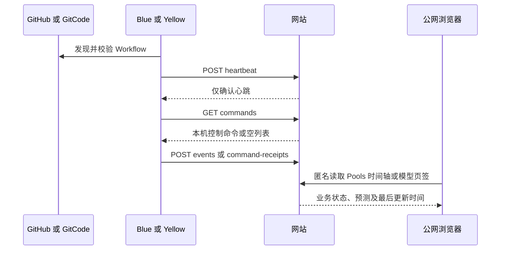
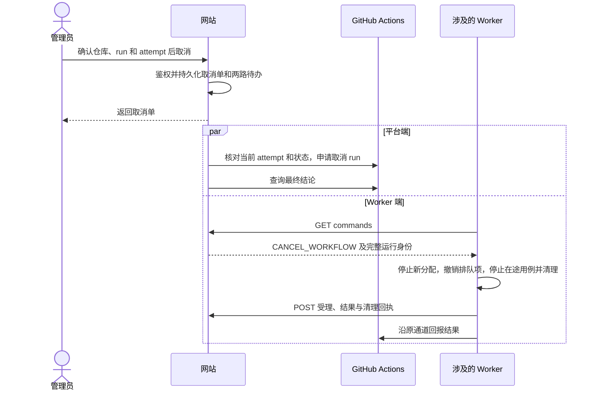

# Lite Actions 调度网站 PRD

**v1.0 · 开发交付版 · 2026-11-17**

## 1. 目标与部署边界

任何人都能从公网打开网站，无须登录、VPN 或来源 IP 白名单，即可查到：哪组设备被哪个仓、谁的 PR、哪次 Workflow、哪个用例占用？预计何时释放，下一笔何时能跑？管理员可调整排队优先级、取消 GitHub Workflow、管理集群。Blue、Yellow 各自从 GitHub/GitCode 发现任务、校验来源并在本地调度；网站汇总 Worker 已发现的任务，保存控制命令、发布生产 Pools 配置。网站故障时原 CI 继续工作。

目标托管为 Cloudflare Workers Free（页面/API）和 D1 Free（状态、索引、热明细）。**本项目新增费用上限为 0**，含托管、数据库、归档、请求、构建部署和域名。只启用可以保证零新增费用的服务；不自动升级，预算提醒不能替代硬限制。归档后端须满足同一约束；R2 有超额计费，不作为默认部署依赖。参见 [R2 计价](https://developers.cloudflare.com/r2/pricing/)、[D1 免费额度](https://developers.cloudflare.com/d1/platform/pricing/)及[计费与上限](https://developers.cloudflare.com/billing/understand/usage-based-billing/)。

Yellow 只通过批准的出口主动发起 HTTPS；Blue 同协议。公网访问的是网站，Worker 无须开放入站端口。机器身份独立认证，心跳、取令、遥测计入出口预算。业务看板公开两区节点的真实 IP/端口；发布前核验两区允许出区并向公网展示的业务字段。原始执行日志、平台 Token、Worker 密钥、SSH 与代理凭据不进入公开接口。

## 2. 页面与权限

| 页面 | 功能 |
|---|---|
| Pools 时间轴 | 纵轴按 Worker → Pool → 节点 → 已配置设备组展开全部环境；横轴为时间，标记“现在”。实线表示实际租约，虚线表示预计使用。条目显示仓库、PR 作者/编号、Workflow、case、阶段、已用及预计时长。多机任务可跨行，同一物理卡只计一次。 |
| 模型仓 | 依据两端配置支持的仓库自动生成页签，没有任务也有页签。个人仓、组织仓按逻辑模型映射合并，保留平台和完整仓名；`lite-actions` 与其他仓同级，默认选中 `vllm-ascend`。纵向列 case，按 Workflow run 分组；分别显示 PR 作者、触发者、PR、Action、用例、申请/实际分配的 Blue/Yellow、A3/A5 节点数和卡数；展开显示实际节点 IP、端口、设备 ID。手动和定时触发显示来源类型。 |
| 活动与历史 | 默认展开待执行、准备、运行、清理中的用例。首行“展开最近 50 条历史”，每次再加载 50 条，以结束时间和唯一 ID 倒序分页。同一页签可连续翻阅近一年的历史并打开详情，跨热库和归档无需切换入口。管理员在 GitHub Workflow 行取消整次运行，在排队 case 行插队。GitCode 保留展示、历史和插队。 |
| 集群管理 | 所有人可看环境、设备组、当前及期望配置版本；管理员可新增、暂停、恢复、排空删除。操作前显示影响的设备、排队用例和活动租约。 |
| 用户管理 | Super 使用预置密钥通过后端验证后登录。新增只输入用户名，系统生成网站登录密钥，创建普通管理员。Super 可以重复查看所建管理员的完整账号和登录密钥；删除立即撤销该账号及会话，保留审计。Super 初始密钥由部署侧配置。 |

| 身份 | 读取与操作范围 |
|---|---|
| 公网匿名访客 | 可读全部业务数据：仓库、PR、提交人、Workflow、case、排期、集群、节点真实 IP/端口、设备、近一年历史及归档详情。无需账号；不能执行管理操作、查看用户密钥或领取 Worker 命令。 |
| 普通管理员 | 用户名和密钥登录；可跨任一接入的个人仓和组织仓插队、管理集群、取消 GitHub Workflow。不能访问用户管理。 |
| Super | 具备全部管理员权限，另可管理用户和读取其网站登录密钥。 |

后端分别鉴权管理写接口、用户管理读接口和 Worker 接口；公开看板只返回业务字段。管理凭据和控制命令不进入公开响应、共享缓存或日志。审计记录操作账号、目标、时间及结果。

**占用与预测。** 本系统持有租约时展示对应 case。没有 Lite Actions 租约、但有外部占用或占用归属无法确认时，显示“未知占用”，不显示外部用户或进程；仅有新鲜空闲证据时显示“已确认空闲”。离线、隔离及暂停是独立标记，展示最近更新时间。预测采用同模型、同用例、同环境和资源形态最近 10 次成功执行的中位耗时，不含排队。显示样本数：不足 10 次用现有样本，0 次显示“暂无估算”，超出中位耗时显示“已超过预计”。排期以 Unified Router 的队列、资源资格和租约信息为依据，结合历史时长展示；信息不足时标“暂无估算”。下一笔选谁、能否跳过队首、分配哪组设备，均由 Unified Router 决定。网站不实现第二套选单算法。

## 3. Worker 通信、数据与归档

| Worker 主动请求（`/api/v1/worker`） | 约定 |
|---|---|
| `POST /heartbeat` | 首次报到及定时心跳，携带实例、健康和已应用配置版本；仅回确认。默认 30 秒一次，连续缺 3 次标为离线。 |
| `GET /commands` | 默认 15 秒一次，按认证身份只返回本机待办或空列表；禁缓存，读取不算受理。按 Yellow 实测预算调整周期。 |
| `POST /command-receipts` | 按唯一命令 ID 回报受理、完成、冲突、过期或失败。 |
| `POST /events`、`POST /snapshots` | 本地状态改变时上报事件；首次连接、重连、事件缺口时对账当前资源和活动任务。 |
| `GET /configs/{revision}` | 按同步命令拉取不可变版本，校验、应用后回执。 |



两端从本地持久状态生成统一事件：`QUEUED → RESERVED → STAGING → RUNNING → CLEANING → 终态`，另记回队、租约分配/释放、隔离与平台回报。对网站及原平台统一阶段含义；Yellow 采用获准的精简报文。本地变更与待发事件一并持久化，两路回报独立重试。网站按实例、序号、事件 ID 去重，快照对账。任务身份使用平台、完整仓名、run、attempt、dispatch（如有）和 case ID；页签合并不改变身份。心跳只更新最新值。

**上线从零开始。** 不导入上线前已结束的任务。首次快照纳入仍排队、执行或持有租约的任务；没有可靠起止时间的记录不计入耗时统计。活动任务一直留在热库。

**历史留存。** 任务摘要和明细均从任务结束起保留一年。前 30 天从热库查询；第 31 天起明细分批压缩归档，保留分页索引，原页签仍可查看摘要和完整详情，允许加载较慢。满一年按留存策略清理摘要、索引及归档明细。归档须可读、可校验，成功后才移除热明细。存储、读取和恢复均须零新增费用；没有满足条件的归档介质时暂缓正式上线。运行中容量不足或归档失败时告警，保留未成功归档的源数据。

## 4. Workflow 取消与 case 插队

**首版只支持取消 GitHub Workflow。** 一次点击取消指定仓库的一次 run/attempt，包括平台上的构建、lint，以及两区正在排队、执行或稍后发现的全部用例。GitCode 不发起网站取消，前后端均执行此限制。已结束用例保留原结果。



GitHub App 只装到目标仓，授予 `Actions: write`，私钥存后端 Secret。[GitHub 取消接口](https://docs.github.com/en/rest/actions/workflow-runs#cancel-a-workflow-run)按 run ID 操作；每次发送前核对最新 attempt 与状态，过期或不确定时不发送，超时先对账。Worker 按平台、完整仓名、run、attempt 持久化取消标记，与发放租约互斥。重复投递返回原回执，过期未受理需重新发起，已开始清理则继续。页面分列平台结论、各 Worker 停止进度与设备释放；清理未确认的设备不可调度。任何一路失败不抹去另一路结果。网站不能持久化命令时拒绝操作，不向平台发送取消。

**插队。** 管理员可对 GitHub/GitCode 的排队 case 提交“提前执行”指令。由 Unified Router 在对应 Worker、Pool 和调度类别内受理优先级调整；已取得租约则返回冲突。页面以 Router 回执展示生效顺位并刷新排期。插队不抢占在途任务、不拆多机组合。

## 5. 集群管理与配置热加载

网站后端是生产 Pools JSON 的唯一发布源；仓库 `config/pools.json` 用于初始化。每次修改校验旧版本，发布递增 `revision` 与 SHA-256。Worker 验证来源、设备和容器绑定，在调度边界切换；在途任务从分配到清理使用同一配置快照。断网或坏配置沿用最后生效版本，回滚以新版本发布。


支持按 Pool、整台节点或已配置设备组暂停/恢复。例：一台 16P 节点有 `0–7` 与 `8–15` 两组。暂停 `0–7` 后，该组以及与其相交的任何组合（包括整台 16P）不再获发新租约；`8–15` 不因这次暂停丧失候选资格。实际选单顺序沿用 Unified Router 的调度策略，网站按 Worker 回执展示暂停状态和实际分配。暂停从 Worker 确认应用配置时生效，已运行的用例继续。恢复不解除隔离。新增资产先验证归属、物理身份、设备拓扑和容器绑定；删除先排空并处理队列、租约和隔离引用，保留历史身份。跨 Worker 迁移须原 owner 先确认排空再交接。

## 6. 目录与验收

```text
control-center/
  docs/PRD.md       frontend/       api/             # 产品、页面和接口
  contracts/        db/migrations/  deploy/          # 协议、数据、部署
  probes/           tests/                           # 出口探针和端到端测试
ci_core/
  control_client.py                                  # 心跳、取令、事件与回执
  router.py / job_state.py / egress_policy.py        # 取消、队列和出口预算
  config.py / executor.py / reporting.py             # 配置快照、清理、平台回报
```

| 验收项 | 通过条件 |
|---|---|
| 公网读取 | 从非企业网络，用无登录态的浏览器打开正式域名，无须 VPN 或白名单。查看两区 Pools、各模型活动任务和历史详情，能读到实际节点 IP/端口。 |
| 权限隔离 | 匿名直接调用集群变更、插队、取消、用户管理、Worker 取令或上报接口时被拒绝，状态和队列不变；普通管理员不能读取密钥列表。Super 新建的普通管理员可跨仓操作，删除后旧会话失效。检查公开页、公开 API 和缓存均不包含凭据。 |
| 看板 | 受支持仓自动出现，`lite-actions` 无独立分类。基于同一租约的两种视图一致；外部或无法归属的占用显示“未知占用”。加载 103 条历史分页为 50/50/3；覆盖 0、少于 10、满 10 个耗时样本。 |
| 热库与成本 | 首次不补已结束历史；构造跨 30 天的历史，在原页签连续分页、无重漏，第 31 天的详情可打开。验证归档失败时源数据仍在、归档可恢复、满一年后摘要和明细到期清理。核验存储及读取均零新增费用；免费配额耗尽时拒绝无法持久化的操作，原 CI 继续。 |
| 取消与插队 | GitHub 测含原生作业、Blue/Yellow 队列及在途用例的 run；验证晚发现、旧 attempt、重复、离线、清理失败与独立回报。GitCode 取消在 UI/API 均不可用，其排队 case 仍可插队。 |
| 集群与恢复 | 暂停 16P 节点的一组 8P：验证该组及相交组合停止新租约，另一组资格不变；页面反映 Router 的实际分配，不指定哪笔任务先跑。在途清理沿用旧版本。覆盖恢复、删除排空、双端部分生效、回滚和断网 30 分钟后的去重对账。 |

## 7. 开发交接与上线条件

开发顺序：先用合成任务跑通两个视图和权限矩阵，再接入 Worker 事件与快照，随后实现管理命令、Pools 热加载和归档。使用同一组测试数据验证公开页面、管理员操作结果与本地租约的一致性。

正式上线前须取得三类证据：① 两区业务字段可公开发布，真实 Yellow 使用批准域名完成认证 POST 心跳、GET 命令/配置和 POST 回执，并满足出口预算；② 在已安装专用 App 的 GitHub 测试仓完成一次含原生作业和 Worker 用例的整次运行取消；③ 在实际零新增费用配置上验证容量预算、归档、读取、恢复及配额耗尽行为。开发、联调可先用模拟数据；未满足的上线条件记录具体缺项。
