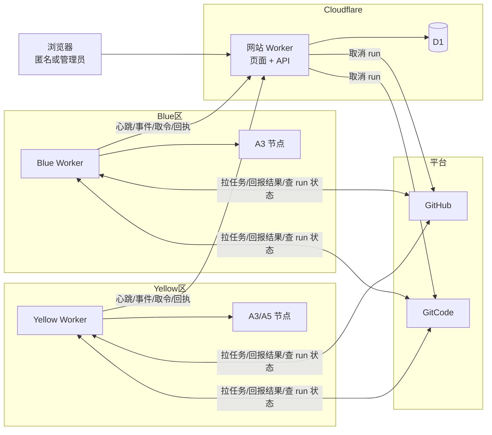
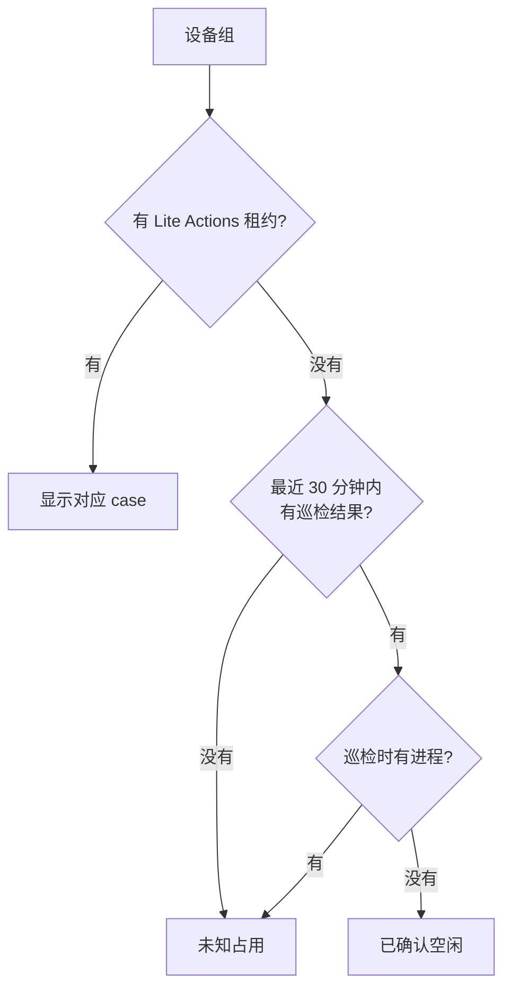
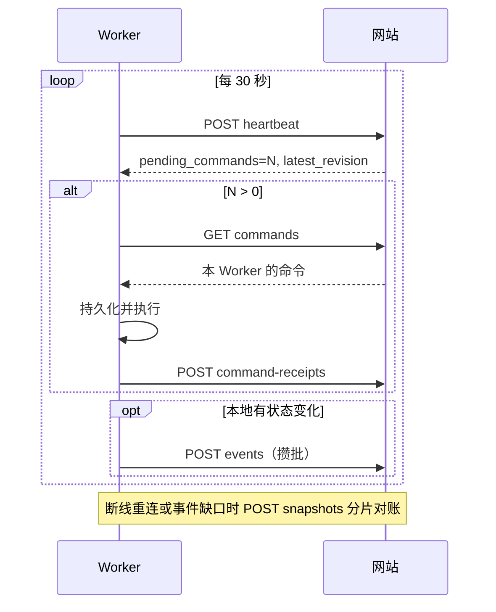
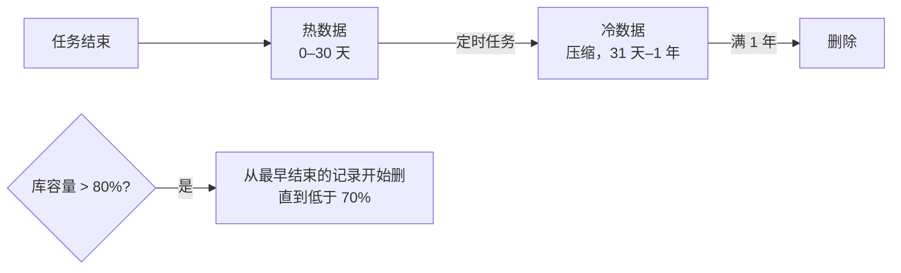
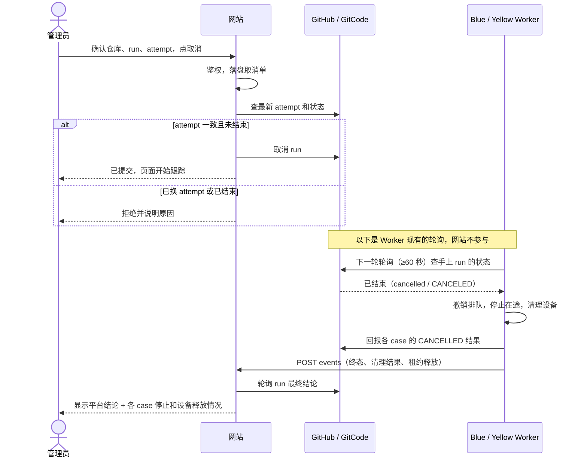
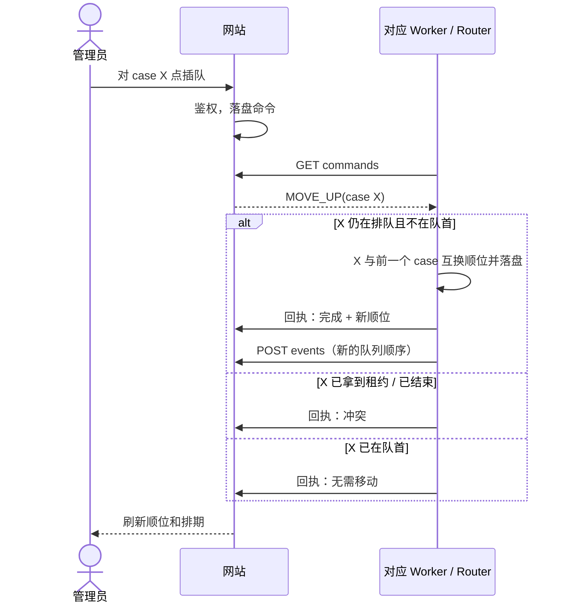
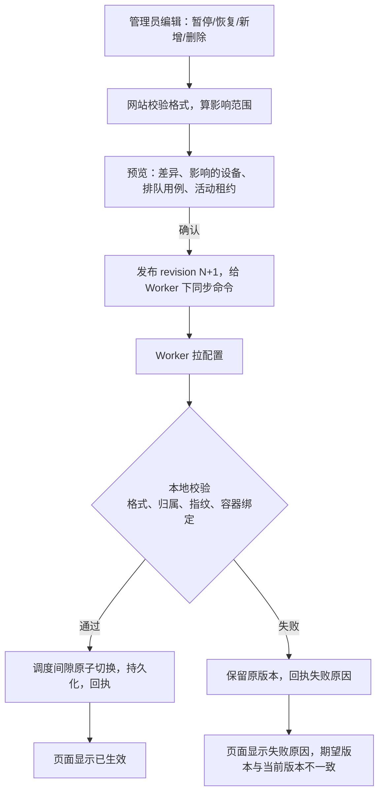
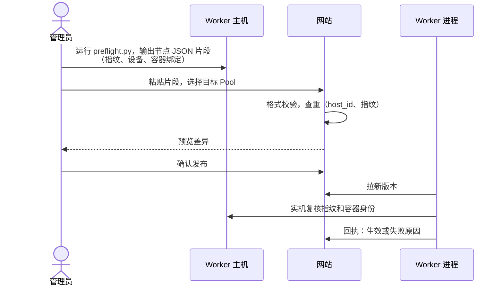
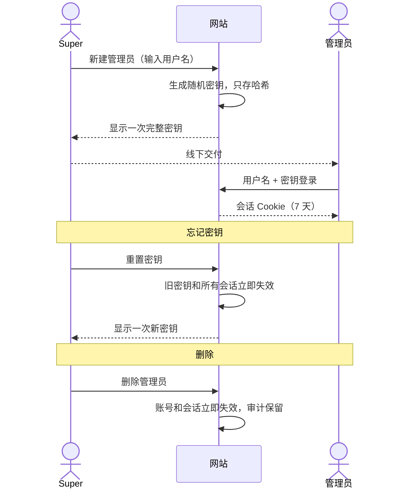

# Lite Actions 调度网站 PRD

**v1.1 · 2026-11-19** · 开发详细设计与落地计划见 [DESIGN.md](DESIGN.md)

## 1. 网站能力一览

| 能力 | 说明 | 规格 |
|---|---|---|
| 公开看板 | 任何人打开网址就能看，不用登录、VPN、白名单 | 节点 IP 中间两段掩码，如 `7.xxx.xxx.19:22` |
| Pools 时间轴 | 每组卡现在被谁用、什么时候释放、后面排着谁 | 实线 = 实际租约，虚线 = 预计 |
| 模型仓视图 | 按模型分页签，看每个 Workflow run 的用例和分配 | 每个支持的模型一个页签，没任务也有 |
| 活动与历史 | 正在跑的和已结束的用例，点开看详情 | 每次加载 50 条；历史最长 1 年 |
| 任务详情 | 元数据、各阶段耗时、平台 Actions 链接、最终结果 | 不含日志 |
| 设备状态 | 占用中 / 未知占用 / 已确认空闲，叠加离线、隔离、暂停 | 空闲巡检每 2 分钟，结果 30 分钟内有效 |
| 预计时长与排期 | 每个用例预计跑多久、什么时候开始 | 同类最近 10 次 PASS 的中位数 |
| 取消 Workflow | 一键取消一次 run，平台作业和两区用例一起停 | GitHub、GitCode 都支持；Worker 1–2 分钟内停下 |
| 插队 | 排队用例往前挪 | 点一次前移一位，可连续点 |
| 集群管理 | 新增、暂停、恢复、删除 Pool / 节点 / 设备组 | 配置带版本号，可回滚 |
| 账号 | Super + 普通管理员 | 密钥只显示一次；会话 7 天 |
| 刷新 | 页面数据自动刷新 | 页面 30 秒；公开接口缓存 10 秒；Worker 心跳 30 秒；90 秒没心跳算离线 |
| 存储 | 全部在一个 D1 库里 | 近 30 天热数据，1 年内冷数据；容量超 80% 自动删最早的记录 |
| 费用 | Cloudflare Workers Free + D1 Free | 新增费用 0 |
| 上传报文 | Worker 发往网站的全部上传请求及 Yellow 平台写请求严格控包 | 单次整包 < 2,000 字节（严于 2 KB），由 `upload_intercept` UT 强制拦截校验 |

## 2. 边界

- **网站挂了，CI 照常跑。** Blue、Yellow 仍然自己从 GitHub/GitCode 拉任务、调度、回报。网站只做汇总、取消和下发命令。
- **网站不调度。** 谁先跑、分哪组卡，全部由 Unified Router 决定。网站不写第二套选单算法。
- **Worker 只出不进。** 所有通信由 Worker 主动发 HTTPS，Worker 不开入站端口。
- **零新增费用。** 不开 R2，不开付费功能。免费额度用完就当天不可用，不自动升级。
- **不公开敏感信息。** 原始日志、诊断行、平台 Token、Worker 密钥、SSH/代理凭据、容器 ID、内网 `node_ip` 不出现在任何公开接口。

## 3. 页面与权限

| 页面 | 内容 |
|---|---|
| Pools 时间轴 | 纵轴 Worker → Pool → 节点 → 设备组，横轴时间，标出“现在”。实线是实际租约，虚线是预计。条目显示仓库、PR 作者/编号、Workflow、case、阶段、已用/预计时长。多机任务跨行，同一张卡只算一次。零卡探针不占设备行。 |
| 模型仓 | 每个支持的逻辑模型一个页签，没任务也有。页签与平台仓的映射由网站配置维护（例如 GitHub `cann-framework/torchtitan-npu` 和 GitCode `cann/torchtitan-npu` 归入同一页签），条目上保留平台和完整仓名。`lite-actions` 是普通页签，默认选中 `vllm-ascend`。页签下按 Workflow run 分组列 case：PR 作者、触发者、PR、Action、用例、申请/实际的 Blue/Yellow、A3/A5、节点数、卡数。展开看节点 `host_id` 和设备 ID。手动、定时触发标来源类型。 |
| 活动与历史 | 在模型仓页签内。默认显示待执行、准备、运行、清理中的用例；下面“展开最近 50 条历史”，每次再加载 50 条，按结束时间 + ID 倒序。冷热数据在同一个列表里翻页。 |
| 任务详情 | 任务身份、各阶段起止和耗时、分配的节点和设备、最终结果（PASS/FAIL/CANCELLED 等）、平台上这次 Actions run 的链接。 |
| 集群管理 | 所有人可看环境、设备组、当前/期望配置版本、暂停/隔离/离线状态。管理员可新增、暂停、恢复、排空删除，操作前先看影响范围。管理员可看操作记录。 |
| 用户管理 | 仅 Super。新建、重置密钥、删除管理员。 |

| 身份 | 能做什么 |
|---|---|
| 匿名访客 | 看全部业务数据，节点 IP 中间两段掩码。不能做任何操作。 |
| 普通管理员 | 用户名 + 密钥登录。看完整 IP。可对所有接入仓插队、取消 Workflow、管理集群、看操作记录。不能进用户管理。 |
| Super | 管理员的全部权限，加用户管理。 |

规则：

- 掩码在服务端做，公开接口从不返回完整 IP。格式：`113.xxx.xxx.205:153`。
- 公开接口带 `Cache-Control: public, max-age=10`；登录后的接口 `private, no-store`，不进共享缓存。
- 管理写接口、用户管理接口、Worker 接口分别鉴权。匿名调用一律拒绝，不改任何状态。
- 每次管理操作记审计：谁、对什么、何时、结果。

## 4. 设备状态与排期

### 4.1 设备组状态

- Worker 每 2 分钟对没被本系统租用的设备组跑一次只读 `npu-smi`，只看有没有进程，不杀进程、不取锁。结果 30 分钟内算新鲜。
- “未知占用”不显示外部用户和进程。
- 离线、隔离、暂停是另外的标记，和上面的状态叠加显示，附最后更新时间。

### 4.2 预计时长

- 取同一逻辑模型、同一 case、同一 Pool 和资源形态最近 10 次 PASS 的执行耗时中位数，不含排队。
- 不足 10 次用已有样本，0 次显示“暂无估算”。显示样本数。
- 运行时间超过中位数显示“已超过预计”。

### 4.3 排期虚线

Worker 在队列变化时上报每个 (Pool, 任务类型) 队列的顺序，以及每个排队 case 的候选设备组。网站按这个顺序依次往候选组里排：哪个候选组预计最先空出来就画在哪。

- 只用于显示，实际以 Router 分配为准。
- 某个 case 没有估算，它和同队列后面的 case 都显示“暂无估算”。
- 只能落在“未知占用”设备组上的 case 显示“等待外部释放”。

## 5. Worker 通信

接口在 `/api/v1/worker` 下。每个 Worker 有独立的机器密钥，服务端只存哈希。

| 接口 | 用途 |
|---|---|
| `POST /heartbeat` | 每 30 秒一次。带实例、健康、已应用配置版本、最近一轮巡检完成时间。回包：待办命令数和最新配置版本。连续 3 次没收到（90 秒）标离线。 |
| `GET /commands` | 只在心跳说有待办时调用。只返回本 Worker 的命令。不缓存，读取不算受理。 |
| `POST /command-receipts` | 按命令 ID 回报：受理、完成、冲突、失败。 |
| `POST /events` | 状态变化攒批，有变化才发，最多 30 秒一次。巡检结果变化也走这里。 |
| `POST /snapshots` | 首次连接、重连、发现事件缺口时分片上报当前资源、活动任务和队列，网站以此对账。 |
| `GET /configs/{revision}` | 收到配置同步命令后拉配置。 |

规则：

- **报文大小：** Worker 发往网站的所有一次性上传类请求（`POST` / `PUT` / `PATCH`，含请求行、Host、全部请求头与鉴权、正文及底层传输附加头）以及 Yellow 发往平台的全部写请求，单次整包严格小于 2,000 字节（满足 < 2 KB 限制，与 Yellow 现有出口上限一致）。超出的批量事件、快照或队列数据自动拆分成多个独立请求。由单元测试 `tests/test_upload_intercept.py`（`upload_intercept` UT）在底层发送层拦截全部上传路径强制校验；Blue 既有平台诊断通道（Commit Comment ≤ 7,000 字节、Release Asset ≤ 4 MiB）须在拦截注册表中显式白名单并校验各自上限。
- **事件：** 阶段 `QUEUED → RESERVED → STAGING → RUNNING → CLEANING → 终态`，另记回队、租约分配/释放、隔离、平台回报、队列顺序变化。任务第一次出现时发完整描述，之后只发短编号和变化字段。
- **可靠性：** 待发事件落盘，发网站和发平台各自重试，互不阻塞。网站按 (实例, 序号) 去重；序号不连续就要求 Worker 发快照。
- **身份：** 平台 + 完整仓名 + run + attempt + dispatch（如有）+ case ID。页签合并不影响身份。
- **从零开始：** 不导入上线前已结束的任务。首次快照只带仍在排队、执行、持有租约的任务。没有可靠起止时间的不进耗时统计。
- **不为展示多调平台：** 展示用的字段只取 Worker 已经拿到的数据，不额外请求 GitHub/GitCode。
- **请求量：** 两个 Worker 心跳每天约 5,800 次，其余请求只在有事件或命令时发生。

## 6. 数据存储与留存

只用一个 D1 库（Free 单库上限 500 MB）。

| 数据 | 内容 |
|---|---|
| 热数据 | 活动任务，以及结束 30 天内的任务完整记录 |
| 冷数据 | 结束 31 天到 1 年的任务明细，分批压缩 |
| 索引 | 所有已结束任务的摘要，按 (结束时间, ID) 分页，冷热共用 |
| 其他 | 配置版本、命令、回执、取消单、账号、会话、审计 |

- 定时任务把满 30 天的明细压进冷数据，写入并校验成功后再删热数据；同时删除满 1 年的记录。
- 容量超过 80%（400 MB），从最早结束的任务开始删（摘要、索引、明细一起），删到 70% 以下并告警。活动任务、未结束的命令和取消单、账号、审计不参与滚动删除。
- 历史列表翻到底，如果有被删掉的数据，提示“更早的记录已因容量清理”。
- D1 每日写额度（10 万行）用完：网站拒绝管理操作；Worker 的事件留在本地，之后补发；CI 不受影响。

## 7. 取消 Workflow

网站只调平台的取消接口，不给 Worker 发命令。Worker 本来就在每轮轮询（至少 60 秒一次）里查自己手上每个 run 的平台状态，发现 run 已结束就自己停：

- 排队中的 case：直接以 CANCELLED 结束。
- 执行中的 case：触发取消，停进程、清理设备，回报 CANCELLED 和清理结果。
- 之后才被发现的 case：Worker 只接收状态为排队/进行中的 run，已取消的 run 不会再入队。
- 换了新 attempt：旧 attempt 的 case 按“已被取代”处理，同样停掉。

| 平台 | 取消接口 | 凭据 |
|---|---|---|
| GitHub | `POST /repos/{repo}/actions/runs/{run_id}/cancel`；2 分钟内没结束再调 `force-cancel`（应对 `if: always()` 的作业） | GitHub App（已公开），装在目标仓，权限 `Actions: write`，私钥放 Cloudflare Secret。仓库没装 App 时按钮置灰。 |
| GitCode | `POST /api/v8/repos/{repo}/actions/runs/{run_id}/stop` | 有目标仓流水线操作权限的专用账号 Token，放 Cloudflare Secret。 |

规则：

- 一次取消针对一个仓库的一次 run/attempt，包括平台上的构建、lint 等原生作业和两区所有相关 case。已结束的 case 保留原结果。
- 发送前必须核对最新 attempt 和状态；查不清就不发，超时先查再决定是否重发。重复点击返回同一张取消单。
- 页面上的停止进度和设备释放来自 Worker 的普通事件，按 run 身份关联到取消单。清理没确认的设备照常进隔离、不可调度。
- 平台取消失败（无权限、接口报错），页面显示失败原因，任务继续跑。
- Worker 和网站断开时，只要它还能访问平台，取消照样生效；事件在恢复后补发。

## 8. 插队

管理员在 GitHub 或 GitCode 的排队 case 上点“插队”：这个 case 和同一队列里紧挨在它前面的排队 case 换位。想往前挪几位就点几次。

- 队列 = 同一 Worker、同一 Pool、同一任务类型（train / npu_smoke）的排队序列，和 Router 实际使用的一致。
- 已在队首：按钮置灰。已拿到租约：返回冲突。
- 不抢占在途任务，不拆多机组合。
- 多个管理员同时点，Router 按收到顺序逐个处理，每次基于当时的位置换一位。

train 用例排队超时为 72 小时；npu_smoke 无排队超时。

## 9. 集群管理与配置热加载

### 9.1 配置来源

- 网站是生产 Pools 配置的唯一发布源。仓库 `config/pools.json` 只用来初始化网站和全新 Worker。
- 每次发布基于当前版本修改（版本对不上就拒绝，防并发覆盖），生成递增 `revision` 和 SHA-256。
- Worker 把最后生效的版本存在 `LITE_ACTIONS_STATE_DIR`。启动、重启、自动更新代码后都先加载它；状态目录里没有时才读仓库 `pools.json`。
- 断网或新配置校验失败，继续用最后生效的版本。回滚就是把旧内容作为新版本再发一次。
- 在途任务从分配到清理一直用分配时的配置快照。新配置在调度间隙切换。

### 9.2 发布流程

### 9.3 新增资产

网站不直连节点，所有实机校验在 Worker 侧完成。

### 9.4 暂停与恢复

- Pool、节点、设备组三级都能暂停，配置里用可选字段 `paused: true` 表示。字段不存在就是没暂停；恢复时直接删掉这个字段，不写 `false`。
- 设备组不新增 ID，用 `host_id + devices` 识别。
- 例：16P 节点有 `0–7`、`8–15` 两组。暂停 `0–7` 后，该组以及所有包含它的组合（含跨节点组合）不再发新租约；`8–15` 不受影响。
- 从 Worker 回执“已应用”开始生效。正在跑的继续跑，排队的继续等。
- 和 `enabled: false` 的区别：`enabled: false` 会让排到该 Pool 的任务直接失败；`paused` 只是不发新租约，任务继续排队。
- 恢复不解除隔离。

### 9.5 删除与迁移

- 删除前先排空：预览列出只能在这些资源上跑的排队 case，管理员确认后这些 case 以 CANCELLED 结束并回报平台；活动租约等它跑完。
- 有未解除隔离的节点不能删，先上主机用 `reconcile.py` 处理。网站不提供解除隔离。
- 删除后历史记录里的节点身份保留。
- 跨 Worker 迁移：先发一版从原 Worker 删除，原 Worker 确认排空后，再发一版加到新 Worker。

## 10. 账号

- Super 密钥在部署时通过 Secret 配置。
- 管理员密钥是系统生成的 32 字节随机串，服务端存 HMAC-SHA256。
- 会话：`HttpOnly; Secure; SameSite=Strict` Cookie，7 天有效，删除/重置立即失效。
- 同一用户名 + IP 10 分钟内失败 5 次，锁 10 分钟。

## 11. 验收

| 项 | 通过条件 |
|---|---|
| 公网读取 | 无登录浏览器打开网站，看到两区 Pools、各模型活动任务、历史详情；IP 显示为掩码。登录后看到完整 `host_id`。 |
| 权限 | 匿名调用集群变更、插队、取消、用户管理、Worker 接口全部被拒，状态不变。普通管理员进不了用户管理。删除管理员后旧会话立即失效。公开页面、接口、缓存里查不到凭据和完整 IP。 |
| 看板 | 支持的仓自动出现页签，`lite-actions` 无特殊分类。时间轴和模型仓基于同一租约，显示一致。外部占用显示“未知占用”；巡检空闲 30 分钟内显示“已确认空闲”，超时退回“未知占用”。103 条历史分页为 50/50/3。覆盖 0、少于 10、满 10 个耗时样本。 |
| 上传报文（`upload_intercept` UT） | `tests/test_upload_intercept.py` 在底层 HTTP 发送层拦截所有一次性上传类请求（`POST`/`PUT`/`PATCH`），按真实线序序列化（含请求行、Host、完整请求头与鉴权、`Content-Length`/`Accept-Encoding`、正文）统计整包字节：① 覆盖网站全部上传接口（Blue/Yellow 的心跳、事件、快照分片、回执）与 Yellow 全部平台上传接口（GitHub/GitCode 的 ACK、进度、结果及其重试），以最大合法长度输入构造，单次整包均 < 2,000 字节（满足 < 2 KB）；② 构造超限多条事件、大快照与长队列，验证拆包后每个请求均 < 2,000 字节；③ 静态扫描与运行期注册表核验全部上传路径，Blue 既有平台诊断通道（Commit Comment ≤ 7,000 字节、Release Asset ≤ 4 MiB）显式白名单并按各自上限校验，任何新增的未纳入覆盖的上传代码路径直接触发单测失败。 |
| 存储 | 不导入上线前历史。构造跨 30 天的数据，同一列表连续翻页无重无漏，第 31 天的详情能打开。把容量推过 80%，最早的已结束记录被删到 70% 以下，活动任务不受影响。满 1 年的记录被清理。写额度用完时管理操作被拒，Worker 事件之后补发，CI 不受影响。 |
| 取消 | GitHub 和 GitCode 各一个含原生作业、两区排队和在途用例的 run，一次取消后 2 分钟内全部停下并释放设备。覆盖：取消后才被发现的用例、旧 attempt、重复点击、Worker 与网站断开但能访问平台、清理失败、平台取消接口失败、GitHub `always()` 作业需 force-cancel。 |
| 插队 | 同一队列连续点 3 次，case 前移 3 位；队首置灰；已拿到租约返回冲突；GitCode case 可插队。 |
| 集群 | 暂停 16P 节点的一组 8P：该组及包含它的组合不发新租约，另一组正常。在途任务用旧配置跑完。覆盖：恢复、粘贴 preflight 片段新增节点、删除排空、有隔离时拒绝删除、两 Worker 只有一端生效、回滚、断网 30 分钟后重连对账去重、Worker 重启和代码自动更新后仍用最新生效版本。 |

## 12. 上线前提与待定事项

上线前需要：

1. 真实 Yellow 用网站域名完成心跳、取令、拉配置、回执，并满足出口预算（取决于待定 1）。
2. 在装了 App 的 GitHub 测试仓、配好 Token 的 GitCode 测试仓，各完成一次含原生作业和 Worker 用例的整次取消。
3. 在实际免费配置上验证容量水位、滚动删除和额度耗尽行为。

待定：

1. **Yellow 出口策略。** 现在 Yellow 只放行 GitHub/GitCode API，单个请求必须小于 2,000 字节，写请求令牌桶上限 4 个，还有每日上传字节总额。要定：网站域名能否加入放行名单；网站流量和平台回报是否共用每日额度（共用的话给 CI 回报留保底，超水位先停网站上报）。协议已按小报文设计，结论不影响接口。
2. **域名。** 先用 `workers.dev`。边缘缓存的具体实现在开发时按实际域名实测确认。
3. **72 小时排队的实际上限。** 模型仓的 Waiter job 如果跑在 GitHub 托管 runner 上，单 job 最长 6 小时；Waiter 结束、run 结束后，Worker 会把排队的 case 取消。要让 train 真的能排 72 小时，Waiter 需要跑在自托管 runner 上，或改等待方式。
