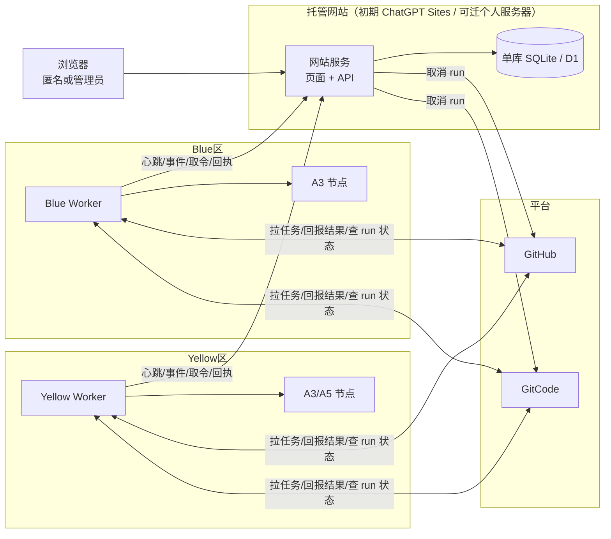
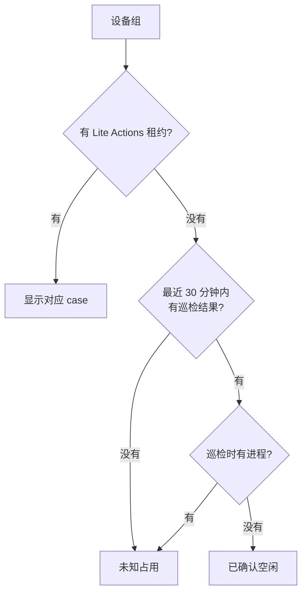
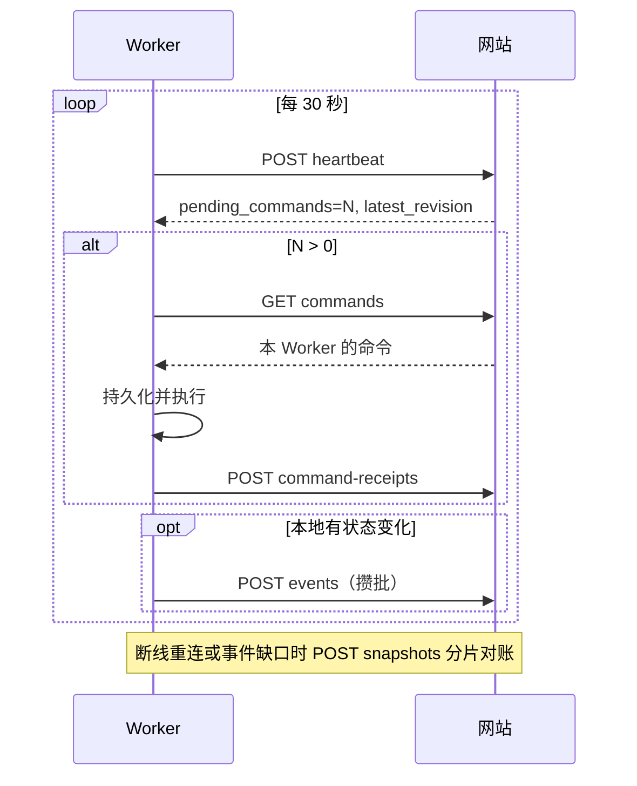
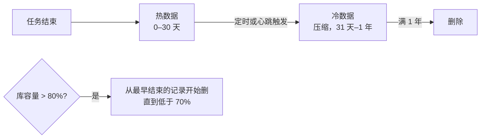
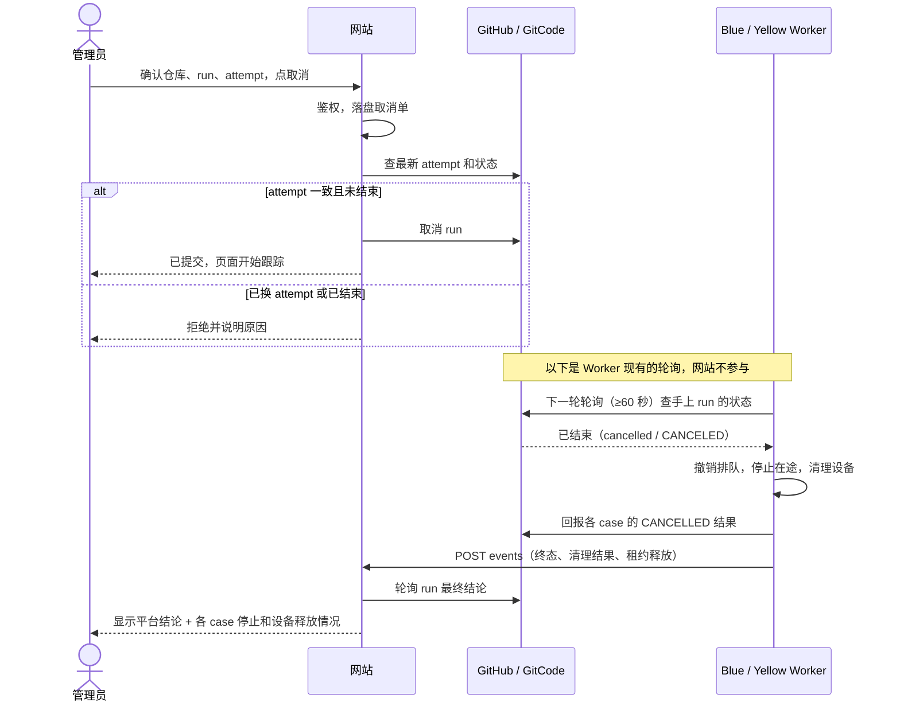
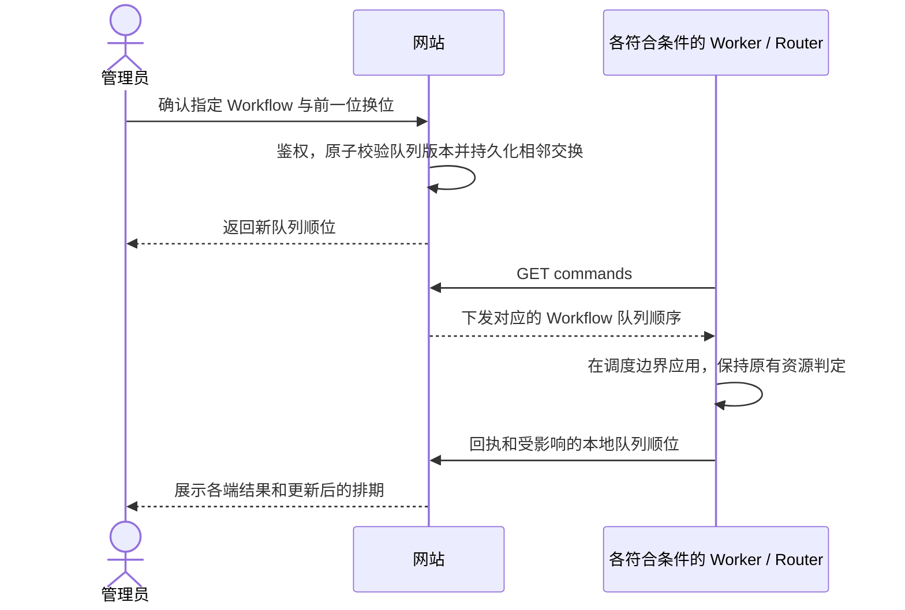
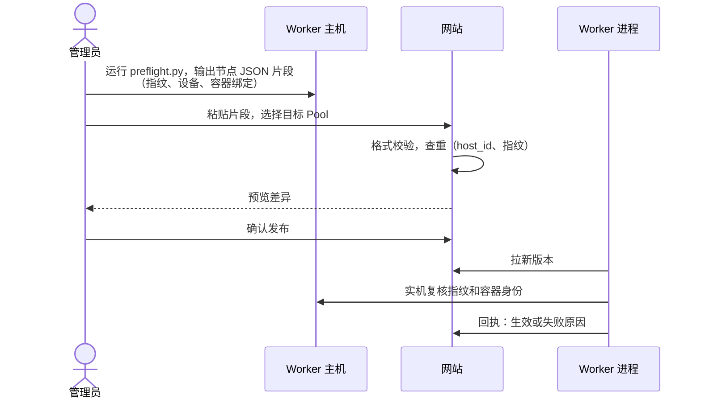
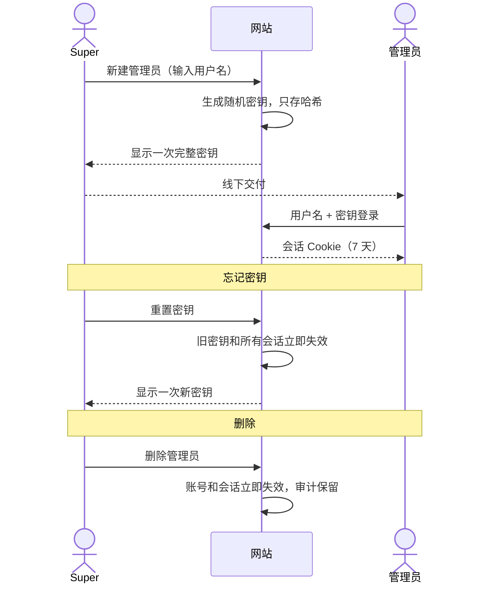

# Lite Actions 调度网站 PRD

**v1.5 · 2026-11-19** · 开发详细设计与落地计划见 [DESIGN.md](DESIGN.md)

## 1. 网站能力一览

| 能力 | 说明 | 规格 |
|---|---|---|
| 公开看板 | 任何人打开网址就能看，不用登录、VPN、白名单 | 节点 IP 中间两段掩码，如 `7.xxx.xxx.19:22` |
| Pools 时间轴 | 每组卡现在被谁用、什么时候释放、后面排着谁 | 每组独立画条，实线表示实际租约，虚线表示预计 |
| 代码仓任务看板 | 在统一表格查看各仓 Workflow 和子用例 | 一行一个 Workflow run/attempt，按当前队列排列，数据列可单独筛选和排序 |
| 活动与历史 | 同表展示活动和已结束的 Workflow，点加号展开子用例表 | 默认显示当前队列；点击表顶按钮加载历史，每批 50 条，负序号历史在队列上方，可折叠及重新展开 |
| 任务详情 | 元数据、各阶段耗时、平台 Actions 链接、最终结果 | 不含日志 |
| 设备状态 | 在线由 `npu-smi` 确认可见设备，连续 5 次失败判为已离线 | 未知占用标红、暂停调度标黄，显示最近在线时间 |
| 预计时长与排期 | 每个用例预计跑多久、什么时候开始 | 同类最近 10 次 PASS 的中位数 |
| 取消 Workflow | 一键取消一次 run，平台作业和两区用例一起停 | GitHub、GitCode 都支持；Worker 1–2 分钟内停下 |
| 插队 | 将一次 Workflow run/attempt 前移一位 | 与实际队列前一位互换，涉及的 Worker 各自应用并回执 |
| 集群管理 | 新增、暂停调度、恢复调度、先排空再删除 Pool / 节点 / 设备组 | 配置带版本号，可回滚；Pool `enabled` 与暂停调度语义统一 |
| 账号 | Super + 普通管理员 | 密钥只显示一次；会话 7 天 |
| 刷新 | 页面数据自动刷新 | 页面 30 秒；公开接口缓存 10 秒；Worker 心跳 30 秒；90 秒没心跳算离线 |
| 存储 | 全部在一个 SQLite/D1 单库里 | 近 30 天热数据，1 年内冷数据；容量超 80% 自动删最早的记录 |
| 托管与迁移 | 初期使用 ChatGPT Sites 直接部署，后期可迁至个人服务器 | 全量前后端与迁移代码合入 GitHub 仓；零新增费用，由 `portability_intercept` DT 拦截防平台锁定 |
| 上传报文 | Worker 发往网站的全部上传请求及 Yellow 平台写请求严格控包 | 单次整包 < 2,000 字节（严于 2 KB），由 `upload_intercept` UT 强制拦截校验 |

## 2. 边界

- **网站挂了，CI 照常跑。** Blue、Yellow 仍然自己从 GitHub/GitCode 拉任务、调度、回报。网站只做汇总、取消和下发命令。
- **网站不调度。** 谁先跑、分哪组卡，全部由 Unified Router 决定。网站不写第二套选单算法。
- **Worker 只出不进。** 所有通信由 Worker 主动发 HTTPS，Worker 不开入站端口。
- **初期 ChatGPT Sites 直出，代码全入 GitHub 仓、支持迁至个人服务器。** 前后端源码、数据库迁移、Sites 打包脚本与个人服务器运行入口全部合入 GitHub 主仓；业务核心仅依赖标准 Web Fetch 与 SQLite 抽象，不强绑定单一托管商专有 API，支持零业务代码改动迁移至个人服务器（Node.js + SQLite）或 Cloudflare Workers Free + D1 Free。
- **零新增费用。** 不开 R2，不开付费功能。免费额度用完就当天不可用，不自动升级。
- **不公开敏感信息。** 原始日志、诊断行、平台 Token、Worker 密钥、SSH/代理凭据、容器 ID、内网 `node_ip` 不出现在任何公开接口。

## 3. 页面与权限

| 页面 | 内容 |
|---|---|
| Pools 时间轴 | 纵轴 Worker → Pool → 节点 → 设备组，横轴时间，标出“现在”。实线是实际租约，虚线是预计。条目显示仓库、PR 作者/编号、Workflow、case、阶段、已用/预计时长。同一租约涉及多组时，在每个占用组的行内独立画框，复用相同内容及起止时间。同一 16P Yellow 租约覆盖两个 8P 组时，两个黄色框各自可点击，打开同一用例；多机租约沿用同一规则。用例、租约、物理卡和卡时仍按真实身份去重。零卡探针不占设备行。时间轴下方附带“排队用例”面板，按 Worker / Pool 筛选展示待调度用例的预计开始时间与队列顺位，点击时间轴条目或排队行均可打开任务详情。 |
| 代码仓任务看板 | 一个 Workflow 任务表，默认显示全部代码仓。支持按逻辑模型、实际仓库、平台、资源及活动／历史筛选，选择逻辑模型后可清除筛选恢复全部。逻辑模型和平台仓的映射由网站配置维护（例如 GitHub `cann-framework/torchtitan-npu` 和 GitCode `cann/torchtitan-npu` 可映射到同一逻辑模型），支持的模型即使暂无任务也可选，`lite-actions` 与其他模型同级。每行按「平台、完整仓名、run ID、attempt」唯一标识，按顺序显示队列序号、提交时间、平台／完整仓名（可附网站配置的组织仓／个人仓归属标签）、资源（如 Yellow / A5、Blue / A3）、最大卡数、可打开平台原始运行的 Actions ID 链接、调度结果、触发人、触发来源、开始时间、结束时间、运行总卡时。所有数据列均支持组合筛选及升／降序，筛选和排序只影响显示；恢复默认顺序可返回当前队列，序号始终引用原始顺位。行首加号展开子用例表，可查看 PR 作者和编号、用例阶段、申请与实际分配、节点数、卡数、设备 ID、按权限可见的节点地址、起止时间及「耗时」；未开跑的子用例耗时显示“—”，预计开始时间和队列顺位显示在阶段列。管理员从 Workflow 行取消或插队，从回执查看结果。 |
| 活动与历史 | 打开模型仓默认只显示当前活动队列。点击表顶「加载 50 个历史 Workflow」后，同一表在当前队列上方插入最近的历史记录；默认视觉顺序为从上到下 `… -3、-2、-1、0、1、2 …`。首批加载定位到历史与当前队列的交界，选「仅历史」时从首批历史开始浏览。再次加载把更早记录加在顶部，每批 50 条，冷热数据共用分页及详情入口。表格顶部可折叠已加载的全部历史，重新展开时恢复已加载的批次和展开的子用例，历史序号保持不变。只要还有活动子用例，Workflow 保留在当前队列视图并可展开其已结束子用例；全部结束后按同一身份进入历史。 |
| 任务详情 | 可从时间轴条目、排队表、模型仓子用例行打开。展示任务身份、各阶段起止和耗时、分配的节点和设备、最终结果（PASS/FAIL/CANCELLED 等）、数据层级（热库/归档）与平台上这次 Actions run 的链接。不含日志。 |
| 集群管理 | 所有人可看环境、设备组、当前/期望配置版本、设备在线状态、最近在线时间，以及未知占用、暂停调度、排空中、隔离等独立标记。节点直接以 `host_id` 呈现（匿名掩码，登录后完整，不另设节点别名）。管理员可新增、暂停调度、恢复调度、先排空再删除、回滚，操作前先看影响范围。管理员可看操作记录。 |
| 用户管理 | 仅 Super。新建、重置密钥、删除管理员。 |

Workflow 行的汇总口径：

- 队列序号：已有子用例取得租约、准备、运行或清理的当前 Workflow 显示 `0`，即使同一 Workflow 还有等待的子用例；多个并行执行的 Workflow 均可为 `0`。尚未进入在途阶段且有待调度子用例的 Workflow，按当前等待队列从 `1` 连续编号。历史最近一条为 `-1`，依结束时间和唯一标识继续编号为 `-2`、`-3` 等。编号依据完整队列和历史顺序，不随筛选、分页或自选排序重新编号。
- 提交时间取平台记录的该 run／attempt 实际提交时间；开始时间取已知子用例的最早实际执行开始时间。全部子用例终止后取最晚已知结束时间。未知或尚未发生的时间显示“—”，页面用北京时间展示并注明时区。
- 资源列合并子用例的 Worker / Pool，每个组合只展示一次。已分配的用例使用实际资源，未分配的用例使用申请资源。最大卡数取本次 Workflow 下单个子用例的最大卡数，优先使用实际分配，未分配时使用申请。
- 调度结果是独立列，只取“成功”“失败”“排队中”，支持筛选、排序。尚未全部结束的 Workflow 统一显示“排队中”，实际执行阶段在子用例表查看。全部结束后，所有子用例成功才显示“成功”，存在失败、取消等非成功终态时显示“失败”；子用例保留各自终态。
- 运行总卡时 = Σ（子用例实际分配卡数 × 实际执行分钟数）÷ 60，单位为卡·小时。例如 16 卡运行 38 分钟记为 10.13 卡·小时。并行执行的用例分别计入，跨设备组的同一用例只计一次。排队、预计时长与未分配资源不计；活动 Workflow 标明“截至当前”，缺少全部有效计量数据时显示“—”，部分子用例缺少有效计量数据时标明统计不完整。

| 身份 | 能做什么 |
|---|---|
| 匿名访客 | 看全部业务数据，节点 IP 中间两段掩码。不能做任何操作。 |
| 普通管理员 | 用户名 + 密钥登录。看完整 IP。可对所有接入仓插队、取消 Workflow、管理集群、看操作记录。不能进用户管理。 |
| Super | 管理员的全部权限，加用户管理。 |

规则：

- 掩码在服务端做，公开接口从不返回完整 IP。格式：`113.xxx.xxx.205:153`。各页面直接以 `host_id` 作为节点标识（匿名呈掩码，登录呈完整地址），不另设节点显示别名。
- 公开接口带 `Cache-Control: public, max-age=10`；登录后的接口 `private, no-store`，不进共享缓存。
- 管理写接口、用户管理接口、Worker 接口分别鉴权。匿名调用一律拒绝，不改任何状态。
- 每次管理操作记审计：谁、对什么、何时、结果。

## 4. 设备状态与排期

### 4.1 设备组状态

设备组同时维护**在线状态**（`npu-smi` 硬件可见性探测）与**占用状态**（租约/进程巡检），并独立叠加“暂停调度”“隔离”及“Worker 心跳离线”标记。下方流程展示占用状态判定：

- Worker 每 2 分钟对本 Worker 名下**全部已配置节点与设备组**（包括处于暂停调度/初始未启用状态的 Pool、节点与设备组，以及已租用的设备组）通过只读 `npu-smi` 查询硬件可见性。只有实际查到设备组内全部配置卡才判该组“在线”，更新“最近在线时间”并清零连续失败次数。探测报错或缺卡计一次失败；1–4 次显示“探测异常”，第 5 次起显示“已离线”。重复上报不重复计数；没有实际探测记录时显示“待探测”，Worker 心跳离线单独标记。
- 节点及 Pool 汇总其下设备组。全部已离线时标“已离线”，一部分已离线时标“部分离线”。汇总行的最近在线时间取成员最近成功时间的最新值；组行显示自身的最近成功时间，失败、配置发布或页面刷新不改写。
- 对未被本系统租用的设备组，空闲巡检只读进程存在性，不杀进程、不取锁。空闲证据 30 分钟内有效。“未知占用”标红，不显示外部用户或进程。
- “暂停调度”与“排空中”标黄，等待配置生效回执后展示。暂停、排空和隔离与在线状态、占用状态并列显示，暂停或排空后全部节点继续探测在线状态。

### 4.2 预计时长

- 取同一逻辑模型、同一 case、同一 Pool 和资源形态最近 10 次 PASS 的执行耗时中位数，不含排队。
- 不足 10 次用已有样本，0 次显示“暂无估算”。显示样本数。
- 运行时间超过中位数显示“已超过预计”。

### 4.3 排期虚线

Worker 在队列变化时上报每个 (Pool, 任务类型) 队列的顺序，以及每个排队 case 的候选设备组。网站按这个顺序依次往候选组里排：哪个候选组预计最先空出来就画在哪。

- 只用于显示，实际以 Router 分配为准。
- 某个 case 没有估算，它和同队列后面的 case 都显示“暂无估算”。
- 只能落在“未知占用”设备组上的 case 显示“等待外部释放”。

## 5. Worker 通信

接口在 `/api/v1/worker` 下。每个 Worker 有独立的机器密钥，服务端只存哈希。

| 接口 | 用途 |
|---|---|
| `POST /heartbeat` | 每 30 秒一次。带实例、健康、已应用配置版本、最近一轮巡检完成时间。回包：待办命令数和最新配置版本。连续 3 次没收到（90 秒）标离线。 |
| `GET /commands` | 只在心跳说有待办时调用。只返回本 Worker 的命令。不缓存，读取不算受理。 |
| `POST /command-receipts` | 按命令 ID 回报：受理、完成、冲突、失败。 |
| `POST /events` | 状态变化攒批，有变化才发，最多 30 秒一次。设备可见性、连续探测失败次数和最近在线时间变化也走这里。 |
| `POST /snapshots` | 首次连接、重连、发现事件缺口时分片上报当前资源、活动任务和队列，网站以此对账。 |
| `GET /configs/{revision}` | 收到配置同步命令后拉配置。 |

规则：

- **报文大小：** Worker 发往网站的所有一次性上传类请求（`POST` / `PUT` / `PATCH`，含请求行、Host、全部请求头与鉴权、正文及底层传输附加头）以及 Yellow 发往平台的全部写请求，单次整包严格小于 2,000 字节（满足 < 2 KB 限制，与 Yellow 现有出口上限一致）。超出的批量事件、快照或队列数据自动拆分成多个独立请求。由单元测试 `tests/test_upload_intercept.py`（`upload_intercept` UT）在底层发送层拦截全部上传路径强制校验；Blue 既有平台诊断通道（Commit Comment ≤ 7,000 字节、Release Asset ≤ 4 MiB）须在拦截注册表中显式白名单并校验各自上限。
- **事件：** 阶段 `QUEUED → RESERVED → STAGING → RUNNING → CLEANING → 终态`，另记回队、租约分配/释放、隔离、平台回报、队列顺序变化。任务第一次出现时发完整描述，之后只发短编号和变化字段。
- **可靠性：** 待发事件落盘，发网站和发平台各自重试，互不阻塞。网站按 (实例, 序号) 去重；序号不连续就要求 Worker 发快照。
- **身份：** 平台 + 完整仓名 + run + attempt + dispatch（如有）+ case ID。Workflow 行的分组和筛选不改变子用例身份。
- **从零开始：** 不导入上线前已结束的任务。首次快照只带仍在排队、执行、持有租约的任务。没有可靠起止时间的不进耗时统计。
- **不为展示多调平台：** 展示用的字段只取 Worker 已经拿到的数据，不额外请求 GitHub/GitCode。
- **请求量：** 两个 Worker 心跳每天约 5,800 次；每 2 分钟的设备可见性与空闲巡检稳态时通过心跳刷新最近在线与空闲新鲜度，仅状态或连续失败次数变化时才发事件，其余请求只在有状态变化或命令时发生。

## 6. 数据存储与留存

只用一个 SQLite 兼容单库（初期托管于 ChatGPT Sites / D1 Free，单库上限 500 MB；后期迁移个人服务器时直接使用同一套迁移 SQL 的本地单文件 SQLite）。

| 数据 | 内容 |
|---|---|
| 热数据 | 活动任务，以及结束 30 天内的任务完整记录 |
| 冷数据 | 结束 31 天到 1 年的任务明细，分批压缩 |
| 索引 | 所有已结束任务的摘要，按 (结束时间, ID) 分页，冷热共用 |
| 其他 | 配置版本、命令、回执、取消单、账号、会话、审计 |

- 维护任务（支持平台 Cron、个人服务器定时器，以及无 Cron 托管下的心跳/写流量节流惰性触发）把满 30 天的明细压进冷数据，写入并校验成功后再删热数据；同时删除满 1 年的记录。
- 容量超过 80%（默认 400 MB，个人服务器可按配置上限调整），从最早结束的完整 Workflow 开始删（摘要、索引、明细一起），删到 70% 以下并告警。活动任务、未结束的命令和取消单、账号、审计不参与滚动删除。
- 历史列表翻到底，如果有被删掉的数据，提示“更早的记录已因容量清理”。
- 免费托管日写额度（如 D1 10 万行）用完：网站拒绝管理操作；Worker 的事件留在本地，之后补发；CI 不受影响。

## 7. 取消 Workflow

网站只调平台的取消接口，不给 Worker 发命令。Worker 本来就在每轮轮询（至少 60 秒一次）里查自己手上每个 run 的平台状态，发现 run 已结束就自己停：

- 排队中的 case：直接以 CANCELLED 结束。
- 执行中的 case：触发取消，停进程、清理设备，回报 CANCELLED 和清理结果。
- 之后才被发现的 case：Worker 只接收状态为排队/进行中的 run，已取消的 run 不会再入队。
- 换了新 attempt：旧 attempt 的 case 按“已被取代”处理，同样停掉。

| 平台 | 取消接口 | 凭据 |
|---|---|---|
| GitHub | `POST /repos/{repo}/actions/runs/{run_id}/cancel`；2 分钟内没结束再调 `force-cancel`（应对 `if: always()` 的作业） | GitHub App（已公开），装在目标仓，权限 `Actions: write`，私钥放服务端部署 Secret（不入库）。仓库没装 App 时按钮置灰。 |
| GitCode | `POST /api/v8/repos/{repo}/actions/runs/{run_id}/stop` | 有目标仓流水线操作权限的专用账号 Token，放服务端部署 Secret（不入库）。 |

规则：

- 一次取消针对一个仓库的一次 run/attempt，包括平台上的构建、lint 等原生作业和两区所有相关 case。已结束的 case 保留原结果。
- 发送前必须核对最新 attempt 和状态；查不清就不发，超时先查再决定是否重发。重复点击返回同一张取消单。
- 页面上的停止进度和设备释放来自 Worker 的普通事件，按 run 身份关联到取消单。清理没确认的设备照常进隔离、不可调度。
- 平台取消失败（无权限、接口报错），页面显示失败原因，任务继续跑。
- Worker 和网站断开时，只要它还能访问平台，取消照样生效；事件在恢复后补发。

## 8. Workflow 插队

管理员在 GitHub 或 GitCode 的 Workflow 行点“插队”，与当前待调度队列中紧邻的上一位 Workflow 交换。序号 3 一次移动到 2，原序号 2 变为 3；需要继续前移可再次发起。等待队首 `1` 置灰，正在执行的 `0` 不参与相邻交换；目标已退出待调度队列或队列版本不一致时提示冲突并刷新。确认前展示运行身份、预期顺位及排队子用例。插队以实际队列为准，筛选或自定义排序产生的相邻行不决定交换对象，回执后按当前队列顺序显示。

- 可插队的 Workflow 队列是尚未进入在途阶段、且有排队子用例的 run／attempt 的统一顺序。平台首次提交时间和唯一标识可用于确定初始顺序。按同一资源队列投影后，各 Worker 继续在同一 Pool、同一任务类型内逐 case 选单；只调整交换双方的相对优先级，保留同一 Workflow 下子用例顺序及其他 Workflow 相对顺序。两者不共享某个队列时，该队列的子用例顺位可以无变化。各 Worker 按原规则检查资源资格、租约、并发容量与队首阻塞；已持有租约的用例继续执行，平台原生作业不受影响。
- 网站按「平台、完整仓名、run ID、attempt」及队列版本持久化本次换位和指令 ID。相同 ID 重投返回原回执，新一笔操作基于最新队列版本。Worker 在调度边界原子应用并持久化顺位，与发放租约互斥；同 attempt 后续入队或回队的子用例沿用其 Workflow 顺序。新的 attempt 重新入队。零卡探针不参与资源队列提优。
- 表格收到新队列版本后交换两个 Workflow 的显示顺位。分 Worker、Pool、任务类型显示待受理、已应用、无变化、冲突或失败；本地 case 顺位及预测以 Worker 回执和遥测为准。一端离线或失败时保留另一端结果。资源使用情况仍以 Router 为准。
- 排队超时：`train` 用例排队超时为 72 小时；`npu_smoke` 无排队超时。

## 9. 集群管理与配置热加载

### 9.1 配置来源

- 网站是生产 Pools 配置的唯一发布源。仓库 `config/pools.json` 只用来初始化网站和全新 Worker。
- 每次发布基于当前版本修改（版本对不上就拒绝，防并发覆盖），生成递增 `revision` 和 SHA-256。
- Worker 把最后生效的版本存在 `LITE_ACTIONS_STATE_DIR`。启动、重启、自动更新代码后都先加载它；状态目录里没有时才读仓库 `pools.json`。
- 断网或新配置校验失败，继续用最后生效的版本。回滚就是把旧内容作为新版本再发一次。
- 在途任务从分配到清理一直用分配时的配置快照。新配置在调度间隙切换。

### 9.2 发布流程

### 9.3 新增资产

网站不直连节点，所有实机校验在 Worker 侧完成。

新增资产弹窗在粘贴区上方说明执行位置。管理员先 SSH 登录目标 Worker 主机，在该 Worker 的 Lite Actions checkout 根目录执行命令，Yellow 使用 `/opt/lite-actions/native-production/current`，Blue 使用 `/opt/lite-actions/current`。页面按当前 Worker 生成 `preflight.py --export-node-snippet` 完整命令，并提供「复制命令」按钮。管理员替换命令中的节点参数后执行，将标准输出的完整 JSON 粘贴回网站解析预览。命令只读探查，不在浏览器或控制面 Worker 中执行。

### 9.4 暂停与恢复调度

- **语义统一**：Pool、节点、设备组三级统一为同一“是否暂停调度”语义（不再区分 `enabled: false` 与 `paused: true`）。Pool 级使用 `enabled: false` 表示暂停调度、`enabled: true` 表示允许调度；节点和设备组级使用可选字段 `paused: true` 表示暂停调度（字段不存在即允许调度；恢复时直接删掉该字段，不写 `false`）。
- 设备组不新增 ID，用 `host_id + devices` 识别。
- 例：16P 节点有 `0–7`、`8–15` 两组。暂停 `0–7` 后，该组以及所有包含它的组合（含跨节点组合）不再发新租约；`8–15` 不受影响。
- 从 Worker 回执“已应用”开始生效，页面显示黄色“暂停调度”并保留设备在线状态。暂停调度只停止发放新租约，正在跑的继续跑，排队的继续等待（不会因 Pool 暂停而直接报错失败），且全部节点继续进行 2 分钟在线探测。
- 恢复调度不解除隔离。

### 9.5 先排空、再删除与迁移

- **两步删除流程（先排空，再删除）**：
  1. **第一步「排空」**：管理员点击「排空删除」，系统预览影响范围（受影响设备、当前活动租约、只能落在该目标上的排队用例）；确认发布后，目标资源进入「排空中」（底层停止发放新租约，页面显示黄色“排空中”）；只能落在该目标上的排队用例经管理员确认后以 `CANCELLED` 结束并回报平台；活动租约沿用分配时配置快照继续自然跑完。排空期间管理员可随时点「恢复」退出排空。
  2. **第二步「确认删除」**：仅当目标已处于「排空中」，且**活动租约归零、排队引用归零、且无未解除隔离**时，才允许点击「删除」并发布新版本从配置中移除该资产。若仍有活动租约、排队引用或未解除隔离，阻止删除并明确提示阻塞项。
- 有未解除隔离的节点不能删，先上主机用 `reconcile.py` 处理。网站不提供解除隔离。
- 删除后历史记录里的节点身份保留。
- 跨 Worker 迁移：先在原 Worker 完成“排空 → 删除”并确认生效，再发新版加到新 Worker。

## 10. 账号

- Super 密钥在部署时通过 Secret 配置。
- 管理员密钥是系统生成的 32 字节随机串，服务端存 HMAC-SHA256。
- 会话：`HttpOnly; Secure; SameSite=Strict` Cookie，7 天有效，删除/重置立即失效。
- 同一用户名 + IP 10 分钟内失败 5 次，锁 10 分钟。

## 11. 验收

| 项 | 通过条件 |
|---|---|
| 公网读取 | 无登录浏览器打开网站，看到两区 Pools、各模型活动任务、历史详情；IP 显示为掩码。登录后看到完整 `host_id`。 |
| 权限 | 匿名调用集群变更、插队、取消、用户管理、Worker 接口全部被拒，状态不变。普通管理员进不了用户管理。删除管理员后旧会话立即失效。公开页面、接口、缓存里查不到凭据和完整 IP。 |
| Pools 时间轴 | 每个 16P 租约在两个 8P 设备组行各有一个独立框，打开同一用例详情，租约和卡时只计一次。外部占用显示“未知占用”；巡检空闲 30 分钟内显示“已确认空闲”，超时退回“未知占用”。覆盖 0、少于 10、满 10 个耗时样本。 |
| Workflow 表格 | 一张表展示活动和历史；按模型、仓库、平台、资源及状态筛选，`lite-actions` 无特殊分类。按平台、完整仓名、run、attempt 唯一分行，加号展示子用例，Actions ID 可跳转。校验列顺序、每列筛选和双向排序、切回实时队列后序号不被筛选重排。首次打开只展示 `0、1、2 …`；首次加载历史后，队列交界按 `-2、-1、0、1` 呈现。校验有运行且有排队子用例的 Workflow 仍标 `0`，且等待队列从 `1` 开始。103 条历史用表顶按钮以 50/50/3 分页，更早数据加在上方；折叠后重新展开恢复已加载批次和子用例展开状态。校验「调度结果」独立分列且只有三个值，子用例列名为「耗时」，16 卡执行 38 分钟显示 10.13 卡·小时。归档详情从原表打开。 |
| 上传报文（`upload_intercept` UT） | `tests/test_upload_intercept.py` 在底层 HTTP 发送层拦截所有一次性上传类请求（`POST`/`PUT`/`PATCH`），按真实线序序列化（含请求行、Host、完整请求头与鉴权、`Content-Length`/`Accept-Encoding`、正文）统计整包字节：① 覆盖网站全部上传接口（Blue/Yellow 的心跳、事件、快照分片、回执）与 Yellow 全部平台上传接口（GitHub/GitCode 的 ACK、进度、结果及其重试），以最大合法长度输入构造，单次整包均 < 2,000 字节（满足 < 2 KB）；② 构造超限多条事件、大快照与长队列，验证拆包后每个请求均 < 2,000 字节；③ 静态扫描与运行期注册表核验全部上传路径，Blue 既有平台诊断通道（Commit Comment ≤ 7,000 字节、Release Asset ≤ 4 MiB）显式白名单并按各自上限校验，任何新增的未纳入覆盖的上传代码路径直接触发单测失败。 |
| 存储 | 不导入上线前历史。构造跨 30 天的数据，同一列表连续翻页无重无漏，第 31 天的详情能打开。把容量推过 80%，最早的已结束记录被删到 70% 以下，活动任务不受影响。满 1 年的记录被清理。写额度用完时管理操作被拒，Worker 事件之后补发，CI 不受影响。 |
| 取消 | GitHub 和 GitCode 各一个含原生作业、两区排队和在途用例的 run，一次取消后 2 分钟内全部停下并释放设备。覆盖：取消后才被发现的用例、旧 attempt、重复点击、Worker 与网站断开但能访问平台、清理失败、平台取消接口失败、GitHub `always()` 作业需 force-cancel。 |
| 插队 | GitHub 和 GitCode 均以 Workflow 为单位提优。验证序号 3 与 2 交换、再次点击将 2 与 1 交换、队首置灰、筛选后仍按真实前一位交换。覆盖跨 Blue/Yellow、共享和不共享资源、晚发现用例、重复与过期请求、单端离线；在途租约及多机组合保持原状。 |
| 集群 | 全部已配置节点（含暂停调度 / `enabled: false` 的 Pool 与节点）均执行 2 分钟在线探测；同一组连续 4 次查不到卡仍显示探测异常，第 5 次显示已离线，期间最近在线时间保持上次成功值；再次查到全部卡恢复在线并刷新时间。未知占用标红，暂停调度/排空中标黄且与在线状态并列。Pool `enabled: false` 与节点/组 `paused: true` 语义统一（均只停新租约、排队不报错）。暂停 16P 节点的一组 8P：该组及包含它的组合不发新租约，另一组正常；在途任务用旧配置跑完。验证「先排空、再删除」两步闭环：排空中可恢复，活动租约/排队引用/隔离未清零时拒绝第二步删除，清零后删除生效。覆盖：粘贴 preflight 片段新增节点、两 Worker 只有一端生效、回滚、断网 30 分钟后重连对账去重、Worker 重启和代码自动更新后仍用最新生效版本。 |
| 可迁移性与 Sites 打包（`portability_intercept` DT） | `control-center/worker/tests/portability-intercept.test.ts` 作为 CI 必跑拦截门禁：① 源码静态扫描业务核心目录，禁止直接调用平台专有 API（如 `crypto.subtle.timingSafeEqual`、`CF-Connecting-IP`、`caches.default`）、禁止直接引入 `@cloudflare/*`/`node:*`、禁止硬编码托管域名、禁止启用 R2/付费绑定；② 同一份核心代码与同一份 SQLite 迁移文件，同时在 ChatGPT Sites/D1 运行时与个人服务器 Node.js + SQLite 运行时跑通全套核心链路（静态 SPA 回退、公开脱敏、管理员登录与防爆破 IP 识别、无 Cron 心跳推进取消跟踪、冷块 gzip BLOB 读写与容量检测）；③ 校验 GitHub 仓内完整源码一键产出标准 ChatGPT Sites 产物包（`dist/client/index.html`、`dist/server/index.js`、`dist/.openai/hosting.json`），且前端零硬编码绝对后端地址、零仓外私有路径引用。 |

## 12. 上线前提与待定事项

上线前需要：

1. **初期 ChatGPT Sites 托管实机核验**：核验 ChatGPT Sites 环境对 `.openai/hosting.json` 的 D1 持久化绑定、服务端 Secret 注入、出站 `fetch()` 访问 GitHub/GitCode API 及 Sites 域名接入的实际能力边界；若其中某项受平台限制，直接以同一套可迁移代码切换部署至个人服务器（Node.js + SQLite）或 Cloudflare Workers Free + D1 Free，零业务返工。
2. 真实 Yellow 用网站域名完成心跳、取令、拉配置、回执，并满足出口预算（取决于待定 1）。
3. 在装了 App 的 GitHub 测试仓、配好 Token 的 GitCode 测试仓，各完成一次含原生作业和 Worker 用例的整次取消。
4. 在实际免费配置上验证容量水位、滚动删除和额度耗尽行为。
5. 按第 8 节联调 Workflow 提优的管理接口、Worker 应用、两端回执和排期刷新，并回归原有调度规则。

待定：

1. **Yellow 出口策略。** 现在 Yellow 只放行 GitHub/GitCode API，单个请求必须小于 2,000 字节，写请求令牌桶上限 4 个，还有每日上传字节总额。要定：网站域名能否加入放行名单；网站流量和平台回报是否共用每日额度（共用的话给 CI 回报留保底，超水位先停网站上报）。协议已按小报文设计，结论不影响接口。
2. **域名与托管切换。** 初期使用 ChatGPT Sites 分配域名直接部署；后期可无痛迁移至个人服务器自有域名（或 `workers.dev`）。Worker 侧仅修改配置中的 `control_center.url`，零代码变更；边缘/反代缓存按实际域名实测确认。
3. **72 小时排队的实际上限。** 模型仓的 Waiter job 如果跑在 GitHub 托管 runner 上，单 job 最长 6 小时；Waiter 结束、run 结束后，Worker 会把排队的 case 取消。要让 train 真的能排 72 小时，Waiter 需要跑在自托管 runner 上，或改等待方式。
