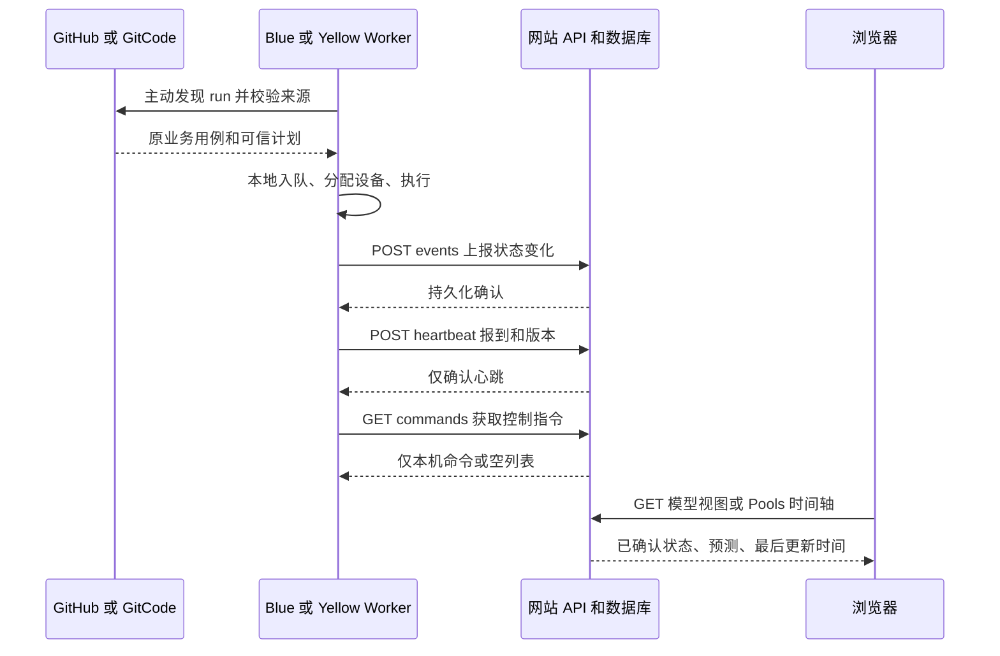
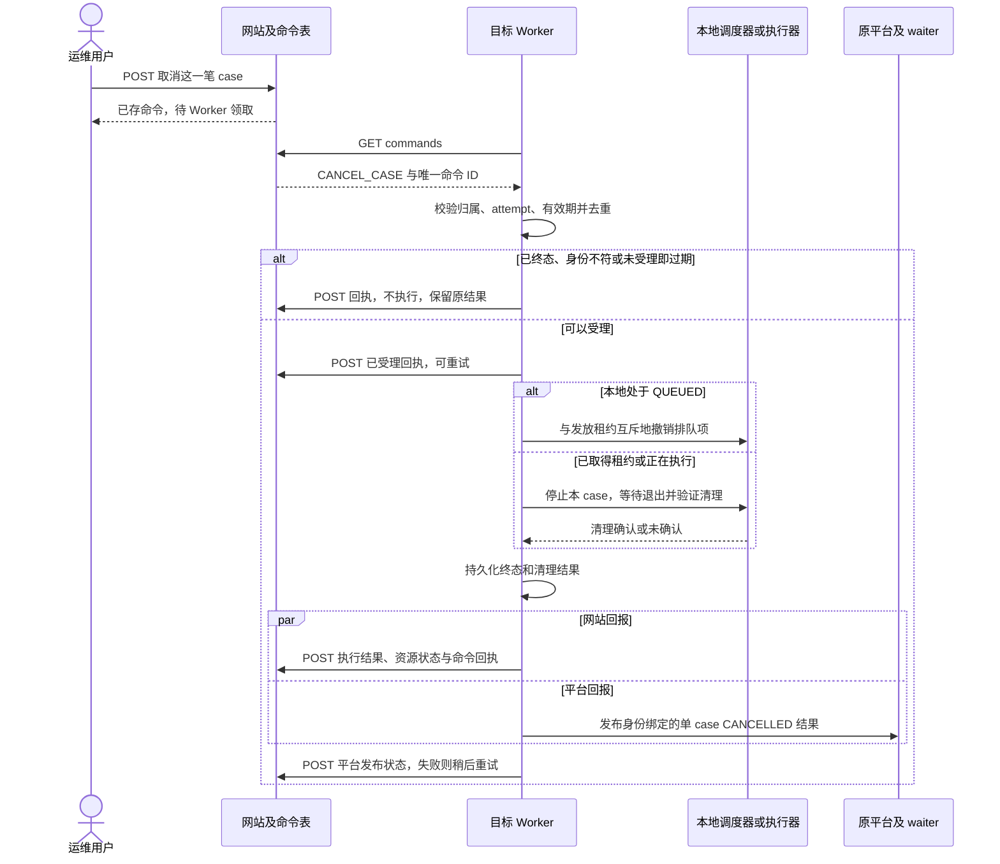
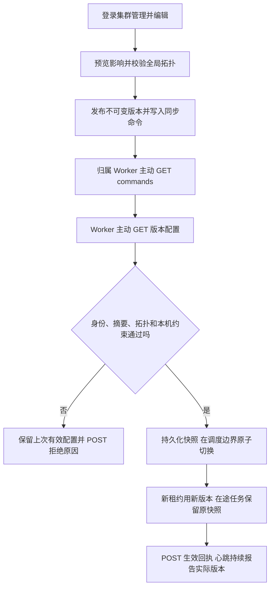

# Lite Actions 调度网站｜产品需求文档（PRD）

**版本：v0.1，评审稿 · 2026-11-17**　|　**代码基线：`main@63ec5d7`**　|　**交付性质：需求与初步设计，非上线记录**

> 网站回答三个问题：**哪些环境被谁占用？我的用例还要等多久？我点击取消、插队或暂停后，Worker 到底执行了没有？** 网站提供统一视图和管理入口，但不代替 Worker 分配设备，也不代替 GitHub/GitCode 授权或触发 CI。

## 1. 项目背景、边界与选型

Lite Actions 让 GitHub/GitCode 上的模型仓工作流把用例交给 Blue、Yellow 两台 Worker，在各自归属的 Pool 中运行。维护者目前需跨平台查看 Actions、回执和 Worker 本地状态；仅看平台进度评论，不能可靠判断一个 8P 用例正在排队、已经拿到卡，还是处在清理阶段。一个 16P 用例也不能只凭“共空闲 16 张卡”就判定可运行，还要满足已验证的多机组合。

| 对象 | 权威来源 | 网站职责 |
|---|---|---|
| 仓库、PR、workflow、run、attempt 与来源授权 | 原 GitHub/GitCode 工作流和 Worker 的既有来源校验 | 关联、展示、跳转；不接受网页凭空创建 CI 用例 |
| 已接收队列、实际顺位、占用设备、执行结果、清理是否确认 | 所属 Worker 的本地调度器、执行器和租约 | 消费事件和对账快照，区分事实、预测、未知 |
| 谁提交了管理操作；期望发布哪一版 Pools | 网站后端 | 鉴权、持久化、审计、分发；等待每台目标 Worker 确认生效 |

**采用 B+：Worker 直拉平台业务用例，网站下发控制任务。** A（网站轮询平台后再把 CI 用例派给 Worker）也能取消和插队，但还要迁移来源校验、增加任务交付与重领，并使网站中断阻塞新任务；第一版不采用。B+ 不要求将平台 Token 集中到网站。看板覆盖“Worker 已发现的用例”，不冒称包含尚未被 Worker 发现的 workflow。网站中断不应拖停原有 CI；控制操作可以延后，但不能假报成功。

**受控区限制：** 跨区 HTTP 连接只能由 Yellow 发起，Blue 用同一套协议。不要向 Worker 发起入站请求，不开反向隧道，不要求 WebSocket。只传批准的结构化元数据；日志、内部地址和凭据有各自的出区边界。平台出口现有报文、域名、速率、字节预算仍然有效。未经批准不得增加一条绕开出口策略的 HTTP 客户端。

**现有实现与所需改造。** 下列链接固定到基线，避免把设计当成现状：[Router 与平台回报](https://github.com/depeng1994/lite-actions/blob/63ec5d7247ab789b7eb25010b41c3191ae7322ab/ci_core/router.py)、[本地持久状态](https://github.com/depeng1994/lite-actions/blob/63ec5d7247ab789b7eb25010b41c3191ae7322ab/ci_core/job_state.py)、[Yellow 出口策略](https://github.com/depeng1994/lite-actions/blob/63ec5d7247ab789b7eb25010b41c3191ae7322ab/ci_core/egress_policy.py)、[拓扑分配](https://github.com/depeng1994/lite-actions/blob/63ec5d7247ab789b7eb25010b41c3191ae7322ab/ci_core/scheduler.py)、[执行与清理](https://github.com/depeng1994/lite-actions/blob/63ec5d7247ab789b7eb25010b41c3191ae7322ab/ci_core/executor.py)。当前 Yellow 主要发布入队确认和终态；Blue 尝试更新主要阶段的进度评论。两者都不是完整事件流水。当前 Router 启动时加载 Pools，执行器另行读盘，因此热加载不是简单覆盖文件。

## 2. 页面、角色与操作

| 页面 | 默认内容与用户操作 |
|---|---|
| **Pools 时间轴** | 纵轴列出全部配置环境，按 Worker → Pool → 物理节点/设备组展开；无任务、暂停、离线、隔离的环境也要有行。横轴是时间，标明“现在”。实线表示实际租约，虚线表示预测时段。条目显示平台、完整仓名、PR 作者与编号、workflow/run、case、阶段、已用时间、预计时长和后续排期。点击查看设备、租约和历史事件。不同逻辑分组不得重复累计同一物理设备。 |
| **模型仓任务** | 每个逻辑模型一个页签，默认 `vllm-ascend`。通过显式映射把受支持的个人仓、组织仓归入同一模型；不按仓名尾段猜测，保留平台、完整仓名和原始链接。纵向一行一个 case attempt，可按 run 分组。显示 PR 作者、触发者、PR、Action、case、需要/实际占用的 Blue/Yellow、A3/A5 节点数和 NPU 数。点击展开具体环境、实际节点 IP/端口（限批准范围）、设备 ID、时间与回报状态。未分配时写“请求 2 台，已分配 0 台”，不把候选 IP 当事实。 |
| **历史记录** | 默认仅展开待执行及执行中的任务（含准备、清理）；列表首行显示“展开最近 50 条历史任务”。每次再取 50 条，按结束时间及唯一 ID 稳定倒序，游标分页，与活动列表去重。切换模型只查该模型。手动/定时触发没有 PR 时展示真实触发类型；PR 作者与触发者未知时留空或标“未知”。 |
| **集群管理** | 登录且有管理权限后，可新增、暂停、恢复、删除环境或 Pool，并查看影响的节点、等待用例、活动租约、期望版本及各 Worker 实际版本。删除和暂停须明确作用范围；暂停不杀任务，删除先排空。 |
| **任务操作** | 在任务行提供“提前执行”“取消此用例”；确认框展示仓库、run、attempt、case、归属 Worker，说明只影响这个 case。页面区分待领取、已受理、成功、冲突、拒绝和过期；不要点击即变绿。 |
| **用户管理（Super）** | 列出所有网站用户的账号及**完整、可重复查看的登录密钥**，不做一次展示。新增时只填用户名，系统生成默认密钥；支持删除。删除使账号、密钥及现有会话失效，并保留历史操作人的审计记录。 |

**权限最小划分：** 访客/只读用户看获准公开的信息；已授权的运维账号可做单 case 操作和集群变更；Super 另可管理用户。权限由后端验证，不只隐藏按钮。网站用户密钥按产品要求允许公开，其持有者即可冒用该账号，日志只能归因到账号；不把它当作可证明个人身份的凭据。Super 管理页不等于匿名展示页。Worker 身份密钥、平台 Token、SSH/代理凭据不属于此功能，绝不展示。对未获出区批准的 IP，使用稳定环境别名；仅在浏览器打码、却已把原 IP 传给第三方后端，不算满足要求。

**同一组数据的示例（虚构）：** 模型页的一行可显示“vllm-ascend · PR #123 · Dispatcher Smoke · case_003 · Yellow/A5 · 申请 2 台 × 8P · 已分配 0 台”。只有 Worker 确认完整租约后，它才在 Pools 的两行出现实线占用条；点击任一条均回到同一 case，不生成两条任务历史。

### 预计耗时与排期

- 运行时长取同模型用例、同运行环境/资源形态（Pool 或等价硬件、节点数 × 每节点卡数）最近 **10 次有效可比执行**的中位数。建议首版取正常成功且起止时间齐全的样本；排队、取消、超时和基础设施异常不混入。展示样本数和口径；不足 10 次按现有样本标低置信度，0 次显示“暂无估算”。运行超过中位数显示“已超过预计”，不长期显示“剩余 0 分钟”。
- 算卡何时释放用**租约持有时长**（取得租约至清理并释放），不要用纯执行耗时替代。对排队任务，按实际队列顺序、人工优先级、执行槽、设备重叠、可用能力和已验证多机拓扑模拟最早启动/结束时间。积累不足、清理未确认、隔离、Worker 离线或配置分歧时，给阻塞原因而非伪精确时刻。预测不持有租约、不反写调度决策。

## 3. 通信契约：POST 报到，GET 取控制任务

以下路径是首版拟议接口。**GET 网站上的“任务”是取消、插队、配置同步等控制指令；不是待训练或待冒烟的 CI 用例。心跳响应不夹带命令，也不承担配置文件下载。**

| 发起方 / 方法与路径 | 用途与成功语义 |
|---|---|
| Worker `POST /api/v1/worker/heartbeat` | 启动时首次认证报到，以后定时报活；传 Worker 实例、协议版本、已应用的配置版本及简短健康摘要。后端用接收时间更新 `last_seen_at`；仅返回报到确认。无浏览器在线时照常记录。未预配的 Worker 不得自行注册取得权限。 |
| Worker `GET /api/v1/worker/commands` | 独立定时拉取**本 Worker**可处理的未过期命令；无命令返回空列表。读取不删除、不确认、不执行。按认证身份隔离，不相信查询参数自报的 worker ID；禁止中间缓存，响应 `Cache-Control: no-store`。 |
| Worker `POST /api/v1/worker/command-receipts` | 按 `command_id` 确认受理、完成、拒绝或冲突；应答丢失后可重发。网站只在取得相应回执后推进命令状态。 |
| Worker `POST /api/v1/worker/events` | 状态改变即提交，允许小批；含实例、事件 ID、序号、发生时间、目标身份和白名单字段。包括实际资源分配、释放、取消及平台回报状态。服务端持久化后才确认。 |
| Worker `GET /api/v1/worker/configs/{revision}` | 收到同步指令后拉取不可变配置或获准的 Worker 专属投影，验证版本、来源、完整性后应用并回执；不在心跳中传整份 JSON。 |
| Worker `POST /api/v1/worker/snapshots` | 首次上线、重连或发现序号缺口时提交有界快照，与服务器对账；只含所管任务、资源、配置版本和水位，不上传整个状态文件。 |
| 浏览器 → 网站 | `GET` 看板、详情或分页历史；有权限的用户 `POST` 单 case 命令及配置变更。浏览器不连 Worker，不持有 Worker/平台凭据。 |

**建议试运行参数，不是现网承诺：** 心跳 30 秒、GET 指令 15 秒，分别配置、带抖动；连续缺失 3 次心跳标记离线。命令正常领取延迟约一个轮询周期，**不含**终止和清理时间。在线但取令失败与整机离线分别告警。网络失败退避，尊重限流；为终态和取消回执预留预算，不为追求刷新率挤占 CI 回报。



### Blue / Yellow 统一上报

两端从**本地持久状态变更**生成同一版事件协议；应覆盖 `QUEUED`、`RESERVED`、`STAGING`、`RUNNING`、`CLEANING`、所有终态、资源回队/释放、隔离及平台发布状态。允许早退和跳过未发生阶段；暂时占用导致的合法重新排队不是旧事件倒灌。统一 GitHub/GitCode 进度阶段时，须同步调整并测试 Yellow 的出口白名单和平台适配，用固定字段和有界报文表达同一语义；不把 Blue 的诊断输出、附件或字节额度照搬给 Yellow。容量不够时区分“平台进度延迟”与“任务停滞”，不通过绕过策略补齐。

本地状态变化和待发事件须原子持久化或能从可靠日志重建；网站和平台各自重试，互不阻塞。服务器按事件 ID 去重，按 Worker 实例/序号及任务版本防止旧状态覆盖新状态。快照不可复活更老的 attempt，不可将离线机器的卡推断为空闲。离线缓存有上限；优先保留终态、未确认命令、租约和清理信息，确需合并时标明历史缺口，恢复后快照对账。上线前的历史只从有可靠身份的记录回填，并标明数据起点；无证据不补造阶段时间。

## 4. 取消与插队

### 4.1 取消一个 case，而不是取消整个 workflow

每条命令至少有 `command_id`、目标 Worker、`平台/完整仓名/run_id/attempt/dispatch_id（如有）/case_id`、操作账号、创建时间、有效期、目标状态前提。命令状态、执行结果、设备清理结果、平台发布状态是四件事，必须分列显示。



**竞争与故障处理：** GET 返回不代表领取成功。离线时留单，受理前过期不晚执行；丢包重投同一 ID，重启后仍能查到已受理或终态，不能重复停止进程。终态与取消发生竞争，以 Worker 对该次执行的原子决定为准；已完成的 `PASS` 不改写。受理后跨过有效期不能放弃正在执行的清理。排队取消不占卡；清理未确认时，即使任务是 `CANCELLED`，设备仍显示“不可调度/待核验”。平台不可达只重试结果回报，不再执行取消。网站不得直接释放租约，也不调用整条 workflow 的 cancel 接口。原 waiter 的作业徽标可能为失败；验收看受信的单 case 结果和其余用例不受影响，不强求平台徽标为 Cancelled。

### 4.2 插队

用户在 `QUEUED` 行点击“提前执行”；反馈用同一命令协议。Worker 在本地锁内核对任务仍排队，在**同 Worker、同 Pool、同调度类别**中优先于普通项；多个人工提前项按 Worker 确认的操作顺序排列，普通项保留原相对次序，原入队序号不覆盖。回执携带生效顺位与顺位快照版本；刷新全部受影响任务的预测。已 `RESERVED` 则返回冲突，不抢运行任务、不拆机组、不越过隔离或替他人终止训练。队首受阻继续遵守原调度规则；插队成功不是马上开跑的承诺。

## 5. 集群管理：一份期望配置，分 Worker 确认生效

生产 **Pools JSON 只有网站后端一个期望配置发布源**。GitHub 的 `config/pools.json` 是初始化模板/离线开发基线，不是生产运行时第二写入口。每次编辑基于明确的旧版本；并发编辑冲突时要求重新核对，不静默覆盖。新版本不可变，使用递增 `revision` 与 SHA-256（覆盖原先“MD5 是否变化”的目的）；摘要校验内容，发布者认证与 Worker 本地执行边界另行校验。



| 操作 | 调度语义与 GUI 反馈 |
|---|---|
| 新增 | 先登记、后验证、再可分配。校验唯一 owner、物理指纹、设备组、已验证多机组合及绑定容器；Worker 还须对照本机受信清单，禁止普通 GUI 配置任意 SSH 目标、命令或开启抢占。允许新增获准资产，不把填 IP 等同于可执行。 |
| 暂停/恢复 | 暂停从 Worker 确认起禁止新租约，已运行任务继续；已排队用例保留并展示阻塞原因，原有超时/平台失效规则不被取消。若池内有其他合格节点，可照旧选择。恢复只恢复候选资格，不覆盖隔离。 |
| 删除 | 先停止新租约并排空，显示受影响的队列、活动租约和隔离引用。未解决不得硬删；仅有的候选被永久移除时，要先处理或显式取消等待用例，不静默改派。删除后，历史仍按原版本解释。 |
| 回滚与故障 | 回滚发布一个新的 revision 引用旧内容。单个 Worker 未确认时显示“部分生效/待同步”，不可冒称全局成功。跨 Worker 迁移物理资源，旧 owner 必须先确认排空并解除归属，新 owner 才可启用；旧 owner 离线时禁止交接。网络故障继续使用最后有效版本，不能自动启用 GitHub 模板。首次没有可信有效配置则不放行新租约。 |

配置版本贯穿分配、staging、执行和 cleanup；Router、executor 及其子进程使用同一租约快照。版本放在受保护的运行状态目录，不改运行中的发布代码树。所需的本机密钥和执行权限仍由部署侧管理，不上云。

## 6. 存储、托管与运行约束

| 数据 | 保存和查询方式 |
|---|---|
| 最新 Worker、环境、租约、活动任务 | 更新当前状态表；保留服务器接收时间及事件水位。心跳只更新最新值，不把每次轮询永久写历史。 |
| Case 与状态事件 | 以完整执行身份作唯一键；事件追加写，按 Worker/序号去重。常用索引：模型/终态时间/ID、Worker/Pool/活动状态、用例配置/结束时间、命令目标/状态。状态由事件事务性更新，或从事件重建。 |
| 配置、命令、用户、审计 | 配置版本不可变；命令及回执可重放；审计保存操作人、对象、前后值/结果，不把用户密钥或其他凭据写入日志。删除用户、节点不抹历史。 |
| 历史归档 | 热库放索引和近期明细；归档仅限获准出区的历史，按时间分段压缩到对象存储。先验证归档与恢复，再清理热库。大体积执行日志不为此看板出区。保留期、归档预算由部署时确定。 |

**首选 Cloudflare Workers + D1 + R2，备选 ChatGPT Sites。** GitHub 负责代码、评审和交付，不用 Git 提交模拟实时数据库。优先零/低增量费用，不承诺永久免费。以 2 台 Worker、15 秒 GET、30 秒心跳、每天 300 个 case、每个 8 条事件且逐条提交估算：每天约 **19,680 次** Worker→网站请求（11,520 + 5,760 + 2,400）；不含 UI、回执、重试、快照和配置。每事件 1 KB 时约 72 MB/30 天，未含索引及审计。评估时分开算 HTTP 请求、数据库读写行、**单库容量**、对象存储和尤其重要的 Yellow 出站字节（含请求头）。Cloudflare 免费 D1 **单库 500 MB，不是 5 GB 单库**；按实测增长决定归档阈值。参见 [D1 限额](https://developers.cloudflare.com/d1/platform/limits/)、[D1 计费](https://developers.cloudflare.com/d1/platform/pricing/)、[Workers 限额](https://developers.cloudflare.com/workers/platform/limits/)及 [ChatGPT Sites 官方说明](https://help.openai.com/en/articles/20001339-creating-and-using-chatgpt-sites)。

**Yellow 实测是上线门槛，网站首页能打开不算通过。** 用同一小型探针对两种候选后端测试：批准域名、DNS/TLS/代理、非交互机器鉴权、POST 心跳与事件持久化、带认证 GET 取到正确命令和配置、跨身份拒绝、GET 禁缓存、响应体可读、报文上限、429/超时与断线补传。只用虚构任务/别名，不输出凭据或代理信息；记录观测时间、状态码、耗时和字节数。先过最小请求测通，再按拟议频率核算与平台共用的日预算，超限则降低频率/批量提交或重新选址，不绕过出口。最终选型同时满足网络、数据出区、吞吐、恢复与费用要求；两种 SaaS 都不过时，改用已批准的管理服务位置，不暴露 Worker。

## 7. 初步目录结构与现有代码接点

以下为**计划结构**；本次仅新增本 PRD，不代表目录内的服务已实现。

```text
control-center/                  # 网站功能统一入口
  docs/PRD.md                    # 本文：产品、契约与验收
  frontend/                      # Pools 时间轴、模型页签、集群/用户管理
  api/                           # 鉴权、事件摄取、命令、快照对账、配置发布
  db/migrations/                 # 状态、历史、用户、命令和审计表
  contracts/                     # 版本化 JSON Schema、错误码、双端契约样例
  deploy/                        # 首选平台配置、备选适配与非秘密部署说明
  tests/                         # API/界面/端到端、假 Worker 与平台 waiter
  probes/                        # Yellow 出口可行性探针，仅用合成数据
ci_core/                         # 现有 Worker，不复制调度器进网站
  control_client.py              # 拟新增：心跳、GET 取令、待发事件与回执
  router.py / job_state.py        # 持久化状态变化；取消、人工优先级与租约互斥
  config.py / executor.py        # 版本化配置、租约固定快照及清理边界
  egress_policy.py / reporting.py # 双区统一阶段，保留区域出口约束
config/pools.json                # 仅作初始模板
```

## 8. 交付顺序与验收

建议按 **G0 出口探针 → G1 双视图与统一遥测 → G2 单 case 控制 → G3 版本化集群管理** 开放；登录鉴权和审计先于任何写入口。以下均为验收要求，不是当前已通过的测试。

| 关卡 | 必须能复现的结果 |
|---|---|
| G0 · 网络 | 在真实 Yellow 上只用出站 HTTP；POST 心跳不返回命令，GET 取令不确认也不消费，Blue 取不到 Yellow 的命令。候选服务实测结果和预算可对比。 |
| G1 · 看板与身份 | Blue/Yellow 同一阶段呈现一致；可区分已分配、实际运行、清理和释放。GitHub/GitCode 同名仓、同 run 的 rerun、同名 case 不串单。默认 vllm-ascend；103 条历史按 50/50/3 加载且无重复。0、少于 10、恰好 10 个耗时样本均有明确显示。 |
| G1 · 故障 | 断网 30 分钟原 CI 照常执行，页面标过期而非空闲；重连、乱序、重发及 Worker 重启后，终态不回退、租约不重复。网站停机不影响原平台回报。 |
| G2 · 取消 | 排队、运行中、已完成、旧 attempt、回执丢失、离线过期、清理无法确认各测一次；同 run 其他 case 不受影响。GitHub 和 GitCode 分别核对实际 waiter 结果；平台回报失败只重试回报。 |
| G2 · 插队 | 至少两个普通任务和两个人工提前任务验证稳定顺序、重启保序；分配竞争返回明确结果。16P 不拆组，运行任务不被抢占。 |
| G3 · Pools | 验证新增待核验、暂停只挡新租约、在途任务按原配置完成清理、删除前排空、坏配置拒绝、部分生效、回滚与跨 owner 交接；网络失败不退回模板。 |
| 权限与成本 | 匿名用户不能写；非 Super 不能读用户密钥列表；Super 新增后可再次查看完整密钥，删除后旧会话不能发命令。审计无凭据。测量查询行数、容量增长、Yellow 出口和 API 延迟，验证备份恢复。 |

**发布前待核实：** Yellow 可批准的域名/字段/真实 IP 展示范围及流量预算；非交互鉴权在候选托管环境能否成立；两端平台 waiter 对取消的实际展示；数据库保留期、恢复目标及轮询参数。上述结果影响部署或阈值，不改变“Worker 主动建连、POST 报到、GET 取令、本地调度”的协议边界。
