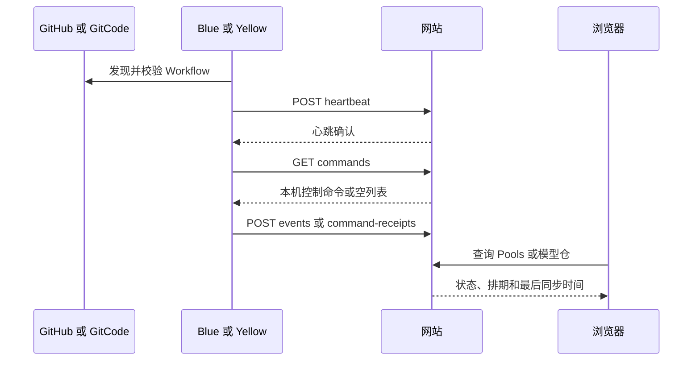
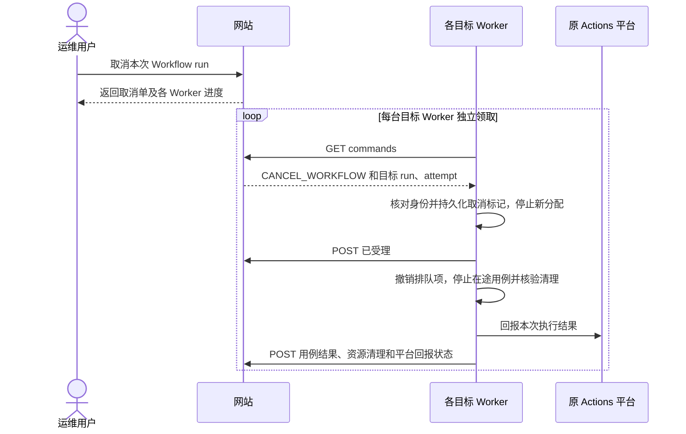
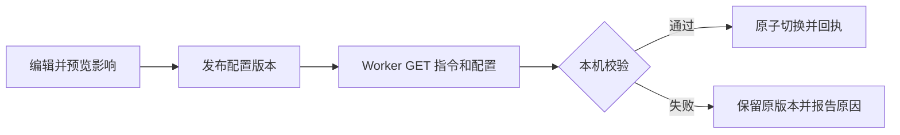

# Lite Actions 调度网站 PRD

**v0.2 · 2026-11-17**

## 1. 目标与部署环境

维护者在一个网站上查看 Blue、Yellow 的 A3/A5 环境：谁在用卡、来自哪个仓和 PR、预计何时结束、下一批任务何时能跑。运维人员在网站上取消一次 Workflow 运行、调整排队顺序、管理集群。

Blue、Yellow 各自从 GitHub/GitCode 发现 Workflow，校验来源，在所属 Pool 内排队、分配设备、执行并回报结果。网站汇总 Worker 已发现的任务，保存管理命令和生产 Pools 配置。网站不可用时，Worker 使用最后生效的配置继续 CI。

网站部署目标为 Cloudflare Workers（页面和 API）、D1（当前状态、历史、配置、审计）和 R2（压缩历史归档）。Yellow 只允许向批准的域名主动发起 HTTPS 请求；Blue 使用相同协议。机器身份独立认证，出区字段和请求字节计入各区预算，原始运行日志留在执行区。

## 2. 页面与权限

| 页面 | 要求 |
|---|---|
| Pools 时间轴 | 纵轴按 Worker → Pool → 节点/设备组列出所有环境，包括空闲、暂停、离线和隔离环境；横轴为时间。实线表示实际租约，虚线表示预计占用。任务条显示仓库、PR 作者和编号、Workflow、case、阶段、已用及预计时长。多节点任务可跨行，物理卡只计一次。 |
| 模型仓 | 默认 `vllm-ascend` 页签；同一模型的个人仓和组织仓按配置合并，保留平台、完整仓名和链接。纵向列出活动 case，按 Workflow run 分组。分别显示 PR 作者与触发者、PR、Action、用例、申请与已分配的 Blue/Yellow、A3/A5 节点数及卡数。展开可看已分配环境的 IP/端口和设备 ID；受限地址显示稳定别名。手动、定时运行按实际触发类型显示。 |
| 历史与操作 | 默认展开待执行、准备、运行和清理中的任务。在列表首行点击加载最近 50 条历史 case，每次再加载 50 条，按结束时间和唯一 ID 倒序分页。**取消入口在 Workflow 分组上**，确认框显示仓库、run、attempt、涉及的 Worker 和用例数；排队 case 可点“提前执行”。 |
| 集群管理 | 已授权的运维用户可新增、暂停、恢复、删除环境或 Pool，查看受影响的队列、租约，以及每台 Worker 生效的配置版本。 |
| 用户管理 | Super 可列出所有网站账号及完整登录密钥，重复查看；新增时只输入用户名，由系统生成默认密钥。删除后账号、密钥和会话立即失效，历史审计保留。 |

只读用户查看获准信息；运维用户管理任务与集群；Super 另可管理用户。后端校验权限。操作记录账号、目标、时间和结果；用户密钥只在 Super 管理页提供，Worker、平台和 SSH 凭据留在部署环境。

**耗时与排期。** 取同模型、同用例、同环境和资源形态最近 10 次成功执行的中位耗时，不含排队时间。显示样本数；不足 10 次用已有样本，0 次显示“暂无估算”，超时长显示“已超过预计”。预测后续排期使用实际队列、槽位、设备组、已验证的多机拓扑及租约持有时长。离线、隔离或清理未确认时，显示阻塞原因和最后更新时间。

## 3. Worker 通信与数据

| Worker 主动请求（前缀 `/api/v1/worker`） | 用途 |
|---|---|
| `POST /heartbeat` | 首次报到和定时心跳；上报实例、健康和配置版本，仅返回确认。默认 30 秒一次，连续缺失 3 次标记离线。 |
| `GET /commands` | 默认 15 秒一次，只取本机未过期的控制命令。空队列返回空列表；禁缓存，读取不算受理。 |
| `POST /command-receipts` | 按命令 ID 回报受理、完成、冲突、过期或失败。 |
| `POST /events`、`POST /snapshots` | 状态变化时发送事件；首次连接、重连或序号缺失时提交有界快照。 |
| `GET /configs/{revision}` | 按同步指令拉取不可变配置，应用后回执。 |



Blue、Yellow 从本地持久状态生成同一套阶段：`QUEUED → RESERVED → STAGING → RUNNING → CLEANING → 终态`，并记录重新排队、分配、释放、隔离和平台回报。两端向网站及原平台使用一致的阶段含义，Yellow 使用批准的精简报文。事件与本地变更一并持久化；平台和网站独立重试。网站按实例、序号和事件 ID 去重，重连后按快照对账。心跳只更新最后在线时间；D1 保存可分页的历史索引，R2 按时间归档，恢复校验后清理热库明细。

## 4. 取消 Workflow 与插队

**取消对象是一次 Workflow 运行**，键为 `平台 + 完整仓名 + run_id + attempt`。同一 PR 的其他 Workflow 及后续 rerun 不在范围内。`dispatch_id`、`case_id` 用来定位该次运行的执行明细。一次点击生成一个取消单，由涉及的每台 Worker 分别领取；同次运行的全部 Lite Actions 用例共用取消决定，包括稍后才被发现的用例。



Worker 在同一调度边界处理取消标记和新租约。待执行用例退出队列，已分配用例停止并清理，已结束用例保留原结果。重复命令返回原回执；旧 attempt 不得影响新 attempt。离线 Worker 显示“待领取”；受理前过期需重新发起，已受理的清理继续。网站汇总各 Worker 进度，分列 **Workflow 平台状态、Worker 停止进度、设备清理结果**；清理未确认的设备保持不可调度。平台回报失败只重试回报。平台自托管之外的作业是否随同停止，见第 7 节。

**插队。** 对仍在 `QUEUED` 的 case，Worker 在同 Worker、同 Pool、同类别队列内将其提前。人工提前项按受理顺序排列，其他项维持原顺序；已取得租约则返回冲突。回执返回新顺位并刷新排期。插队不抢占在途任务，也不拆分多机组合。

## 5. 集群配置与热加载

网站发布唯一生产 Pools JSON；仓库 `config/pools.json` 用于初始化。每次修改基于明确的旧版本，生成递增 `revision` 和 SHA-256。Worker 验证来源、内容和本机资产清单后，在调度边界切换；新租约使用新版，在途任务从分配到清理固定使用原版本。



新增环境先核验 owner、物理身份、设备组、多机拓扑和容器绑定，再启用。暂停从 Worker 确认起停止发新租约，已运行任务继续；恢复后按现有隔离和容量规则排队。删除先排空并处理等待项、租约和隔离引用，历史引用保留。跨 Worker 迁移先由原 owner 确认排空。回滚以新版本发布旧内容；页面分别显示每台 Worker 的期望版本和实际版本。

## 6. 目录与验收

```text
control-center/
  docs/PRD.md       frontend/       api/             # 产品、网页、服务端
  contracts/        db/migrations/  deploy/          # 协议、表结构、部署
  probes/           tests/                           # 出口探针、集成与端到端测试
ci_core/                                             # Worker 接入
  control_client.py                                  # 心跳、取令、事件与回执
  router.py / job_state.py / egress_policy.py        # 取消标记、优先级、出口预算
  config.py / executor.py / reporting.py             # 配置快照、清理、平台回报
```

| 验收项 | 通过条件 |
|---|---|
| Yellow 出口 | 在真实 Yellow 使用批准域名和机器凭据完成 POST 心跳、GET 本机命令和配置、POST 回执；Blue 无法领取 Yellow 命令。按实测请求头和报文核算日预算，终态回报有预留。 |
| 看板 | 两区同阶段同显示，空闲/离线/隔离可区分；完整租约才绘制实际占用。103 条历史分 50/50/3 加载且无重复。覆盖 0、少于 10、满 10 个耗时样本。 |
| Workflow 取消 | 在 GitHub、GitCode 各测一次含 Blue/Yellow、排队和运行用例的 run；一次点击覆盖全部目标，已完成结果保留，另一 run 和 rerun 不受影响。覆盖晚发现、离线、重复领取、自然结束和清理失败，核对平台终态。 |
| 插队与配置 | 验证重启后顺序不变、16P 组合完整；验证新增核验、暂停排空、删除、回滚、双 Worker 部分生效和在途清理沿用旧配置。 |
| 故障、权限与容量 | 断网 30 分钟 CI 继续；恢复后重发不重复、状态不倒退。非 Super 无法读取密钥列表；删除账号后旧会话失效。验证归档恢复，记录日请求、库增长、查询延迟和 Yellow 出站字节。 |

## 7. 产品待确认

取消一次 Workflow 时，平台自行执行的 lint、构建等非 Lite Actions 作业是否也应随整次运行终止？这决定是否需要原平台的 Workflow 取消权限，以及原生 Actions 页面应显示的最终结论。
