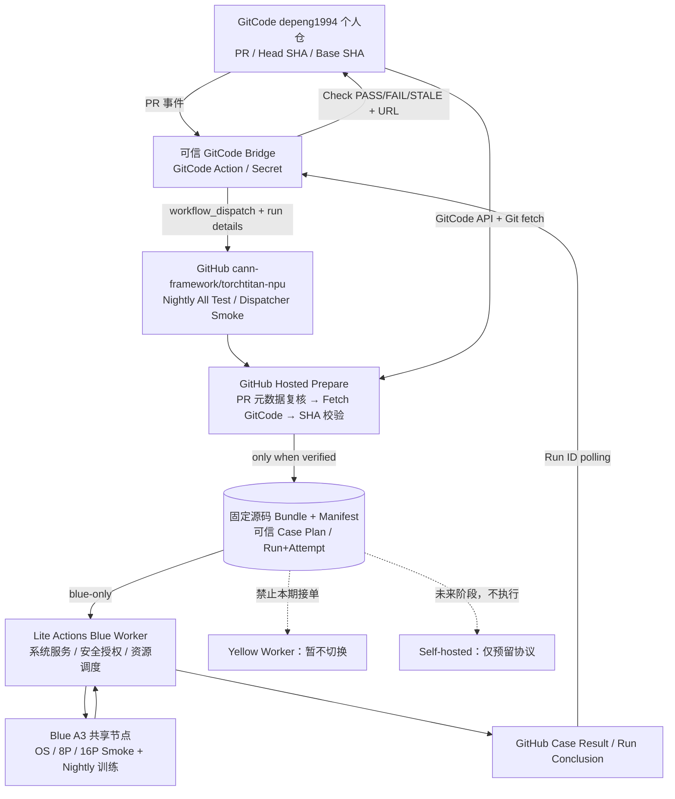
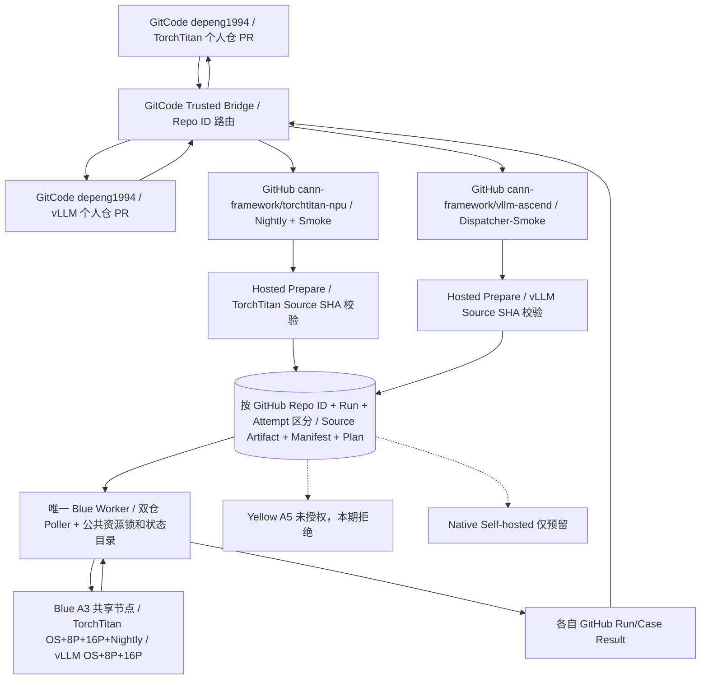
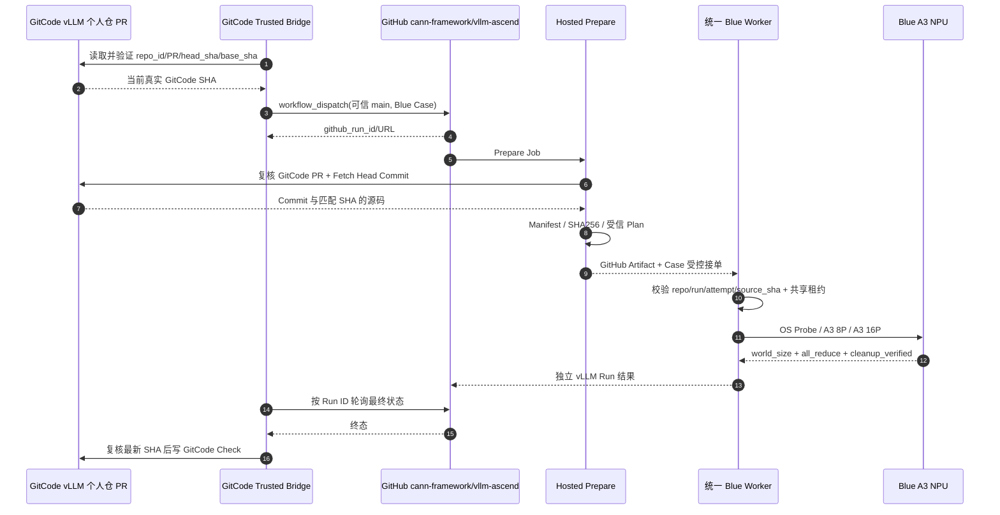
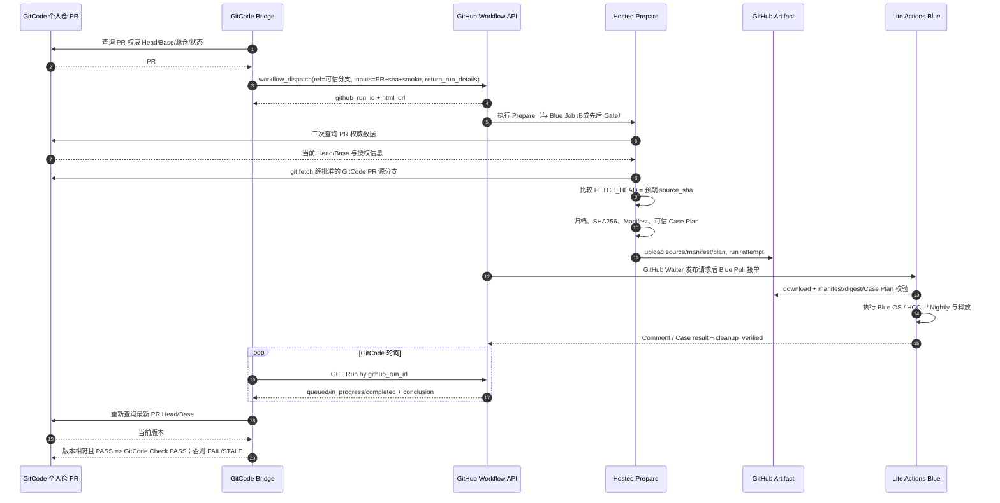
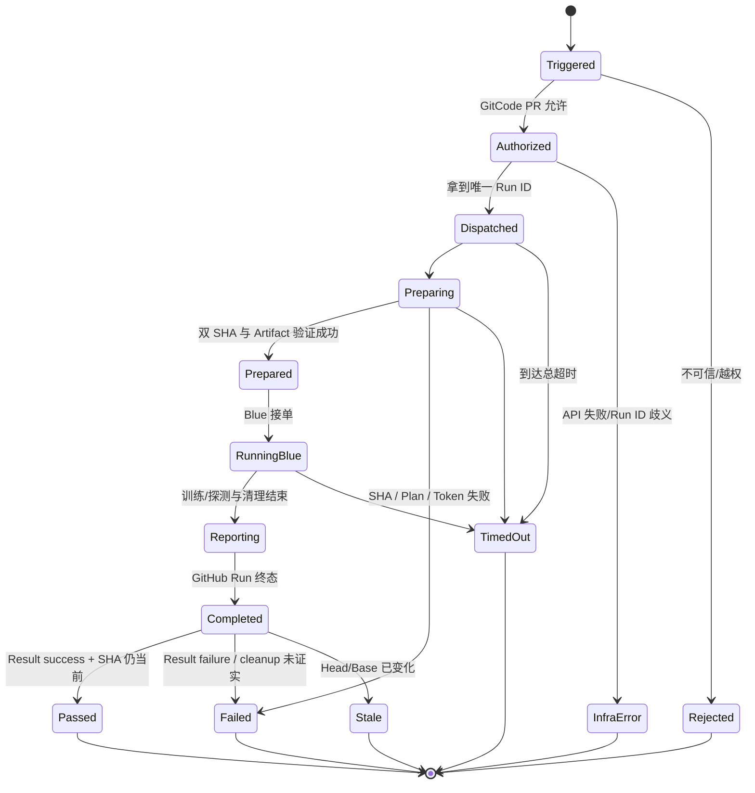

# GitCode → GitHub Actions 双仓训练 CI 转发与统一源码准备：详细设计

> **版本**：V2.2 · 双仓 + vLLM Blue A3 Smoke / 待端到端验收  
> **更新**：2026-11-01  
> **设计分支**：`depeng1994/lite-actions:gitcode-forward`  
> **GitHub 组织**：`cann-framework`（已完成重命名）  
> **源仓**：GitCode `cann/torchtitan-npu`（上游只读）与 `depeng1994` 个人仓（首期开发、合并及验收范围）  
> **目标 CI 仓**：GitHub `cann-framework/torchtitan-npu`（master）及 `cann-framework/vllm-ascend`（main）  
> **执行与调度仓**：GitHub `depeng1994/lite-actions`  
> **生效边界**：同一个 Blue Worker 首期接入 TorchTitan 与 vLLM 两个 GitHub 仓；vLLM 新增 Blue A3 OS/8P/16P Smoke。Yellow Worker **不部署、不启用、不验收硬件**；原生 Self-hosted Runner 仅接口预留。

## 0. 决策摘要与现状核对

**V2.2 增补的重要范围：** V2.0 仅覆盖 TorchTitan-NPU，遗漏了 vLLM-Ascend。现在明确将 GitCode `depeng1994` **vLLM 个人仓 PR → GitHub `cann-framework/vllm-ascend` → 可信 Prepare → 同一个 Blue A3 Worker → GitCode Check** 纳入本期核心需求；vLLM 本期必须包含 Blue Worker OS Probe、A3 8P 和 A3 16P 真实 HCCL Smoke。既有 Yellow A5 8P/32P 不算 Blue 的验收，也不要求用户现在动 Yellow。GitCode vLLM 个人仓实际项目 ID/地址需授权环境验证，不能把 GitHub 同名 Fork 当作 GitCode 可用性的证明。

**本轮确认的架构决策：** 首期只处理 **GitCode PR 的训练代码、已有测试用例和经批准的 Case 选择器变更**。GitCode 个人仓的可信 Bridge 通过 GitHub `workflow_dispatch` 启动 **已有的** Nightly All Test / Dispatcher Smoke Test；GitHub Hosted `prepare` Job 从 GitCode 固定 PR Commit、核验并封装源码；现有 Lite Actions **Blue Worker** 拉取与校验该产物、执行既有任务；GitCode Bridge 根据同一个 GitHub Run 的终态和最新 PR Head 判定 PASS/FAIL/STALE。保留原生 Self-hosted Adapter 协议设计，但本期不实现、不注册 Runner、不列硬件验收门槛。

**本轮不再保留三个独立 Action 的开发/验收目标**：

- ~~`a3_8p_lite_actions.yml` / T16~~
- ~~`a3_16p_lite_actions.yml` / T17~~
- ~~`a5_64p_lite_actions.yml` / T18~~

其测试能力不是取消，而是归并：**Nightly All Test** 验证训练用例，**Dispatcher Smoke Test** 验证 Blue 侧系统探测、8P/16P 通信与释放。**A5/Yellow 不在本期执行范围**。三个旧 YAML 文件的实际清理应在统一入口合入、旧 Required Checks 和外部调用方清理完成后单独提交；本轮仅修改设计文档，不直接删除模型仓生产 YAML。

**已核对的仓库事实（2026-11-01，只读）**：

1. GitHub 组织已是 `cann-framework`；`cann-framework/torchtitan-npu` 仓库 ID 为 `1210038933`，默认分支 `master`。独立 Lite Actions 仓为 `depeng1994/lite-actions`，默认分支 `main`。
2. Lite Actions `main` 的 `ci_core/contract.py` 已列出唯一业务入口 `nightly_fulltests.yml`、`lite_actions_dispatcher_smoke.yml`，使用 schema 3。Blue/Yellow Worker 均在代码中存在。
3. **模型仓 `master` 尚未完成对应收编**：目前 `.github/workflows/` 仍有上述三个独立 YAML、`lite_actions_common.yml` 等；新入口在 [模型仓 Draft PR #11](https://github.com/cann-framework/torchtitan-npu/pull/11) 的 `ci/lite-actions-v2` 分支，未合入。**不能直接在 `master` 上假定 Nightly/Smoke 可触发**。
4. Lite Actions `config/pools.json` 中 Blue A3 池为 `enabled=true`，Yellow 的 A3/A5 池均为 `enabled=false`。`docs/blue-worker.md` 记载 Blue 已使用 systemd 正式服务，当前模型工作流仍从 PR 分支调用；`docs/validation.md` 提供已有 Blue Smoke/Nightly 实机证据。**历史成功不能代替本次跨平台桥接成功**。
5. 远端可访问设备中，按用户指定应使用**非 depeng 的第二台 Remote Desktop Commander 环境**查询 GitCode 登录/凭据；只允许向 GitCode `depeng1994` 个人仓写入/合并，`cann/torchtitan-npu` 上游仓不得写入。个人仓的实际项目地址、目标分支、权限及 GitCode Actions 状态须在 P0 Spike 中确认，不应将猜测的网址视为已授权。
6. 现有 `sync-upstream.yml` 会从 `gitcode.com/cann/torchtitan-npu` 拉取并同步 GitHub 分支；该同步可能覆盖/清理 GitHub 侧分支。新方案不能依赖 GitHub 上存在一个永久可写的个人 PR 镜像分支。
7. `cann-framework/vllm-ascend` Repository ID 为 `1438625957`、默认 `main`，已存在 `lite_actions_dispatcher_smoke.yml`，但当前只支持 Yellow A5 8P/32P。其 `prepare_request.py`、`wait_result.py` 与 Workflow 的 checkout 仍有旧组织名硬编码，必须适配。
8. Lite Actions 的 `ci_core/vllm_ascend.py` 目前只有固定 A5 Case；`ci_core/ssh_runner.py` 使用模块级 VLLM 判定并硬编码 `a5_smoke.py` 和证据文件。vLLM Blue A3 不属于简单把 A5 Case 改名，必须在可信注册表、执行脚本、repo 身份和产物校验处扩展。

### 0.1 实施范围

| 项目 | 本期策略 | 说明 |
|---|---|---|
| GitCode 入口 | `depeng1994` 个人仓中可信 `.gitcode/workflows` | 本期开发和真实 PR 触发均在个人仓闭环；上游只读 |
| GitHub 入口 | TorchTitan Nightly/Smoke + vLLM Dispatcher-Smoke | 分别在可信 master / main 触发；禁止执行 PR 新增 Workflow |
| 源码 | GitCode PR Head SHA（严格比对） | GitHub `control_sha` 与 GitCode `source_sha` 分离 |
| 准备 | GitHub Hosted `prepare` Job | 所有 NPU 调度前先固化 Source Bundle、Manifest、Plan |
| 执行 | 一个 Lite Actions Blue Worker，双仓共用 | TorchTitan 与 vLLM 使用同一 `a3_shared_blue`、同一设备/端口锁、同一 Blue systemd 和持久化状态 |
| Yellow | 用户后续手动操作 | vLLM 原有 A5 8P/32P 定义保留；本期 GitCode Bridge 严禁任何 Yellow/A5 调度 |
| 原生 Self-hosted | 协议/文件接口预留 | 不实现 adapter，不部署 runner、不列为本期验收 |
| 新增 GitHub Actions YAML | 明确不支持自动运行 | PR 修改 Workflow 走独立基础设施评审 |
| 独立 A3/A5 Workflow | 从新设计、验收和调用入口中移除 | 物理删除待统一入口正式上线后清理 |

## 1. 需求目标与需要解决的问题

### 1.1 需求目标（结果导向）

| ID | 需求目标 | 生产级验收口径 |
|---|---|---|
| G01 | GitCode 个人仓 PR 可以自动触发 GitHub CI | GitCode PR 页出现原生 Bridge Action；GitHub 有对应可点击 Run |
| G02 | 实际测试源码精确对应 GitCode PR | `gitcode_head_sha = manifest.source_sha = 训练端校验记录的 source_sha` |
| G03 | GitHub 控制流保持可信、任务可复用 | GitHub 只运行已注册的 Nightly/Smoke，不能执行 PR 新增 YAML |
| G04 | 所有执行端使用统一 Prepare | GitHub Prepare 完成 SHA/Artifact 校验后才允许 Blue 接单 |
| G05 | Blue 正式环境可运行、结果闭环 | GitCode 个人 PR → GitHub Smoke/Nightly → Blue 实机 → GitCode Check |
| G06 | 失败与过期不能误报 PASS | SHA 错误、运行失败、超时、PR 更新、资源未释放均 FAIL/STALE |
| G07 | 改名后稳定运行，存量能力不回归 | `cann-framework` 身份校验、Blue systemd、原 GitHub CI 可回归 |
| G08 | Yellow 完全隔离、本期不碰 Self-hosted | 生产 Yellow 状态和设备不改变；原生 Runner 只保留扩展口 |
| G09 | vLLM GitCode PR 跨平台闭环 | vLLM 个人仓 PR → vLLM GitHub Smoke → Blue → GitCode Check，代码 SHA 精确一致 |
| G10 | vLLM Blue OS/8P/16P HCCL Smoke | OS 不占卡，8P `all_reduce_sum=28`、16P `all_reduce_sum=120`；蓝区清理有证据 |
| G11 | 双仓互斥及隔离 | TorchTitan/vLLM 在同一 Blue Worker 不重复占卡、不串仓、不串结果，Yellow 无任何更改 |

### 1.2 必须解决的工程问题

| 问题 | 当前风险 | 解法 / 关键 Gate |
|---|---|---|
| Q01 个人仓 GitCode 权限 | 不允许直接写入 `cann` 上游 | 使用第二台远程环境认证，只向 `depeng1994` 个人仓提交/发 PR；权限失败阻断 |
| Q02 GitCode Secrets/事件安全 | PR 内容可能携带恶意脚本 | 可信目标分支 Bridge，`pull_request_target` 仅跑受信代码；提交代码不接触 Token |
| Q03 GitHub Dispatch 关联 | 同时运行会串单 | `return_run_details=true` 获取明确 Run ID；不可用则实现有唯一 nonce 的受控关联并拒绝歧义 |
| Q04 Workflow 是否已注册 | 模型 `master` 目前没有统一入口 | 先合入/切换已审查的 Nightly/Smoke；试运行可锁定现有 `ci/lite-actions-v2` 分支 |
| Q05 GitCode Commit 可获取性 | Fork 分支、SHA 裸 fetch 并非总可用 | 根据经 API 校验的 PR 源仓/分支 fetch，`rev-parse` 必须等于传入 Head SHA |
| Q06 双 SHA/身份 | schema 3 目前用 GitHub Run `head_sha` 表示待测源码 | `control_sha` 与 `source_sha` 分开；扩展 Plan/Report/Waiter 校验但保留旧 GitHub CI 兼容性 |
| Q07 Artifact 消费 | 当前 Worker `model_archive()` 直接 GitHub fetch | GitCode 转发路径消费 Prepare 的 Source Bundle；原生 GitHub 路径保持旧逻辑，阶段式上线 |
| Q08 Blue 资源权限 | NPU 多用户共享、隔离记录 | 只允许 `worker=blue`、`pool=a3_shared_blue`、受信 Case；不改资源抢占、设备释放逻辑 |
| Q09 GitCode 结果正确性 | 旧 PR 版本完成后可能误判 | GitHub Run 到终态后再次查询 GitCode PR Head/Base；不同则 STALE/FAIL，不写当前 PR PASS |
| Q10 真正端到端验收 | CPU 模拟不能证明跨平台能运行 | E2E-01～E2E-06 均需真实 GitCode PR 页面、GitHub Run、Blue 证据、回写状态 |
| Q11 GitHub 组织更名 | 多个代码常量仍为 `torchtitan-npu/` | 统一目标 `cann-framework`、稳定 repo ID 校验、全链路 CI 回归 |
| Q12 镜像双写与状态恢复 | Github 同步会删分支、Blue 有运行中状态 | 不依赖 PR 镜像分支；Blue drain、同一状态目录、升级回滚与 pending report 恢复 |
| Q13 vLLM 现有入口只支持 A5 | Blue 选择器无法准入或错误派发 Yellow | vLLM 受信 Smoke Workflow/测试注册表增加 Blue OS/A3 8P/16P；新 Provider 默认 Blue |
| Q14 执行端 A5 硬编码 | A3 16P 误用 A5 脚本/验证文件 | 按每任务仓库+Case+池类型分发通用 HCCL Smoke；A5 旧用例兼容 |
| Q15 Blue 跨仓并发和状态隔离 | 同一台 NPU 可能双重租赁或结果串仓 | 唯一 Blue Router、共享租约，任务键含控制仓 ID + Run/Attempt/Case |
| Q16 vLLM GitCode 项目身份尚未核实 | 错把 GitHub Fork 当作 GitCode PR 来源 | 对 vLLM GitCode 个人仓单独 P0 授权/Repo ID/PR 事件 Spike |

## 2. 系统架构与部署边界

### 2.1 组件职责

| 组件 | 部署位置 | 职责及不允许的行为 |
|---|---|---|
| GitCode Personal PR | `depeng1994` 个人仓 | PR、Head/Base、提交来源的权威源；禁止把个人仓 CI Token 下发给训练机 |
| GitCode Bridge | 个人仓 `.gitcode/workflows/` | PR 事件、调用 GitHub Dispatch、轮询与展示 Check；不得执行 PR 中的脚本 |
| GitHub Workflow | `cann-framework/torchtitan-npu` 的 Nightly/Smoke | 可信调度控制面；Workflow `ref` 指向受控 GitHub 分支，不等于源码 SHA |
| Hosted Prepare | GitHub `ubuntu-latest` | 查询 PR、获取 GitCode Commit、计算摘要、生成 Artifact/Plan；失败阻断执行 |
| Artifact Store | GitHub Actions | `source-bundle`、`source-manifest`、`case-plan`，按 Run/Attempt 唯一绑定 |
| Lite Actions Blue | `depeng1994/lite-actions` + Blue systemd | 安全校验、租约、并发、SSH、训练/探测、释放、结果回报 |
| GitCode PR Check | 个人仓 PR 的 Bridge Job | 把 GitHub 终态正确映射为 GitCode 本地 Job PASS/FAIL |
| Yellow Worker | 保留配置，**不启动新生产接单** | 直到用户另行操作后再扩容 |
| Native Self-hosted | 未部署 | 仅保留未来 `needs: prepare + Artifact` 兼容接口 |

### 2.2 总体架构图



### 2.3 信任与权限边界图

```mermaid
flowchart LR
  U["不可信输入\nGitCode PR 源码 / 分支名 / 测试参数"] --> G["可信控制域\n个人仓 base Bridge + GitHub master Prepare"]
  G -->|"权限审查 / SHA / digest / allowlist"| A["准入后的源码与 Plan"]
  A --> B["Blue Worker\n固定 NPU 池、已有资源锁"]
  T["GitHub/GitCode Token"] -->|仅供可信控制面| G
  U -.-X T
```

**注意：** SHA/摘要只能证明版本一致，不能证明代码不存在恶意行为。首期 Blue 实机测试只对授权的个人仓、授权提交人及批准的测试选择器开放；外部 Fork 默认为拒绝。可信 `prepare` 必须读取来自可信 GitHub 分支的验证器，不可从 PR 上传源码中导入具有执行副作用的任意 Python 来决定资源权限。


### 2.4 vLLM 加入后的双仓共享 Blue 架构（V2.2）



两个 GitHub 仓分别生成自己的 Run、Artifact、Source SHA 与 Plan。**物理资源仍只有一套 Blue A3**，不得为 vLLM 再部署第二个 Blue 调度进程或建立另一套不互通的锁。

### 2.5 vLLM Blue 端到端数据流（V2.2）



## 3. 端到端数据流、状态和身份

### 3.1 GitCode PR → GitHub → Blue → GitCode 完整时序



### 3.2 身份与幂等键

| 字段 | 来源 | 不变量 |
|---|---|---|
| `gitcode_repo` / `gitcode_repo_id` | GitCode 可信 PR API | 仅 `depeng1994` 个人仓允许列表；主仓禁止写入 |
| `gitcode_pr` | GitCode 可信 API | 必须是对应个人仓真实、未关闭 PR |
| `source_sha` | GitCode PR Head | 40 位 SHA；Fetch 的实际 Commit 必须相同 |
| `base_sha` | GitCode PR 目标分支 | 最终 Check 时必须重新校验基线，避免陈旧结果 |
| `control_sha` | GitHub workflow dispatch 的分支 SHA | 决定可信 Workflow/Prepare 代码版本，不与 `source_sha` 混用 |
| `github_run_id` / `run_attempt` | GitHub Actions | 唯一定位 Artifact、Plan、Case/结果；不能靠最新一条 Run 猜测 |
| `source_digest` | Prepare | Source Artifact 字节哈希；Blue 本地再次验证 |
| `plan_digest` | Prepare | 任务参数/Case/资源约束的规范化哈希 |
| `bridge_key` | Bridge | `repo_id + PR + head_sha + base_sha + pipeline`；用于去重和版本判定 |

**严禁**将 `GITHUB_SHA` / `github.run.head_sha` 替换为 GitCode SHA；在旧 schema 3 中该字段应继续解释为 GitHub 控制面 SHA。需要新版本协议（建议 schema 4）增加 `source` 子对象与源校验字段，并提供原生 GitHub 路径与新 GitCode 路径的兼容转换。

### 3.3 单次任务状态机



任意非成功终态禁止当前 GitCode PR 显示 PASS；GitCode Bridge 应始终返回非 0 Exit Code（STALE 可在摘要中单独展示，不允许作为成功）。超时后优先取消相应 GitHub Run，执行中断必须遵循 Blue 的任务归属与资源释放机制；不可用“超时即删除租约”取代 NPU 检查。

## 4. 核心协议与 Artifact 方案

### 4.1 可信 GitCode Bridge → GitHub Dispatch

GitCode Bridge 通过目标分支受信任的脚本从 GitCode PR API 取权威元数据，再发送：

```json
{
  "ref": "master",
  "return_run_details": true,
  "inputs": {
    "source_provider": "gitcode",
    "gitcode_repo": "depeng1994/torchtitan-npu",
    "gitcode_pr": "123",
    "gitcode_head_sha": "0123456789abcdef0123456789abcdef01234567",
    "gitcode_base_sha": "abcdef0123456789abcdef0123456789abcdef01",
    "test_cases": "[{\"test_id\":\"worker_os_blue\"},{\"test_id\":\"dispatch_smoke_8p\"}]"
  }
}
```

以上 SHA、PR 号、仓库地址均为**示例值**；个人仓存在性/名称、GitHub Workflow `inputs`、GitCode API path 和 GitCode `on` 事件类型，需要 P0 Spike 验证后固化。`ref=master` 仅在 Nightly/Smoke 合入默认分支后使用；开发验证期间可用受控 `ci/lite-actions-v2` / 专用 CI 分支，禁止将测试用 PR 提交的 Workflow 当作可信控制面。

如 GitHub API 返回 `workflow_run_id`，直接绑定；如果环境 API 行为不支持该响应，增加唯一 `bridge_nonce` 并查询带 nonce 的受信 Run 元数据，**遇到多条候选即拒绝**，不使用“最新一条”兜底。

### 4.2 Source Manifest（schema 1，拟新增）

```json
{
  "schema": 1,
  "source_provider": "gitcode",
  "source_repo_id": "trusted-gitcode-repository-id",
  "source_repo": "depeng1994/torchtitan-npu",
  "pr_number": 123,
  "head_ref": "feature/change-tests",
  "base_ref": "master",
  "source_sha": "0123456789abcdef0123456789abcdef01234567",
  "base_sha": "abcdef0123456789abcdef0123456789abcdef01",
  "control_repo_id": 1210038933,
  "control_repo": "cann-framework/torchtitan-npu",
  "control_sha": "11223344556677889900aabbccddeeff11223344",
  "github_run_id": 123456789,
  "run_attempt": 1,
  "source_artifact": "gitcode-source-123456789-1",
  "source_sha256": "64位十六进制SHA256摘要",
  "case_plan_sha256": "64位十六进制SHA256摘要"
}
```

**生产校验**：禁止用 PR 载荷直接信任 Fork URL，必须从 GitCode API 权威响应解析且校验允许列表。完整校验 `source_sha`、`source_sha256`、`control_repo_id`、Run/Attempt、计划摘要。Manifest 是审计元数据，不能凭其存在就跳过 Artifact 字节校验。`git archive` 不自动封装 submodule/LFS 内容；对本期需要的依赖另行固定版本/校验，不暗示源码包是完整镜像。

### 4.3 Artifact 命名和所有权

| Artifact | 制作者 | 消费者 | Gate |
|---|---|---|---|
| `gitcode-source-<run>-<attempt>` | Prepare | Blue / 未来 Self-hosted | 归档内 GitCode 指定 SHA、SHA256 一致 |
| `source-manifest-<run>-<attempt>` | Prepare | Blue、Waiter、Bridge（元信息） | GitHub Run/Attempt 唯一，内容结构合法 |
| `lite-ci-request-<attempt>` | Prepare / 现有规划入口 | Blue | 受信 Plan/schema 4、worker/pool allowlist、plan digest 一致 |

Blue 当前生产 schema 3 使用 `lite-ci-request-<attempt>`；新字段须显式升级协议并更新双方消费者。**不得生产端一半采用 schema 3、一半采用 schema 4 后直接切换。** 旧 GitHub 原生 PR 工作流维持原始路径，直到双路径回归通过。

### 4.4 Blue 选择器硬限制

首期仅接收已注册选择器及 Blue 资源覆盖：

- Dispatcher Smoke：`worker_os_blue`、`dispatch_smoke_8p`、`dispatch_smoke_16p`（具体 ID 仍按模型特性分支注册表核验）。
- Nightly：既有 Blue 8P DSV4 Muon/AdamW 训练用例（保留 LOSS、5 步和 cleanup 证据）；由可信 Workflow defaults 指定，不由 PR 输入任意定义训练拓扑。
- `worker=yellow`、`a3_shared_yellow`、`a5_shared_yellow`、任意 A5/64P 调度一律拒绝；不改变 Blue 设备隔离记录，不强制回收外部占卡进程。

## 5. 需求拆分及逐项开发设计

### R01｜组织名与统一 Workflow 收编（必须先完成）

**影响：** 模型仓 Workflow、`prepare_request.py`、`wait_result.py`、Lite Actions `contract.py`、`github.py`、`router.py`、`ssh_runner.py` 等仍引用旧组织名。推荐用仓库稳定 ID 鉴别可信身份，以新名称组装 GitHub API 和 clone URL，禁止永久信任旧组织名重定向。

**实现：** 将两种业务 Workflow `nightly_fulltests.yml` / `lite_actions_dispatcher_smoke.yml` 在模型仓受审代码线上落实；按既有 Draft PR #11、依赖和镜像同步策略决定何时合入 `master`。旧独立 YAML 的删除必须在两个统一入口和旧调用者替换完成后单独审查。**禁止本设计分支擅自删除模型仓三个旧 YAML。**

**验收：** GitHub 新组织下两个工作流可运行；既有 GitHub-only Nightly/Smoke 结果正常；旧仓库路径硬编码检查通过。

### R02｜GitCode 个人仓可信 Bridge

**位置（首期只写个人仓）：** `.gitcode/workflows/ci-github-bridge.yml`、`.gitcode/scripts/github_bridge.py`，以及个人仓受控分支中的测试配置。上游 `cann/torchtitan-npu` 只读。

**实现：** 个人仓目标分支上部署受信 `pull_request_target` Bridge；限制目标 branch、本人/审核账号、Repo ID、源仓与 tests 白名单。密钥放个人仓 Secret `GH_ACTIONS_BRIDGE_TOKEN`，GitHub Token 限定目标 repo 的 Actions 最小权限；不得 Checkout PR Head 后运行 PR 中的 Bridge 脚本。Bridge 记录可访问的 GitHub Run URL，轮询期间持续打印简短进度。

**验收：** 个人仓 PR 打开/更新后真正出现 GitCode Action；无权 PR 不能拿到 Secret 或启动 Blue。

### R03｜PR 权威元数据验证和 GitCode Fetch

**实现：** Bridge 和 Prepare 都查询 GitCode 当前 PR 数据。验证个人仓 ID、真实 Head Repo、目标分支、PR Open、Head SHA、Base SHA。Git Fetch 使用已核验的源仓分支，不依赖从 GitCode 裸 SHA 直接 Fetch。`rev-parse FETCH_HEAD` 必须严格等于 API 返回并与 Dispatch 传输一致的 40 字节十六进制 SHA。抓取期间 PR 更新则拒绝该请求；结束时再次做 PR 版本检查。

**验收：** 正常 PR SHA 成功；篡改输入 SHA、伪造 repo、修改后旧 Run 都不能 PASS。

### R04｜GitHub Dispatch 与幂等

**实现：** GitHub Workflow 首期只选 Smoke/Nightly。优先 `workflow_dispatch` 返回 Run Details；Bridge 用 `bridge_key` 关联与去重，避免 GitCode Action 重试造成重复 NPU 训练；如果重复调用，复用同版本 Run 或明确取消旧 Run，不能靠最近 Run 猜测。失败时错误分类为 `AUTH`、`DISPATCH`、`RUN_ID`、`STALE`、`TIMEOUT`、`UPSTREAM_FAILURE`。

**验收：** 单 PR 同 SHA 的重复触发不导致多组 Blue 任务；GitCode 日志出现 GitHub Run ID 和 URL。

### R05｜统一 Prepare：源码、Manifest、Plan

**位置：** GitHub Hosted Job，Nightly 和 Smoke 共同调用可信模块/可复用工作流。

**实现：** `needs` 前置。可信脚本校验 GitCode 元数据、Fetch 源码、冻结训练相关文件、计算 bundle SHA256、生成 Source Manifest/Case Plan、上传 Artifact。Case 列表必须来自可信注册/白名单；PR 提供的测试文件作为测试对象，但不能不受控地修改 Runner 标签、worker/pool、资源抢占、最大并行、脚本入口或密钥权限。`source_sha` 与 `control_sha` 分开，先生成全部 Artifact 再允许 Blue Pull 接单。

**验收：** Prepare 失败零 Blue 任务；Artifact 均有可核查摘要和 Run/Attempt。

### R06｜Lite Actions Blue Artifact 消费及安全复用

**位置：** `ci_core/contract.py`、`ci_core/github.py`、`ci_core/ssh_runner.py`、`ci_core/router.py`、`ci_core/executor.py`、相关单测。

**实现：** 只对 `source_provider=gitcode` 使用本次 Prepare 的源码归档；原 GitHub-only 任务保留现有 GitHub SHA 取源码路径。Blue Pull 必须校验计划签名性质的信任链（可信 GitHub Run+Artifact 来源/字段/摘要，而不是单靠自报 JSON）。资源调度、并发锁、SSH 派发、进程组取消、已存在隔离、结果重试和 20 行摘要继续复用；不更改 NPU 编排算法。

**验收：** Blue Smoke 的 OS、8P、16P 在新源代码路径下运行，释放后可重复用卡；原 GitHub CI 路径仍通过。

### R07｜GitCode 最终 Check 与过期检测

**实现：** Bridge 按明确 Run ID 轮询，只有 GitHub `completed/success`、case 清理成功和 GitCode Head/Base 仍相同才返回 0。`failure/timed_out/cancelled/action_required`、Prepare 拒绝、无 Run ID、过期版本一律非零退出。GitCode Job Summary 提供 `GitCode PR → Source SHA → GitHub Run → Blue Case → GitCode Check` 的链路与日志链接。禁止因 GitCode 等待超时而直接认为 Blue 设备已释放。

**验收：** GitCode PR 原生 Check 与 GitHub Run 完全一致；SHA 更新后旧 PASS 不覆盖新 Head。

### R08｜Blue 正式发布与生产状态保留

**实现：** Blue `ssh ycy` 由 `lite-actions-blue.service` 继续运行；以现有 `main` 发布为稳定回退点。工作在独立分支、临时目录和候选状态中验证；正式升级执行 drain → 快照 → 停机 → 同一持久状态目录/配置 → 部署候选 → 校验 → 启动。若有运行中训练、待回传状态或未解除隔离，先闭环后切换；不能启动第二个 Worker 实例争夺同一资源。升级后要验证新的完整 Run 以及旧 `pending report` 恢复。

**验收：** 本轮跨平台 E2E 成功并且 Blue 无新增未知隔离；原生产 Nightly/Smoke 回归正常。Yellow 完全保持当前状态。

### R09｜个人仓合并/镜像与分支一致性

**实现：** 本轮所有 GitCode 代码仅在 `depeng1994` 个人仓修改/合并，上游 `cann` 不写入。训练代码直接取个人仓 PR SHA，不要求 GitHub 镜像先同步；后续官方上游合并、GitHub `sync-upstream.yml` 与 GitCode Push Mirror 改动属于独立工作，需确认单一写入者和 `gh-pages`/特性分支保护。拒绝将个人仓 PR 与 GitCode 上游 PR 号混为同一身份。

**验收：** 个人仓 PR 反复提交可独立通过 CI；未修改上游，GitHub 镜像无冲突覆盖。

### R10｜Native Self-hosted 接口预留（本期不做）

保留 Provider-neutral `Source Manifest`、`source_digest` 与 Artifact 合同；未来可增 `train.needs: prepare`，原生 Runner 下载并校验相同 Bundle。**本轮不添加 `.github/workflows` 自托管业务 Job，不部署 Runner，不做原生 Runner 端到端验收**。

### R11｜回归、监控、限流与故障处置

沿用 20 行诊断、180 字符/行、Comment 请求预算与 LOSS/清理判定；Bridge Summary 不泄露训练完整日志、Token 和私有机器地址。设置最大等待、GitHub API 退避及 403/429 重试边界。监控同一个 `bridge_key` 的触发、Prepare、Blue 接单、回报、最终 Check；按唯一身份防止重复训练。状态异常 Fail Closed。


## 5A. vLLM-Ascend Blue A3 Smoke 专项详细设计（V2.2，本期必做）

### VL-01｜vLLM 双平台路由与源仓权限

GitCode 入口是 `depeng1994` 的 vLLM 个人仓 PR；P0 必须确认 GitCode 项目的 URL、Repo ID、受保护目标分支、Actions 权限及 GitHub Dispatch Token。GitHub 目的地固定为 `cann-framework/vllm-ascend`（Repo ID `1438625957`，可信 `main`），Workflow 仅使用已注册的 `lite_actions_dispatcher_smoke.yml`。不得用同名 GitHub `depeng1994/vllm-ascend` Fork 的存在来推断 GitCode 个人仓可用。

通用 Bridge 应映射 `(gitcode_repo_id, gitcode_pr, source_sha) → (control_repo_id, github_run_id, run_attempt)`。两仓即使 PR 号码、分支名或 Case ID 相同也不能复用 Run、结果和 Artifact。所有源代码由 vLLM 对应 GitCode PR 的 Commit 固定，`github.sha` 始终表示 GitHub 可信控制面版本，不能代替实际执行的 `source_sha`。

### VL-02｜vLLM GitHub Smoke 入口支持 Blue、保留原 A5

当前 `.github/workflows/lite_actions_dispatcher_smoke.yml` 的 `prepare`、`smoke`、`result` 都围绕 Yellow A5 设计；`prepare_request.py` 默认 `worker=yellow`、`target_pool=a5_shared_yellow`、`docker=vllm-kimi-wangjinyin`，选择器仅 `dispatch_smoke_a5_8p`/`dispatch_smoke_a5_32p`。需要为 GitCode Provider 增加**受信 Blue 固定 Case 选择器**；不要让 GitCode 任意传入 worker、pool、docker、shell 命令。默认仅 vLLM Blue OS + A3 8P，A3 16P 单独显式选择。

vLLM `pull_request_target` 的原有 GitHub-only 路径保留但不得在本期被 GitCode Bridge 引导为 Yellow；GitCode Provider 明确拒绝 `a5_shared_yellow` 和任何 A5 Case。`actions/checkout` 里的旧 `torchtitan-npu/vllm-ascend` 及 Python 常量统一改为 `cann-framework/vllm-ascend`。

### VL-03｜vLLM Blue 受信 Case 与脚本

规划三个新 Case ID：

| ID（拟） | 类别 | Worker / Pool | 拓扑 / 真实验收 |
|---|---|---|---|
| `vllm_worker_os_blue` | `worker_probe` | Blue，不占 Pool | 验证 Blue 接单、身份与 GitHub 结果 |
| `dispatch_smoke_a3_8p` | `npu_smoke` | Blue / `a3_shared_blue` | 1×8，`WORLD_SIZE=8`，`all_reduce_sum=28` |
| `dispatch_smoke_a3_16p` | `npu_smoke` | Blue / `a3_shared_blue` | 2×8，`WORLD_SIZE=16`，`all_reduce_sum=120` |

在可信 `ci_core/vllm_ascend.py` 增加对应拓扑、`ci_overrides`、耗时、Blue 绑定，保留既有 A5 8P/32P 配置但本期禁止启动。不能把动态 PR 输入直接作为租约规格。OS Probe 使用 `worker_probe`，不占用 Docker/NPU。A3 Smoke 使用**已经核验**的 Blue 容器 `cann_master_torchtitan_master_xyj`，但新上机前仍需只读检查两个节点实际镜像 ID、`torch_npu`、CANN、HCCL 网络与完整绑定。

vLLM 现有 `a5_smoke.py` 将 `choices`、`WORLD_SIZE` 和结果证据名称写死为 A5 8P/32P。建议抽象为硬件无关的 `hccl_smoke.py`（旧 A5 可保留包装器），按受信 Test ID 校验 `world_size` 和 `sum`；rank 0 输出 `DISPATCH_SMOKE_PASS` 以及结构化文件，8P=28、16P=120、32P=496。Smoke 只证明通信及调度，不等于 vLLM 完整推理/模型验证。

### VL-04｜单 Blue 多仓执行与安全隔离

Blue 仍保持唯一 systemd 服务，使用现有 `/var/lib/lite-actions/blue` 状态目录、相同 NPU 设备/端口锁和隔离记录。生产配置需要受信地启用两个 Repo：`LITE_ACTIONS_MODEL_REPOS=cann-framework/torchtitan-npu,cann-framework/vllm-ascend`（实际生效前必须先更新仓库白名单、预检并兼容旧状态）。

必须重点修复：`ci_core/ssh_runner.py` 使用模块级 `VLLM = MODEL_REPO == ...`，并在 `remote_command`、`verify`、`stage` 里分叉 A5 特有实现。在双仓 Blue 部署时，以**每次 Run 的 Repo ID/Source Provider/Test ID/Pool 类型**决定目标执行入口及其证据，不依赖常驻 Worker 启动时的默认仓库。`ci_core/executor.py` 已通过子进程环境选择模型仓，但不能跳过新的 Source Artifact 校验。A5 特有 rootinfo 检查继续按 `ascend-a5` 池类型触发，Blue A3 16P 不能误走 A5 rootinfo 或 A5 PID 清理逻辑。

测试必须覆盖：跨仓同一设备租约互斥、并发入队、取消、失败清理、状态恢复和结果不串仓；不得新增第二个 Blue Worker 进程或绕过已有共享锁。

### VL-05｜vLLM Prepare/Artifact/Waiter 与改名兼容

vLLM 的 GitHub Hosted Prepare 从 **GitCode vLLM 个人仓的 PR API** 再次查证提交并按已验证的来源 fetch 到精确 `source_sha`；生成与 TorchTitan 同规范的 Source Bundle、SHA256、Manifest、可信 Case Plan，绑定 `control_repo_id=1438625957`、GitCode Repo ID、Run、Attempt、Case Plan digest。执行端必须校验每个字节摘要与所有身份字段。实际执行脚本来自经 Prepare 固定的该 GitCode SHA，不允许执行未经审批的 PR Workflow YAML。

vLLM `wait_result.py` / `prepare_request.py` 目前硬编码旧组织名，必须更新并保留原 GitHub-only 兼容路径；不能把 vLLM Run 的 Comment 按 TorchTitan 的 GitHub 仓库查询。GitCode Bridge 结束时重新检查 PR Head/Base，过期成功标记 STALE/非 0，而非给最新 PR 绿灯。

### VL-06｜vLLM 开发文件、阶段与发布门槛

| 位置 | 必改文件 / 用途 |
|---|---|
| GitCode `depeng1994` vLLM 个人仓 | `.gitcode/workflows/ci-github-bridge.yml`、`.gitcode/scripts/github_bridge.py`，与 TorchTitan Bridge 共享受信逻辑 |
| GitHub `cann-framework/vllm-ascend` | `.github/workflows/lite_actions_dispatcher_smoke.yml`、`.github/scripts/lite_actions/prepare_request.py`、`wait_result.py`，新增 GitCode Prepare 和通用 HCCL Smoke |
| GitHub `depeng1994/lite-actions` | `ci_core/vllm_ascend.py`、`contract.py`、`github.py`、`registry.py`、`ssh_runner.py`、`router.py`、`executor.py`、`tests/test_workflow.py` |
| 部署 | 仅 Blue 的双仓 Poller/可信 Source 消费及资源隔离；Yellow 服务与池不变 |
| 阶段验收 | vLLM GitCode 权限 Spike → Blue OS → Blue A3 8P → Blue A3 16P → 跨仓互斥 → 失败/STALE → 正式发布 |

现有 vLLM PR #2 面向 Yellow A5，只能作为旧代码/历史证据，不可算 Blue 通过。GitHub vLLM Smoke 已在 `main`，但 Blue Case 和 GitCode Provider 都还需要开发。Yellow 由用户后续独立操作；本期不能为省事先去开 A5 Pool 或在 Yellow 上试验。

## 6. 双模型多仓实施文件清单与开发顺序

### 6.1 GitCode `depeng1994` 两个模型个人仓（分别写入/提交）

| 文件（拟新增） | 内容 |
|---|---|
| `.gitcode/workflows/ci-github-bridge.yml` | PR Trigger、受信 base、GitHub Dispatch、等待与原生 Check |
| `.gitcode/scripts/github_bridge.py` | PR API 复核、Run ID、重试/轮询、当前 Head/Base 判断 |
| `.gitcode/scripts/bridge_contract.py` | 可信仓库/Case 白名单、变量/输入验证与错误映射 |
| `.gitcode/tests/test_github_bridge.py` | Mock API 的拒绝/重试/STALE 单测 |
| `.gitcode/README-ci-bridge.md` | Secret、调试、手动触发、复盘步骤 |

**权限要求**：GitCode 第二台远程环境需分别确认 **TorchTitan 与 vLLM** 个人仓真实 URL、GitCode Repo ID、目标分支、PR/Action 权限和受保护 Secrets；这一步暂未证明已可写，不能以同名 GitHub Fork 存在推断 GitCode 项目可用。

### 6.2 GitHub `cann-framework/torchtitan-npu`（通过 PR 修改）

| 文件 | 内容 |
|---|---|
| `.github/workflows/nightly_fulltests.yml` | 受信 Nightly：增加 GitCode Provider 可选输入、统一 Prepare |
| `.github/workflows/lite_actions_dispatcher_smoke.yml` | 受信 Smoke：增加 GitCode Provider 可选输入、统一 Prepare |
| `.github/scripts/lite_actions/prepare_request.py` | 版本源分离、扩展 Case Plan 与 Manifest |
| `.github/scripts/lite_actions/wait_result.py` | Run/Attempt/Source Identity 核验与透传 |
| `.github/scripts/lite_actions/prepare_gitcode.py`（拟新增） | GitCode PR 查询、源 Fetch、摘要、Artifact |
| `tests/integration_tests/...` | 受信 Case 注册/选择与兼容测试 |

**特别说明**：若 Nightly/Smoke 仍在 Draft PR #11 中，先做统一工作流落地与审查，不直接在 `master` 调用不存在的 Workflow。旧三个独立业务 YAML 仅在全部消费者迁移后单独删除；T16～T18 不再分别作为新功能需求或验收编号。

### 6.3 `depeng1994/lite-actions`（双仓共享控制面和唯一 Blue Worker）

| 文件 | 内容 |
|---|---|
| `docs/gitcode-forward-design.md` | **本文件；首先提交到 `gitcode-forward` 分支** |
| `ci_core/contract.py` | schema 4、Source Identity、TorchTitan/vLLM 两个 GitHub Repo ID、Blue-only 校验、GitHub-only 兼容 |
| `ci_core/github.py` | GitHub Artifact/Run/身份管理、改名适配 |
| `ci_core/ssh_runner.py` | Bundle 消费与缓存，真实执行 SHA 校验；按每个 Run 的仓库/Case 选择 TorchTitan 或 vLLM HCCL 入口，不能依赖模块级 VLLM 判断 |
| `ci_core/router.py` / `executor.py` | 接单 Gate、Blue 授权、回报与恢复 |
| `ci_core/vllm_ascend.py` | 受信 Blue OS / A3 8P/16P 定义及原 A5 8P/32P 兼容 |
| `tests/test_workflow.py` | 双仓协议/状态/安全、取消/资源回归、共享设备锁和结果隔离 |
| `docs/blue-worker.md` / `README.md` | 上线、回滚、运维与链路说明 |

### 6.4 开发推进顺序（P0–P6）

| 阶段 | 交付物 | 退出标准 |
|---|---|---|
| P0 基线/权限 | GitCode TorchTitan/vLLM 两个个人仓权限 Spike、分别盘点 GitHub Workflow、Blue 状态备份 | 两仓 GitCode PR/Bridge 权限与 GitHub 可信入口可用，vLLM Case 清单符合 Blue-only |
| P1 Bridge Spike | 分别从 TorchTitan 与 vLLM 个人 GitCode PR 启动对应 GitHub **Blue OS probe** | 两仓各自有 GitCode PR → GitHub Run → GitCode Check 的证据，不能跨仓取结果 |
| P2 Prepare | GitCode PR SHA → Source Bundle/Manifest/Plan 的 GitHub Hosted Job | SHA 正确且恶意输入被拒绝，错误不触发 NPU |
| P3 Blue Adapter | schema 4、双仓 Artifact 消费、vLLM Blue A3 8P/16P HCCL 入口、唯一 Blue 共享资源锁 | 协议/安全/单测通过；原两仓 GitHub-only 入口不回归；Yellow 未动 |
| P4 大 E2E | 执行 TorchTitan E2E-01～06 + vLLM E2E-07～12 | 两个 GitCode 个人仓真实 PR、各自 GitHub Run、Blue 实际执行/拒绝证据齐全 |
| P5 Blue 正式切换 | Blue 服务带状态平滑升级、回滚能力 | 正式 Blue E2E + 旧入口 Smoke/Nightly 通过 |
| P6 文档与关闭 | 双仓代码审查、运维文档、失败演练和汇总 | **12 个 E2E** 有真实链接及结果，Yellow/Native 保持未切换 |

## 7. 端到端“大验证用例”：本期正式验收矩阵

**原则**：每个 E2E 必须从**对应模型 GitCode `depeng1994` 个人仓的真实 PR/Action** 出发，经该模型 GitHub Repo ID/Run、可信 Prepare、Blue 实际执行或拒绝，最后**回到同一 GitCode PR 页面显示 Check 状态**。TorchTitan 为 E2E-01～06；vLLM 为 E2E-07～12（Blue OS、8P、16P），合计 12 项。不能用 GitHub 单独成功、CPU 单测或 Yellow A5 历史验证替代任何 Blue 大用例。

### E2E-01｜个人仓 PR → GitHub Blue Smoke → GitCode PASS（主链路，P0）

**准备**：在 GitCode `depeng1994` 个人仓创建 PR，修改一个可安全执行的测试用例内容/注释或受控测试参数；确保 GitCode 可信 Bridge 已在个人仓目标分支注册。允许选择 Blue 的 `worker_os_blue` + `dispatch_smoke_8p`，实际运行 8P HCCL（必要时先用 OS 探测打通网络）。

**操作/数据流**：GitCode 个人 PR 触发 `ci-github-bridge` → Bridge 从 PR API 取得最新 Head SHA → GitHub `lite_actions_dispatcher_smoke.yml` 返回 Run ID → Hosted Prepare 从个人 GitCode 源分支抓 Commit 并固定 Artifact → Blue 实际执行 OS/8P、校验释放 → GitHub Case 和 Run 变 success → GitCode Bridge 复核 Head/Base 一致并退出 0。

**通过证据（必须全部具备）**：① GitCode PR/Actions URL、本人账号与 Head SHA；② GitHub Run URL/Run ID；③ Source Manifest 完整 SHA 与源码包 digest；④ Blue 任务日志（OS/HCCL 校验）、具体 Test ID、`cleanup_verified=true`；⑤ GitCode PR Check 绿色 PASS，且源 SHA 一致。**不得用 GitHub 的 `master` 源码替代 GitCode PR。**

### E2E-02｜同一 PR 更新新提交后再次转发，旧 PASS 不污染新版本（P0）

**操作**：E2E-01 成功后，对同一 PR push 新 Commit（Head A→B）。新 GitCode Action 再次 dispatch；旧 Run 可能仍在终态或运行中。

**通过证据**：版本 A 的 Source Manifest/Run 与版本 B 分别可追踪，B 的实际执行 `source_sha=B`；如果 A 结果在 B 之后才结束，GitCode 不得对 B 显示 A 的成功；B 执行完成才可 PASS。同 SHA 重试不得额外占用 Blue 资源。

### E2E-03｜GitCode PR 测试变更导致 Blue Smoke 真失败，GitCode 正确 FAIL（P0）

**操作**：在受控个人 PR 上提交明确会导致已选 smoke case 失败的测试变更（例如安全的校验断言失败），触发 GitHub Smoke，确保不是被 Prepare 拒绝的伪失败。

**通过证据**：GitHub 对应 Case 的真实执行显示 FAIL、保留关键报错；Blue 设备释放或安全隔离确认；GitCode PR Action 最终红色 FAIL，能跳转到相同 Run。测试完成后通过更新 PR 恢复变更，不在生产环境留下故障配置。

### E2E-04｜错误 SHA 或不可信源被 Prepare 拒绝，Blue 零任务（P0，安全阻断）

**操作**：通过受控手动 Bridge 测试入口/测试模式，模拟 PR 指定 SHA 与 GitCode 实际 Head 不一致、Repo ID 不在 allowlist，或要求 Yellow/A5 Case。

**通过证据**：Prepare/可信 Bridge 明确给出拒绝原因，GitHub Run 为非成功、GitCode Action 红色；Blue 调度日志与资源租约证明**没有新任务下发**；Yellow 服务与资源状态没有变化。拒绝场景不靠在真实 PR 里偷偷注入不可信 Workflow。

### E2E-05｜个人仓 PR → GitHub Nightly All Test → Blue 五步训练 → GitCode PASS（P0）

**操作**：在个人仓 PR 上修改一个受控训练用例或训练代码，选择已注册的 Nightly 默认 Blue 8P Muon/AdamW（实际用例与资源许可需先核对）；GitHub 运行 `nightly_fulltests.yml`，Prepare 固定对应 GitCode SHA；Blue 完成训练并释放。

**通过证据**：GitCode 个人 PR URL、GitHub Nightly Run、两个 Case 使用同一 `source_sha`，每个 PASS 有真实 rank0 LOSS 五步证据（不宣称新的数值精度一致性）、`cleanup_verified=true`，GitCode 最终 PASS，且没有旧代码回退。**此用例涵盖原 A3 8P 独立业务验证的核心能力，但不再启动独立 `a3_8p_lite_actions.yml`。**

### E2E-06｜个人仓 PR → GitHub Blue 16P Smoke → GitCode PASS（P0，跨节点）

**操作**：同样从 GitCode 个人 PR 触发统一 `lite_actions_dispatcher_smoke.yml`，仅选择已批准的 `dispatch_smoke_16p`；Blue 通过原有两机 HCCL 拓扑执行真实通信测试并释放。

**通过证据**：一条 GitCode PR Action 对应唯一 GitHub Smoke Run、Prepare SHA 一致、两节点都正确持有/释放资源、`cleanup_verified=true`，GitCode PASS。此项验证的是**统一 Smoke 中的 16P Case**，不是恢复独立 `a3_16p_lite_actions.yml`。


### E2E-07｜vLLM GitCode 个人 PR → GitHub vLLM Smoke → Blue OS + 8P → GitCode PASS（P0）

**起点**：在 GitCode `depeng1994` 的 vLLM 个人仓创建真实 PR，修改安全的既有 Smoke 用例文件。受信 Bridge 取权威 GitCode Repo ID / PR Head SHA / Base SHA，固定选择 `vllm_worker_os_blue` + `dispatch_smoke_a3_8p`，仅 Dispatch 到 GitHub `cann-framework/vllm-ascend` 的 `lite_actions_dispatcher_smoke.yml`。

**完整链路**：GitCode vLLM PR Action → GitHub vLLM Run（可信 `main`）→ Hosted Prepare 从 GitCode 拉取指定 SHA → Source Artifact / Manifest / Plan → **唯一 Blue Worker** → A3 8P HCCL → GitHub Case Comment/Run 终态 → GitCode PR Check 绿色。

**通过证据**：GitCode PR/Action URL、GitHub vLLM Run/Attempt URL、Repo ID `1438625957`、Source SHA、Source Artifact SHA256、Blue OS 结果、单节点 `WORLD_SIZE=8` / `all_reduce_sum=28`、`cleanup_verified=true`，GitCode 当前 PR Head 对应 PASS。**只通过 OS 或仅成功调用 Dispatch 均不算通过。**

### E2E-08｜vLLM GitCode PR → GitHub vLLM Smoke → Blue 双节点 16P → GitCode PASS（P0）

在个人 vLLM GitCode PR 选择受信 `dispatch_smoke_a3_16p`，由 Blue A3 两个节点各分配一组 8P，真实 HCCL `WORLD_SIZE=16` / `all_reduce_sum=120`。需证明两节点的容器 ID、占用 NPU、HCCL 端口租约、rank 清理和 `cleanup_verified=true`；GitHub vLLM Run 与 GitCode vLLM PR 最终状态和 SHA 一致。**不允许把 Yellow A5 32P 结果替换此项。**

### E2E-09｜vLLM 个人 PR 更新 A→B，旧 PASS 不得污染新提交（P0）

vLLM PR 的 SHA=A 已派发后提交 B。Bridge 触发新的 GitHub vLLM Run，Prepare/Blue 实际使用 B 的 Artifact。若 A 的 Run 迟到 PASS，当前 B 的 GitCode Check 必须保持非成功（旧结果 STALE）；只有 B 的 Run 结束且 Head/Base 校验一致才允许 PASS。证据保留 A/B 两次 Source SHA、Run ID、GitCode PR Checks 与必要的取消/去重记录。

### E2E-10｜vLLM 越权、错仓和 Yellow A5 选择器被拒绝（P0）

通过受控测试入口模拟：vLLM GitCode Repo ID 不符、PR Head SHA 不符、把 TorchTitan Repo ID 作为 vLLM 控制仓、选择 `a5_shared_yellow` / `dispatch_smoke_a5_32p`。Bridge/Prepare **Fail Closed**，GitHub 与 GitCode 显示非成功；Blue 无新 NPU 任务、Yellow 完全没有访问和配置变化，两个仓库没有串 Artifact/Comment。

### E2E-11｜TorchTitan 与 vLLM 同时发起 Blue Smoke，物理资源锁不冲突（P0）

在 TorchTitan 和 vLLM 两个 GitCode 个人仓各建真实 PR，分别 Dispatch 到两个 GitHub 仓，制造 Blue 8P 任务时间重叠。**必须只有一个 Blue systemd 调度进程与共享物理锁目录**；同一组设备不会被重复分配，允许资源可用时安全并发或排队；释放后下一个 Case 可启动。两仓的 Repo ID、Run、Source SHA、Case、GitCode 最终 Check 各自独立，不能串结果、不能误杀对方 ranks。

### E2E-12｜vLLM PR 的真实 Smoke 失败 → Blue 清理 → GitCode FAIL（P0）

在授权 vLLM 个人 PR 上提交可控、不会破坏设备的校验失败变更。要求 GitCode 指定 SHA 正常通过 Prepare，**真实进入 Blue A3 8P 的脚本运行阶段**，输出可判定失败根因，核验设备释放或安全隔离；对应 GitHub vLLM Run FAIL，GitCode vLLM PR 以链接到同一 Run 的红色 Check 结束。故意传错 SHA 导致 Prepare 失败**不能**充当此用例的实际执行失败证据。

### 7.1 本期不设置的 E2E 目标

- 不跑 Yellow OS/训练/A5 8P/32P/64P 实机验收，不做 Yellow 生产切换；用户后续另行操作。**vLLM 本期必须运行 Blue A3 OS/8P/16P Smoke。**
- 不做原生 Self-hosted Runner 的注册、实际任务或结果回写验收。
- 不以 GitCode 上游 `cann` 组织仓 PR 为唯一触发源；**TorchTitan 与 vLLM 各自在可写的 `depeng1994` 个人仓形成完整闭环**。若对应个人仓权限缺失，应明确阻断，不得用 GitHub Fork PR 代替。
- 不要求 GitCode PR 新增的 `.github/workflows/*.yml` 自动转发执行；只使用可信 Nightly/Smoke。

### 7.2 强制验收记录模板

每次真实 E2E 结束后，填写如下表格，不允许只记录 PASS/FAIL：

| E2E | GitCode PR / Action | GitCode Head SHA | GitHub Run / Attempt | Source SHA / Digest | Blue Case / 真实日志 | 清理证据 | GitCode 最终 Check |
|---|---|---|---|---|---|---|---|
| E2E-01 | 待运行 | 待运行 | 待运行 | 待运行 | 待运行 | 待运行 | 待运行 |
| E2E-02 | 待运行 | 待运行 | 待运行 | 待运行 | 待运行 | 待运行 | 待运行 |
| E2E-03 | 待运行 | 待运行 | 待运行 | 待运行 | 待运行 | 待运行 | 待运行 |
| E2E-04 | 待运行 | 待运行 | 待运行 | 待运行 | 应无任务 | 证明零调度 | 待运行 |
| E2E-05 | 待运行 | 待运行 | 待运行 | 待运行 | 待运行 | 待运行 | 待运行 |
| E2E-06 | 待运行 | 待运行 | 待运行 | 待运行 | 待运行 | 待运行 | 待运行 |
| E2E-07 vLLM Blue 8P | 待运行 | 待运行 | 待运行 | 待运行 | 待运行 | 待运行 | 待运行 |
| E2E-08 vLLM Blue 16P | 待运行 | 待运行 | 待运行 | 待运行 | 待运行 | 待运行 | 待运行 |
| E2E-09 vLLM SHA 变更 | 待运行 | 待运行 | 待运行 | 待运行 | 待运行 | 待运行 | 待运行 |
| E2E-10 vLLM 安全拒绝 | 待运行 | 待运行 | 待运行 | 待运行 | 证明无任务 | 零调度 | 待运行 |
| E2E-11 两仓 Blue 并发 | 两仓待运行 | 两个 SHA | 两个 Run | 两个 Digest | 资源互斥 | 共享锁 | 各自 Check |
| E2E-12 vLLM 真 FAIL | 待运行 | 待运行 | 待运行 | 待运行 | 待运行 | 待运行 | 待运行 |

## 8. 测试先决条件、风险、回滚与明确的人工边界

### 8.1 实施前 Gate（任何一项不满足不得宣称 E2E 全通过）

1. GitCode 第二台 Remote Desktop 环境可分别认证到 TorchTitan 和 vLLM 两个 `depeng1994` 个人仓，且只向个人仓推送/合并；不记录或输出 Token 明文。
2. 个人仓受信 Bridge 可以获得具备最小权限的 GitHub Dispatch Token；GitCode Runner 能访问 GitHub API，GitHub Hosted Prepare 能 Fetch GitCode 指定 PR。
3. TorchTitan Nightly/Smoke 以及 vLLM Dispatcher-Smoke 在**各自 GitHub 受信分支**存在，Lite Actions Blue 消费同一规范的 Source/Plan；TorchTitan Draft PR #11 及 vLLM Blue 新增脚本均必须先完成审查和测试。
4. Blue systemd 环境、当前任务、隔离状态、日志目录、回滚版本均已核实，保证不启动双实例；Yellow 仍禁用。
5. 两个 GitHub 仓的 Repo ID、两个 GitCode 个人仓权威 Repo ID、源码地址、Workflow 所需权限分别校验通过。
6. Blue 的 vLLM A3 容器内 `torch_npu`、CANN/HCCL、节点网络及真实脚本均完成 preflight；一个 Blue 服务实例已配置双仓 Poller，Yellow 无改动。

### 8.2 风险及治理

| 风险 | 后果 | 处理 |
|---|---|---|
| GitCode 个人仓 PR API/权限不可用 | Bridge 无法准入 | P0 只读探测，需用户授权；不要向 cann 上游写入 |
| GitHub master 缺统一入口 | 调用错误 Workflow 或根本无法启动 | 合入 PR #11 前锁定 CI 分支、检查文件存在、按治理切换 master |
| 仅改 Workflow 不改 Worker 协议 | Artifact/plan 被旧 schema 拒绝 | 同版本切换 schema 4；保留 GitHub-only 兼容与回滚 |
| PR 途中更新 | 旧 Commit PASS 误判当前 PR | 派发前/Prepare 前/最终 Check 三次验证 Head/Base |
| PR 恶意执行/凭据泄露 | 影响 NPU 和账号 | 受信 Workflow、最小权限、个人授权、资源白名单、隔离 |
| 两个同步器覆盖模型分支 | 丢失 CI 分支或导致错误控制面 | 梳理 `sync-upstream.yml` 与 Push Mirror；本期不以 CI 镜像分支为依赖 |
| Blue 切换时任务未结束 | 丢任务、重复训练、设备未释放 | drain + 状态快照 + 同状态目录 + 版本回退 + reconcile |
| Yellow 误准入 | 未验证 A5/资源受影响 | 协议和路由同时 Blue-only，禁用 Yellow，E2E-04 与 E2E-10 拒绝证明 |
| vLLM A5-only 代码 | A3 Smoke 在 Plan 或实际脚本阶段失败 | 在 vLLM 固定注册表/Workflow/脚本和 Blue SSH 路由逐层修复，E2E-07/08 验证 |
| 两仓 Blue 共享锁 | 可能双重占卡或跨仓错误清理 | 单 Blue Router + 相同物理锁和 Repo ID 任务键，E2E-11 验证 |

### 8.3 失败时回滚原则

- 只回滚新增的 GitCode Bridge 触发/Secret 使用、GitHub GitCode Provider 输入及 Blue 候选版本；**不**删除隔离记录、不复用未知状态设备、不强制复位其他训练进程。
- Blue 回滚到经验证 `main` 发布，保留 `/var/lib/lite-actions/blue`、配置信息和 `pending report`；回滚前确认 schema 消费兼容并完成在途任务 drain。
- GitHub 旧直接触发入口保留至新 E2E 已通过，防止跨平台 Bridge 失败导致唯一 CI 路径不可用。
- Yellow 和 Native Self-hosted 本期无切换，无须回滚动作。

### 8.4 需要用户介入（最小化）

| 事项 | 是否需要用户 | 说明 |
|---|---|---|
| GitHub 组织重命名 | 已完成 | `cann-framework` 已确认 |
| GitCode `depeng1994` 两个个人仓的提交权限 | 可能 | 非 depeng 远端设备具备 GitCode 凭据；需分别确认 TorchTitan 与 vLLM 的个人仓权限，否则对应 E2E 无法验收 |
| GitCode 项目 Actions / Secrets 后台 | 可能 | 若 CLI/API 不允许设置，用户在个人仓配置最小权限 Secret |
| Blue 正式切换 | 用户已允许 | 仍须遵守生产切换 Gate，不允许跳过 drain/安全证据 |
| Yellow 生产 Worker | **必须用户后续亲自操作** | 当前不改变 Yellow 的任何运行/配置状态 |
| Native Self-hosted | 不需要 | 本期不做 |

## 9. 定义完成（DoD）与最终交付

### 9.1 本期 DoD

**必须同时满足：**

1. GitCode `depeng1994` 的 TorchTitan 与 vLLM 两个个人仓各自存在真实 PR/Action，准确派发对应 GitHub 目标仓并返回稳定 Run ID。
2. TorchTitan Nightly/Smoke 和 vLLM Dispatcher-Smoke 均使用相同规范的可信 Prepare，实际执行源码是各自 GitCode PR SHA，两个仓库身份不可串用。
3. 一个 Blue Worker 精确消费两个模型仓的 Artifact：TorchTitan OS/8P/16P Smoke 与 Nightly Muon/AdamW；**vLLM Blue OS + A3 8P/16P HCCL Smoke**。均有完整清理证据。
4. **E2E-01～E2E-12** 均有各自 GitCode PR、GitHub Run、Source SHA、Blue 实际执行或安全拒绝与 GitCode Check 证据；失败、STALE 和拒绝不得显示通过。
5. 两个模型仓原有 GitHub-only CI 回归正常，Blue 跨仓共享设备锁、隔离与 pending report 保持可靠；原 vLLM A5 定义仍保留。
6. `cann-framework` 名称、GitHub API 和 GitCode 个人仓角色正确，Blue 切换完成，Yellow 维持禁用，Native 保持预留。

**不能把以下成果称为 DoD：** 文档合入、单元测试通过、仅 GitHub 手工触发成功、只在 GitCode 显示了绿色图标但没运行 Blue、或者基于旧 GitHub `master` 源码的误成功。

### 9.2 本次提交范围

这次任务在已有 `depeng1994/lite-actions:gitcode-forward` 分支补齐 **TorchTitan + vLLM 两仓设计、vLLM Blue A3 OS/8P/16P 和 12 个端到端验收**；不启动训练、不切换 Blue、不操作 Yellow、不修改 GitCode 上游仓。后续实现仍需按本文件 E2E 实机验收。

## 10. 参考资料（持续维护）

- [GitHub `cann-framework/torchtitan-npu`](https://github.com/cann-framework/torchtitan-npu)
- [GitHub `cann-framework/vllm-ascend`](https://github.com/cann-framework/vllm-ascend)
- [vLLM 现有 Dispatcher-Smoke（A5 only）](https://github.com/cann-framework/vllm-ascend/blob/main/.github/workflows/lite_actions_dispatcher_smoke.yml)
- [vLLM GitHub PR #2（面向 Yellow A5，不计 Blue）](https://github.com/cann-framework/vllm-ascend/pull/2)
- [Lite Actions vLLM Yellow 运维预留](https://github.com/depeng1994/lite-actions/blob/main/docs/vllm-a5-smoke.md)
- [GitHub 模型仓 Draft PR #11：统一 Nightly / Smoke 入口](https://github.com/cann-framework/torchtitan-npu/pull/11)
- [Lite Actions `main`](https://github.com/depeng1994/lite-actions)
- [Lite Actions Blue 生产运行手册](https://github.com/depeng1994/lite-actions/blob/main/docs/blue-worker.md)
- [Lite Actions 既有实机验证记录](https://github.com/depeng1994/lite-actions/blob/main/docs/validation.md)
- [GitCode Actions 触发事件与 `pull_request_target`](https://docs.gitcode.com/docs/help/home/org_project/pipeline/core-concepts/trigger-events/)
- [GitCode PR/MR Pipeline Security](https://docs.gitcode.com/docs/help/home/org_project/pipeline/security-permissions/pr-mr-pipeline-security/)
- [GitHub REST Create a workflow dispatch event](https://docs.github.com/en/rest/actions/workflows#create-a-workflow-dispatch-event)
- [GitHub Actions Security: Self-hosted runners](https://docs.github.com/en/actions/security-guides/security-hardening-for-github-actions)
