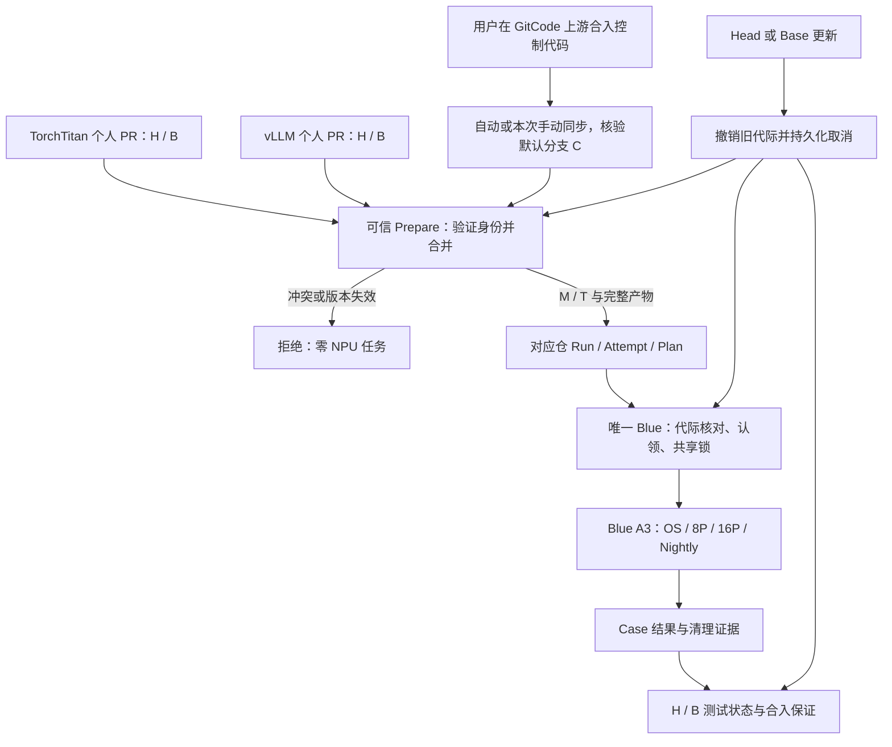
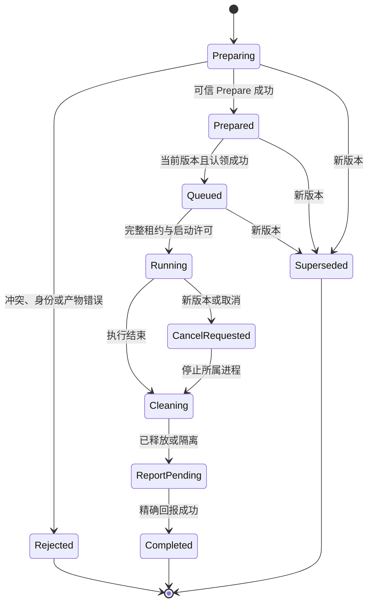

# GitCode → GitHub Actions 双仓合并结果 CI：详细设计

> **版本**：V3.1 · 已确认调试同步、vLLM 容器与门禁策略 / 待实现及端到端验收  
> **更新**：2026-11-01（北京时间）  
> **设计分支**：depeng1994/lite-actions:gitcode-forward  
> **目标 CI 仓**：cann-framework/torchtitan-npu（master）、cann-framework/vllm-ascend（main）  
> **执行仓**：depeng1994/lite-actions；唯一 Blue Worker  
> **本次变更**：允许本次调试手动同步 GitCode 控制代码；固定 vLLM Blue Smoke 容器为 vllm_hccl_smoke；确定测试状态与合入保证的分层策略。本次刷新文档，代码绑定和实机证据仍待实施。

## 0. 已拍板决策与实施边界

### 0.1 用户确认与授权确定的决定（2026-11-01）

| 决策 | 本期必须实现的行为 | 对旧设计的替换 |
|---|---|---|
| D01 控制面由 GitCode 上游维护，调试允许手动同步 | 两个 GitHub 模型仓保持与各自 GitCode 上游一致的默认分支；控制代码在 GitCode 修改、审查、合入。常态自动同步；本次调试可将可信 GitCode 控制提交手动同步到对应 GitHub 默认分支，核验后立即联调 | 不再因等待自动同步任务阻塞本次调试；不新增专用 CI 分支，不在 GitHub 形成独有控制补丁 |
| D02 绿色证明与最新 Base 的合并结果通过 | 固定真实 PR Head H 与该 PR 目标分支最新 Base B，测试其合并结果 M/T；门禁绑定相同版本 | 不再把 PR Head 本身当作实际被测源码；Head-only 成功不能满足本期要求 |
| D03 最新提交优先 | 新 Head 到来主动撤销旧代际的排队/启动权，取消旧运行并清理；新版优先调度 | 不能只等待旧任务结束后标记 STALE；旧任务不得复活或污染新版结果 |
| D04 vLLM Blue Smoke 固定容器 | vLLM Ascend Blue 8P/16P Smoke 的受信 Case、Plan、节点绑定和真实执行必须使用 Docker 容器 vllm_hccl_smoke；落实为代码校验 | 删除复用 TorchTitan 容器的方案；OS Probe 仍不启动 Docker，既有 A5 路径不作全局替换 |
| D05 门禁边界由助手确定 | 本期交付固定 H/B 的合并测试状态与更新后失效重测；原生原子合入保证可用则验证后接入，缺少时采用明确标示版本的受限模式继续调试 | 不再等待用户选择；不额外开发合入服务/改写分支治理，不把测试 PASS 冒充原子合入许可 |

D02 同时要求处理 **Base 前进、PR 改目标分支和旧绿灯失效**。只监听 Head 更新不能满足“最新 Base”。D05 已确定首期采用“版本化合并测试结果 + 事件/轮询失效”的交付边界；P0 依据实证选择 §4.6 的原生或受限模式，无须再次请用户选择。不把最后一次 GET 当作原子合入保证，也不把缺少该保证扩展成新合入系统。

“无专用 CI 分支”的约束针对两个 GitHub 模型镜像仓。独立的 Lite Actions 实现/设计分支流程继续保留，本文件仍在既有 gitcode-forward 分支维护。

### 0.2 权威来源、仓库映射与变更职责

| 对象 | 权威来源 | 写入/消费规则 |
|---|---|---|
| TorchTitan 可信控制代码 | GitCode cann/torchtitan-npu 的默认分支，核对实际镜像配置 | Workflow、Prepare、Waiter、可信执行器与注册表在 GitCode 合入后自动同步；本次调试允许按 §0.4 手动同步 |
| vLLM 可信控制代码 | 实际 GitCode 镜像源仓及默认分支；URL、Repo ID、分支待核验 | 不根据 GitHub 仓名推测源仓；映射确认后采用相同上游合入及自动/本次手动同步流程 |
| GitHub TorchTitan | Repo ID 1210038933；默认 master | 只从已同步、已核验的默认分支派发 |
| GitHub vLLM | Repo ID 1438625957；默认 main | 只从已同步、已核验的默认分支派发 |
| 本期业务 PR | GitCode depeng1994 的两个个人仓中的真实 PR | 分别核验项目 ID、Head 来源、目标分支、账号与权限；外部 Fork 默认拒绝 |
| 个人仓 Bridge | 对应 GitCode PR 目标分支的可信 .gitcode/workflows 与脚本 | 基于受信目标分支执行；不能 Checkout PR 后运行其中的 Bridge |
| Lite Actions | depeng1994/lite-actions | 负责协议、准入、租约、源码消费、监督、清理、恢复与回报 |

**Base 的含义：** B 来自该 PR 的真实目标仓/分支。首期若 PR 开在个人仓，B 就是该个人仓的目标分支最新提交。GitHub 控制提交 C 来自上游镜像；B 和 C 不得混用，也不要求相等。未来若要验证 Fork Head 合入官方上游，应使用目标为该上游的真实 PR 或另行声明该模式。

对原样 Git ref 同步的镜像，发布核验必须满足 C=U。同步配置/工作流本身也须在上游保留或由已核验的外部同步器维护，避免第一次覆盖默认分支后同步入口消失；不以 GitHub 独有补丁补救。

**职责边界：** 本轮助手对 GitCode 上游保持只读；后续上游控制面变更由用户合入。本设计不授权自动合并业务 PR、修改 Required Checks、改变生产分支保护或启用 Yellow。

### 0.3 已核对基线与当前缺口

以下是 2026-11-01 的代码快照，不等于部署验收：

| 对象 | 快照 | 已确认事实 |
|---|---|---|
| 旧设计 V2.2 | lite-actions 5d01fe9b8a0a7fddfe7cf3bd2d65a41b66ad456a | 原设计只封装 Head，需要整体迁移为合并结果 |
| 上一版设计 V3.0 | lite-actions a10da23cb11388bb1dc30b13bb95d8bd61237622 | 已收敛合并结果/取消协议；本版补充手动同步、固定容器及已选门禁模式 |
| Lite Actions main | 9b881db9c541d589dd57564eef2b41b3ee78d4d6 | schema 3、多仓支持、Blue/Yellow、持久化状态均已存在；GitCode 合并源尚未实现 |
| TorchTitan master | 8a71d8940e877cc9f2e5f4b977b4f18d48539592 | 当前同步器强制同步上游分支，并清理上游不存在的分支，仅豁免 gh-pages |
| TorchTitan Draft PR #11 | 016a031081482c366d7c8f575da530a673b8699c | 统一 Nightly/Smoke 的实现参考；不能直接合入 GitHub 作为本期控制面发布 |
| vLLM main | e20e2c482606e2ddd6b2fe1bf3a78638f55da8a8 | 现有 Smoke 面向 Yellow A5，Blue OS/A3 8P/16P 仍需实现 |

D01 使镜像成为正式发布途径，而不是绕过对象。PR #11 的必要实现应移植到 GitCode 上游，由用户合入，再同步验证。PR #11 当前会删除 a3_16p_lite_actions.yml、a5_64p_lite_actions.yml，并把 a3_8p_lite_actions.yml 重命名为 nightly_fulltests.yml；移植时应拆开统一入口接入与旧入口清理，直到调用者和旧门禁完成迁移。

旧代码中另有这些必须修复的依赖：

- TorchTitan registry.inspect_archive 会在控制机执行源码包中的 Python；GitCode 合并源路径不能复用该行为。
- Worker 对 request Artifact 的发现不等于 Prepare Job 已成功，需新增完整准入条件。
- schema 3 的内部 head_sha 在部分 PR 路径已归一化为待测源码 SHA，不能统一改释为控制 SHA。
- 旧结果通过 Commit Comments 回传，Worker/Waiter 有 20×100 条扫描预算；schema 4 不得沿用无界历史扫描。
- 仓库改名、schema 升级、旧 pending report 和隔离状态需要显式迁移。
- vLLM 的 A5 脚本、证据路径及模块级仓库判断需要按任务扩展；两个模型仓不能串结果。
- 生产 Blue 实际发布、在途任务、绑定与隔离状态仍须现场只读盘点；历史成功不是本轮证据。

### 0.4 本次调试的手动同步例外

用户已允许本次调试临时手动同步 GitCode 代码到 GitHub，无须等待定时自动同步。手动与自动同步采用相同的可信源和发布核验：

1. 明确 GitCode 控制源 Repo ID、默认 ref 和可信提交 U，包含 Workflow 及全部依赖脚本；被测 PR 的 Workflow 不因本例外成为控制代码。
2. 同步至对应 GitHub 默认分支：TorchTitan master、vLLM main。原样同步 Git 提交，核验 C=U、所需文件完整、Workflow 已注册；不通过复制文件后新建独有 GitHub 提交实现临时补丁。
3. 记录 sync_mode=manual、源/目标仓与 ref、U/C、操作者、时间、同步前目标 SHA 和相关 Run。同步与自动任务不得同时改同一目标 ref；存在非快进差异时先核对两侧与在途版本，不将本例外解释为无条件强推许可。
4. 核验通过即可开展本次 Workflow/Blue 联调。自动同步延迟不再是调试阻断项；可信源、身份或文件核验失败仍不能派发。
5. 手动同步期间仍固定每次 Run 的 C；后续同步不得让已经生成的 Plan/Bundle 改用浮动分支。调试结束交接回常态自动同步并核对单一写入者；本次手动 E2E 证据与自动同步恢复证据分别记录。

本例外只改变控制代码的同步方式。PR 的 H/B、合并结果测试、可信代码审查及资源/取消规则继续适用；不新增专用 CI 分支。

## 1. 需求目标与工程约束

### 1.1 目标

| ID | 目标 | 验收口径 |
|---|---|---|
| G01 | GitCode PR 自动触发 GitHub CI | 两个个人仓各有真实 PR/Action、准确的 GitHub Run 链接 |
| G02 | 实际测试合并结果 | H/B 来自真实 PR，T=Merge(B,H).tree，Blue 执行 M/T 对应 Bundle |
| G03 | 控制面可信且来源唯一 | GitCode 上游 U 经自动或本次手动同步到 GitHub 默认分支 C；C=U、方式可追溯，实际控制代码固定 C |
| G04 | Prepare 成功后才接单 | Prepare Job 成功、全部产物和身份可验证，才允许资源准入 |
| G05 | Blue 结果闭环 | 对应 GitHub Run、必需 Case、清理及 GitCode 当前版本门禁一致 |
| G06 | 失败/过期不误绿 | 冲突、SHA/Tree 错误、取消、超时、漏 Case、清理不明均非成功 |
| G07 | 兼容原 GitHub CI | schema 3 原有 SHA 与结果语义不被破坏，改名和状态迁移可验证 |
| G08 | Yellow / Self-hosted 边界 | Yellow 服务和资源保持当前状态；原生 Self-hosted Adapter 仅预留，与 §4.6 的原生门禁模式分开 |
| G09 | vLLM 双平台闭环 | vLLM 个人 PR 合并结果经对应 GitHub 仓、同一 Blue 返回结果 |
| G10 | vLLM Blue OS/8P/16P | OS 不进 Docker/不占卡；8P/16P 实际使用 vllm_hccl_smoke，HCCL 分别为 28/120，逐节点清理 |
| G11 | 双仓共享资源但故障隔离 | 同一物理锁；无串仓/重复租约；一仓失败不阻断另一仓清理 |
| G12 | 最新 Base 测试状态 | Base 更新使旧版本状态失效并重测；test_result 与 merge_gate 分开，按 §4.6 已选原生/受限模式验收，不强制另建原子合入系统 |
| G13 | 最新版本优先 | Head/Base 变化后主动取消旧代际，旧启动/回报/释放不能操作新任务 |
| G14 | 可恢复与可审计 | 请求认领、取消、回报和隔离持久化；重启与回滚不丢状态 |

### 1.2 开发前必须解决的问题

| ID | 问题 | 本期处理 |
|---|---|---|
| Q01 | 两个 GitCode 个人仓身份/权限 | 在用户指定的非 depeng 第二台远端环境只读核验；不输出凭据 |
| Q02 | PR 与 Secret 隔离 | 可信 Bridge/Prepare/Worker；PR Python 不在控制机执行 |
| Q03 | Dispatch 关联/未知响应 | 稳定 nonce、持久化映射、DISPATCH_UNKNOWN 恢复 |
| Q04 | 统一 Workflow 未在默认镜像上线 | GitCode 控制提交就绪后，可自动或本次手动同步并核验，再联调；没有 CI 分支兜底 |
| Q05 | Head/Base 可获取性 | 按权威 repo/ref 获取 H/B，核对实际对象及合并所需历史 |
| Q06 | 版本身份与兼容 | 显式区分 H、B、M、T、C；保留旧 schema 3 语义 |
| Q07 | Artifact 消费 | 一次解析 SourceHandle，全链路禁止 GitCode 路径回退 GitHub 源码 |
| Q08 | Blue 准入 | 固定可信 Case/Pool/容器；不抢占外部进程 |
| Q09 | 旧结果与最新门禁 | 代际失效、平台版本绑定；区分测试通过与合入时原子保证 |
| Q10 | 实机证明 | 保留双仓 12 项主链路，增加合并/镜像/取消/门禁场景 |
| Q11 | 组织改名 | 稳定 Repo ID + 受控名称映射 + 状态迁移 |
| Q12 | 上游与镜像发布 | GitCode 为唯一控制代码写入源；本次自动同步延迟可走 §0.4 手动路径，记录并避免双写 |
| Q13 | vLLM 入口只支持 A5 | 增加受信 Blue OS/A3 Case，GitCode Provider 拒绝 Yellow |
| Q14 | 执行脚本 A5 硬编码 | 按每任务 repo/Case/硬件分发，A5 兼容保留 |
| Q15 | 双仓隔离 | 一个 Router、共享物理锁、按仓/Run 隔离故障 |
| Q16 | vLLM GitCode 路由未确认 | 分别核实业务个人仓和控制上游源仓，不用 GitHub Fork 替代 |
| Q17 | 合并结果构造 | 固定合并策略/Git 版本，验证 H/B→M/T；冲突零调度 |
| Q18 | Base-only 更新 | 目标分支 push + 可信 reconciler，失效并重新规划相关开放 PR |
| Q19 | 平台原子门禁未知 | P0 实证选原生或受限模式；缺少时继续版本化合并测试，不宣称原子可合并、不增建合入服务 |
| Q20 | 新版本取消与旧回调 | 持久化 generation、取消意图、lease_id/fencing_token |
| Q21 | 结果通道容量 | 按确定 ID 取结果，明确权限/留存；不扫描控制提交全部评论 |
| Q22 | 安全恢复 | 清理资料启动前落盘，恢复不依赖 Artifact 或源仓仍在线 |

## 2. 架构与信任边界

### 2.1 组件职责

| 组件 | 位置 | 职责 |
|---|---|---|
| GitCode 上游控制代码 | 两个实际镜像源仓默认分支 | 用户审查并合入控制代码，镜像发布源 |
| GitCode 个人 PR | 两个已核验个人仓 | Head、真实目标分支、PR 状态的权威来源 |
| Trusted Bridge | GitCode 个人仓受信目标分支 | 验证事件/PR、派发、轮询、取消请求、发布版本绑定状态 |
| GitHub Workflow/Prepare | 两个模型镜像仓默认分支 | 固定 C，构建 H/B 合并结果、可信 Plan 与 Artifact |
| Artifact Store | 对应 GitHub Run/Attempt | Source Bundle、Runner Bundle、Manifest、最终 Request |
| Blue 控制协调器 | 唯一 Blue systemd 服务 | 串行更新每 PR 代际、持久化认领、资源调度、监督、恢复 |
| Blue 执行域 | 已绑定 A3 节点/容器 | 执行 M/T 的测试载荷；不接收 GitHub/GitCode 凭据 |
| Result Channel/Waiter | Blue + GitHub + Bridge | 精确身份的回报、聚合与当前门禁 |
| GitCode 状态/原生门禁 | 目标项目 | test_result 绑定 H/B；原生能力已验证才提供 merge_gate，否则按 §4.6 受限模式展示 |

Blue 的控制协调逻辑与既有 Router 在同一服务中运行，使用同一持久化目录和资源锁；不得另起一个可调度同一 NPU 的进程。控制机可配置最小权限的 GitCode 只读元数据凭据，用于独立核对当前 PR/Base、补偿事件和取消；该凭据绝不进入训练环境。其网络和权限是 P0 验证项。

### 2.2 双仓与合并结果流



### 2.3 可信执行器与待测源码

| 内容 | 版本来源 | 允许执行位置 |
|---|---|---|
| Bridge | GitCode 受信目标分支固定提交 | GitCode 控制 Job |
| Workflow、Prepare、Waiter、可信目录与执行器 | 已同步控制提交 C / 固定 Lite Actions 发布 | 控制域；可访问最小必要权限 |
| 训练实现、受准入的测试载荷/断言 | 合并结果 M/T | Blue 执行域 |
| Case 资源、Pool、容器、最大超时、执行入口 | 受信注册表及部署策略 | PR 只能提交受校验的选择器 |
| 取消、设备检查、结果完整性验证 | 可信 Worker 版本 | 不允许被 PR 包覆盖 |

GitCode Provider 禁止在 Prepare/Blue 控制机调用 Source Bundle 的 inspect/catalog/build_test_list 或导入其 Python。需要的目录/资源定义由 C 的可信注册表生成并由 Worker 校验。可信执行器与 Source Bundle 分目录、固定入口，避免 PR 模块遮蔽控制脚本。

SHA/摘要不是恶意代码隔离机制；本期只准入明确授权的个人仓、提交者和测试载荷。共享容器和设备租约不应被描述为对任意外部代码的安全沙箱。

## 3. 端到端流程、身份与状态

### 3.1 单次执行流程

1. **控制发布就绪**：用户上游提交 U 已自动或按 §0.4 手动同步为 GitHub 默认分支 C，必要文件/权限/版本核验通过；本次调试不等待自动任务。
2. **事件与快照**：Bridge 读取事件身份，再查询真实 PR、Head 仓/引用及目标分支，固定 H/B；迟到事件不得静默改测另一个 Head。
3. **派发**：只向映射的 GitHub 默认分支触发 Smoke/Nightly，传固定版本、选择器、不可复用快照/意图与 nonce；保存 Run ID。可信 Prepare 先发布不可执行的 dispatch-intent，Blue 沿用 Pull 通道尽早登记在途任务。
4. **固定控制版本**：获取实际 Run/Workflow 身份，Prepare/Waiter 均 checkout 同一不可变 C；发布版本不符则拒绝或重新规划。
5. **构建合并结果**：读取并复核 H/B，按受信策略得到 M/T；冲突或缺依赖则失败，不能降级为仅测 H。
6. **封装与提交请求**：生成完整 Source/Runner/Manifest，最后发布带 Artifact ID/摘要的 schema 4 Request；Prepare Job 成功后才可接单。
7. **Blue 准入与认领**：核验最新 PR/Base、当前代际、完整产物、Case 与 Blue 策略；持久化执行认领和租约，再启动。
8. **运行与主动取消**：测试 M/T；Head/Base 更新使旧代际失效，撤销旧排队/启动权并停止所属任务。
9. **可信清理与回报**：逐节点确认清理或隔离，按 Run/Attempt/Case 定位结果；回报失败只重传，不重复训练。
10. **状态与门禁**：全部必需 Case 成功且当前 H/B/代际及发布权一致，才发布该版本合并测试通过；“当前可合并”还需 §4.6 的平台原子保证，未证实不能混称。

### 3.2 身份合同

| 字段/简称 | 定义 | 不变量 |
|---|---|---|
| pr_repo_id + pr_number | PR 所在目标仓与编号 | 两仓不能仅按 PR 号混用 |
| head_repo_id/ref/head_sha = H | 真实 PR 源仓、源引用及提交 | 不信任输入 URL；经 API 与 Fetch 双重验证 |
| base_repo_id/ref/base_sha = B | 真实目标仓、目标分支最新提交 | 本期个人 PR 的 B 不替换为镜像仓或官方上游 |
| tested_merge_sha = M | 固定 H/B 的平台预合并或本地合成提交 | 只作为测试快照，无需推到任一远端 |
| tested_tree_sha = T | M 对应的合并结果 tree | 实际测试内容来源；必须由批准策略的 H/B 得到 |
| upstream_control_sha = U | 用户已在实际 GitCode 上游合入的控制发布 | 来源及默认分支已验证 |
| control_sha = C | 本次 GitHub Run 实际使用的可信控制提交 | 镜像发布证据绑定 U→C；所有控制 Job 固定 C |
| bridge_event_id / action_run / attempt | GitCode 触发与运行身份 | 原始事件与重跑可追踪，不用最新一条 Action 猜测 |
| source_snapshot_id / dispatch_intent_id | 受信快照与派发意图的不可复用身份 | 与完整 H/B 身份及原始事件绑定；不能仅因 SHA 再次相同重新授予旧请求资格 |
| request_spec_digest | H/B、合并策略、控制版本及受信测试规格的摘要 | 不含 GitHub Run/Attempt、nonce 等投递身份 |
| pr_generation | Blue 协调器对当前 PR 版本分配的持久化代际 | 单写者更新，旧代际不能恢复调度权 |
| rerun_intent_id / execution_generation | 受信整单重跑意图及协调器分配的代次 | 同一 intent 重传不新增，不能靠输入自报整数绕过去重 |
| pipeline / publication_revision | 命名的必需测试组及其当前发布权 | 同一 H/B 下改规格或重跑也能撤销旧结果发布权 |
| github_run_id / run_attempt | GitHub 执行身份 | Artifact、Plan、结果均绑定，禁止跨 Attempt 猜测 |
| lease_id / fencing_token | Blue 每次租约及其代际令牌 | 旧回调不得释放新租约或终止新进程 |

V3 新设计的 schema 4 使用显式 H/B/M/T/C 字段，不继续用一个 source_sha/head_sha 承载不同身份。schema 3 原字段保留旧语义：当前 vLLM PR-target 的内部 head_sha 已被归一化为 PR 源码 SHA。转换器必须先保存 API 原始控制身份，再做事件相关的兼容转换。

### 3.3 PR 代际与任务状态

每个 PR 的协调作用域为 **(pr_repo_id, pr_number)**，跨 Smoke/Nightly。当前版本至少包含 Head/Base 的仓库、引用、提交与合并策略；Head/Base/目标分支变化、关闭/合并或授权失效均撤销旧版本。新 Head 需要取消该 PR 的所有旧版本任务，不能只取消某一个 Pipeline。

GitCode 事件是核对信号，不是可直接写入当前状态的权威快照。唯一 Blue 控制协调器按 PR 串行读取权威 API、持久化版本与代际，记录事件去重和取消意图。迟到事件不能将状态退回旧提交；强推 A→B→A 不能重新启用已撤销的执行记录。平台 revision/事件字段及重跑识别方式在 P0 用真实载荷锁定。

**登记方式与保证边界：** 保留现有 Pull 拓扑，不假定已有可公开访问的 Blue 入站 API。Bridge 的 source_snapshot_id/dispatch_intent_id 来自受信原始事件和调用身份，并绑定完整 H/B、控制仓/Workflow/C、pipeline、选择器、重跑意图、nonce、创建时间与期限；网络重试保持同一身份。可信 Prepare 在最早控制阶段发布独立 dispatch-intent Artifact（不含执行 Plan、不能触发租约）。Blue 校验控制来源/授权、查询权威状态并持久化意图与唯一代际映射，再追踪该 Run；最终 Request 引用此不可变意图。Blue 尚未登记时由 Bridge 负责取消本次派发，登记后由协调器补偿。

已经登记、观察或记录撤销的旧 intent/Request 永不改绑到新代际。首次迟到请求如跨越已知版本变化，必须用可信事件顺序/revision/事件账本证明归属；无法证明则拒绝，不能只因 H/B 相同授予当前资格。P0 须锁定事件历史可读性及账本持久化方案；若平台没有 revision/可恢复历史，完全发生在两次观察之间且没有任何可读记录的 A→B→A 无法仅从当前 SHA 辨认，本期不宣称具备该能力。当前权威状态不可读取时，不启动新任务、不发布当前 PASS；运行中的取消时效以事件/轮询的发现和停止证据衡量，不能承诺推送瞬间已经停止。

另按 (PR, pr_generation, pipeline) 保存当前发布权，指向当前 request_spec_digest + execution_generation，或明确声明的并行必需集合。控制 C、选择器或授权重跑改变时，事务更新该发布权。新旧顺序以已验证的 intent/事件顺序为依据，不按 Prepare 完成先后决定；最终 Request 只能绑定仍有效的 intent，较旧 Prepare 晚到不能重新取得发布权，无法证明顺序则拒绝覆盖。旧规格/旧重跑即使 H/B 相同也不能覆盖新结果；Smoke 成功不能替代 Nightly 或所要求的 16P。只有 canonical execution 能提交该发布权下的状态。



图中的 Completed 仅表示任务闭环，PASS 还需全部 Case、清理、版本和门禁判定。清理或回报期间被替换的结果只进入历史审计；不改变当前 PR 结论。


## 4. 协议、Prepare、取消与结果设计

### 4.1 Dispatch 合同与幂等

只允许目标仓已核验默认分支：TorchTitan 为 master，vLLM 为 main。参数示例仅说明结构，所有项目 ID、SHA、事件名与 API 版本必须在 P0 锁定：

```json
{
  "ref": "master",
  "return_run_details": true,
  "inputs": {
    "source_provider": "gitcode",
    "test_mode": "merge_result",
    "gitcode_pr_repo_id": "verified-personal-project-id",
    "gitcode_pr": "123",
    "expected_head_sha": "1111111111111111111111111111111111111111",
    "expected_base_sha": "2222222222222222222222222222222222222222",
    "expected_control_sha": "3333333333333333333333333333333333333333",
    "test_cases": "[{\"test_id\":\"worker_os_blue\"},{\"test_id\":\"dispatch_smoke_8p\"}]",
    "bridge_nonce": "stable-event-and-invocation-identifier",
    "request_context": "{\"source_snapshot_id\":\"trusted-snapshot-identifier\",\"dispatch_intent_id\":\"stable-dispatch-intent-identifier\",\"rerun_intent_id\":\"initial-or-authorized-whole-run-intent\"}"
  }
}
```

GitHub 已支持返回 Run Details；使用固定 API 版本并验证实际返回的 workflow_run_id/URL。nonce 在正常路径也必须存在，并进入可信 run-name/请求元数据。nonce 来自受信事件与调用身份，跨网络重试保持稳定，不由 PR 文本任意指定。

request_context 为有类型/长度限制的 JSON 字符串，解析后与可信事件和早期 intent 核对，不能当作任意调用参数透传。示例保持十个 Workflow 输入，最终 YAML 与 Bridge 使用同一合同。

派发前记录意图；服务端是否已接收不明时进入 DISPATCH_UNKNOWN，按 nonce、仓、Workflow、时间范围与输入身份找回候选。不能仅取最新 Run；歧义时停止新的资源执行并恢复关联。Bridge 的进程内变量不能作为唯一持久化记录：映射须有可恢复的事件/Run 元数据及 Blue 认领账本。

**两个摘要各司其职：**

- request_spec_digest：规范化 PR 身份、H/B、T、合并策略、控制仓/Workflow/C、受信选择器、策略与运行环境版本；不含投递 Run/Attempt/nonce。
- plan_digest：本次完整 Plan 的规范化摘要，包含 Run/Attempt/产物引用；排除自身 plan_digest 字段。

Blue 先按 (PR, pr_generation, request_spec_digest, execution_generation) 原子选定整单 canonical execution，再在其下按 case_id 认领；重复 Run 不得分别抢走同一整单的部分 Case。相同规格的重复投递不能再分配一组 NPU；不同选择器（例如 8P 与 16P）不互相复用。重复 GitHub Run 应明确链接 canonical execution 并结束为重复/取消，不能把另一个 Run 的原生结果伪装为本 Run 独立执行。Bridge 必须识别受信重复关系，跟随 canonical 的状态或将重复记录排除出门禁；重复 Run 的 cancelled 不能覆盖 canonical 的当前成功/失败。无法证明关联时失败关闭。

GitCode/schema 4 首期仅支持从受信 Bridge 新建整单重跑。Bridge 携带可验证的操作者/事件身份和 rerun_intent_id，协调器把同一 intent 原子映射到同一 execution_generation；新授权 intent 才增加代次并撤销前一次执行/发布权。网络重试、重复事件不增加代次。GitHub 原生全部或部分 Job rerun 均明确拒绝，提示通过 Bridge 重跑；schema 3 原行为保留。旧 H/B 的手动重跑仍须判为过期。

### 4.2 合并结果构建

1. 从已校验 PR API 与目标分支 API 确定 H/B、仓库 ID、ref、PR open 状态和授权；不要把事件中陈旧的 base.sha 当作当前分支 tip。
2. 只从允许的 GitCode 主机/项目获取 H/B。按已核验引用 fetch，再核对对象 SHA；取得足够共同祖先历史，缺历史或来源不明则拒绝。
3. 使用隔离目录、固定 Git 版本和受信配置执行批准的合并策略。可使用 git merge-tree --write-tree 构造结果 tree；必须检查退出状态和冲突信息，不能因输出了 tree ID 就视为无冲突。
4. 默认设计为固定 merge 策略，基于 B 合入 H。若目标项目实际使用 squash/rebase，P0 必须确定能证明内容等价的策略；未证明前不能用另一策略的测试冒充通过。
5. 合并冲突报 MERGE_CONFLICT，既不发布可执行 Request，也不租用 NPU。禁止执行 PR hooks、构建脚本、任意 merge driver 或 Python 目录发现。
6. 正常合并结果得到 T，并封装为本地测试提交 M；父提交顺序为 B、H。受信生成器固定作者、提交者、时间生成规则及消息模板，保证重试可复现。H=B、快进、无变化等边界规则和预期树必须有测试。
7. 平台已有预合并 ref 可作为优化，但必须验证其输入父提交/树与本次 H/B/策略一致。引用名称和 merge_commit_sha 字段本身不构成证明。
8. 只归档已验证的 T，记录文件/依赖完整性和 bundle SHA256；M 无须推回任一远端。实际最终合并提交可能因元数据不同而 SHA 不同，内容判定以 H/B/策略及 tree 为准。
9. PR 测试载荷必须存在于 M/T，可信执行器/入口来自 C。缺入口、接口不兼容或依赖不足，在 Prepare 阶段拒绝。
10. 构建后再次核对当前 H/B；已变更则废弃该请求，按新版本重新准备。

Git archive 不自动补齐 submodule/LFS。Manifest 必须列出本期用到的依赖、固定对象及是否封装；需要时由可信 Prepare 拉取并校验，执行端不得自行取浮动分支。vLLM 的 csrc/third_party/catlass 若本期 HCCL 不依赖，可明确记录 gitlink 与未封装状态。

### 4.3 Source Manifest 与 Request（拟新增）

Source Manifest schema 2 只描述来源、内容与控制版本；最终 Request schema 4 引用它。**Manifest 不嵌入最终 plan_digest**，避免 Plan/Manifest 互相哈希形成循环依赖。

```json
{
  "schema": 2,
  "source_provider": "gitcode",
  "test_mode": "merge_result",
  "pr": {
    "repo_id": "verified-personal-project-id",
    "number": 123,
    "head_repo_id": "verified-head-project-id",
    "head_ref": "feature/change",
    "head_sha": "1111111111111111111111111111111111111111",
    "base_repo_id": "verified-personal-project-id",
    "base_ref": "master",
    "base_sha": "2222222222222222222222222222222222222222"
  },
  "merge": {
    "policy": "approved-merge-policy-v1",
    "builder_version": "pinned-build-environment",
    "tested_merge_sha": "4444444444444444444444444444444444444444",
    "tested_tree_sha": "5555555555555555555555555555555555555555"
  },
  "control": {
    "upstream_repo_id": "verified-upstream-project-id",
    "upstream_default_ref": "master",
    "upstream_control_sha": "3333333333333333333333333333333333333333",
    "github_repo_id": 1210038933,
    "default_ref": "master",
    "control_sha": "3333333333333333333333333333333333333333",
    "runner_sha256": "aaaaaaaaaaaaaaaaaaaaaaaaaaaaaaaaaaaaaaaaaaaaaaaaaaaaaaaaaaaaaaaa"
  },
  "github_run_id": 123456789,
  "run_attempt": 1,
  "source_artifact_id": 12345,
  "bundle_sha256": "bbbbbbbbbbbbbbbbbbbbbbbbbbbbbbbbbbbbbbbbbbbbbbbbbbbbbbbbbbbbbbbb",
  "dependencies": []
}
```

所有值均为示例，不是已验证项目/运行。40 位 SHA 指 40 个十六进制字符。代码仓库名用于展示/寻址，准入以稳定 Repo ID 和已核验映射为依据。

最终 schema 4 Request 必须包含：

- control_repo_id、Workflow ID/path、C、GitHub Run/Attempt、Bridge 事件/nonce、dispatch_intent_id；
- PR H/B 身份、source_snapshot_id、M/T、合并策略、pipeline、request_spec_digest 与 rerun_intent_id；
- 早期 dispatch-intent 与 Source/Runner/Manifest 的不可变 Artifact ID、名称、大小、摘要；
- 可信 Case 全集、资源/超时/环境策略、策略版本与 plan_digest；
- Prepare Job 身份、可信 deadline、请求级与每 Case 的 result_slots（Check Run ID 及 App/仓/C/Run/Attempt/Case 身份）。

pr_generation、execution_generation 和 lease fencing 由 Blue 持久化协调器形成运行封套；不是由 PR 或任意 Dispatch 输入自报。request_id=(control_repo_id, github_run_id, run_attempt) 与 source_snapshot_id/代际的绑定一旦持久化不可更改；已撤销请求即使 H/B 再次相同也不能重新准入。首次迟到请求须验证原始受信事件/快照关系，不能只比当前 H/B；具体可证明边界见 §3.3。Waiter 通过 §4.7 的 AdmissionReceipt 获得并固定运行封套，不改写不可变 Plan 或重算摘要。

### 4.4 Artifact 就绪与安全消费

| Artifact | 生成者 | 校验和用途 |
|---|---|---|
| dispatch-intent-<run>-<attempt> | 可信 Prepare 最早阶段 | 仅登记 PR/快照/派发/控制身份；不授予任何执行或资源权限 |
| gitcode-merge-source-<run>-<attempt> | Prepare | 唯一 source.tar.gz；内层文件的 SHA256 明确为 bundle_sha256 |
| trusted-runner-<run>-<attempt> | Prepare 从 C 导出 | 独立可信执行器/目录版本及摘要 |
| source-manifest-<run>-<attempt> | Prepare | schema 2、H/B/M/T/C、Source Artifact ID 与依赖 |
| lite-ci-request-<attempt> | Prepare 最后发布 | schema 4、完整 Case/产物引用、plan_digest |

GitHub 外层 ZIP 的摘要与内部 source.tar.gz 摘要不能混用；分别标明校验对象。缓存键包含 provider、repo ID、M/T 及 bundle digest；缓存命中仍验证内容。SourceHandle 一次解析，供 Router、Executor、SSH 子进程共享；GitCode 路径任何一层都不得回退到 GitHub model_archive。

**接单门槛同时成立：**

1. 来自批准的控制仓、默认分支、Workflow 和实际 C；
2. 绑定本 Run/Attempt 的 Prepare Job 已 completed/success；
3. Source、Runner、Manifest、Request 全部存在，ID/归属/大小/摘要一致，全部 result_slots 已由预期 App 创建且身份可验证；
4. 请求 H/B 仍当前、代际有效，Case 与 Blue 策略通过；
5. 没有取消、重复执行认领或过期 deadline。

needs: prepare 不能单独约束外部 Pull Worker。全部普通产物先上传、Request 最后发布；Worker 仍检查 Prepare Job 成功。处理只上传部分文件、上传 Request 后失败/取消、重复候选、过期/被删除产物时都不启动。

下载、解压、缓存需限制压缩/解压大小、文件数与路径；拒绝路径越界、危险链接和覆盖控制目录。控制机向每个节点传输后再次核对 bundle digest，所有节点完成 staging 才允许 launch。关键模型模块的实际加载路径与运行环境版本纳入执行证据。

### 4.5 最新版本优先、取消与 Base 更新

Blue 控制协调器在一个事务中更新 PR 当前版本/代际、撤销旧执行资格并记录取消意图。执行持久化层采用带版本和唯一约束的事务接口；实现可采用 SQLite，不能用多次独立状态 update 假装跨记录原子事务。

| 旧任务位置 | 新版本到来后的动作 |
|---|---|
| 仅派发/Prepare 中 | 标记过期并取消对应 GitHub Run；不允许 Request 获得启动权 |
| 排队中 | 撤销排队资格，终结为 SUPERSEDED/CANCELLED |
| 已租约、未启动 | 再核对代际；取消 staging/启动，核验后释放或隔离 |
| 正在执行 | 持久化取消意图，终止该任务所属进程，逐节点清理 |
| 清理/回报中 | 完成安全清理，结果只留历史，不改变当前门禁 |

执行侧状态独立为 CancelRequested → Stopping → Cleaned / Quarantined。GitHub Run cancelled 不代表 NPU 已释放。接单、租约获取后、staging 后 launch 前及运行中核对当前代际；结果发布再核对当前发布权。最新代际是启动和发布当前成功的条件，不是清理自身任务的条件：旧任务仍须完成清理，仅当持久化租约的 lease_id/fencing_token/execution_id 与该任务捕获的绑定完全相同时才能释放这份租约。远端任务标记与 fencing 防止旧回调终止新进程、释放新租约。

新版可以先 Prepare 和排队，也可使用与旧任务无关且已确认空闲的设备；不得绕过旧任务占用和隔离。继续禁止强制回收外部进程，不改变 Blue 隔离规则。

**更新来源与责任：**

- GitCode PR 事件：驱动 Head 更新；Bridge 验证原始事件与当前权威状态。
- 目标分支 push：可信 GitCode workflow 枚举受影响的开放 PR，使旧门禁失效并调用相同 Bridge 逻辑准备新 H/B。
- GitCode 周期 reconciler：补偿事件丢失，重新创建缺失的受信执行并补发版本状态；其对 PR Check 的关联能力必须在 P0 实证。
- Blue 只读 reconciler：独立核对已登记派发和已接单 PR/Base，发现过期立即撤销并取消；在 Prepare 成功前也跟踪 Run 所有权。Bridge 负责本次在途派发的即时取消，协调器恢复账本并补偿；不依赖 Bridge 始终存活，也不伪造 GitCode Action。
- PR 关闭、合并、改目标分支或授权撤回：撤销旧代际；不再自动重排已无资格的请求。

重复/乱序通知不能降低代际。短时密集更新可合并触发，但必须先失效旧门禁，且不能借此延后旧任务取消。记录发现更新、发起取消、远端停止、释放/隔离的时间及超时原因。

### 4.6 GitCode 绿色与合并门禁：已确定的分层策略

**本期交付的测试语义：** 固定当前 H/B，执行合并结果 M/T；Head/Base 变化后失效、取消并重测。Check 命名为“合并结果测试”，详情显示 H、B、T、验证时间与 Run；绿色表示该明确版本的测试成功，不承诺任意未来时刻 Base 都不变。发布该版本“合并测试通过”必须同时满足：

- 全部必需 Case 集合与 Plan 一致并成功，身份、摘要、M/T 及清理证据有效；
- PR 仍 open，发布前查询的 Head/Base、目标引用与已测版本相同，代际有效；
- 当前 Pipeline 的规格、重跑代次及 canonical execution 仍拥有发布权；
- GitCode 状态能够关联已测 H/B 或可验证预合并版本，详情明确显示测试过的 Base；
- 已知 Head/Base 更新先撤销旧版本状态，再进行新版准备，不能拿旧 PASS 覆盖当前状态。

无法确认当前 H/B、版本已失效或结果身份不全时保持 PENDING/BLOCKED 或明确失败。指定 H/B 的历史 PASS 可保留，但不得冒充当前版本的成功。

**单独核验的合入保证：** 最终 GET 与状态发布之间仍可有更新，绿色之后、用户合入之前也可能更新 Base。再次 GET、轮询、事件补偿和普通 PR 级状态覆盖不能证明“实际合入瞬间仍是已测 Base”。该保证需要平台原子核对版本条件、自动使旧结果不再满足门禁，或提供等价保证的合并队列。

P0 必须在目标项目记录原生 Check 的提交/预合并绑定、Base 更新失效、受保护分支的合入条件及原子验证/合并队列能力，覆盖上述竞争窗口。如果只支持事件后异步失效，必须明确可观测延迟，不能写成无窗口保证。2026-11-01 核对的 [GitCode 公开合并 API](https://docs.gitcode.com/docs/apis/put-api-v-5-repos-owner-repo-pulls-number-merge/) 没有文档化 expected_head_sha/expected_base_sha/CAS 参数；这不足以断言平台不支持，也不足以假定普通 Merge API 已提供保证。

**D05 已选方案：** P0 根据实证记录 merge_gate_mode=native 或 versioned_only；默认不假定存在原子能力。首期不新增受控合入服务、不约束全部分支写入者，不因缺少该能力停止源码、Workflow 或 Blue 调试，也不再为这一范围选择询问用户。

| 模式 | 测试结果 test_result | 合入保证 merge_gate | 本期处理 |
|---|---|---|---|
| native | 满足上述版本/Case/清理条件才 PASS | 原生版本绑定、Base 自动失效及原子合入检查/等价队列均有实证后，才可记 VERIFIED | 使用原生能力，E2E-17 验证旧 H/B 不能放行；未满足条件则 BLOCKED |
| versioned_only | 发布明确 H/B/T/时间的版本化 PASS，发现变化立即 STALE/PENDING 并重测 | NOT_PROVIDED：不声明“当前可安全合入” | 合并测试与调试继续，记录发现/失效时延和窗口；不把该 Check 新配置成唯一合入许可 |
| 平台无法分开表达测试与合入许可 | PASS 只展示在明确的执行详情中 | 对会被解释为合入许可的混合状态保持 BLOCKED/PENDING | 允许完成测试与调试；记录 TEST_PASS + GATE_BLOCKED，不能伪装为完整原子门禁通过 |

test_result 与 merge_gate 分字段存储、展示和验收；受限模式不把门禁能力缺失伪报成测试失败，也不让测试 PASS 掩盖门禁限制。Head/Base 的已知变化仍须先撤销旧状态与启动权，取消并重测；轮询/事件补偿须记录发现、失效和停止延迟。平台失联、无法确认版本或状态发布失败时，不新增当前 PASS，现存历史结果保留其版本与验证时间。

G12 以“平台能力有证据、所选模式符合上述合同、版本失效/重测验证通过”关闭；不要求平台必须具备原子合入功能。正式交接明确所用模式及是否提供原子合入保证，不能把受限模式写成无限期有效的最新 Base 绿灯。

### 4.7 结果通道与状态恢复

**schema 4 选定由可信 Prepare 预创建、按固定 ID 读取的 GitHub Check Run 通道，作为 P0 权限验证目标。** Prepare 和 Blue 使用同一专用 GitHub App 在对应控制仓的授权身份：Prepare 创建一个请求级 aggregate slot 和每个 Case 的 slot，Blue 后续只更新这些已绑定 ID。App 的预期 ID 来自受信配置，不能由 PR 指定；两端分别取得限定仓库/权限的短期 installation token，不共享长期运行时 Token，私钥/Token 不进入任何 Bundle、Artifact 或 NPU 子进程。

Prepare 在最终 Plan 发布前取得全部 check_run_id，将每个 result_slot 的 ID、App ID、控制仓 ID、C、Run/Attempt 与 Case/aggregate 身份写入 Plan，随后计算 plan_digest。创建时的唯一 check_name/external_id 使用 repo/run/attempt/case 与规格身份，不包含尚未生成的最终 plan_digest，以免循环依赖。最终摘要由 Blue 的首次更新绑定。

Blue 准入时持久化 AdmissionReceipt，包含 request_id、plan_digest、request_spec_digest、snapshot/intent、canonical_execution_id、pr_generation、execution_generation 与 publication_revision，并发布到已固定的 aggregate slot。Waiter 从验证后的 Plan 直接 GET 每个 Check Run ID，核对 API 所属仓、head_sha=C、App、external_id、Run/Attempt/Case 及 receipt，固定此运行封套；所有 Case 结果必须引用同一封套。Plan 不因准入而改写。重复请求的 receipt 明确指向 canonical 及其可信结果身份，Bridge 按该关系跟随，不能从 duplicate Run 的取消结论推断 canonical 失败。

创建请求响应丢失时先进入未知状态，用唯一 check_name、app_id、filter=all 和完整身份作有界恢复；多候选、不可见或范围不完整则 Prepare 失败并保持零硬件执行，禁止盲目重复 POST。正常读取完全不依赖共享控制提交的结果列表。[GitHub 按 ref 列举](https://docs.github.com/en/rest/checks/runs#list-check-runs-for-a-git-reference) 存在最近 1000 个 Check Suite 的范围限制，因此恢复失败不能解释成“此前未创建”。未发布可执行 Plan 的遗留槽由控制恢复流程终结。

Plan 发布后，slot 被删/过期不能另建 ID 偷换不可变绑定：记为 ResultChannel 不可用，保留 outbox 与清理证据；需受信整单新请求才能绑定新 slots。API 暂时失败只对原 ID 重传，不重跑训练。留存、同名容量、过期行为与创建/更新权限在 P0 和 INT-07 锁定。

GitHub 官方 Checks 创建/更新要求 GitHub App 身份及 Checks: write；普通用户 PAT 不能代替该写入身份。能力不足时阻断 schema 4 上线，可另提 ResultChannel 设计，不能静默退回全历史 Commit Comment 扫描。原 schema 3 暂保留原回报协议。

结果携带 H/B/M/T/C、代际、发布权、规格摘要、Run/Attempt、Case、状态和 cleanup_verified。全部必需 Case 完成才汇总测试成功；跳过、缺失、重复冲突或清理不明不算 PASS。旧代际、旧规格、旧重跑及重复 Run 不得覆盖当前状态。GitHub 结果槽的测试结论不能代替 §4.6 的 GitCode 当前门禁判定。

沿用每 Case 最多 20 行、每行 180 字符的诊断限制，汇总只含必要元数据和链接；完整训练日志留在执行环境，不在 Bridge 摘要暴露 Token 或私有机器地址。新增字段必须有长度/类型边界并验证最终序列化预算。

### 4.8 兼容、升级与回滚

| 路径 | 协议/行为 |
|---|---|
| 已有 GitHub 手动/PR 流程 | 保留 schema 3 原字段及事件相关 SHA 语义 |
| vLLM GitHub pull_request_target | 保留 PR 源码 SHA 的既有归一化和回报关联 |
| GitCode 合并结果 | 只使用 schema 4 + Manifest 2；不把 H 或 C 当作 M |
| GitCode/schema 4 的 GitHub 全部或部分 Job rerun | 首期拒绝并提示从可信 Bridge 新建整单重跑；schema 3 不改 |
| 未知 state/协议版本 | 拒绝启动或准入，不忽略字段继续执行 |

状态迁移必须包含旧仓名→稳定 Repo ID 的核验映射、schema 3 原始载荷、排队与在途任务、pending report、隔离记录、远端目录/标记和租约。启动前持久化清理必需的环境与运行指纹；reconcile 不重新下载源码、不导入 PR Python。

发布执行 drain → 核验 → 快照 → 停旧实例 → 原目录事务迁移 → 校验 → 启新实例；真实候选硬件验证同样独占生产锁和已知隔离状态。无硬件的 Mock/静态检查可以使用独立目录，不能用空白候选状态绕开真实隔离。

回滚不能直接丢弃新版状态并恢复旧快照。保留新增取消、隔离和 outbox；旧二进制不支持新 state_version 时必须拒绝启动，完成经验证的兼容迁移后再回退。模型控制代码回滚选择明确的可信 GitCode 回退提交，常态从上游回退后自动同步；本次调试可按 §0.4 手动同步并核验，GitHub 不补独有回滚提交。

### 4.9 超时、权限与故障隔离

分别定义 Prepare、排队、执行、取消清理、结果回传与 Bridge 总等待预算，保留清理余量。现有 Worker 有排队/执行时限，Waiter/平台 Job 另有等待时限，新协议需统一校验最坏组合；不能只沿用各处默认值。

可信 Plan 含 deadline，远端监督程序在 Bridge/网络异常时仍能终止本任务；无法核验释放则隔离。持久化取消与 outbox 恢复不依赖任务还出现在 active Run 列表。

| 身份 | 最小用途与存放位置 |
|---|---|
| GitCode Bridge/状态发布 | 个人项目 PR/事件读取、必要状态发布和受控重跑；GitCode 可信 Job |
| GitHub Dispatch | 限定两个控制仓 Actions 触发/读取/取消；不下发 NPU |
| GitHub Prepare | GitCode PR/源代码只读、Artifact 上传、同一专用 App 的 Checks 写入以创建结果槽；Hosted 可信控制 Job |
| Blue 控制进程 | GitHub 读取/取消/Check 回报，GitCode 当前 PR/Base 只读，授权 SSH |
| Blue 执行域 | 仅批准运行环境和资源标记；不含平台 Token |

按仓/Run 隔离 403/404、坏 Plan、产物错误和超时；一个失败请求不能中断另一仓的取消、调度和回报。定义每仓退避和请求预算，清理优先。Token 有效期/轮换、源码与 Artifact 可读范围、日志脱敏在 P0 核验。


## 5. 逐项开发设计与文件责任

### R01｜上游控制面发布与镜像核验

模型 Workflow、Prepare、Waiter、注册表和执行器变更在实际 GitCode 上游准备，由用户审查并合入默认分支。按镜像配置核对 U→C（原样同步必须相等）、Repo ID、默认分支名、所需文件/Workflow 注册及发布策略，确认同步入口本身不会被覆盖丢失。常态自动同步；本次调试按 §0.4 手动同步并核验后即可联调，不等待自动任务。只有源、版本、文件或注册核验不满足时才拒绝派发。

GitHub Draft PR #11 仅作为移植实现参考，不作为直接上线入口。旧独立 YAML 的移除必须与调用者/旧门禁迁移分开安排；本轮不删除模型仓文件、不更改 Required Checks。

### R02｜个人仓 Trusted Bridge 与事件入口

个人仓受信目标分支部署 .gitcode/workflows/ci-github-bridge.yml、可信脚本和测试。验证本人/审核账号、PR 目标仓、Head 来源、目标分支及测试白名单；不执行 PR 内的 Bridge。明确原始事件与当前快照的绑定，分别处理 PR、Base push、手动整单重跑和周期补偿。

GitCode 实际语法、上下文、Token 权限和 Check 关联以 P0 载荷为准，不能照搬 GitHub 的事件拼写。全部凭据只在控制域使用。

### R03｜权威 H/B 与合并源码 Provider

新增统一 GitCodeMergeSourceProvider：解析真实 PR 目标/来源、核验 H/B、构建 M/T、校验依赖及发布 SourceHandle。合并过程不调用 PR Python。个人 PR 的 Base 与上游控制仓分开建模；冲突、浅历史不足、错误 repo/ref、陈旧合并引用都失败关闭。

### R04｜Dispatch、请求账本与完整重跑

固化 API 版本、nonce、早期 intent、Run ID 持久化及 DISPATCH_UNKNOWN 恢复；语义摘要覆盖选择器/策略/控制版本。Blue 持久化层提供跨投递唯一认领，把受信 Bridge 的授权重跑意图映射到新 execution_generation。投递重复可产生多个 GitHub Run，但不能重复占卡或取得第二份状态发布权；重复 Bridge 跟随 canonical 并注明复用。schema 4 的 GitHub 原生全部/部分 rerun 均提示转到 Bridge。

### R05｜统一 Prepare 与发布门槛

Nightly/Smoke 共同调用受信 Prepare。固定 C，先发布不可执行 intent，再构建合并源 M/T 和独立可信 Runner、检查入口/接口，预创建结果槽，上传完整 Artifact，最后发布 Request。Blue 检查 Prepare Job 成功及全部引用，不能仅靠 needs 或 Artifact 名称推定就绪。

### R06｜Blue SourceHandle 与安全准入

Router、Executor、SSH 子进程使用同一已验证 SourceHandle；禁止把新路径简单接到现有 inspect_archive。可信目录/资源参数来自 C/部署策略，训练载荷来自 M/T；检查缓存和逐节点传输摘要。保持现有 NPU 编排算法、共享锁和外部占卡避让。

### R07｜当前版本门禁与结果通道

实现由 Prepare 预创建结果槽、Plan 固定 ID、Blue 回报 AdmissionReceipt/Case 的 schema 4 ResultChannel，聚合完整 Case 和清理证据，绑定 H/B/M/T/C、代际与发布权。GitCode 发布器按 §4.6 分开 test_result、merge_gate 与 merge_gate_mode；原子能力不足采用 versioned_only 继续调试，不等待新增合入服务。旧 STALE/FAIL、旧规格或重复 Run 不得覆盖当前结果。

### R08｜状态迁移、Blue 升级与回滚

增加 state_version、事务式 PR 代际/执行认领/取消/outbox。迁移旧名称和 schema 3 载荷；原目录保留隔离、远端标记和清理资料。独占实例、drain、迁移验证、发布和回退均有操作记录。未知状态版本拒绝启动。

### R09｜Latest-wins 与 Base 变更补偿

实现 PR 作用域的持久化取消，覆盖派发、Prepare、排队、已租约、运行、清理与回报。Head 更新取消所有旧 Pipeline；Base 前进和 PR retarget 同样失效旧版本。GitCode Base push/周期补偿负责重排，Blue 只读协调器负责独立撤销过期启动权和取消。

### R10｜Native Self-hosted 接口预留

保留 SourceHandle、Runner Bundle、Manifest、资源清理/结果合同。未来 Adapter 消费相同 M/T 和可信 Runner；本期不实现、不注册 Runner，也不增加硬件验收目标。

### R11｜故障隔离、限流与审计

多仓 Poller、状态查询、坏 Plan 和结果重试按仓/Run 隔离，避免整轮 tick 被一个请求阻断。定义期限、API 退避与恢复指标，保持诊断预算。审计连接 GitCode 事件/PR、H/B/M/T、U/C、Run/Attempt、代际、Case、租约、清理和最终门禁。

## 5A. vLLM Blue A3 专项设计

### VL-01｜分别核验业务源与控制源

GitCode depeng1994 vLLM 个人仓作为首期 PR 入口，其 Repo ID/URL/目标分支须独立核验；vLLM 控制代码的实际 GitCode 上游源仓也须单独核验。映射到 GitHub cann-framework/vllm-ascend（1438625957，main）后，只从镜像默认分支 dispatch。

### VL-02｜Blue 入口与既有 A5 兼容

在 GitCode 上游维护的 lite_actions_dispatcher_smoke.yml 增加 GitCode merge_result 输入与受信 Blue 默认集合。既有 GitHub 原生触发路径的 A5 定义保留，并随控制代码在 GitCode 上游维护、同步到 GitHub；GitCode Provider 明确拒绝 Yellow/A5。Prepare/Waiter 的旧组织名修正及固定 C 的 checkout 一并在上游合入后同步。

### VL-03｜受信 Case 与真实测试载荷

| Case ID（拟） | 类型 | Worker/Pool | Plan 的 docker | 验收 |
|---|---|---|---|---|
| vllm_worker_os_blue | worker_probe | Blue，无 Pool | None | 接单/身份/回报，不启动 Docker、不占 NPU |
| dispatch_smoke_a3_8p | npu_smoke | Blue / a3_shared_blue | vllm_hccl_smoke | 1×8，WORLD_SIZE=8，all_reduce_sum=28 |
| dispatch_smoke_a3_16p | npu_smoke | Blue / a3_shared_blue | vllm_hccl_smoke | 2×8，WORLD_SIZE=16，all_reduce_sum=120 |

可信注册表限定拓扑、环境、入口、时限，默认 OS+8P，16P 显式选择。通用 HCCL 执行监督与证据校验来自 C，待测的已批准 Smoke 载荷来自 M/T；资源决策不依赖 PR Python。载荷缺失或适配版本不符在 Prepare 拒绝。

**固定容器，必须落实到代码：** vLLM Blue 8P/16P 统一使用 Docker 容器 vllm_hccl_smoke。受信 vLLM Case 定义设置单一常量 VLLM_BLUE_SMOKE_DOCKER = "vllm_hccl_smoke"，两个 Case 的 docker 字段与最终 Plan 均使用此值；Worker 再独立校验，不允许 PR、Dispatch 选择器或临时环境变量覆盖该绑定。

每个选中节点的 environments["vllm_hccl_smoke"] 必须绑定该节点真实同名容器的不可变 container_id、image_id、image_ref。预检核对 Docker Name（规范化前导斜杠）、ID、Running 与镜像身份，缺失、停机、旧容器误绑定或镜像不符均拒绝；不得回退到 TorchTitan 容器 cann_master_torchtitan_master_xyj。16P 两节点分别核验，容器名相同不意味着容器 ID 相同。

stage、run、verify、cancel、cleanup 与恢复均使用启动前持久化的同一节点/容器 ID 绑定；容器被重建后，不重新按同名容器猜测清理目标。仍须检查 torch_npu/CANN/HCCL、设备与网络；8P/16P 预期值来自受信规格，rank0 证据与全部 rank/进程退出及清理一致。OS Probe 保持 docker=None；TorchTitan 及既有 A5 8P/32P 的容器定义不作全局替换，本期不启动 A5。

| 代码/配置责任 | 必须实现的行为 |
|---|---|
| 可信 vLLM Case 定义 / ci_core/vllm_ascend.py | Blue 8P/16P 固定 docker="vllm_hccl_smoke"，保持既有 A5 定义 |
| 模型 Prepare / ci_core/contract.py / plan.py / registry.py | Plan 写入固定值，禁止输入覆盖；Worker 独立验证模型、Case 与容器匹配 |
| ci_core/config.py / config/pools.json | 受信节点 environments 绑定真实同名容器，预检 Name/ID/Running/镜像，错误绑定失败 |
| ci_core/executor.py / ssh_runner.py / reconcile 与持久化状态 | 全阶段使用同一捕获绑定，恢复不误选重建容器 |
| ci_core/resources.py | 继续按宿主机物理设备/端口共享锁，容器名不形成第二个资源锁域 |

此处是本轮写入设计的强制代码要求；仅文档出现容器名不算实现完成，须由代码校验与 E2E 容器证据验收。

**范围：** Check 名称标明 Bridge/HCCL Smoke。该用例证明合并测试载荷、调度与通信，不等于 vLLM 完整推理或所有业务代码功能通过。

### VL-04｜同一 Blue 的双仓执行

继续一个 systemd 服务和 /var/lib/lite-actions/blue，受信配置启用两个模型仓，同一设备/端口锁和隔离记录。vLLM 使用 vllm_hccl_smoke、TorchTitan 使用其既有环境，也必须争用同一宿主机物理设备锁，不能按容器名隔离锁。按每次任务的 Repo ID、Provider、Case、Pool 与硬件类型选择入口/证据，不依赖常驻模块级 VLLM 默认值。

A3 不进入 A5 rootinfo 或回收逻辑；取消一个仓的旧任务不能误杀另一仓进程。除共享锁互斥，还必须通过“一仓 403/坏 Plan，另一仓继续完成和清理”的测试。

### VL-05｜合并源与依赖完整性

vLLM 使用同一 H/B→M/T、Manifest 2 和 schema 4；Control Repo ID 固定为 1438625957。不能消费 TorchTitan 的 Artifact、Comment 或 Check 对象。catlass submodule 是否 materialize 按实际用例依赖声明，固定 Gitlink/内容摘要；不允许执行机自行拉浮动版本。

### VL-06｜落地文件与上线顺序

| 位置 | 变更 |
|---|---|
| GitCode vLLM 个人仓可信 Base | Bridge、Base 更新/周期补偿、版本状态发布与测试 |
| 实际 GitCode vLLM 上游 | Workflow、Prepare、Waiter、合并源模块、可信 HCCL 控制器/目录、必要源码载荷接口 |
| GitHub vLLM 默认 main | 自动或本次手动同步后的核验和 Workflow 验证，不形成独有补丁 |
| Lite Actions | vllm_ascend、contract、plan、registry、config、resources、github、router、executor、ssh_runner、结果/状态/SourceProvider 与测试；按 VL-03 固定容器 |
| Blue 部署 | 双仓 Poller、单一代际账本、各节点 vllm_hccl_smoke 的真实容器绑定和共享物理资源锁；Yellow 不变 |

先完成本地实现、协议/Mock 与权限预检，再按 §6.4 完成用户上游合入/镜像和兼容 Blue 就绪，随后验证 OS、8P、16P、取消/STALE/真失败、跨仓互斥和故障隔离。旧 vLLM PR #2 的 Yellow A5 证据不能计入 Blue 本期验收。

## 6. 实施清单与开发顺序

### 6.1 GitCode 个人仓（两个项目分别落地）

- .gitcode/workflows/ci-github-bridge.yml：受信 PR、手动重跑入口。
- .gitcode/workflows/ci-pr-reconcile.yml（拟）：Base push 与周期补偿。
- .gitcode/scripts/github_bridge.py：API 复核、nonce、派发、恢复/取消、结果等待。
- .gitcode/scripts/bridge_contract.py：项目/分支/账号/选择器映射及规格身份。
- .gitcode/scripts/publish_ci_status.py（拟）：按已验证平台合同发布当前版本状态。
- .gitcode/tests/：重复、乱序、过期、Base 推进、原子门禁和 API 故障。
- .gitcode/README-ci-bridge.md：凭据、映射、整单重跑、门禁限制和恢复操作。

### 6.2 GitCode 上游模型仓（用户合入；自动或本次手动同步）

| 文件/模块 | TorchTitan | vLLM |
|---|---|---|
| .github/workflows/nightly_fulltests.yml | 统一 Nightly + merge_result | 本期无新增 vLLM Nightly |
| .github/workflows/lite_actions_dispatcher_smoke.yml | Blue OS/8P/16P | Blue OS/A3 8P/16P，保留旧 A5 |
| .github/workflows/lite_actions_common.yml 或受信复用模块 | 统一 Prepare/Waiter | 复用同一合同，按项目映射 |
| .github/scripts/lite_actions/prepare_request.py | schema 4 及可信目录 | 同规范 |
| .github/scripts/lite_actions/prepare_gitcode.py（拟） | H/B 合并、Manifest、产物 | 同规范 |
| .github/scripts/lite_actions/wait_result.py | 按 ID 结果及兼容 schema 3 | 同规范 |
| 可信 runner/catalog 与测试载荷接口 | 训练/Smoke 资源边界 | 通用 HCCL，禁止 A5 错路由 |
| 上游同步配置/工作流 | 核验源与默认分支、单一写入者 | 核实实际配置后同样处理 |

个人 PR 的合并源码中必须具备其测试载荷接口。上游加了适配器不等于个人 Base 自动具备；个人仓更新、所需接口版本和 Prepare 文件检查需一同列入交接。

### 6.3 Lite Actions

必改范围：ci_core/contract.py、plan.py、registry.py、config.py、resources.py、github.py、router.py、executor.py、ssh_runner.py、reporting.py、job_state.py、vllm_ascend.py、scripts/reconcile.py 及受信节点配置 config/pools.json。vllm_hccl_smoke 固定字段、真实容器身份核验和恢复绑定按 VL-03 落实；resources 的物理锁语义保持。新增 source_provider/merge-source 身份、PR 协调器、事务存储、ResultChannel 的具体模块名由实现确定，但接口和责任按本文件锁定。

测试扩展到现有 tests/test_workflow.py、test_multi_repo_worker.py、test_process_lifecycle.py 及新的源码/协议/状态测试；README、docs/blue-worker.md 和验证记录同时更新。测试目标为行为不变量，不以配置快照代替跨阶段验证。

### 6.4 P0–P6 推进顺序

| 阶段 | 交付 | 退出标准 |
|---|---|---|
| P0 事实与能力 | 两类 GitCode 源仓映射、权限/事件/网络、事件历史/账本、门禁能力、Checks App 能力、生产状态与 vLLM 容器盘点 | 能力与缺口有实证；按 §4.6 选 native/versioned_only，不因原子能力不足扩大范围或阻断调试 |
| P1 本地协议与控制代码 | schema 4/Manifest 2、可信执行器、H/B→M/T、早期 intent/结果槽/完整产物、幂等 | 静态/CPU/Mock 通过；上游待审提交完整，不引用尚未存在的脚本 |
| P2 本地 Blue 适配 | 单一代际账本、SourceHandle、ResultChannel、取消 fencing、迁移、双仓隔离与 vllm_hccl_smoke 代码绑定 | 兼容 schema 3；Plan/节点/真实容器核验一致，候选不绕过生产锁/隔离 |
| P3 上游发布与受控联调就绪 | GitCode 完整控制提交自动或本次手动同步到 GitHub 默认分支，兼容 Blue 按独占/迁移规程就绪 | C=U/文件/注册核验，记录 sync_mode；Provider 在兼容 Worker 就绪前关闭，其后开放受控验收范围 |
| P4 分层 E2E | OS → TorchTitan 8P/16P/Nightly → vLLM 8P/16P → 跨仓与版本取消 | E2E-01～18 及 INT 必验有证据；部分瞬间用注入测试 |
| P5 正式发布 | drain、迁移、独占切换、正式 Run 和回滚演练 | 状态/隔离/outbox 保留，旧入口回归；Yellow 不变 |
| P6 交付关闭 | 文档、权限、同步模式、门禁模式及运维交接、完整证据链接 | 调试 DoD 与常态自动同步恢复分别记录；未验证的能力不得宣称完成 |

P1/P2 可在 P0 不涉及权限的部分并行开发；平台未知能力不得以 Mock 冒充实证。可信 GitCode 控制提交就绪后，手动同步通过 §0.4 核验即可进行本次平台联调，不等待定时镜像。没有可信控制代码或同步核验未过时继续本地验证，不使用专用 CI 分支。不在新 Producer 已启用时等待 Consumer 适配，也不发布只含 Workflow 而缺少脚本的半成品。

## 7. 端到端验收与故障验证

### 7.1 原 12 项主链路（全部升级为合并结果）

每项从对应 GitCode 个人 PR/Action 出发，关联同一模型 GitHub Repo/Run，经可信 Prepare 和 Blue 执行或拒绝，再回到正确 GitCode 版本的状态。证据包含 H/B/M/T/C，不能仅记录 Head；分别记录 test_result、merge_gate 与 mode。受限模式可出现 TEST_PASS + GATE_NOT_PROVIDED/BLOCKED，这表示合并测试闭环通过、未提供原子合入保证，不能把两者合并成“全部门禁通过”或误报训练失败。

| E2E | 场景 | 必需证明 |
|---|---|---|
| E2E-01 | TorchTitan PR → OS+8P → PASS | 真实 HCCL、执行 M/T、完整 Case、清理与当前门禁 |
| E2E-02 | TorchTitan Head A→B | 主动取消 A 的排队/运行任务；B 使用新合并树；旧结果不能复活 |
| E2E-03 | TorchTitan Smoke 真失败 | 失败载荷进入 M/T 并实际执行，GitHub/GitCode 非成功，释放或隔离 |
| E2E-04 | TorchTitan 安全拒绝 | 错 Head/Base repo/SHA、伪造合并来源或 Yellow 请求零任务 |
| E2E-05 | TorchTitan Nightly Muon/AdamW | 两 Case 使用同一 M/T，rank0 五步 LOSS、清理、实际模型模块路径 |
| E2E-06 | TorchTitan 双节点 16P | 两节点真实通信、租约/端口、逐节点释放、正确 M/T |
| E2E-07 | vLLM PR → OS+A3 8P → PASS | 独立 Repo ID/Run、M/T；8P 实际在 vllm_hccl_smoke 执行，Name/ID/镜像证据，WORLD_SIZE=8、sum=28 与清理；OS 不进容器 |
| E2E-08 | vLLM 双节点 A3 16P | 两节点各自 vllm_hccl_smoke 的 Name/不可变 ID/镜像与真实进程，WORLD_SIZE=16、sum=120、物理锁/端口/清理 |
| E2E-09 | vLLM Head A→B | 主动撤销/取消 A，B 新合并树；旧 STALE/FAIL 不覆盖新 PASS |
| E2E-10 | vLLM 越权/错仓拒绝 | 错控制仓、Head/Base/合并身份、A5 Case 拒绝；Yellow 无访问变更 |
| E2E-11 | 两仓重叠执行 | 唯一 Blue，共享物理锁；无串结果/重复占卡/跨仓误清理 |
| E2E-12 | vLLM 真实执行失败 | 载荷通过 Prepare 后在 vllm_hccl_smoke 内 A3 8P 真失败；按原容器 ID 清理，红色版本测试状态闭环 |

E2E-03/12 不能用错误 SHA 的 Prepare 拒绝代替实机失败。E2E-05 只沿用既有五步/LOSS 口径，不宣称新的数值精度认证。vLLM HCCL 也不宣称完整推理验证。

### 7.2 新增决策验收 E2E-13～18

| E2E | 场景 | 必需证明 |
|---|---|---|
| E2E-13 | 上游控制发布与同步 | GitCode 可信 U 自动或本次手动同步后，默认分支 C=U/文件/注册正确；记录 sync_mode、操作者、时间、前后 SHA，可直接支撑调试。自动同步恢复单列收尾证据，不使用专用 CI 分支 |
| E2E-14 | 合并结果内容正确 | 测试同时依赖 Head 与 Base 的改动；另构造 Head 单独通过、合并后失败；至少一次实机源码差异证明执行 T |
| E2E-15 | 合并冲突 | 真实 PR H/B 冲突，明确 MERGE_CONFLICT，无可执行请求/租约，当前状态非成功 |
| E2E-16 | Base-only 前进 | Head 不变，Base X→Y；旧运行取消/旧绿灯失效，用新 T 重测；丢事件时补偿可恢复 |
| E2E-17 | 所选门禁模式与竞争窗口 | 最后 GET 后或测试通过后、合入前 Base 推进：native 证明旧 H/B 不放行；versioned_only 证明结果绑定版本、失效/重测时延可观测且不声称原子可合并，混合状态按 §4.6 阻断 |
| E2E-18 | 取消、乱序与旧回调 | 排队/运行取消至少各一次真实验证；租约/launch/清理/回报瞬间注入，已登记/已观测 A→B→A 的旧 intent 永不复活；旧回调只清理自己的租约 |

E2E-17 在明确的测试范围内验证既有平台能力，不自动合并用户业务 PR 或修改分支保护。原生能力不足即采用已选受限模式，保留事实、窗口和模式证据，继续测试/调试；不把轮询冒充原子能力，也不为此新增合入服务。

### 7.3 必验集成测试（主要 CPU/Mock）

| ID | 场景 | 通过标准 |
|---|---|---|
| INT-01 | 同 H/B 选择 8P→16P，Bridge 整单重跑，重复事件/丢 Dispatch 响应 | 规格/发布权不混用；重复至多一次执行，duplicate 取消不覆盖 canonical；授权重跑有新代次 |
| INT-02 | PR 同名模块/inspect/环境注入 | Prepare、Blue 规划/预检/reconcile 不执行源包 Python、不泄露控制凭据 |
| INT-03 | 部分产物、Request 后 Prepare 失败/取消、坏摘要/错仓/过期 | 零启动；不回退错误源码；安全解压和缓存校验 |
| INT-04 | schema 3/4、组织改名、旧状态迁移/回滚 | 旧 SHA/报告语义保留，排队/取消/outbox/隔离不丢失 |
| INT-05 | Artifact 删除或平台失联后 reconcile | 可用持久化可信资料核验，不依赖重新下载/导入源码 |
| INT-06 | 一仓 403/坏 Plan/查询故障 | 另一仓仍能执行、取消、清理、回报 |
| INT-07 | 同一控制提交大量结果、创建丢响应/slot 删除/App 权限 | Plan 固定 ID 正常直读；创建不明零调度，已固定 ID 不偷换；receipt 一致，无全历史扫描 |
| INT-08 | 旧 Attempt、GitHub 全部/部分重跑、控制分支推进、漏/skip Case | schema 4 的原生 rerun 拒绝并指向 Bridge；旧发布权失效、C 固定、漏测不绿 |
| INT-09 | vLLM 容器固定值、错绑定、重建与跨容器物理锁 | Plan/Case 只能用 vllm_hccl_smoke；误指旧容器/Name或ID不符拒绝，无回退；OS 不进 Docker；恢复不清理重建容器，双仓仍共享物理锁 |

### 7.4 本期明确排除与证据模板

- 不跑 Yellow OS/训练/A5 8P/32P/64P 实机验收，不切换其生产状态。
- 不实现/注册原生 Self-hosted Adapter。
- 不允许未经合入的 PR Workflow 自动成为控制面。
- 不用 GitHub Fork PR、单独手工 GitHub 成功或历史 Yellow 证据替代 GitCode 闭环。

| 用例 | GitCode PR/事件/Action | H / B / M / T | 上游 U / GitHub C / sync_mode | Run / Attempt / 代际 | Case/容器 Name-ID-镜像/加载路径 | 租约/取消/清理 | test_result / merge_gate / mode |
|---|---|---|---|---|---|---|---|
| E2E-01～12（每项独立一行） | 待运行 | 待核验 | 待核验 | 待运行 | 待运行或零执行证明 | 待验证 | 待验证 |
| E2E-13～18（每项独立一行） | 待运行 | 按场景 | 待核验 | 按场景 | 平台/源码/实机证据 | 按场景 | 待验证 |
| INT-01～09（每项独立一行） | 测试记录 | 输入/预期/结果 | 固定版本 | 故障注入记录 | 断言与关键输出 | 状态快照 | 不误成功 |

模板行只是占位，正式交付必须展开每一个用例，保留非成功场景的预期与实际结果，不能把整个范围写一行 PASS。

## 8. 实施 Gate、风险、回滚与交接

### 8.1 硬前置

1. 两个个人 PR 仓、两个实际控制上游仓、GitHub 镜像的 ID/ref/权限/同步路径分别核验。
2. 可信 GitCode 控制提交自动或本次手动同步到 GitHub 默认分支，C=U/文件/注册核验通过即可联调；本次不要求等待自动同步任务。
3. GitCode 事件/历史、Check 版本绑定及 Base-only 失效有实证；按 §4.6 选择 native/versioned_only 并分开测试结果与合入保证，原子能力不足不阻断调试。
4. 同一 GitHub App 的 Prepare 创建/Blue 更新权限、Plan 固定 ID/receipt/恢复、GitCode 状态发布能力验证通过。
5. 控制域可查询 GitCode、Hosted 可取得 H/B、Blue 可获取 Artifact；凭据和源码可读范围已核实。
6. Blue 唯一实例、状态/隔离、节点容器/镜像/网络、两仓资源策略及恢复基线均已盘点；vLLM 选中节点实际使用 vllm_hccl_smoke，按 VL-03 校验代码与绑定。
7. schema 3/4、旧仓名和 state_version 迁移有测试，关闭任何依赖空白状态绕开隔离的路径。

### 8.2 风险处理

| 风险 | 处理 |
|---|---|
| GitCode 控制提交未就绪或自动同步延迟 | 控制提交未就绪则继续本地开发；已就绪则按 §0.4 手动同步核验后调试，不等待定时任务 |
| 手动同步与自动同步并发/版本漂移 | 记录前后 SHA 与 sync_mode，协调同一 ref 单写者；每 Run 固定 C，调试后恢复常态自动同步 |
| vLLM 容器名正确但实际指向旧环境 | 代码固定 docker 值，并核验真实 Docker Name/ID/镜像；不回退 TT 容器，物理锁仍共享 |
| 个人 Base 与控制上游混淆 | 分别存储 pr.base_repo/ref/B 与 control.upstream/U/C，错误映射拒绝 |
| GitCode 没有已证明的原子门禁 | 采用 versioned_only 继续测试/调试；记录 test_result 与 NOT_PROVIDED/BLOCKED，不新增合入系统、不冒充原子可合并 |
| 事件缺 revision 或可恢复历史 | 已观察撤销永久有效；无法证明归属的迟到 intent 拒绝，未观察 ABA 不作绝对承诺 |
| Head/Base 频繁变化 | 当前门禁先失效，取消旧代际，短窗口合并重复触发并限制队列 |
| 控制端执行 PR Python | 可信目录/Runner 与 Source 分离；全调用链安全测试 |
| Prepare/产物就绪竞争 | 最后 Request + Prepare Job 成功 + 完整引用 |
| 重复请求与错误复用 | 语义规格、显式重跑代次、持久化唯一认领 |
| 旧取消/结果迟到 | 代际与租约 fencing；旧回调只影响其所属任务 |
| schema/组织名迁移不完整 | 事务迁移和旧载荷保留；拒绝未知版本 |
| 结果通道权限或容量不足 | P0 验证及容量门槛，不回退全历史评论扫描 |
| 单仓故障影响另一仓 | 每仓/Run 错误隔离与清理优先 |
| Yellow/A5 错准入 | Provider、Workflow、Plan、Worker 多层 Blue-only 校验 |

### 8.3 回滚与人工交接

可先关闭新增 Bridge 准入，保留已有任务取消、清理和 outbox。Blue 回退遵循 §4.8，保留未知占用隔离；不删除隔离记录、不复位外部训练。模型控制代码回退到明确的可信 GitCode 提交，常态自动同步，本次调试允许按 §0.4 手动同步核验；不能在 GitHub 形成独有补丁。已有 GitHub 原生触发入口保留至新路径验收与调用者迁移完成。

| 事项 | 责任/状态 |
|---|---|
| GitCode 上游控制变更审查合入 | 用户完成；本轮仅形成设计，不代为合入 |
| 本次调试手动同步 | 用户已允许；按 §0.4 核验、记录并避免并发写入，调试后交接恢复自动同步 |
| 上游/个人仓/镜像映射与能力验证 | 后续 P0 实证；不能凭同名仓或文档推定 |
| 合入保证模式 | D05 已确定策略；P0 依实证选择 native/versioned_only，不再等待用户范围决策 |
| vLLM 容器代码绑定 | 实现 VL-03 的固定字段/真实容器身份校验，并提供 8P/16P 实机证据；本次文档更新不代表代码已生效 |
| Secrets/App/门禁后台变更 | 先完成具体方案与权限核验，按实际能力说明必要操作 |
| Blue 实现与正式发布 | 按既有授权范围和生产 Gate 执行；本轮没有切换 |
| Yellow | 用户后续独立操作，本期保持当前状态 |
| Native Self-hosted | 仅协议预留 |

## 9. 完成定义与本次变更记录

### 9.1 本期 DoD

必须同时满足：

1. 可信 GitCode 控制提交已自动或按本次例外手动同步，两个 GitHub 默认分支 C=U、文件与 Workflow 注册可验证，sync_mode 和来源记录完整；没有 GitHub 独有 CI 补丁或专用 CI 分支。本次调试可凭手动同步证据完成，常态自动同步恢复另列交接项。
2. 两个个人仓真实 PR 的 H/B 被准确获取，实际执行 M/T，C 与上游控制发布可追溯；两个模型身份不串用。
3. 一个 Blue 完成 TorchTitan OS/8P/16P/Nightly Muon/AdamW，以及 vLLM Blue OS/A3 8P/16P；vLLM 8P/16P 的代码/Plan 固定 vllm_hccl_smoke，真实容器 Name/ID/镜像与执行、清理证据一致，双仓仍共享物理锁。
4. Head/Base 更新主动取消旧版本并失效旧结果；重启、乱序和迟到回调不复活旧任务或破坏新租约。
5. GitCode 状态准确表达当前已测 H/B 的合并结果，按 §4.6 已选策略记录 native/versioned_only 模式及平台证据，分别验收 test_result 与 merge_gate。原子能力不足不阻断本期合并测试闭环；明确未提供的保证，不扩建合入服务。
6. E2E-01～18 和 INT-01～09 均有独立记录，原 GitHub 原生事件的 schema 3 路径回归正常。
7. 安全准入、完整产物、结果按 ID 关联、状态迁移/回滚、跨仓故障隔离和清理恢复完成。
8. Yellow 状态维持不变，Native Self-hosted Adapter 仅预留，旧入口删除另按迁移计划处理。

文档提交、单测通过、只有 GitHub 手动成功或只有 GitCode 绿色，均不能单独宣称完成。使用旧源码/仅 Head、vLLM Smoke 跑入错误容器不能通过本期验收。未验证的平台能力或自动同步恢复明确留作证据缺口；已验证不具备原子门禁时按受限模式如实交付，不再将其视为未拍板问题。

### 9.2 V3.1 文档提交范围

本次只更新 depeng1994/lite-actions 既有 gitcode-forward 分支的本文件：

- 扩充 D01：本次调试允许手动同步可信 GitCode 控制提交到模型 GitHub 默认分支，补齐流程、验收、回滚和自动同步恢复交接。
- 新增 D04：vLLM Blue 8P/16P 的代码/Plan/节点绑定固定 vllm_hccl_smoke，并核验实际容器身份与共享物理锁；OS、TorchTitan、既有 A5 边界明确。
- 落实用户授权的 D05：固定 H/B 合并测试与合入保证分开，原生能力不足采用受限模式继续调试，不新增合入服务，不再待用户拍板。
- 保留 V3.0 的 H/B/M/T/C、可信执行器、幂等、代际取消与兼容方案；更新 E2E-07/08/12/13/17，增加容器 INT-09，现为 18 项 E2E 与 9 项集成验证。

本轮没有修改两个 GitHub 模型仓、GitCode 上游/个人仓、生产 Worker、Required Checks 或任何硬件配置。

## 10. 参考资料与已核对源码

### 10.1 仓库基线

- [V2.2 设计基线](https://github.com/depeng1994/lite-actions/blob/5d01fe9b8a0a7fddfe7cf3bd2d65a41b66ad456a/docs/gitcode-forward-design.md)
- [V3.0 设计基线](https://github.com/depeng1994/lite-actions/blob/a10da23cb11388bb1dc30b13bb95d8bd61237622/docs/gitcode-forward-design.md)
- [Lite Actions main 基线](https://github.com/depeng1994/lite-actions/tree/9b881db9c541d589dd57564eef2b41b3ee78d4d6)
- [registry：控制机目录发现](https://github.com/depeng1994/lite-actions/blob/9b881db9c541d589dd57564eef2b41b3ee78d4d6/ci_core/registry.py)
- [config：逻辑环境与真实容器解析](https://github.com/depeng1994/lite-actions/blob/9b881db9c541d589dd57564eef2b41b3ee78d4d6/ci_core/config.py)
- [resources：共享物理设备租约](https://github.com/depeng1994/lite-actions/blob/9b881db9c541d589dd57564eef2b41b3ee78d4d6/ci_core/resources.py)
- [github：Artifact、SHA 归一化与多仓查询](https://github.com/depeng1994/lite-actions/blob/9b881db9c541d589dd57564eef2b41b3ee78d4d6/ci_core/github.py)
- [router：任务键、状态与取消](https://github.com/depeng1994/lite-actions/blob/9b881db9c541d589dd57564eef2b41b3ee78d4d6/ci_core/router.py)
- [reporting：现有评论回传](https://github.com/depeng1994/lite-actions/blob/9b881db9c541d589dd57564eef2b41b3ee78d4d6/ci_core/reporting.py)
- [reconcile：清理恢复依赖](https://github.com/depeng1994/lite-actions/blob/9b881db9c541d589dd57564eef2b41b3ee78d4d6/scripts/reconcile.py)
- [TorchTitan sync-upstream](https://github.com/cann-framework/torchtitan-npu/blob/8a71d8940e877cc9f2e5f4b977b4f18d48539592/.github/workflows/sync-upstream.yml)
- [TorchTitan Draft PR #11：仅实现参考](https://github.com/cann-framework/torchtitan-npu/pull/11)
- [vLLM 当前 Workflow](https://github.com/cann-framework/vllm-ascend/blob/e20e2c482606e2ddd6b2fe1bf3a78638f55da8a8/.github/workflows/lite_actions_dispatcher_smoke.yml)
- [Blue 运维](https://github.com/depeng1994/lite-actions/blob/9b881db9c541d589dd57564eef2b41b3ee78d4d6/docs/blue-worker.md)
- [既有验证记录：不替代本轮 E2E](https://github.com/depeng1994/lite-actions/blob/9b881db9c541d589dd57564eef2b41b3ee78d4d6/docs/validation.md)

### 10.2 平台合同（2026-11-01 核对，项目实际能力仍须 P0 验证）

- [GitCode 触发事件及 Base push 相关语法](https://docs.gitcode.com/docs/help/home/org_project/pipeline/syntax-reference/trigger-events/)
- [GitCode PR/MR 流水线安全](https://docs.gitcode.com/docs/help/home/org_project/pipeline/security-permissions/pr-mr-pipeline-security/)
- [GitCode 结果与 PR Checks 展示](https://docs.gitcode.com/docs/help/home/org_project/pipeline/running-pipelines/view-run-results/)
- [GitCode 合并 PR API：公开参数未列 expected Head/Base 条件](https://docs.gitcode.com/docs/apis/put-api-v-5-repos-owner-repo-pulls-number-merge/)
- [GitHub workflow_dispatch API](https://docs.github.com/en/rest/actions/workflows#create-a-workflow-dispatch-event)
- [GitHub 返回 Run ID 的能力说明](https://github.blog/changelog/2026-02-19-workflow-dispatch-api-now-returns-run-ids/)
- [GitHub Workflow 触发与默认分支注册](https://docs.github.com/en/actions/reference/workflows-and-actions/events-that-trigger-workflows#workflow_dispatch)
- [GitHub Check Runs：身份、权限与按 ID 读取](https://docs.github.com/en/rest/checks/runs)
- [GitHub 重跑全部或部分 Jobs](https://docs.github.com/en/actions/how-tos/manage-workflow-runs/re-run-workflows-and-jobs)
- [Git merge-tree：构建合并结果 tree](https://git-scm.com/docs/git-merge-tree)


